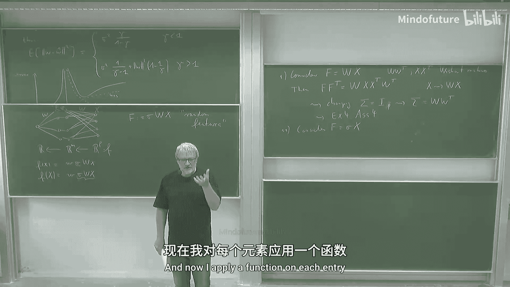

# 019：随机特征模型的一般性评述 🧠


在本节课中，我们将探讨如何将之前讨论的简单线性模型扩展为更复杂的网络结构，特别是随机特征模型。我们将分析其中涉及的数学问题，包括随机矩阵的乘法以及对其元素应用非线性函数。

---

## 从线性模型到更复杂的网络

上一节我们介绍了线性回归模型。本节中，我们来看看如何通过添加层和非线性变换来构建更复杂的网络。

一个简单的扩展是在线性映射后引入非线性激活函数。假设我们有一个输入数据矩阵 **X**，首先通过一个随机权重矩阵 **W** 进行线性映射，然后应用一个逐元素的非线性函数 **σ**，最后通过另一个权重向量 **w** 进行线性组合得到输出。

因此，我们的函数 **f** 可以表示为：
```
f(X) = w^T * σ(W * X)
```
这里，**W** 将输入映射到一个中间隐藏层（维度为 M），**σ** 是逐元素应用的非线性激活函数，**w** 是最终的线性权重。

在这种设置下，网络通常只在最后一层（即 **w**）进行学习。这意味着，我们实际上不是直接对原始输入 **X** 进行线性回归，而是对通过 **W** 和 **σ** 计算得到的“特征”进行回归。这些特征被称为**随机特征**，而整个模型则称为**随机特征模型**。

---

## 理解随机特征模型中的数学问题

为了像分析线性模型一样理解这个更复杂的模型，我们需要解决两个核心的数学问题。

以下是两个需要理解的关键部分：

1.  **随机矩阵的乘法**：我们需要理解 **F = σ(WX)** 的分布，特别是 **F F^T** 的谱特性。这涉及到两个随机矩阵 **W** 和 **X** 的乘积。
2.  **对矩阵元素应用非线性函数**：我们需要理解对矩阵 **WX** 的每个元素应用函数 **σ** 会产生什么影响。这是一个在经典随机矩阵理论中不常见的操作。

---

## 问题一：随机矩阵的乘法

首先考虑线性部分 **WX**。假设 **W** 和 **X** 都是高斯随机矩阵，那么 **W W^T** 和 **X X^T** 在极限下具有Marchenko-Pastur分布。

我们关心的是 **F F^T = W X X^T W^T** 的特征值分布。这本质上是一个具有非单位协方差矩阵的Wishart矩阵。这里的协方差矩阵由 **W W^T** 决定。

在之前的练习中，我们已经处理过协方差矩阵具有离散特征值的情况。对于这里更一般的连续分布情况，其思路是相似的：我们可以推导出一个关于Stieltjes变换的定点方程。这个方程可能没有解析解，但可以通过数值方法求解。

因此，虽然问题变得更复杂，但原则上我们可以沿用经典随机矩阵理论中的工具来处理随机矩阵的乘法及其对协方差结构的影响。

---

## 问题二：应用非线性函数

现在考虑第二个问题：对矩阵元素应用非线性函数 **σ**。

如果我们将 **σ** 直接应用于一个高斯随机矩阵 **X**，会发生什么？此时，矩阵的每个元素都经过了相同的非线性变换，但元素之间的独立性保持不变。我们得到的是一个元素独立同分布（但非高斯分布）的随机矩阵。

对于像Marchenko-Pastur定律这样的经典结果，高斯分布假设并非必需。只要矩阵元素是独立同分布的（满足某些矩条件），极限谱分布仍然成立。因此，**仅仅对一个独立同分布的随机矩阵施加逐元素的非线性变换，并不会改变其渐近特征值分布**。



---

## 组合的挑战与非线性的随机矩阵理论

然而，在我们的随机特征模型 **σ(WX)** 中，情况要复杂得多。我们首先将两个矩阵相乘得到 **WX**，**WX** 的元素之间已经存在相关性。然后再对其应用非线性函数 **σ**。

这种“先乘后非线性变换”的组合操作，产生了一个其元素具有复杂依赖结构的矩阵。经典随机矩阵理论并未直接研究这类对象。理解和分析这类矩阵的谱性质，是当前随机矩阵理论研究的一个新方向，很大程度上受到神经网络研究的推动。这可以被称为**非线性的随机矩阵理论**。

对于这类组合问题，我们需要调整甚至开发新的数学工具。虽然已经取得了一些进展，但要完全理解多层非线性网络的行为，仍然是一个活跃且富有挑战性的研究领域。

---

## 总结

本节课中我们一起学习了如何从简单的线性模型过渡到随机特征模型。我们识别了分析此类模型时需要解决的两个核心数学问题：随机矩阵的乘法，以及对矩阵元素应用非线性函数。第一个问题可以通过推广经典Wishart矩阵理论来处理，而第二个问题在元素独立时是平凡的。然而，当两者结合时，便引出了“非线性随机矩阵理论”这一新的研究领域，旨在理解具有复杂依赖结构的随机矩阵的谱性质。