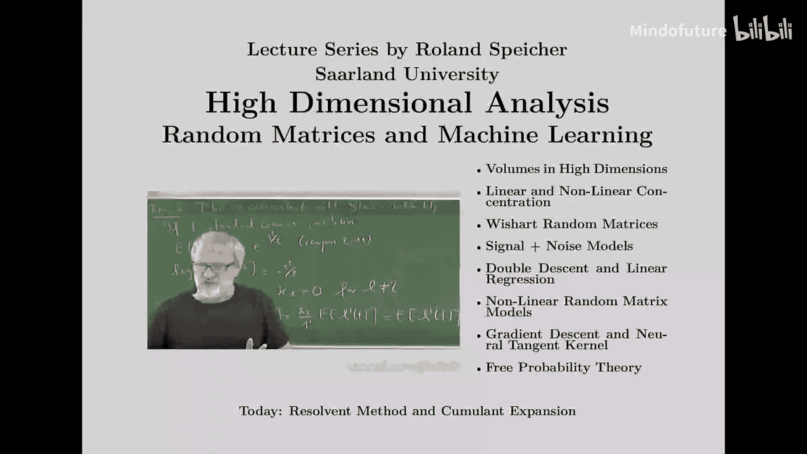
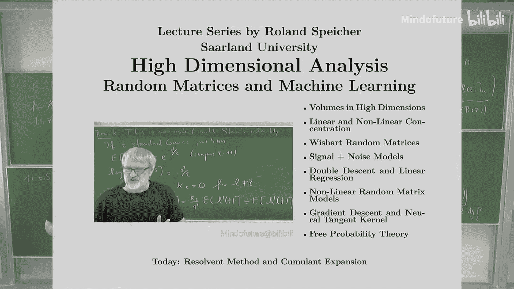
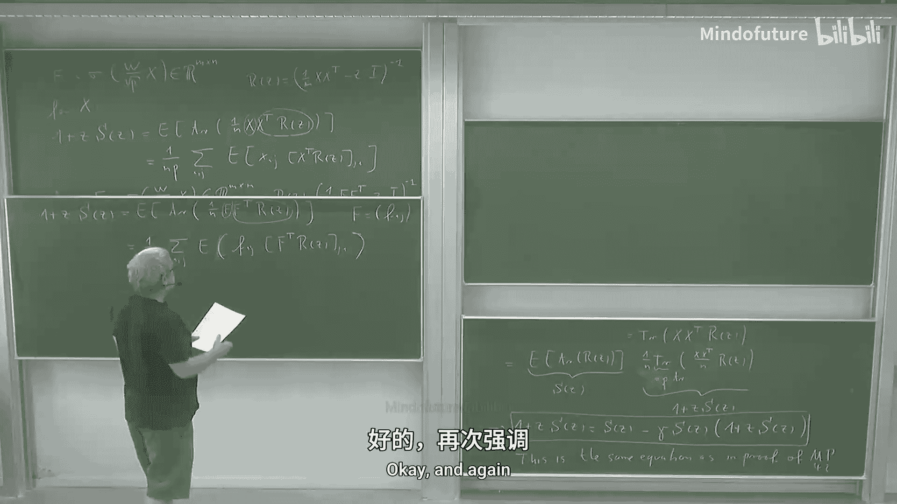
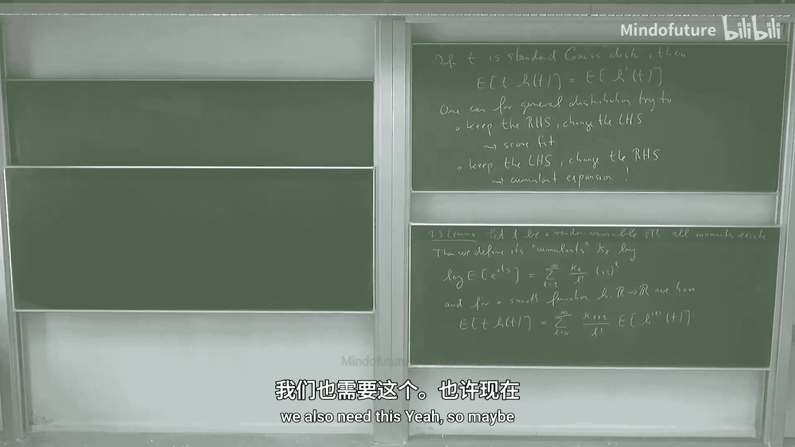

# 022：预解方法与累积量展开







在本节课中，我们将探讨如何将预解方法推广到更复杂的特征矩阵分布计算中。我们将遇到一个核心问题：当矩阵的条目不再是独立高斯分布时，如何继续我们的推导？为了解决这个问题，我们将引入一个强大的工具——累积量展开，它是斯坦因恒等式在非高斯情况下的推广。

## 从高斯到非高斯的挑战

上一节我们介绍了预解方法在标准高斯矩阵中的应用。本节中我们来看看，当我们想要计算更复杂矩阵（例如特征矩阵）的分布时，情况会如何变化。

我们考虑一个特征矩阵 **F**，它由权重矩阵 **W** 和数据矩阵 **X** 通过非线性变换得到，其形式为 **F = σ(WX/√p)**。这里，**X** 是一个 M×N 的矩阵，**W** 是一个 P×N 的矩阵，因此 **F** 是一个 M×P 的矩阵。我们的目标是研究其经验谱分布，这涉及到矩阵 **FF^T / N** 的预解式 **G(z) = (FF^T/N - zI_M)^{-1}** 及其施蒂尔杰斯变换 **m(z) = E[tr(G(z))]/M**。

我们像之前一样开始推导，得到如下表达式：
```
(1 + z m(z)) = (1/N) * E[tr(FF^T G(z))]
```
将其展开为矩阵元素求和的形式：
```
= (1/(N*M)) * Σ_{i,j} E[ f_{ij} * (F^T G(z))_{ji} ]
```
这里，**f_{ij}** 是矩阵 **F** 的条目。问题出现了：在标准高斯矩阵 **X** 的情况下，我们曾利用斯坦因恒等式，将乘以 **x_{ij}** 的期望转化为对其余变量函数的导数期望。然而，**F** 的条目 **f_{ij}** 不再是独立的高斯变量，因此经典的斯坦因恒等式不再直接适用。

## 累积量展开：斯坦因恒等式的推广

那么，对于更一般的分布，我们是否还有类似斯坦因恒等式的工具呢？答案是肯定的，这就是累积量展开。为了理解其本质，我们先从一维情况入手。

在一维情况下，若随机变量 **t** 服从标准高斯分布，斯坦因恒等式表明：
```
E[ t * h(t) ] = E[ h'(t) ]
```
其核心思想是，乘以变量 **t** 的效应等价于对函数 **h** 求导的效应。对于非高斯分布，这个等式不再成立。我们可以选择保持等式左边不变，而将右边推广为包含高阶导数的线性组合，其系数由称为“累积量”的量决定。

具体来说，对于任意随机变量 **t**（假设各阶矩存在），我们定义其特征函数的对数的幂级数展开系数为累积量 **κ_l**：
```
log E[ e^{i t s} ] = Σ_{l=1}^{∞} κ_l * (i s)^l / l!
```
那么，对于光滑函数 **h**，有以下累积量展开公式：
```
E[ t * h(t) ] = Σ_{l=0}^{∞} (κ_{l+1} / l!) * E[ h^{(l)}(t) ]
```
其中 **h^{(l)}** 是 **h** 的 **l** 阶导数。当 **t** 是标准高斯时，只有二阶累积量 **κ_2 = 1** 非零，其他累积量为零，上述公式就退化回经典的斯坦因恒等式。

## 多维累积量展开



我们需要处理的是矩阵的多个条目，因此需要多维版本的累积量展开。设有一组随机变量 **T_1, ..., T_K**（在我们的问题中，它们对应矩阵 **F** 的所有条目）。

首先定义多维累积量。令 **s = (s_1, ..., s_K)**，多维累积量 **κ(T_{i_1}, ..., T_{i_r})** 定义为多维特征函数对数的幂级数展开系数：
```
log E[ exp(i Σ_{k=1}^{K} s_k T_k) ] = Σ_{r=1}^{∞} (i^r / r!) * Σ_{i_1,..., i_r} κ(T_{i_1}, ..., T_{i_r}) * s_{i_1} ... s_{i_r}
```

那么，对于光滑函数 **H(T_1, ..., T_K)**，多维累积量展开公式为：
```
E[ T_a * H(T) ] = Σ_{r=0}^{∞} (1/r!) * Σ_{i_1, ..., i_r} κ(T_a, T_{i_1}, ..., T_{i_r}) * E[ ∂^{r} H(T) / (∂T_{i_1} ... ∂T_{i_r}) ]
```
这个公式看起来复杂，但其核心思想是清晰的：乘以某个变量 **T_a** 的期望，可以表示为该函数所有可能偏导数的期望的线性组合，组合系数由包含 **T_a** 的相应阶数的累积量给出。

## 累积量与矩的组合关系

累积量的定义比较抽象，但它们与更熟悉的“矩”有着深刻的组合联系。这种联系可以通过在上述展开公式中，选择 **H** 为变量的单项式函数来揭示。

以下是几个低阶例子，展示了矩如何用累积量表示：

*   **一阶矩（均值）**： 令 **H = 1**，公式给出 `E[T_a] = κ(T_a)`。即一阶累积量就是均值。
*   **二阶矩（协方差）**： 令 **H = T_b**，公式给出：
    ```
    E[T_a T_b] = κ(T_a)κ(T_b) + κ(T_a, T_b)
    ```
    这可以理解为：二阶矩等于两个一阶累积量的乘积（变量独立部分）加上二阶累积量（变量关联部分）。
*   **三阶矩**： 令 **H = T_b T_c**，公式经过计算可整理为：
    ```
    E[T_a T_b T_c] = κ(T_a)κ(T_b)κ(T_c) + κ(T_a, T_b)κ(T_c) + κ(T_a, T_c)κ(T_b) + κ(T_b, T_c)κ(T_a) + κ(T_a, T_b, T_c)
    ```

从这些例子中，我们可以观察到一个优美的组合模式：**随机变量集合的矩，等于将该集合的所有可能划分（partition）所对应的累积量乘积求和**。例如，对于集合 `{a, b, c}`：
*   划分 `{ {a}, {b}, {c} }` 对应项：`κ(T_a)κ(T_b)κ(T_c)`
*   划分 `{ {a, b}, {c} }` 对应项：`κ(T_a, T_b)κ(T_c)`
*   划分 `{ {a, c}, {b} }` 对应项：`κ(T_a, T_c)κ(T_b)`
*   划分 `{ {b, c}, {a} }` 对应项：`κ(T_b, T_c)κ(T_a)`
*   划分 `{ {a, b, c} }` 对应项：`κ(T_a, T_b, T_c)`

所有划分对应的项之和正好等于三阶矩 `E[T_a T_b T_c]`。这个关系对任意阶矩都成立，它提供了计算和理解累积量的一种强大而直观的组合视角。

## 总结

本节课中我们一起学习了将预解方法应用于非高斯矩阵的关键步骤。我们认识到，当矩阵条目不满足独立高斯假设时，斯坦因恒等式需要被推广。我们引入了累积量的概念，它通过特征函数对数的幂级数来定义。最重要的工具是**累积量展开公式**，它将乘以一个随机变量的期望，表达为该函数各阶导数期望的加权和，权重由累积量决定。

此外，我们还揭示了累积量与矩之间深刻的组合关系：矩等于对所有可能划分下，对应子集累积量乘积的求和。这为我们分析复杂随机矩阵的谱性质提供了新的切入点。在接下来的课程中，我们将利用累积量展开这个工具，继续推导特征矩阵经验谱分布所满足的方程。