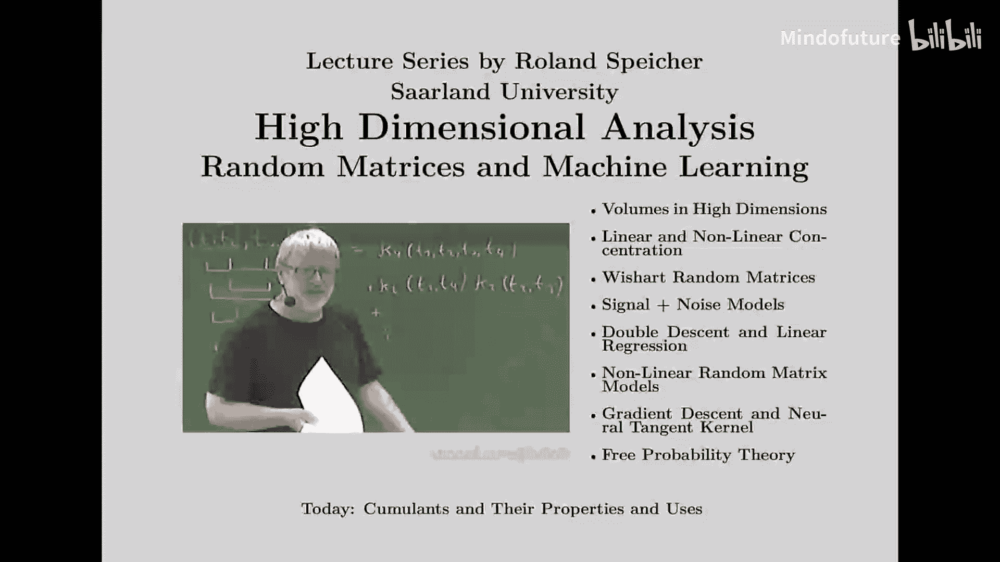
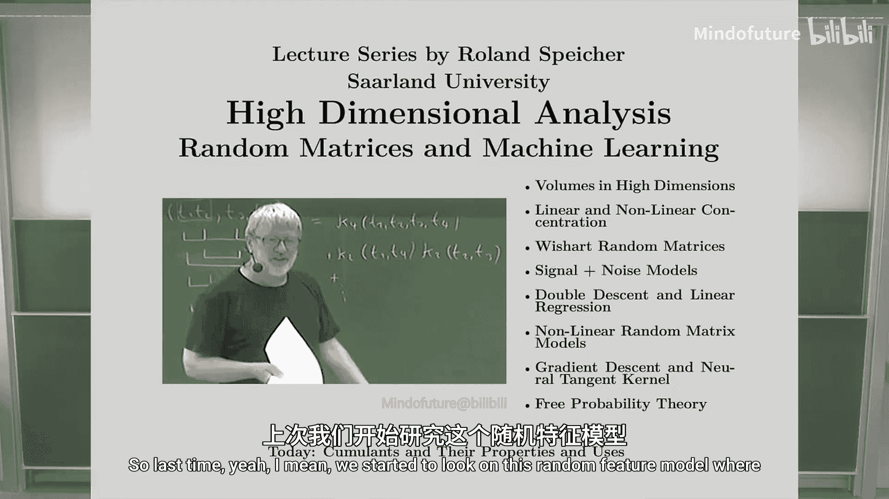

# 023：累积量的性质及其应用






在本节课中，我们将系统性地学习累积量这一重要概念。我们将从其定义出发，探讨其核心性质，特别是它与随机变量独立性之间的关系，并学习如何处理乘积的累积量。这些知识对于后续分析随机特征模型至关重要。

## 累积量的定义与组合解释

上一节我们引入了累积量展开的概念，作为高斯情形下Stein恒等式的推广。本节中，我们将更精确地定义累积量，并理解其组合意义。

首先，我们需要定义集合的分划。对于一个给定的集合S（例如数字1到n），一个分划π将其分解为若干个非空、互不相交的子集（称为块），这些块的并集等于S。我们用P(S)或P_n表示所有分划的集合。最小的分划是每个元素单独成块，记为0_n；最大的分划是所有元素在一个块中，记为1_n。

现在，我们考虑一个由随机变量构成的代数A（例如所有多项式），以及其上的期望函数E。累积量κ_n被定义为从A^n到R的n线性函数，它们通过所谓的“矩-累积量公式”与矩相联系。

**矩-累积量公式**：对于任意n个随机变量T_1, ..., T_n，其矩（即乘积的期望）可以表示为所有分划上累积量乘积的和：
```
E[T_1 ... T_n] = Σ_{π ∈ P_n} κ_π(T_1, ..., T_n)
```
其中，对于分划π，κ_π定义为各块的累积量的乘积。具体地，若π的块为V_1, ..., V_r，则：
```
κ_π(T_1, ..., T_n) = ∏_{i=1}^{r} κ_{|V_i|}(T_{j_1}, ..., T_{j_{|V_i|}})
```
这里，κ_{|V_i|}是阶数为块大小的累积量，其参数为该块对应的随机变量。

这个公式隐式地定义了累积量。我们可以通过递归求解来理解它。

以下是前几个低阶累积量的求解示例：
*   **n=1**：唯一分划是1_1。公式给出 `E[T_1] = κ_1(T_1)`。因此，一阶累积量就是期望：`κ_1(T) = E[T]`。
*   **n=2**：分划有两个：1_2（一个块）和0_2（两个块）。公式为：
    ```
    E[T_1 T_2] = κ_2(T_1, T_2) + κ_1(T_1)κ_1(T_2)
    ```
    由此可解出二阶累积量，即协方差：
    ```
    κ_2(T_1, T_2) = E[T_1 T_2] - E[T_1]E[T_2]
    ```
*   **n=3**：分划有五个。公式为：
    ```
    E[T_1 T_2 T_3] = κ_3(T_1, T_2, T_3) + κ_2(T_1, T_2)κ_1(T_3) + κ_2(T_1, T_3)κ_1(T_2) + κ_2(T_2, T_3)κ_1(T_1) + κ_1(T_1)κ_1(T_2)κ_1(T_3)
    ```
    可以递归地解出κ_3，它是三阶矩减去所有低阶累积量组合的贡献。

上述定义过程也可以通过默比乌斯反演得到显式的“累积量-矩公式”，将累积量表达为带符号和阶乘系数的矩的求和，但其结构复杂性使得显式计算在n较大时不切实际。我们更关注其结构性性质。

## 累积量与独立性

我们引入累积量的主要动机之一是它能简洁地刻画随机变量的独立性。这正是累积量比矩更有用的核心原因之一。

**核心定理**：考虑随机变量代数A中的若干个子集{T_i}。这些子集中的变量相互独立，当且仅当所有“混合累积量”为零。

所谓混合累积量，是指累积量κ_n(T_1, ..., T_n)的参数至少来自两个不同的子集T_i和T_j。也就是说，只要累积量的参数不是全部来自同一个子集，其值就为零。

**证明思路（充分性）**：假设混合累积量为零。我们需要证明独立性，即乘积的矩可以因子化。考虑一个包含来自不同子集的变量T和S的混合矩E[...T...S...]。利用矩-累积量公式将其展开为对分划的求和。由于混合累积量为零，任何连接了来自不同子集变量的分划块（即混合块）其对应的累积量贡献为零。因此，只有那些每个块内的变量都来自同一子集的分划才有贡献。这样的分划自然地分解为对各子集变量位置的分划的独立选择，其累积量贡献也相应因子化。最终，对分划的求和也因子化为各子集变量矩的乘积，这正是独立性所要求的因子化性质。

这个定理表明，独立性等价于累积量在跨组时的“退耦”。在近似独立的情况下，讨论累积量的“小性”比讨论矩的“近似因子化”通常更为方便和直接。

## 乘积的累积量

在实际应用中（例如我们的随机特征模型），我们经常需要处理随机变量的乘积。因此，理解如何用单个变量的累积量来表达乘积的累积量至关重要。

**乘积累积量公式**：假设我们将n个随机变量T_1, ..., T_n分成M组相乘，得到新的随机变量（大写）T_1, T_2, ..., T_M，其中每个T_I是某组小t变量的乘积。那么，这些新变量T_I的M阶累积量可以通过原始小变量t_i的累积量来表达：
```
κ_M(T_1, ..., T_M) = Σ_{π ∈ P_n} κ_π(t_1, ..., t_n)
```
这里的求和仅限于满足特定条件的分划π：**该分划必须“连接”所有M个组**。这意味着，在分划的块结构中，不能存在一个子集，使得其中的块完全由来自某几个组（但不是所有组）的变量构成；每个块都必须以某种方式帮助连接不同的组。

**示例说明**：
*   **无乘积情形**：每个T_I就是一个t_i。此时，条件要求分划连接所有单个变量，唯一满足条件的分划就是最大分划1_n。公式退化为`κ_n(t_1,...,t_n) = κ_n(t_1,...,t_n)`，是平凡的。
*   **全乘积情形**：所有t_i乘在一起，得到单个变量T_1。此时M=1，没有“连接所有组”的条件（因为只有一组）。公式要求对所有分划π求和，这正是矩-累积量公式的逆过程，结果等于E[∏ t_i]，与κ_1就是期望的定义一致。
*   **具体例子**：计算`κ_3(T_1, T_2, T_3)`，其中`T_1 = t_1 * t_2`，`T_2 = t_3`，`T_3 = t_4`。我们需要找出所有连接了组`{t_1,t_2}`、`{t_3}`和`{t_4}`的分划。可能的连接方式包括：一个块包含所有四个变量（κ_4）；或者通过若干二阶累积量（κ_2）将不同组的变量两两连接，同时确保所有组都被连通。

这个公式虽然项数可能很多，但其结构清晰。它告诉我们，乘积的累积量可以表示为原始变量累积量的和，其中只保留那些“桥接”了所有乘积因子的分划结构。在后续分析随机特征矩阵F = φ(WX)时，其元素是W和X矩阵元素的乘积（再经过非线性函数φ）。我们将利用此公式，结合W和X中元素的独立性（其累积量性质简单），来分析F的累积量结构，进而研究其特征值分布。

## 总结

本节课我们一起深入学习了累积量。我们从其通过矩-累积量公式的递归定义出发，理解了其组合解释。最重要的性质是，随机变量的独立性等价于其混合累积量为零，这为检验独立性提供了有力工具。最后，我们学习了处理随机变量乘积的累积量公式，该公式只对连接了所有乘积项的分划进行求和。这些工具将为我们在下一课中分析更复杂的随机特征模型奠定基础。