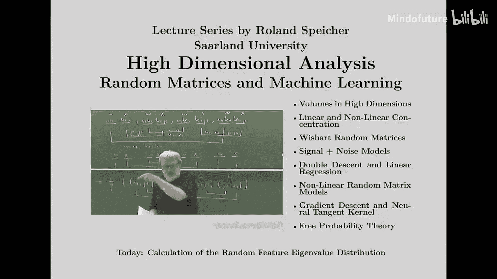
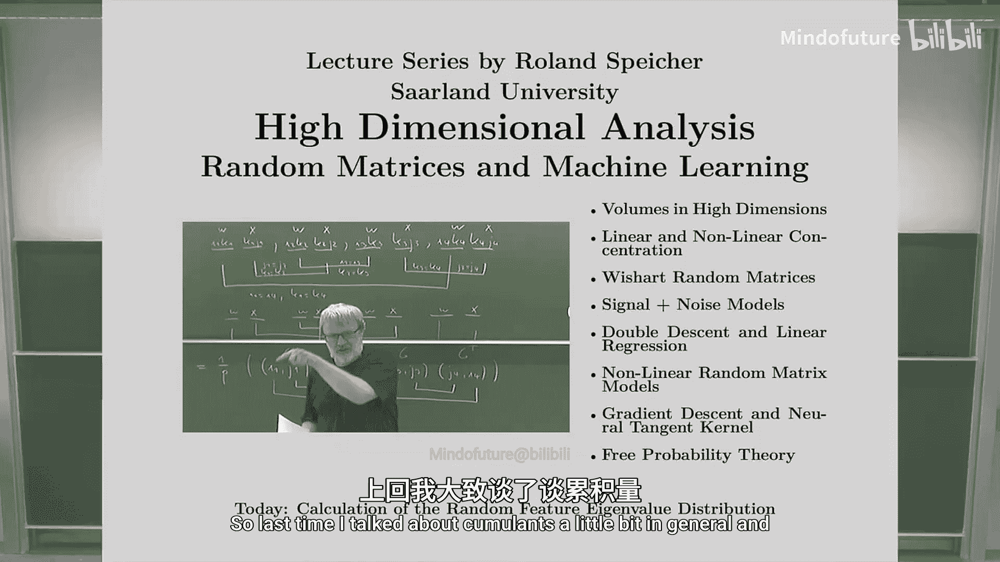
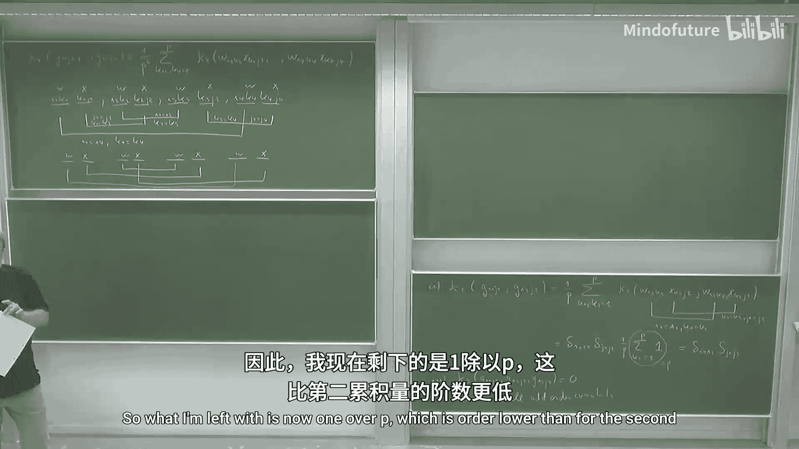

# 024：随机特征值分布的计算

在本节课中，我们将学习如何计算随机特征模型中特征矩阵的特征值分布。我们将重点介绍累积量的概念，并展示如何利用累积量展开来分析随机矩阵乘积的谱特性。我们将从高斯矩阵的累积量开始，逐步扩展到随机特征模型中的非线性变换。

---

## 高斯矩阵的累积量

上一节我们介绍了累积量的基本概念和性质。本节中，我们来看看如何计算高斯随机矩阵的累积量。

设矩阵 **X** 是一个 **P × N** 的标准高斯随机矩阵，其所有元素 **X_ij** 独立且服从标准正态分布 **N(0, 1)**。对于这些随机变量，其累积量具有非常简单的结构。

**命题 1：** 对于标准高斯随机矩阵 **X** 的元素 **X_ij**，其累积量 **κ_n** 在 **n ≠ 2** 时均为零。唯一的非零累积量是二阶累积量，即协方差：
$$
\kappa_2(X_{ij}, X_{kl}) = \delta_{ik} \delta_{jl}
$$
其中 **δ** 是克罗内克δ函数。这意味着只有当两个元素完全相同时，其二阶累积量（协方差）为1，否则为0。

**推导：**
1.  由于所有 **X_ij** 相互独立，根据累积量的性质，混合累积量为零。因此，非零累积量只能出现在所有变量都相同的情况下。
2.  对于单个标准高斯变量，其所有高于二阶的累积量均为零。因此，只有当 **n=2** 时，累积量才可能非零。
3.  对于二阶累积量，即协方差，对于标准高斯变量有 **E[X_{ij}^2] = 1**，且 **E[X_{ij}] = 0**，因此 **κ_2(X_{ij}, X_{ij}) = 1**。

这个结果为我们分析更复杂的矩阵乘积奠定了基础。

---

## 矩阵乘积 **G = WX** 的累积量

现在，我们考虑一个更复杂的场景：两个独立高斯矩阵的乘积。设 **W** 是 **M × P** 的标准高斯矩阵，**X** 是 **P × N** 的标准高斯矩阵。我们定义矩阵 **G** 为：
$$
G = \frac{1}{\sqrt{P}} W X
$$
**G** 是一个 **M × N** 的矩阵，其元素为 **G_ij**。我们的目标是计算这些元素的累积量。

首先，我们计算一阶累积量（期望）：
$$
\kappa_1(G_{ij}) = \mathbb{E}[G_{ij}] = \frac{1}{\sqrt{P}} \sum_{k=1}^{P} \mathbb{E}[W_{ik} X_{kj}] = 0
$$
因为 **W** 和 **X** 独立且均值为零。

接下来，我们计算二阶累积量：
$$
\kappa_2(G_{i_1 j_1}, G_{i_2 j_2}) = \frac{1}{P} \sum_{k_1, k_2=1}^{P} \kappa_2(W_{i_1 k_1} X_{k_1 j_1}, W_{i_2 k_2} X_{k_2 j_2})
$$
利用累积量的乘积公式和 **W**、**X** 的高斯性质，非零贡献仅来自于将 **W** 项配对、**X** 项配对，并且所有 **K** 索引必须相同的情况。最终结果为：
$$
\kappa_2(G_{i_1 j_1}, G_{i_2 j_2}) = \delta_{i_1 i_2} \delta_{j_1 j_2}
$$
这与单个高斯矩阵的情况类似。

对于高阶累积量，情况变得复杂。奇数阶累积量由于无法完成所有变量的配对而为零。偶数阶累积量可能非零，但具有特定的结构。

**命题 2：** 对于矩阵 **G** 的元素，其 **2R** 阶累积量 **κ_{2R}(G_{i_1 j_1}, ..., G_{i_{2R} j_{2R}})** 仅在索引 **{(i_r, j_r)}** 能排列成一种循环结构时才非零。具体来说，存在一个排列 **σ ∈ S_{2R}**，使得索引满足以下循环条件：
$$
j_{\sigma(1)} = i_{\sigma(2)},\quad j_{\sigma(2)} = i_{\sigma(3)},\quad ...,\quad j_{\sigma(2R)} = i_{\sigma(1)}
$$
在这种情况下，累积量的主导阶为 **O(1/P^{R-1})**。如果索引不满足任何循环结构，则累积量为零。

这种循环结构源于矩阵乘法和累积量配对规则的结合。它意味着 **G** 的元素不再是独立的，但其高阶相关性受到严格限制。

---

## 应用累积量展开到 Stieltjes 变换

为了计算矩阵 **GG^T** 的经验谱分布，我们像处理 Marchenko-Pastur 定律一样，研究其 Stieltjes 变换 **S(z)**：
$$
S(z) = \frac{1}{M} \mathbb{E}[\mathrm{Tr}((GG^T / N - z I_M)^{-1})]
$$
其中 **z ∈ ℂ^+**。

推导过程涉及对 **G** 的元素使用累积量展开公式。展开式将包含无穷级数：
$$
\mathbb{E}[G_{ij} \cdot (\text{某个函数})] = \sum_{L=0}^{\infty} \frac{1}{L!} \sum_{p_1, q_1, ..., p_L, q_L} \kappa_{L+1}(G_{ij}, G_{p_1 q_1}, ..., G_{p_L q_L}) \cdot \mathbb{E}\left[ \frac{\partial^L (\text{该函数})}{\partial G_{p_1 q_1} ... \partial G_{p_L q_L}} \right]
$$

以下是关键步骤：
1.  **主导项（L=0）：** 对应一阶导数项，这与 Marchenko-Pastur 证明中的项相同，会产生一个包含 **S(z)** 的方程部分。
2.  **高阶项（L≥1）：** 这些项包含 **G** 的高阶累积量。根据命题2，许多高阶累积量为零或具有 **1/P** 的衰减因子。在渐近极限下（M, N, P → ∞，比例固定），只有满足特定循环结构且阶数最低的项会保留。
3.  **方程推导：** 通过系统性地处理这些项（例如，对高阶导数项进行部分积分，将其递归地表达为 **S(z)** 的函数），最终可以推导出 **S(z)** 所满足的方程。这个方程比 Marchenko-Pastur 方程更复杂，包含了来自矩阵乘积结构的修正项。

虽然计算过程繁琐，但原理是清晰的：**G** 的累积量的特殊结构使得高阶项在渐近意义下可控制，最终导出一个闭合的方程。

---

## 扩展到非线性变换：随机特征模型

现在，我们考虑完整的随机特征模型。定义特征矩阵 **F**：
$$
F = \sigma(G) = \sigma\left( \frac{1}{\sqrt{P}} W X \right)
$$
其中 **σ(·)** 是一个逐元素应用的非线性激活函数。**F** 的元素为 **F_{ij} = σ(G_{ij})**。

我们需要计算 **F** 的元素的累积量，以便对 **FF^T** 进行类似的谱分析。

**命题 3：** 假设激活函数 **σ** 满足 **∫ σ(t) φ(t) dt = 0**（其中 **φ** 是标准高斯密度），即其关于高斯分布的期望为零。那么，**F** 的累积量具有与 **G** 类似的结构：
1.  奇数阶累积量为零：**κ_{2R+1}(...) = 0**。
2.  二阶累积量：**κ_2(F_{ij}, F_{kl}) = δ_{ik} δ_{jl} · θ_1**，其中 **θ_1 = ∫ σ(t)^2 φ(t) dt**。
3.  高阶（2R阶，R≥2）累积量：仅当索引满足与命题2相同的循环结构时才非零。此时，其主导阶为 **O(1/P^{R-1})**，并且值为 **(θ_2)^R**，其中 **θ_2 = [∫ σ'(t) φ(t) dt]^2**。

**推导思路：**
1.  **中心化假设：** 条件 **∫ σ(t) φ(t) dt = 0** 确保了 **κ_1(F_{ij}) = 0**。这是因为根据中心极限定理，每个 **G_{ij}** 在 **P** 很大时近似服从高斯分布 **N(0,1)**。
2.  **二阶累积量：** 直接计算 **𝔼[σ(G_{ij})^2]**，同样利用 **G_{ij}** 的渐近高斯性，得到 **θ_1**。
3.  **高阶累积量：** 这是最核心的部分。我们将 **σ** 视为多项式（通过近似），则 **F** 的高阶累积量涉及 **G** 的幂的乘积。利用累积量的乘积公式，主导贡献来自于：
    *   一个连接了所有 **R** 个变量组（每组对应一个 **F**）的“大块”，它贡献因子 **1/P^{R-1}**（来自 **G** 的累积量结构）。
    *   在每个变量组内部，剩余的 **G** 变量（“大块”已取走一个）相互配对。由于 **G_{ij}** 是渐近高斯的，配对计算相当于求其矩，最终导出每个组贡献一个因子 **∫ σ'(t) φ(t) dt**。共有 **2R** 个这样的因子，但“大块”连接本身已消耗了 **R** 个配对，故最终剩余 **R** 个因子，即 **(θ_2)^{R/2}**？需要仔细核对指数。详细推导表明，最终结果是 **(θ_2)^R**。

这个结果意义重大：**非线性变换并未破坏累积量的循环结构，但改变了其数值。二阶累积量由 σ 的二阶矩 θ_1 控制，而所有更高阶的偶数累积量则由其导数的矩 θ_2 控制。**

---

## 总结与展望

本节课中我们一起学习了：
1.  **高斯矩阵的累积量**：非常简单，只有二阶累积量非零。
2.  **矩阵乘积 G = WX 的累积量**：具有特殊的循环结构，高阶累积量按 **1/P** 的幂次衰减。
3.  **累积量展开的应用**：利用该展开可以推导出 **GG^T** 的 Stieltjes 变换方程，尽管计算复杂，但原理基于累积量的衰减性质。
4.  **随机特征模型中的非线性变换**：**F = σ(G)** 的累积量保留了循环结构，其值由 **θ_1** 和 **θ_2** 两个参数刻画。这解释了定理中出现的这些常数。

一个深刻的见解是：**随机特征模型 FF^T 的谱性质，在某种意义上等价于一个带有附加噪声的线性模型 GG^T 的谱性质，其中噪声的强度与 θ_2 相关**。这为理解神经网络中非线性层的效应提供了直观的数学视角。我们将在下一节课中进一步探讨这一观点。