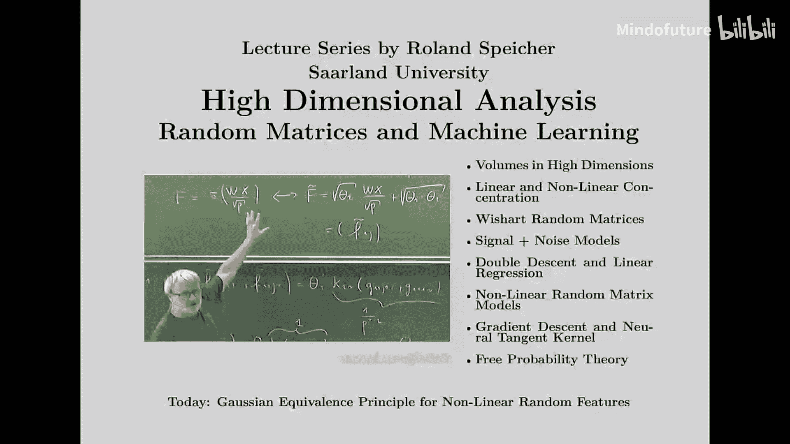
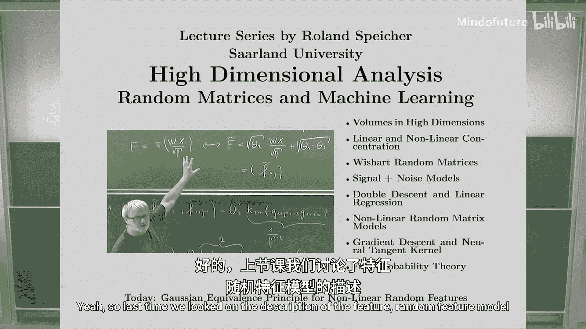
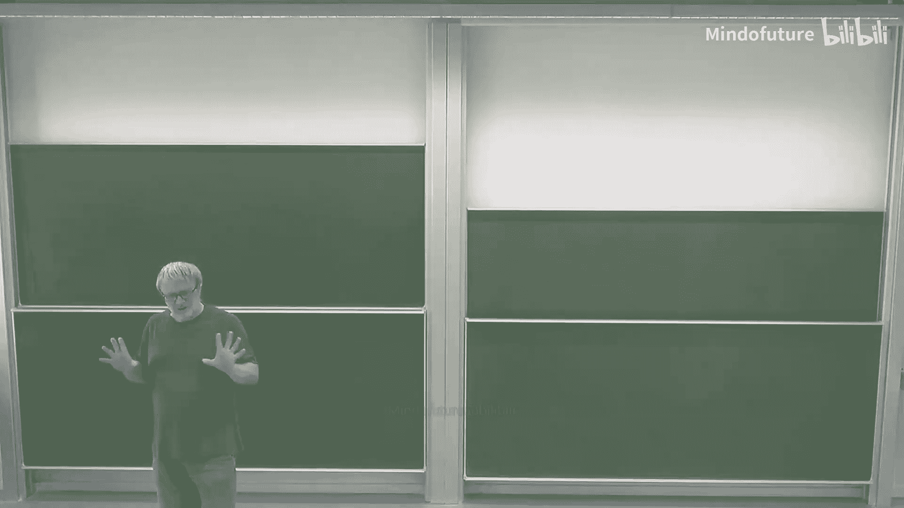

# 025：非线性随机特征的高斯等效原理

在本节课中，我们将学习非线性随机特征模型，并理解其如何通过高斯等效原理，在渐近意义上等价于一个添加了噪声的线性模型。

上一节我们介绍了非线性随机特征模型，并分析了其矩阵元素的累积量结构。本节中，我们将基于该累积量结构，推导出该模型与一个特定线性模型的等价性。

## 累积量结构回顾

首先，我们回顾一下非线性随机特征矩阵 **F** 的累积量结构。矩阵元素为 **F_ij**，其累积量具有特定的“无环”结构。

*   对于二阶累积量（即协方差），其值为 **θ₁(ω)**，其中 ω 代表我们使用的非线性函数。
*   对于所有偶数阶（四阶、六阶等）且阶数大于二的累积量，其结构是“无环”的。这意味着在累积量 **κ(F_{i₁j₁}, ..., F_{i₁j_R})** 中，下标 i 和 j 以特定模式重复出现，且所有下标均不相同。其渐近值为 **(1/P^{R-1}) * θ₂(ω)**，其中 P 是数据维度。

以下是该累积量结构的核心公式表示：

*   二阶累积量：**κ₂(F_{ij}, F_{ij}) = θ₁**
*   高阶（2R阶，R>1）无环累积量：**κ_{2R}(F_{i₁j₁}, ..., F_{i₁j_R}) = (1/P^{R-1}) * θ₂**

这里，**θ₁** 和 **θ₂** 是由非线性函数 ω 计算出的两个常数。

## 高斯等效原理

基于上述累积量结构，我们可以证明一个关键结论：在渐近极限下（当 P 趋于无穷时），原始的非线性随机特征模型与一个特定的线性模型具有相同的特征值分布。

具体而言，我们构造一个线性模型 **F̃**：

**F̃ = √θ₂ * (WX/√P) + √(θ₁ - θ₂) * Z**

其中：
*   **WX/√P** 是原始的线性部分（未施加非线性）。
*   **Z** 是一个独立于 W 和 X 的标准高斯随机矩阵。
*   **θ₁** 和 **θ₂** 是来自原始非线性模型的常数，且 **θ₁ > θ₂**。

接下来，我们验证 **F̃** 的累积量与原始 **F** 的累积量在主导阶上相同。

### 高阶累积量等价性

考虑 **F̃** 的 2R 阶（R>1）累积量。由于 **F̃** 的每一项都是两个独立随机变量（来自线性部分和噪声部分）的和，且累积量具有多重线性，我们可以将其展开。独立随机变量的混合累积量为零，因此只剩下纯来自线性部分或纯来自噪声部分的项。

*   噪声部分 **Z** 是高斯矩阵，其高于二阶的累积量为零，因此不贡献高阶项。
*   线性部分 **WX/√P** 的高阶累积量具有与 **F** 相同的无环结构，但其值为 **(1/P^{R-1})**（相当于原模型中 **θ₂=1** 的情况）。

由于 **F̃** 的线性部分带有系数 **√θ₂**，在计算 2R 阶累积量时，该系数会出现 2R 次，即贡献因子 **θ₂^R**。因此，**F̃** 的高阶无环累积量为：

**κ_{2R}(F̃_{i₁j₁}, ..., F̃_{i₁j_R}) = θ₂^R * (1/P^{R-1}) = (1/P^{R-1}) * θ₂**

这与原始非线性模型 **F** 的高阶累积量公式完全一致。

### 二阶累积量等价性

现在考虑二阶累积量。同样展开 **F̃** 的项：

**κ₂(F̃_{ij}, F̃_{ij}) = κ₂( √θ₂ * G_{ij} + √(θ₁-θ₂) * Z_{ij},  √θ₂ * G_{ij} + √(θ₁-θ₂) * Z_{ij} )**

其中 **G = WX/√P**。由于独立性和累积量的性质，交叉项为零，我们得到：

**κ₂(...) = θ₂ * κ₂(G_{ij}, G_{ij}) + (θ₁ - θ₂) * κ₂(Z_{ij}, Z_{ij})**

已知 **G** 和 **Z** 的元素的二阶累积量均为 1（在适当的归一化下）。代入得：

**κ₂(F̃_{ij}, F̃_{ij}) = θ₂ * 1 + (θ₁ - θ₂) * 1 = θ₁**

这也与原始非线性模型 **F** 的二阶累积量 **θ₁** 完全相同。

## 结论与总结

通过以上推导，我们证明了在主导阶意义上，构造的线性模型 **F̃** 与原始非线性随机特征模型 **F** 具有完全相同的累积量结构。由于随机矩阵的渐近特征值分布由其累积量决定，因此两个模型的特征值分布也相同。

本节课中我们一起学习了高斯等效原理在非线性随机特征模型中的具体体现。核心结论是：**对随机矩阵元素施加非线性变换，在渐近意义上等效于保留其线性部分并添加一个适当强度的独立高斯噪声**。这一原理揭示了某些非线性模型背后隐藏的线性结构，并为其分析提供了强有力的简化工具。该原理也被认为在更广泛的场景中可能成立，是当前研究的一个活跃方向。