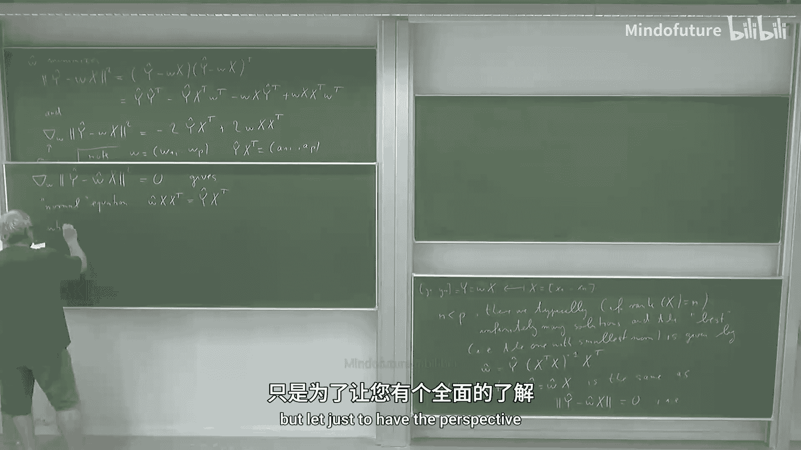

# 026：线性回归的梯度下降法 🧠

在本节课中，我们将学习线性回归问题，并重点探讨如何使用梯度下降法来求解。我们将从线性回归的基本设定开始，逐步引入梯度下降算法，并讨论其在欠定（过参数化）情况下的局限性。最后，我们将介绍一种改进方法——岭回归，它通过引入正则化项来确保算法收敛到一个具有良好性质的解。

---

## 线性回归问题回顾 📝

上一节我们讨论了随机特征模型。本节中，我们回到一个更基础但核心的问题：线性回归。线性回归的目标是找到一个权重向量 **W**，使得对于给定的输入数据矩阵 **X** 和期望输出向量 **Ŷ**，有 **Ŷ ≈ WX**。

在欠定情况下，数据点数量 **N** 小于特征维度 **P**，方程组 **Ŷ = WX** 通常有无穷多解。此时，一个常见的选择准则是寻找范数最小的解，其显式公式为：

**Ŵ = Ŷ Xᵀ (X Xᵀ)⁻¹**

然而，直接计算这个逆矩阵在数值上可能不高效或不稳定，因此我们需要一种迭代算法。

---

## 作为优化问题的线性回归 🔍

我们可以将求解 **W** 的问题转化为一个最小化问题。具体来说，我们希望最小化损失函数 **L(W)**，它衡量了预测值与真实值之间的差距：

**L(W) = ||Ŷ - WX||²**

当 **L(W) = 0** 时，我们得到了精确解。这个损失函数是凸函数，其最小值点可以通过令梯度为零来找到。

以下是计算梯度所需的步骤：
1.  将损失函数展开：**L(W) = ŶŶᵀ - 2ŶXᵀWᵀ + W X Xᵀ Wᵀ**
2.  对 **W** 求梯度（结果为行向量）：**∇ₓL(W) = -2ŶXᵀ + 2W X Xᵀ**
3.  令梯度为零，得到正规方程：**W X Xᵀ = Ŷ Xᵀ**

在过定情况下，**X Xᵀ** 可逆，我们可以直接解出 **W**。但在欠定情况下，**X Xᵀ** 不可逆，正规方程不能给出唯一解，梯度下降法的行为也会变得复杂。

---

## 梯度下降算法 ⬇️

梯度下降是一种迭代优化算法。它从初始猜测 **W₀** 开始，沿着损失函数梯度的反方向（即下降最快的方向）逐步更新参数，以逼近最小值点。

算法的更新规则如下：

**W_{t+1} = W_t - η ∇ₓL(W_t)**

其中：
*   **W_t** 是第 **t** 次迭代的权重。
*   **η** 是步长，在神经网络中常被称为学习率。
*   **∇ₓL(W_t)** 是损失函数在 **W_t** 处的梯度。

在过定（凸且唯一解）的情况下，选择合适的 **η**，梯度下降能保证收敛到最小二乘解。但在欠定情况下，由于存在无穷多解，梯度下降会收敛到其中一个解，但这个解不一定是我们期望的范数最小的“最佳”解。

---

## 一个简单的例子 📐

为了理解欠定情况下的问题，我们考虑一个极简例子：设 **P=2**, **N=1**，数据 **X = [0, 1]ᵀ**，期望输出 **Ŷ = 1**。我们的模型是 **f(x) = θ₁x₁ + θ₂x₂**。

根据方程 **Ŷ = WX**，我们得到 **θ₂ = 1**，而 **θ₁** 可以是任意值。范数最小的解显然是 **θ₁=0, θ₂=1**。

现在应用梯度下降法：
*   损失函数梯度为 **∇L = 2( [θ₁, θ₂] X Xᵀ - Ŷ Xᵀ ) = 2( [0, θ₂] - [0, 1] ) = [0, 2(θ₂ - 1)]**
*   更新规则为：
    *   **θ₁(t+1) = θ₁(t)** （梯度中对应分量为0，永不更新）
    *   **θ₂(t+1) = θ₂(t) - 2η (θ₂(t) - 1)**

可以看到，**θ₂** 会收敛到1，但 **θ₁** 始终保持在初始值，不会自动优化到0。因此，除非初始值恰好设对，否则梯度下降无法得到范数最小的最佳解。

---

## 岭回归：引入正则化 🏔️

为了解决上述问题，并确保解的优良性质（如小范数、平滑性等），我们修改损失函数，加入一个正则化（惩罚）项。这种方法称为岭回归。

新的损失函数为：

**L_λ(W) = ||Ŷ - WX||² + λ ||W||²**

其中 **λ > 0** 是正则化系数。这项 **λ ||W||²** 会惩罚较大的权重，促使算法寻找一个在拟合数据和保持权重较小之间取得平衡的解。

计算新损失函数的梯度并令其为零，我们得到：

**W (X Xᵀ + λI) = Ŷ Xᵀ**

由于 **λ > 0**，矩阵 **(X Xᵀ + λI)** 总是可逆的（因为 **λI** 将特征值提升了 **λ**）。因此，我们可以得到唯一解：

**Ŵ_λ = Ŷ Xᵀ (X Xᵀ + λI)⁻¹**

现在，优化问题变成了强凸的，有唯一解。梯度下降法应用到这个新的损失函数上，能够保证收敛到这个唯一的岭回归解。

---

## 岭回归与原始解的联系 🔗

值得注意的是，岭回归解 **Ŵ_λ** 与原始的最小范数解 **Ŵ** 之间存在紧密联系。当正则化系数 **λ** 趋近于0时，岭回归解会收敛到原始问题中范数最小的那个解：

**lim_{λ→0⁺} Ŵ_λ = Ŵ = Ŷ Xᵀ (X Xᵀ)⁺**

其中 **(X Xᵀ)⁺** 表示 **X Xᵀ** 的伪逆。这为计算最小范数解提供了一种稳定的数值方法：通过求解一个 **λ** 很小的岭回归问题来近似它。

---

## 总结 🎯

本节课我们一起学习了线性回归的梯度下降法。
1.  我们首先将线性回归问题形式化为一个最小化损失函数 **||Ŷ - WX||²** 的优化问题。
2.  接着，我们介绍了梯度下降算法，它通过迭代更新权重来寻找损失函数的最小值。
3.  通过一个简单的二维例子，我们展示了在欠定情况下，标准梯度下降法可能无法收敛到期望的“最小范数解”。
4.  为了克服这个问题，我们引入了岭回归，通过在损失函数中添加 **λ ||W||²** 正则化项，确保了解的唯一性和算法收敛性。
5.  最后，我们看到了当 **λ → 0** 时，岭回归解会逼近原始的最小范数解，从而将两种方法统一起来。

理解梯度下降在线性回归中的行为，是进一步研究其在更复杂神经网络中应用的重要基础。在接下来的课程中，我们将尝试将这里的思路延伸到特征学习等更高级的设定中。