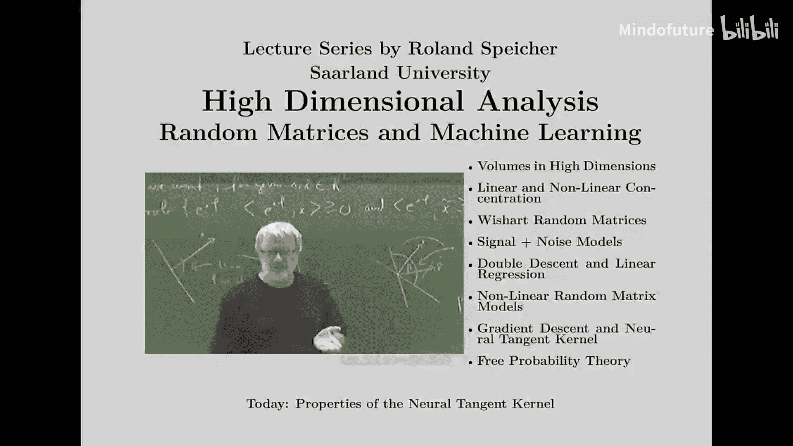
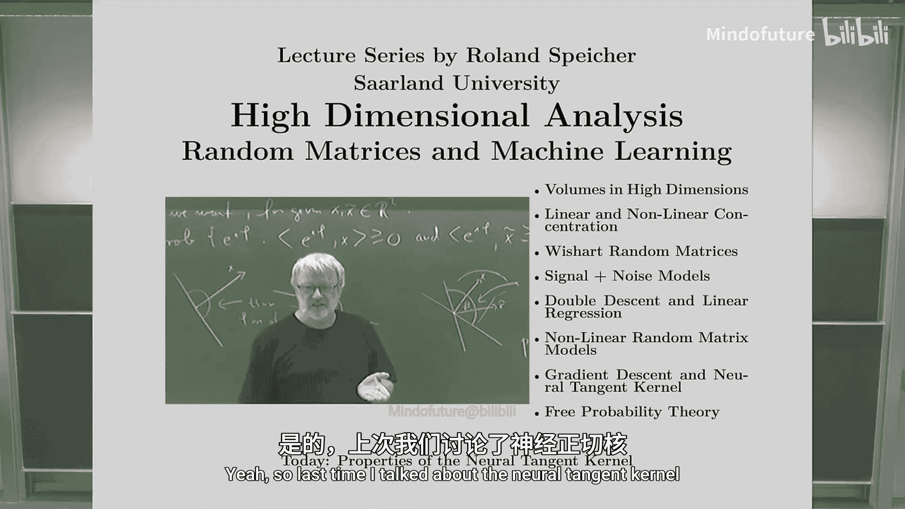

# 028：神经正切核的性质 🔬





在本节课中，我们将深入探讨神经正切核（NTK）的性质。上一节我们介绍了NTK作为无限宽神经网络的一种线性近似。本节中，我们将具体分析为何在极限情况下，NTK会收敛为一个确定性的、与时间无关的核，并探讨其背后的数学原理。我们还将通过一个具体例子（ReLU激活函数）来计算NTK的显式表达式，并解释在训练过程中NTK保持近似不变的原因。


## 模型设定与NTK回顾

我们考虑一个简化的神经网络模型。该网络的输出函数为：
```math
f_\theta(x) = \frac{1}{\sqrt{M}} \sum_{i=1}^{M} a_i \sigma(w_i^T x)
```
其中：
*   `x` 是 `p` 维输入数据，我们假设其范数为1，即 `||x|| = 1`。
*   `w_i` 是 `p` 维权重向量，构成矩阵 `W` 的行。
*   `a_i` 是输出层的权重，我们将其固定为从 `{-1, +1}` 中均匀随机选取的值，因此 `a_i^2 = 1`。
*   `σ` 是激活函数。
*   `M` 是隐藏层的宽度（神经元数量）。
*   参数 `θ` 在这里特指所有权重向量 `w_i` 的集合，而 `a_i` 在训练过程中保持固定。

我们关注的是对权重 `W` 的优化。神经正切核定义为梯度向量的内积：
```math
K_\theta(x, x') = \langle \nabla_\theta f_\theta(x), \nabla_\theta f_\theta(x') \rangle
```
由于我们只优化 `W`，梯度仅对 `w_i` 求导。经过计算，NTK的具体形式为：
```math
K_\theta(x, x') = (x^T x') \cdot \frac{1}{M} \sum_{i=1}^{M} \sigma'(w_i^T x) \sigma'(w_i^T x')
```

## NTK的确定性极限

上一节我们提到，当隐藏层宽度 `M → ∞` 时，随机核 `K_θ` 会收敛到一个确定性的核 `K*`。现在我们来理解其原因。

在当前的模型设定下，权重向量 `w_i` 被初始化为独立同分布的标准高斯随机向量。因此，求和项中的每一项 `σ'(w_i^T x) σ'(w_i^T x')` 对于不同的 `i` 也是独立同分布的随机变量。

根据大数定律，独立同分布随机变量的平均值会收敛到其期望值。因此，当 `M` 很大时，有：
```math
\frac{1}{M} \sum_{i=1}^{M} \sigma'(w_i^T x) \sigma'(w_i^T x') \xrightarrow[M \to \infty]{} \mathbb{E}_v[\sigma'(v^T x) \sigma'(v^T x')]
```
其中 `v` 是一个与 `w_i` 同分布的 `p` 维标准高斯随机向量。

于是，我们得到了极限的确定性神经正切核：
```math
K^*(x, x') = (x^T x') \cdot \mathbb{E}_v[\sigma'(v^T x) \sigma'(v^T x')]
```
对于足够大的 `M`，实际网络的NTK将以高概率非常接近这个极限核。

## 示例：ReLU激活函数的NTK计算

为了更具体地理解极限核 `K*`，我们以ReLU激活函数为例进行计算。ReLU函数为 `σ(t) = max(0, t)`，其导数（几乎处处）为：
```math
\sigma'(t) = \begin{cases}
1, & \text{if } t > 0 \\
0, & \text{if } t < 0
\end{cases}
```
因此，对于ReLU，期望项变为：
```math
\mathbb{E}_v[\sigma'(v^T x) \sigma'(v^T x')] = \mathbb{P}_v (v^T x > 0 \text{ 且 } v^T x' > 0)
```
即计算高斯随机向量 `v` 与两个给定单位向量 `x` 和 `x'` 的内积同时为正的概率。

令 `α = x^T x'` 为两个输入向量之间的余弦相似度。随机变量 `t1 = v^T x` 和 `t2 = v^T x'` 是均值为0、方差为1的联合高斯随机变量，其协方差恰好为 `α`。

我们可以通过一个几何论证来巧妙地计算这个概率，而无需进行复杂的积分。考虑二维情况，因为问题本质在于由 `x` 和 `x'` 张成的平面。一个标准高斯随机向量 `v` 的方向（归一化后）在单位圆上是均匀分布的。

我们需要单位圆上的均匀随机方向与 `x` 和 `x'` 的内积同时为正。这对应于方向向量位于与 `x` 和 `x'` 都成锐角的扇形区域内。设 `θ` 为 `x` 与 `x'` 之间的夹角，则满足条件的扇形角度为 `π - θ`。

因此，概率为：
```math
\mathbb{P} = \frac{\pi - \theta}{2\pi}
```
由于 `α = cos(θ)`，即 `θ = arccos(α)`，我们得到：
```math
\mathbb{E}_v[\sigma'(v^T x) \sigma'(v^T x')] = \frac{\pi - \arccos(\alpha)}{2\pi}
```
最终，ReLU激活函数下的极限神经正切核为：
```math
K^*(x, x') = (x^T x') \cdot \frac{\pi - \arccos(x^T x')}{2\pi}
```
这是一个清晰、确定的解析表达式。

## 训练过程中NTK的（近似）不变性

一个关键且令人惊讶的结论是，在训练过程中，即使参数 `W` 被更新，神经正切核也几乎保持不变。这源于在无限宽极限下，权重本身的变化非常微小。

让我们分析权重的演化。根据梯度下降，参数 `w_i` 的时间导数由损失函数的梯度给出：
```math
\frac{d w_i(t)}{dt} = -\frac{1}{\sqrt{M}} \sum_{k=1}^{n} (f_t(x_k) - y_k) \cdot a_i \cdot \sigma'(w_i(t)^T x_k) \cdot x_k
```
其中 `n` 是训练样本数，`(x_k, y_k)` 是训练数据对。

我们想估计从初始时间 `0` 到时间 `t` 的权重变化量 `||w_i(t) - w_i(0)||`。通过对时间导数积分并取范数，我们可以进行粗略量级分析：
```math
||w_i(t) - w_i(0)|| \approx \left\| \int_0^t \frac{d w_i}{dt} d\tau \right\| = O\left( \frac{n \cdot t}{\sqrt{M}} \right)
```
这里的关键是，求和项中的每个分量（预测误差、激活函数导数等）的量级大致为 `O(1)`，对 `n` 个样本求和得到 `O(n)`，乘以时间 `t`，再除以归一化因子 `1/√M`。

因此，权重的变化幅度为 `O( n t / √M )`。当隐藏层宽度 `M → ∞` 时，只要训练样本数 `n` 固定，这个变化量就趋于 `0`。这意味着在极限情况下，权重几乎不移动，始终停留在初始化附近。

由于神经正切核 `K_θ` 是权重 `W` 的函数，且权重变化极小，因此核本身在训练过程中的变化也微乎其微。这就是NTK在无限宽神经网络中表现出近似不变性的根本原因。在实际的有限宽度网络中，NTK会有微小变化，但其主要特征仍由初始化时的随机核决定。

## 总结

本节课中我们一起学习了神经正切核的核心性质。我们首先回顾了模型，并利用大数定律解释了NTK如何收敛到一个确定性的极限核。接着，我们以ReLU函数为例，通过巧妙的几何论证计算了该极限核的具体解析形式。最后，我们分析了梯度下降训练的动态过程，发现由于权重变化量级为 `O(1/√M)`，在无限宽极限下权重几乎不变，从而导致NTK在训练过程中保持近似不变。这一性质是将复杂神经网络训练简化为线性核方法研究的关键。