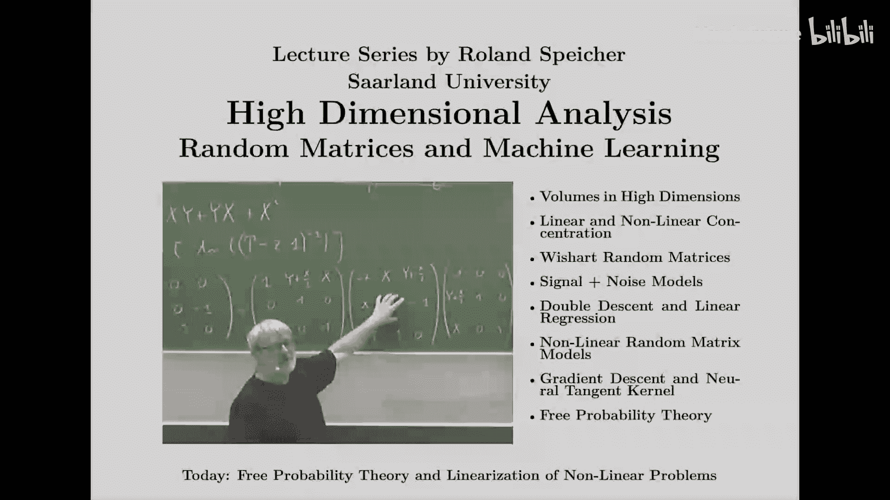
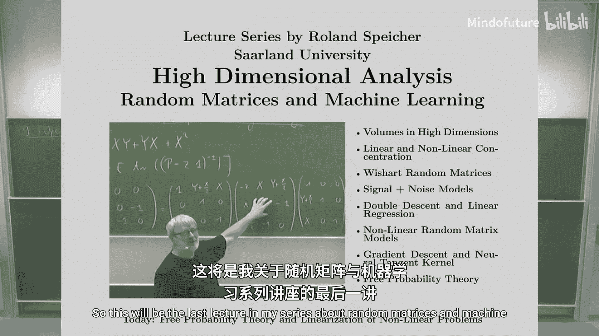
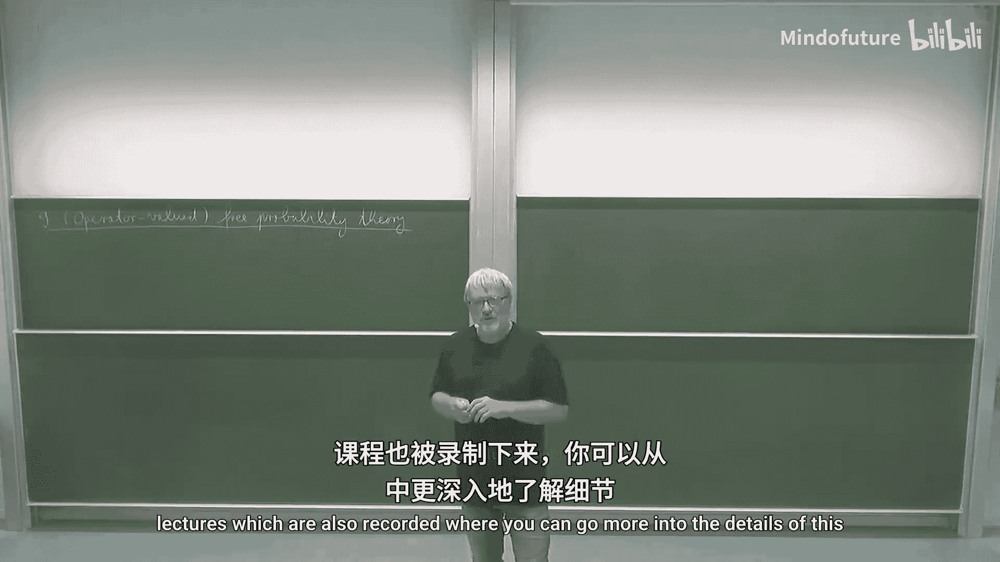

# 029：自由概率理论与非线性问题的线性化








在本节课中，我们将学习自由概率理论，这是一个处理非交换随机变量（如随机矩阵）的强大数学框架。我们将看到，自由概率不仅能够处理自由随机变量之和（对应于独立随机矩阵之和的极限），还能通过其算子值版本处理随机矩阵的多项式甚至有理函数。核心思想是将非线性问题“线性化”，即通过引入矩阵系数，将标量值多项式问题转化为算子值线性问题，从而利用自由卷积等工具求解。

## 自由概率理论概述

上一节我们介绍了随机矩阵在机器学习模型分析中的重要性。本节中，我们来看看一个专门为此类非交换随机对象设计的现代理论——自由概率理论。

自由概率理论由 Dan Voiculescu 在 20 世纪 80 年代创立和发展，至今仍是数学中一个活跃的领域。它类似于经典概率论，但核心处理对象是非交换的随机变量，例如随机矩阵。在随机矩阵的极限下，我们观察到一种特殊的结构，这自然引出了自由概率中的核心概念：自由累积量和自由独立性。

## 随机矩阵的极限结构与自由累积量

考虑一个 N×N 的实对称随机矩阵 **X**，其元素为 X_ij = X_ji。我们之前看到，在计算大 N 极限下的特征值分布时，矩阵元素的经典累积量中，只有那些具有特定循环索引结构的项会贡献主导阶。

具体来说，对于矩阵元素 X 的 L 阶累积量，只有当索引呈循环结构（如 X_{i1 i2}, X_{i2 i3}, ..., X_{iL i1}）时，它才以 N^{-(L-1)} 的阶次贡献。我们定义对应的自由累积量 R_L 为这个主导阶的极限值：

**公式**：R_L = lim_{N→∞} N^{L-1} ⋅ κ_L( X_{i1 i2}, X_{i2 i3}, ..., X_{iL i1} )

其中 κ_L 表示经典累积量，且假设索引 i1, ..., iL 互不相同。

矩阵 **X** 的 L 阶矩（即归一化迹 E[ tr( X^L ) / N ]）在大 N 极限下，可以通过自由累积量 {R_L} 来计算。其计算公式类似于经典矩-累积量公式，但求和中只包含**非交叉划分**。

以下是几个低阶矩的例子：
*   **L=1**: M_1 = R_1
*   **L=2**: M_2 = R_2 + R_1^2
*   **L=4** (假设 R_1 = R_3 = 0): M_4 = R_4 + 2 R_2^2

在 L=4 的例子中，划分 { {1,3}, {2,4} } 是交叉的，它在 N→∞ 时贡献为零。只有非交叉划分（如 { {1,2,3,4} }, { {1,2}, {3,4} }, { {1,4}, {2,3} } ）的贡献得以保留。这种只对非交叉划分求和的矩-累积量关系，正是自由概率理论中的**自由矩-累积量公式**。

## 自由独立性与自由卷积

自由累积量的一个关键性质是，它可以刻画一种新的独立性概念——自由独立性（或称“freeness”）。

如果两个随机矩阵 **X** 和 **Y** 的矩阵元素是经典独立的，那么它们对应的混合自由累积量将为零。这一性质类似于经典独立随机变量的混合累积量为零。因此，我们将满足所有混合自由累积量为零的两个非交换随机变量称为**自由独立**的。

自由独立性的一个直接结果是可加性：如果 **X** 和 **Y** 自由独立，那么它们的和的自由累积量等于各自自由累积量之和。这使得计算自由随机变量之和的分布成为可能，对应的运算称为**自由卷积**。这类似于经典概率中，独立随机变量之和的分布可以通过卷积计算。

## 从求和到多项式：算子值自由概率与线性化

然而，在机器学习模型中，我们常常需要处理更复杂的表达式，而不仅仅是随机矩阵之和。例如，我们可能需要分析 **X*Y + Y*X + X^2** 这样的多项式。此时，**X*Y** 和 **Y*X** 等项不再是自由独立的，因此不能直接应用自由卷积。

为了解决多项式问题，我们需要借助**算子值自由概率理论**。其核心思想是“线性化”：将一个标量值的非线性（多项式）问题，嵌入到一个具有矩阵系数的线性问题中。

以下是一个线性化的具体示例。假设我们想研究多项式 P = X*Y + Y*X + X^2 的史提尔杰斯变换 G_P(z) = E[ tr( (P - zI)^{-1} ) / N ]。直接求逆 (P - zI)^{-1} 很困难。

我们可以构造一个 3×3 的块矩阵，将问题嵌入其中：

**代码/矩阵表示**：
```
[ P - zI   *   * ]   =   [ 1   0   0 ]   [ -zI   X   Y+X/2 ]   [ 1   Y+X/2   X ]
[   *     *   * ]       [ *   1   0 ]   [  X   -I    0   ]   [ 0    1      0 ]
[   *     *   * ]       [ *   *   1 ]   [ Y+X/2  0   -I  ]   [ 0    0      1 ]
```
（* 表示我们不关心的部分）

关键点在于，经过分解后，右侧三个矩阵中的每一个，其关于 **X** 和 **Y** 的部分都是线性的（尽管带有常数矩阵系数）。而原多项式 (P - zI) 的逆，恰好等于这个大的 3×3 块矩阵逆的 (1,1) 块元素。

进一步，我们可以将整个问题重写为：
(P - zI)^{-1} 的 (1,1) 块 = [ ( \hat{P} - \Lambda(z) )^{-1} ] 的 (1,1) 块
其中 \hat{P} 是一个关于 **X** 和 **Y** 的**线性**多项式（但系数是 3×3 矩阵），\Lambda(z) 是一个包含参数 z 的对角矩阵。

于是，计算原多项式 P 的史提尔杰斯变换问题，转化为了计算一个算子值线性函数 \hat{P} 的算子值史提尔杰斯变换问题。在算子值自由概率的框架下，即使系数是矩阵，我们也有工具处理这类自由变量之和（即 \hat{P}）的分布。

这种方法可以推广到任意多项式甚至有理函数。虽然计算变得更复杂，但原则上为我们提供了分析随机矩阵复杂函数的系统性工具。

## 总结

本节课中我们一起学习了自由概率理论的核心思想及其在分析随机矩阵中的应用。

首先，我们看到了随机矩阵在大维极限下如何自然引出自由累积量和自由矩-累积量公式，其中只有非交叉划分贡献。

其次，我们了解了自由独立性作为经典独立性在非交换情形的类比，它允许我们处理自由随机变量之和（自由卷积）。

最后，也是最重要的，我们探讨了如何通过“线性化”技术，将随机矩阵的非线性多项式问题，转化为算子值自由概率中的线性问题。这通过将原问题嵌入到一个具有矩阵系数的更高维线性问题中实现，从而使得我们能够利用自由概率的工具箱来处理机器学习中出现的更复杂的随机矩阵表达式。

自由概率理论为理解高维随机矩阵的行为，特别是那些由独立矩阵构成的多项式的渐近谱性质，提供了一个强大而概念清晰的数学框架。