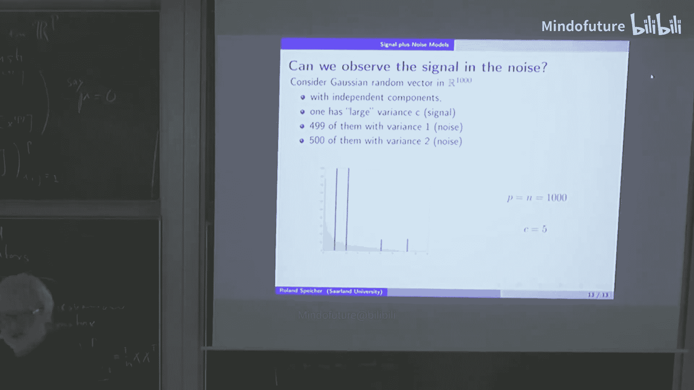
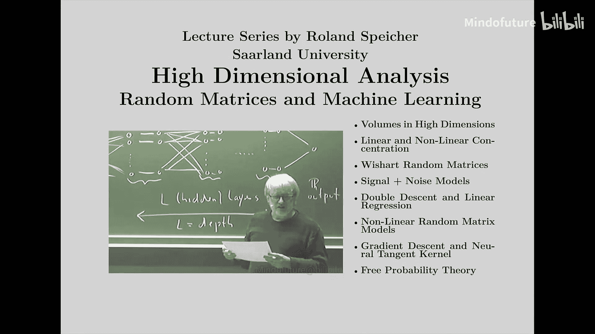

# 030：高维度的诅咒与祝福 🧭

在本节课中，我们将探讨高维空间的两个核心特性：诅咒与祝福。我们将通过观察随机向量和随机矩阵的分布直方图，直观地理解为何高维空间既是挑战也是机遇。

上一节我们介绍了高维分析的基本背景，本节中我们来看看高维空间的具体表现。

## 高维度的诅咒 😨

高维度的诅咒意味着高维空间极其庞大。如果你试图在其中采样，几乎不可能完整地捕捉到某个事物的真实分布。高维空间非常广阔且稀疏。对于许多算法和统计方法而言，高维是灾难性的，因为事物会呈指数级爆炸增长，你需要访问空间中过多的点，而这在计算上是不可行的。

## 高维度的祝福 😇

然而，高维度也带来了祝福。其核心思想是**集中现象**：如果你取高维向量的平滑一维函数，它们通常会集中在一个值附近。这是高维分析中的一个关键优势，也是我们将重点讨论的内容。

## 随机向量的集中现象 📊

为了直观展示，让我们从随机向量开始。以下是观察随机向量长度分布的过程。

### 一维高斯分布

首先，我们看一维高斯分布。取一个方差为1的高斯分布向量，绘制其直方图。即使在一维中，为了获得正态分布的清晰图像，也需要大量采样（例如100万个样本）。

在一维中，向量的长度映射为 `R^p -> R`。由于在 `R` 中，长度就是向量本身的绝对值（负值被翻转到正侧），因此长度的分布本质上就是高斯分布绝对值的两倍。

### 二维高斯分布

现在考虑二维高斯向量。向量的两个分量是独立的高斯分布，我们将其归一化，使得向量的平均长度为1（每个分量的方差为 `1/√2`）。绘制10万个此类向量的长度分布直方图，可以看到长度分布在0到2之间，仍然较为分散。

### 更高维度

当我们进入更高维度时，无法直接绘制向量本身，但可以观察其长度。以下是随着维度 `p` 增加，向量长度分布的变化：

*   **p=1, 2**: 长度分布分散。
*   **p=5, 20, 80, 320, 1000**: 长度分布越来越集中在平均值1附近。

这表明，虽然向量本身在高维球面上广泛分布，但其长度（一个一维函数）却高度集中。这就是集中现象的核心：向量不集中，但其某些函数（如范数）会集中。

## 随机向量的正交性 📐

另一个有趣的现象涉及两个独立高斯向量的正交性。

我们观察两个独立高斯向量之间归一化内积（即夹角余弦）的分布：
`cos(θ) = (x·y) / (||x|| ||y||)`

以下是不同维度下的分布情况：

*   **p=1**: 内积仅为+1或-1（完全平行或反平行）。
*   **p=2**: 分布较广，存在接近平行、反平行和正交的向量。
*   **p=5, 20, 80, 320, 1000**: 分布越来越集中在0附近。

在低维，向量可能平行；但在高维，两个随机向量几乎总是近似正交的。其内积的平均值始终为0，但在高维中，实际值也紧密地集中在0附近，这与低维中可能远离0的情况（如±1）形成对比。

## 协方差矩阵估计的应用 📈

现在，让我们将视角转向更接近实际数据的问题：协方差矩阵估计。

假设我们有一个 `p` 维高斯随机向量，其分量独立，但方差不同：一半分量的方差为1，另一半为2。因此，真实的协方差矩阵 `Σ` 是对角矩阵，其特征值一半为1，一半为2。

### 经典统计视角

我们进行 `n` 次独立观测，并用样本协方差矩阵 `S_n = (1/n) Σ_{i=1}^n X_i X_i^T` 来估计 `Σ`。

*   设定 `p=100`, `n=100`。绘制样本协方差矩阵的100个特征值的直方图。我们看不到清晰的1和2，而是看到一个连续的分布。
*   固定 `p=100`，逐步增加 `n` (1000, 10000, 100000)。随着 `n` 极大增加，特征值分布才开始在1和2附近出现分离。

经典统计学告诉我们，当 `n` 远大于 `p` 时，估计会收敛。但在 `p` 和 `n` 可比拟的现代数据场景中，我们无法获得如此多的样本。

### 高维极限视角

我们考虑另一种极限：让 `p` 和 `n` 以相同的速率趋向于无穷大 (`p, n → ∞`, `p/n → 常数`)。

*   我们观察 `p` 和 `n` 同步增大的情况（如500x500, 4000x4000矩阵）。特征值分布会收敛到一个**光滑的极限曲线**，即**Marchenko-Pastur分布**。
*   我们 `p=n=200` 的实际观测结果，已经与这个高维极限分布非常接近。

因此，虽然我们看不到真实的特征值1和2，但观测到的分布是真实矩阵 `Σ` 的一个可计算、可控制的函数。理解这个极限分布，比等待不现实的巨大样本量更有用。这正是随机矩阵理论，特别是Wishart矩阵极限谱分析的内容。

## 信号加噪声模型 📡

我们进一步考虑一个更实际的“信号+噪声”模型。

设定维度 `p=1000`。假设其中**一个分量**是信号，其方差为 `C`；其余999个分量是噪声，其中一半方差为1，一半为2。

### 信号检测

我们观察样本协方差矩阵的特征值分布 (`p=n=1000`)：

1.  **无信号 (`C=1`)**: 得到标准的Marchenko-Pastur分布，特征值全部位于“噪声谱”内。
2.  **强信号 (`C=7`)**: 在噪声谱范围之外，出现一个**离群的特征值**（图中用更高的柱表示）。虽然真实信号特征值是7，但观测值约为9。信号没有被噪声淹没，而是清晰可辨。
3.  **中等信号 (`C=5, C=4`)**: 离群特征值依然可见，但随着 `C` 减小，它逐渐向噪声谱边缘移动。
4.  **弱信号 (`C=3`)**: 离群特征值消失，融入噪声谱中，无法再被区分。

### 核心结论

这个现象揭示了高维统计中的一个重要原理：
*   当信号强度足够大（超过某个由噪声谱边缘决定的**临界值**），它会产生一个可观测的离群特征值。
*   观测到的离群特征值位置与真实信号强度之间存在确定的数学关系，我们可以通过理论反推真实信号强度。
*   噪声谱本身非常稳定，其内部不会自发产生类似的离群值。

---

本节课中我们一起学习了高维度的双重特性。**诅咒**体现在空间的广阔和采样的困难；而**祝福**则体现在集中现象上，使得随机向量的某些函数（如范数、内积）以及随机矩阵的谱分布，在高维下会呈现出确定性的、可预测的行为。我们通过协方差矩阵估计和信号检测模型，看到了如何利用这些高维极限理论来理解和处理实际中 `p` 与 `n` 可比拟的数据。这正是高维分析赋予我们的强大工具。