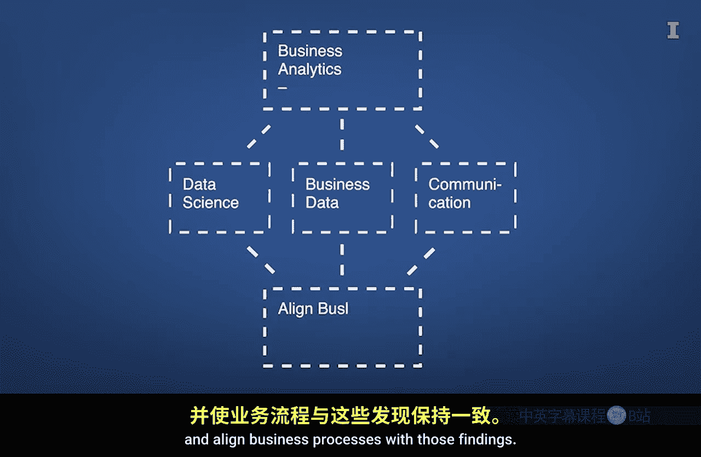
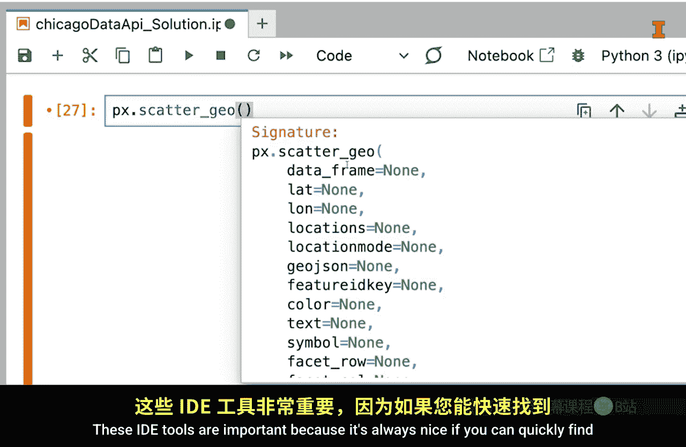
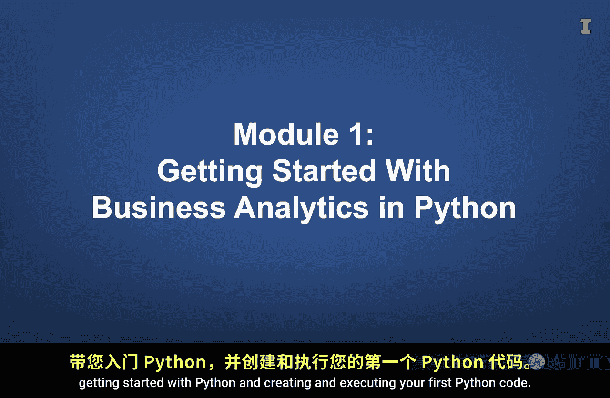
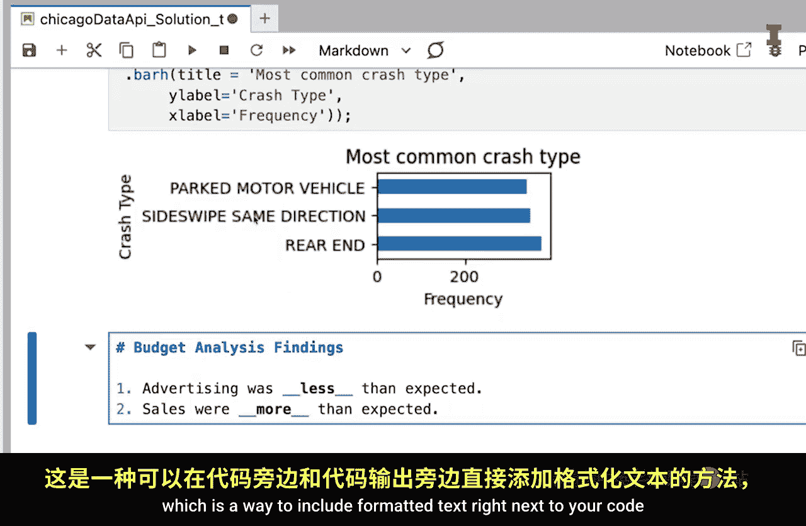
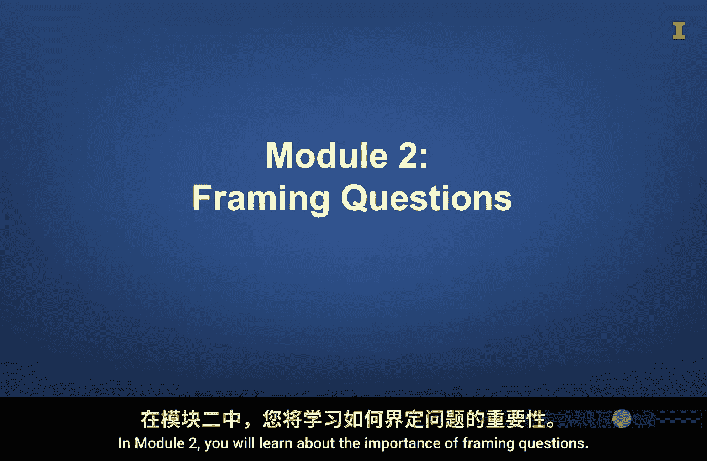
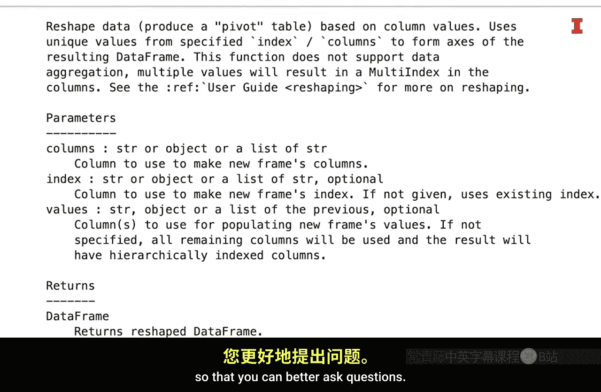
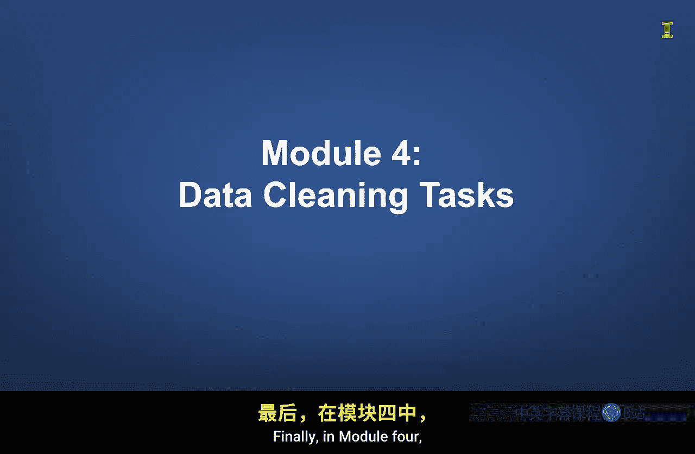
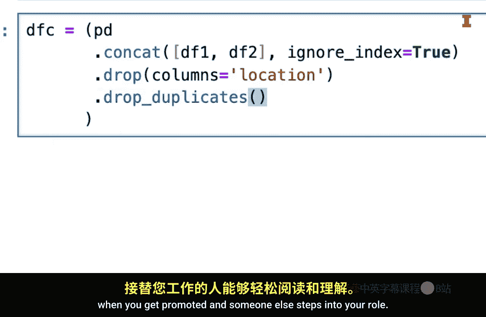

# 伊利诺伊大学【中英⚡商业分析｜Business Analytics Specialization】 p01 P1 01_课程介绍 -BV1z86nB9EGz_p1-

Hi， I'm Ron Geyman。Just like the layers of these incredible Hoots at Bryce Canyon reveal a long。

 complex history。In this course， we'll explore the layers of data to uncover valuable business insights。

In this course， you'll learn about the concept of business analytics。For our purposes。

 business analytics is the application of data science to business settings。Importantly。

 it also includes the ability to communicate findings with others in the organization and align business processes with those findings。

One of the best ways for you to appreciate business analytics is to start analyzing business data。

So in this course， you'll be introduced to Python， a powerful programming language that can be used to perform many data analytic tasks。

Not only will you be introduced to Python， but you'll also get some practice using it。

Learning how to use a programming language can be a challenge。It was for me， but don't worry。

 in addition to giving you practice using Python， you'll be introduced to the tools that will help you create code。

The primary tool is Jupiter Lab， an integrated development environment or IDE that's used for developing script。

An important thing to know is that developers do not memorize all the code they create Instead。

 they know how to use tools that are built into their IDs to help them look up and autocomplete code。

These IDE tools are important because it's always nice if you can quickly find what you need without having to switch environments。

However， you should get used to the fact that you will need to do a lot of searching。

Python is open source， which means a lot of people have created code。That is freely available to use。

All of that code cannot fit into a simple user manual。

 so expect to perform searches on the internet and using AI tools that are not embedded within the IDE that you're using。

Speaking of AI。You should learn to use AI to help you create data analytic code。

 It will save you a lot of time。So throughout this course， we will explore how AI can help you。

However， it's still valuable for you to learn the foundational principles of using Python for analytics so that you can create effective prompts for AI。

 evaluate the AI output， and create things that are difficult to put into words。

This course is divided into four modules， and each one has multiple lessons。In moduleule1。

 we will introduce you to business analytics， getting started with Python and creating and executing your first Python code。

You will also learn about Markdown， which is a way to include formatted text right next to your code and next to the code output。

 so that you don't have to copy and paste the output of the text into a word processing document or presentation software。

In module 2， you will learn about the importance of framing questions。

 This is important not only from a business perspective。

 but also from the perspective of learning how to use Python。

While you don't need to know the same programming concepts in theory that students of computer science need to know。

 it will be helpful to understand some basic concepts like objects so that you can better ask questions。

We will also introduce you to some fundamental data objects in Python。In module three。

 you'll explore what makes data valuable。You will then get experience using Python to explore data sets to identify whether their data is valuable。

Part of that exploration will include learning how to create visualizations with Python。

The ability to explore a data set will be invaluable when you start manipulating and analyzing your data。

Finally， in module 4， you will learn how to perform common data cleaning tasks like changing column names。

 rearranging and removing columns from a data set， dealing with missing values。

 reshaping data sets and combining data sets。

We will also demonstrate how you can clean up your code so that it's easy for others to read when you get promoted and someone else steps into your role。

So that's an overview of the four modules。 Since this is the first in a series of courses in the business analytic specialization that uses Python。

 hopefully， this course will give you a solid foundation for appreciating and performing data analytic tasks in business settings without making it too overwhelming。

Future courses will introduce you to more details of data visualization。

 advanced analytic algorithms， and applying business analytics to marketing。

 accounting and other business domains。Just as Bryces Canyon inspires awe and a desire to understand its wonders。

I hope that this course will ignite your passion for data analytics。When used correctly。

 these skills can transform businesses。My goal is that by the end of this course。

 you'll be equipped and excited to use data to improve your business and make your own discoveries。

