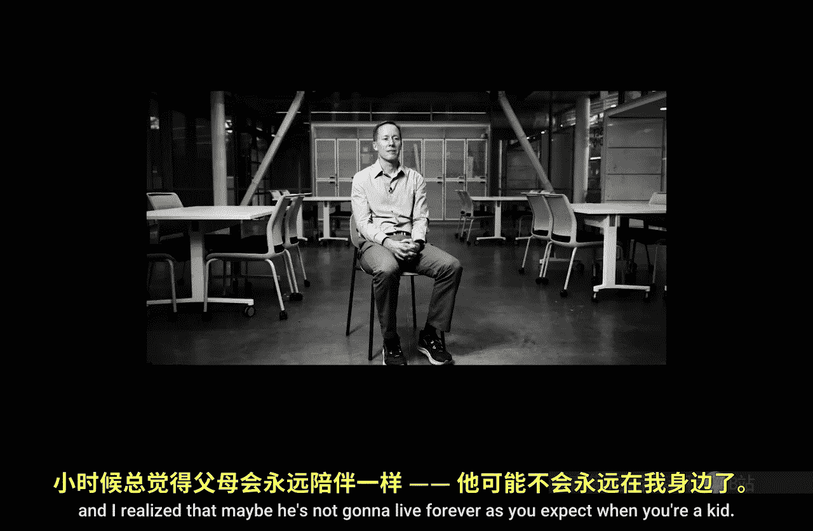
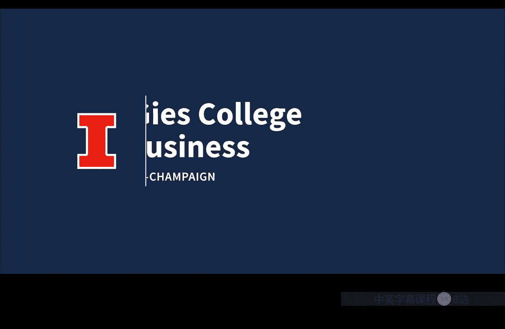

# 伊利诺伊大学【中英⚡商业分析｜Business Analytics Specialization】 p02 P2 02_遇见罗恩·盖蒙教授 -BV1z86nB9EGz_p2-

One misconception that people have about data analytics。

 There's this person with a high and nasly voice。 have no enthusiasm。

 They just like crunching numbers all the time。And that's not at all the。

I teach accounting and data analytics for the University of Illinois。When I was young。

 I hoped I would be an NBA basketball player。I know I'd have to do something else。

Been a teacher for most of my life， my dad， he loved teaching。

 he was really good at making teaching entertaining。

I love that idea of taking an idea and making it easy for someone else to learn。

Transferring knowledge I always wanted to be like him growing up other than he didn't play in the NBA。

 but loved to have a good time so I did have to make a really difficult professional decision。

And when my dad had the stroke， I was living in Georgia。

 he was living in Utah and I realized that you know maybe he's not going to live forever as you expect when you're a kid。

 I had an opportunity to join a business intelligence company and they eventually said，" hey。

 do you want to come join us as a chief data scientist？

It was a really tough decision， but the key thing was that it was close to where my parents lived。

So I'm really grateful that I made that decision to take that job for a number of reasons。

 first of all， because my dad only lived seven months after we moved there。

But I also am grateful that we moved back because I had an opportunity to do like the most fun part of research。

 which is analyzing data。And that experience has been invaluable now as I'm back in academics and I have the wonderful opportunity。

I'm able to share that knowledge with students and help them help their companies。

University of Illinois is amazing and it always has been to like be a part of the University of Illinois for me has really been a dream I could bring a lot from my experience to help these business students learn how to analyze data I could make it accessible to them。

One of the things that I like the most about data analytics is being able to extract a story from the data。

🎼There's room for lots of creativity in data analytics。

 I think it is an art in a lot of ways because you've got these tools， you've got algorithms。

 visualization， software you can create something that has a lot of value to people and that is beautiful Some of the visualizations that you can create with data analytics。

Are really pretty I'm of course biased I love data and I can see lots of applications that probably a lot of people can't see。

 but you can present a visualization that causes interocular traumatic impact。

 a conclusion that hits you right between the eyes and that can be a really neat and rewarding thing to do。

One of the things that I like about working in the online degrees program is being able to meet people from all over the world。

And it's just so cool to just hear people talk， I really enjoy that about this opportunity to work in the online degrees program。

What it's like to work at Ge to come to Illinois。On your way here， as you drive through the fields。

 all of a sudden you're in this oasis of knowledge and skill。

We're part of a huge family across the whole world and it's a wonderful family to be a part of we've got people with tons of different talents and skills that are very willing to share those with one another and to help others along the way So it's exciting to come here because you know that you'll leave having learned something new。

If nothing else， you'll learn more about the great people here or deepen your existing relationship with those people。

