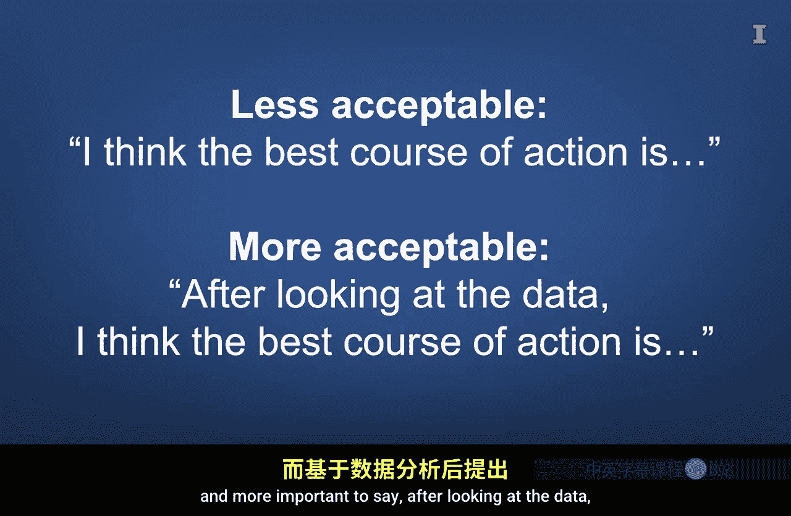

# 伊利诺伊大学【中英⚡商业分析｜Business Analytics Specialization】 p05 P5 01_商业分析概览 -BV1z86nB9EGz_p5-

This is pretty beautiful scenery behind me， right， well I'll come back to that in a minute。

 but first I want to tell you about a story that's relevant to business analytics。

Moneyball is a book by Michael Lewis that's had a big impact on how I think about data driven decisions in a business setting。

Even in the age of artificial intelligence， this story remains a relevant example of how we can augment our hunches with data driven decisions。

Just as the Oakland As use data to find undervalued players。

 allowing them to compete with wealthier teams， we can use business analytics to uncover hidden opportunities within a business landscape。

 identifying undervalued areas for growth。Much like discovering a unique rock formation within Bryce Canyon。

One of the battles that the team struggled with was how much to rely on the intuition of scouts versus the results of data analyses。

The movie has some pretty humorous parts where the scouts are talking about whether the players look like an athlete。

 how the ball sounds when a player hits it， and even what the player's girlfriends look like。

Presumably， the scouts were trying to process the intangibles to identify players that would do well。

 even if they didn't fit the stereotypical image of a good baseball player。The general manager。

 Billy Bean， had a tough time convincing the scouts that the most important thing was how often a player was able to get on base。

This story has some lessons that can be applied to many business environments。

If you haven't read the book or watched the movie， I'd recommend it as an entertaining way to learn about the importance of making room for empirical inquiry in a culture of functionses。

Now hunches aren't all bad， the capability of the human mind and intuition is amazing。For example。

 in a few moments， we're able to combine information about the way a person talks， looks， speaks。

 smells， and moves， and then make judgments about whether that person will be a good fit with the firm's culture。

 or at least we think so。Often we are probably correct。However。

 our capacity is limited and susceptible to weaknesses in certain situations。When used correctly。

 data analyses can augment our mental capacity to help us recognize our mental weaknesses that arise when we rely only on our hunches。

Applying data science， business data， communication。

 and aligning business processes with analytic findings is known as business analytics。

The goal of business analytics isn't always to eliminate all intuition and judgment。

 but to consider how data can be used to inform tactical and strategic business decisions。

Business analytics can help confirm or disconfim a hunch。

 it can also help us spot settings where we wouldn't have recognized important patterns without a lot of effort。

It can also lead us to questions that we wouldn't have considered and even help us formulate new business strategies。

In general， the way business analytics works is that it uses historical data to help us answer the following questions。

 What happened， Why did it happened， What is happening now。

 What will happen next if there's no intervention。And what intervention should be taken to achieve the most desirable outcome？

Now， since Moneyball was written， sports analytics has become a big deal in nearly every sport。

More broadly， data analytics seems to influence every business and every aspect of life。In fact。

 it is the way AI tools like Cha GPT and Gemini are created。

From health analytics related to our exercise， sleep and nutrition to the analyses of where our ancestors are from and the shows that we watch business analytics plays a major role。

Because more companies are adopting data driven decision making tools。

 it's becoming less acceptable to say I think the best course of action is。

 and more important to say， after looking at the data， I think the best course of action is。

As a business professional， it's also becoming more expected that you know how to analyze the data in a way that will bring insight to the decision context。

