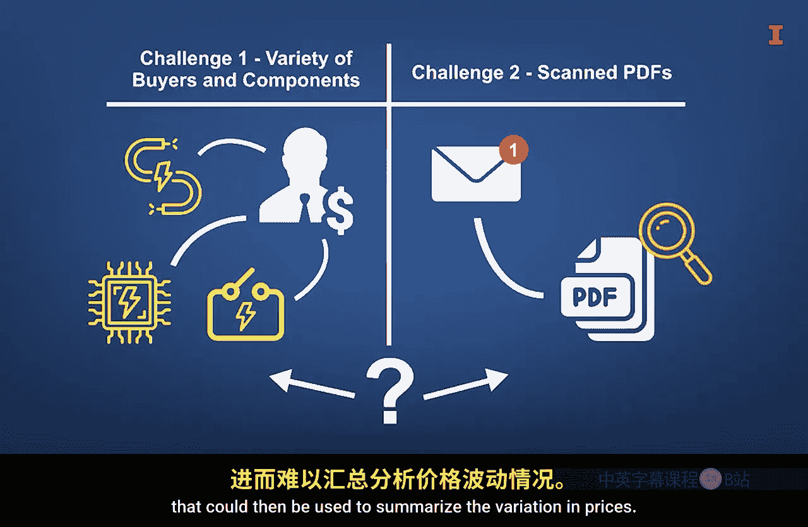
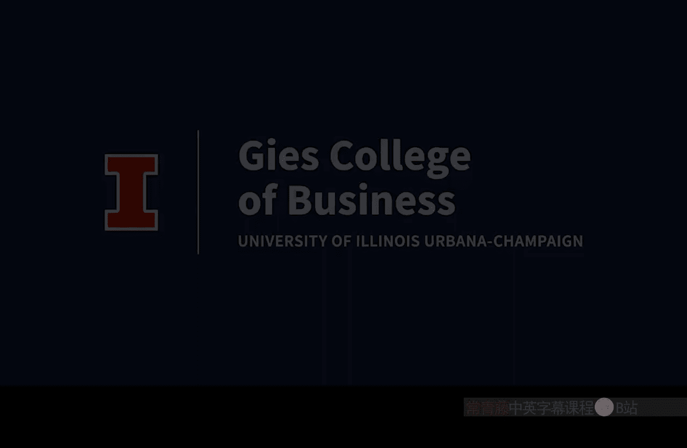

# 伊利诺伊大学【中英⚡商业分析｜Business Analytics Specialization】 p06 P6 02_商业分析实例 -BV1z86nB9EGz_p6-

I've got a beautiful view of Bryce Canyon behind me。 in this lesson。

 we'll review examples of how business analytics has influenced a variety of companies。Hopefully。

 these examples shed light on how you can apply analytics in your current responsibilities。

 much like how the light adds more detail to the beautiful scenery and Bryce Canyon behind me。

Please notice how the creative methods for gathering and or analyzing data led to improved business processes。

The first example is from a personal experience with a growing solar company。

This company suspected that it was often being overcharged for electrical components。However。

 there were a couple of factors that made it hard for them to verify that that was really happening。

First， the company had a variety of people buying a variety of electrical components。

 which made it difficult for the buyers to mentally keep track of the costs。Second。

 even though the invoices were emailed to a single email account， the files were scanned PDFs。

 which is basically a photograph inserted into a PDF file。Thus。

 it wasn't straightforward to convert the image to a tabular format that could then be used to summarize the variation in prices。

Using a coding language and a computer scheduling tool。

 we set up a script to regularly access the email account to which the invoices were sent。

 Download the P file， use optical character recognition to convert the text image into tabular data。

 and then combine all the data into one commissurporated value file。

They then use that file to quickly identify when they were overcharged and recoup what they were paid。

 They ended up recouing about four times as what they paid to set up the script。

This is an example of how a small company used technology to gather data and didn't even rely on sophisticated data processing to improve its business。

We're now going to hear from Dr。 Unatinaangang， who will share examples of how data analytics is used in marketing。

In marketing， analytics has become a game changer and a necessity for firms to stay competitive。

 Let me share two examples from retailing and digital platforms， such as social media。

 These are areas in which I have over a decade of experience and expertise both through my roles in industry as well as through academic research。

 I was also an entrepreneur in the business of retailing prior to getting a PhD in marketing。

 and I saw firsthand how analytics is transforming both in store and online experiences across channels。

😊，Imagine a retail company trying to optimize its promotions to boost sales while minimizing wasteful advertising expenditure。

Historically， businesses would rely on generic promotions or simply gut instinct to target customers。

Now， by using analytics tools， companies can dive deeper into customers' purchase behavior。

 For example， analyzing point of sale data combined with loyalty program。

 from the retailer's mobile app can reveal new trends such as which products are commonly bought together。

 which promotions resonate best with specific customer demographics and so on。😊。

Using this type of data， companies can design targeted campaigns， personalize their offers。

 and even optimize inventory to reduce overstocking or understocking scenarios。

In some of my research with a large scale consumer electronics retailer with over 4000 stores in the US。

 I have shown just how powerful retail app analytics can be in increasing consumer spending as well as loyalty。

Let's switch to another example in platforms like social media websites。

 analytics tools enable businesses to measure engagement metrics like clickthrough ratess， shares。

 as well as sentiment analysis from customer comments。😊，This goes beyond distracting numbers。

 It helps marketers understand what types of content would work best on each platform and at what time their audience would be most active。

For example， an outdoor gear company might discover through social listening and through sentiment analysis that their posts showing adventure stories generate higher engagement among customers than traditional product ads。

😊，Armed with this insight， they can refine their strategy to focus much more on storytel。

 resultingult in a stronger brand connection， as well as higher conversations among customers。

 They can even integrate generative AI tools。😊，Both of my examples highlight how marketing analytics transforms data into actionable insights。

 enabling companies to make smarter， faster and more impactful decisions。

 creative approaches to data analysis can directly improve customer relationships and drive growth。😊。

Sports are a big business， so let's consider analytic examples from that domain。

Baseball is a sport that easily lends itself to statistical analyses because each play is a discrete sequence of events that pretty much starts the same way。

For instance， a right handed batter is going up against a right handed pitcher。

 and we pretty much know where all the filterers will be standing。Moreover。

 it's pretty easy to keep track of how many pitches a pitcher has thrown during that game。

In contrast， basketball is a much more fluid game in which plays blend into each other。

 and players can be in many different places at the beginning of a play。

So enterprising companies have created video software that takes 25 pictures per second and tracks the coordinates of a player and the ball。

This allows new metrics to be considered for identifying undervalued players。

 such as those who are able to make baskets when defenders are really close。

It also allows analysts to use sophisticated statistical analyses to evaluate the defensive value of players。

Wearable technology also helps teams monitor players。

 ensuring that they're rested and ready for key moments。

 much like how scientists monitor environmental conditions to preserve this canyon。

These examples highlight the innovative use of data to enhance performance。

This example illustrates creative uses of data gathering and analysis to improve business。

Consider the fast paced world of stock trading。 It's like trying to react to fleeting changes in the light on canyon walls。

To compete， traders use automated systems that track news and social media。

 interpret information and execute trades in fractions of a second， much faster than any human could。

However， you can assume that a bot was set up to track news feeds or social media posts。

 interpret those bits of news and then place trades fast。In fact。

 the bot did it much faster than a human， like within three seconds of the news coming out。

This example illustrates the use of data gathering and analysis to improve business。

I think the advances in technology like data analytic tools。

 video capturing software technology and AI are something to be loved and not feared。

Some people are concerned that machines are taking over many jobs。

 and I can see where they're coming from。However， those jobs are often quite repetitive and boring。

Thus， many mundane tasks can be delegated to machines so that humans can do more interesting things。

