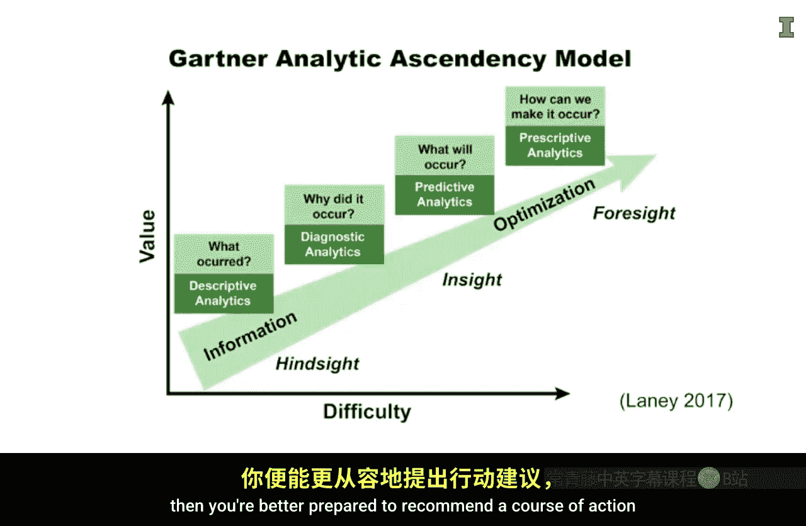

# 伊利诺伊大学【中英⚡商业分析｜Business Analytics Specialization】 p07 P7 03_事实框架 -BV1z86nB9EGz_p7-

In this lesson， I'm going to review a simple framework for making data driven decisions。

 the fact framework。Before we get to that framework， though， let's hear from someone else。

I interviewed Luis Guimmo， director of analyticslytics and application development for the Buffalo Bills。

 an NFL American football team。Towards the end of the interview。

 I asked him what other advice he has for using data analytics to make decisions。

 here's what he said。Really following a structured process to come to your findings。

 always follow a very similar approach of breaking down your problem。

 going through it methodically is really important accuracy。that process leads to accuracy。

 that accuracy leads to trust and the trust in the data and the trust in the results is what will continue to drive analytics forward I。

Whether it's football or you know medical information or retail。

 it doesn't really matter if if you provide inaccurate results。

 then there won't be trust in the data and it'll be。Difficult to continue。As Luis mentioned。

 the process is really important。So let's now talk about the fact framework。

The first step in this framework is to frame the question。Identify a problem that needs to be solved。

 Consider how you can frame the problem in a way that will encourage people to use data to find the root cause。

 and that will lead to some insight on which you can act。At some point。

 you'll also want to consider framing the question in a way that can be answered using a particular analysis。

Second， assemble the data。Financial data is often important because it helps establish the impact of something on profit。

 However， other internally available nonfinancial data。

 as well as external data should also be considered。You may even want to gather your own data。

Once you identify data， you'll need to find a way to extract， transform， and load the data。

 which is often referred to as the ETL process。Finally。

 there's a fair amount of data wrangling that will need to take place so that the data is structured for the calculations that you'll perform on it。

Third， calculate the results。Start by making sure you have a good feel for the basic summary statistics of your data。

What is the distribution of the factors in your data， how many values are missing。

 how correlated are the factors with each other？After you have a fill for the data。

 then you can start performing advanced analytics on the data。

These advanced algorithms can provide insight by surfacing patterns in the data。

There are a variety of algorithms to choose from。Understanding the strengths and weaknesses of each one can help you know when they should be applied。

You should also know how to evaluate the results of the models that are created by the algorithms。

Fourth and finally， tell others about the results。Use technology and methods of communication that are accessible to your audience。

Take effort to make sure you balance the main ideas with the nuance， too many nuances。

 and you will confuse and lose your audience to few nuances and your audience may overgeneralize your results。

As you communicate the results of your analysis to your audience。

 make sure to observe their reaction。Be open to receiving feedback and acknowledge the limitations of your analysis。

As you open yourself up to other opinions and perspectives。

 you'll most likely be able to improve your analysis and gain additional insight as a result。

Almost always， you'll find additional questions to pursue as a result of digging deeper into the underlying cause of the problem that you're addressing。

That's the framework， but I want to emphasize that each part of the framework is important and useful only in conjunction with the other steps。

For instance， what if you don't frame a question， consider what could happen if you just start assembling data without having first framed a question to answer or without having any idea of how it could be useful。

Or how you're going to make calculations with it。Even though information isn't an NASA on your balance sheet。

 It has similarities with inventory。 The more data you have。

 the more you have to invest in storing it， keep track of it， update it。

 protect it and granting access to it。 Thus， deliberately framing a question and then gathering data to answer that question is ideal。

 It can also serve as a compass， a good reference point to go back to if you get sidetracked on a tangential analysis。

Now what if you don't assemble data， framing a question is a good starting point。

 but if you don't have any idea of what data is available to use or if you don't know what can be done with it。

 then you'll have a hard time framing the question in an effective way。Also。

 it's often the perception that sophisticated algorithms can find patterns in any data。

 especially if there is a lot of it。There may be some truth to that， but more often than not。

 you'll make better use of your time and resources by assembling the right data。

 thus it's important to assemble a relevant set of data。While assembling data is super important。

 what if you don't make calculations with the data？

Sophisticated algorithms are really useful because they can identify complex patterns in the data that could take humans a much longer time to identify。

For instance， identifying the optimal ticket price often requires the consideration of many factors such as time of the year。

 day of the week， holidays， weather conditions， and macroeconomic conditions like oil prices to name a few。

It would take a human a long time to evaluate all of the combinations of those factors to arrive at the optimal price。

Thus， using powerful calculations is important because it can arrive at that optimal price much quicker。

Finally， what if you don't effectively tell others about the results？

Even when the question is framed well， a nice data set is assembled and powerful calculations are made。

 it's important to communicate the right information to the right people in the right way so that it is acted upon。

Failure to accurately and succinctly communicate results is a common reason why companies fail to become more data driven。

Thus， being able to effectively tell others about the data is crucial。

The fact framework provides guidance to convert data to improved business performance。Doug Laney。

 the author of Infoomics， has a great graphic called the Gartner Analytics Ascendancy Model。

Which also highlights that data analytic analyses should focus on action。

I like this model because it highlights how insight can be turned into foresight。

Identifying relationships in the data can help you move from descriptive analytics to prescriptive analytics。

 In other words， historical data helps identify relationships which can then be used to predict what will happen。

 If that prediction is unfavorable or unprofitable。

 then you're better prepared to recommend a course of action that will prevent the unprofitable from occurring。

In conclusion， as you start on your journey to use data and advanced analytics to answer business questions。

 remember that all steps in the fact framework are important。

 so you can go from simply descriptive analytics to prescriptive analytics。

