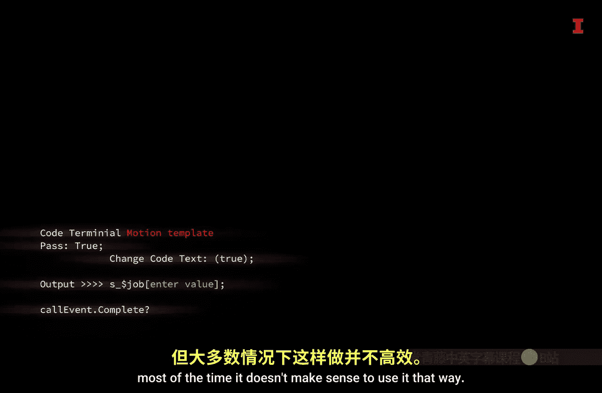
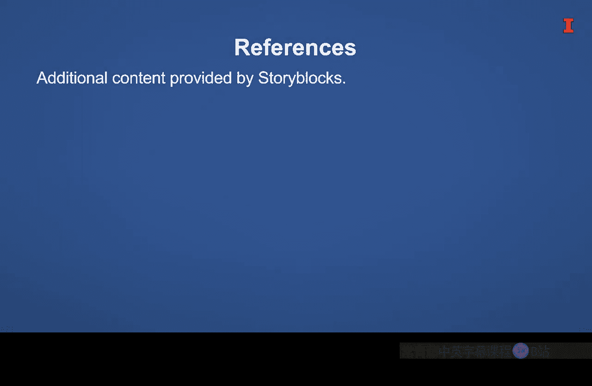

# 伊利诺伊大学【中英⚡商业分析｜Business Analytics Specialization】 p09 P9 05_Python附加工具 -BV1z86nB9EGz_p9-

In this video， we'll talk about how to use Python once you've installed it。

While you could use Python by itself in a simple text editor type of environment。

 like command prompt or terminal。Most of the time， it doesn't make sense to use it that way。 Instead。

 most of the time， you will use Python， along with other accoutrements or accessories that make it much easier to create。

 read and run Python code。

The three main accoutrements are one， a computer for running the code。Two。

 programming modules so that you can use functions rather than recreate commonly used code。

And three integrated development environments or IDdeEs to help you remember the syntax and the functions for running the code。

Now， let's consider an autoshop analogy that will hopefully put each accoutreman into perspective。

When you need to repair a car， many of you will take it to a mechanic。

This mechanic is like a computer that can perform certain tasks much faster than we can perform them。

The mechanic communicates with other mechanics using a specific language。

The language that they used to communicate is Python in our case。

Mechanics have a variety of tools that they use to perform certain tasks。

The mechanic buys the tools once and will then only bring the set of tools to the car that are relevant to the problem that they are fixing。

For instance， ratchets and screwdrivers would be used for almost every task。

 so they may keep those in a general purpose tool box。

They would have a different toolbox for diagnosing problems。

 which might contain tools like multimeterters and scan tools that they would bring to the car if a check engine light is on。

They would have yet a different toolbox that would include a jack， jack stands， and a torque wrench。

 which they would bring to the car if they were fixing a flat tire。

The various tool boxes are like programming modules。

 which contain a set of functions that make it much easier to perform specific tasks。

Just as mechanic does not bring all tools to the car every time they work on a car。

Only specific programming modules are imported based on the needs of the task。

The programming modules need to be installed only once。

 but they must be imported to the environment every time you use functions from the module。Finally。

 the mechanic most likely works in a garage that helps them keep track of their tools。

 has quick reference posters on the walls and has ways to adjust the lighting and maybe can even run the car to test out if the repair worked。

😊，This garage is like the integrated development environment that is used when working with Python。

Now， integrated development environments include ways to quickly reference code。

 rather than recall it exactly for memory。 They also help to make sure that your code syntax is correct。

 and they can even help you run small parts of your code and evaluate the output。

I hope that analogy is helpful。The important thing at this point is to recognize the distinction between Python and the accoutrements so that one。

 you have a better understanding of how Python is used and2。

You know that you will not have to memorize all the code。

 I think it's particularly important for those who are new to Python to recognize that they will not have to commit to memory the code and processes。

 because that can be overwhelming。Now as we go through the other videos and lessons。

 you'll gain more experience with using Python and its accoutrements。

