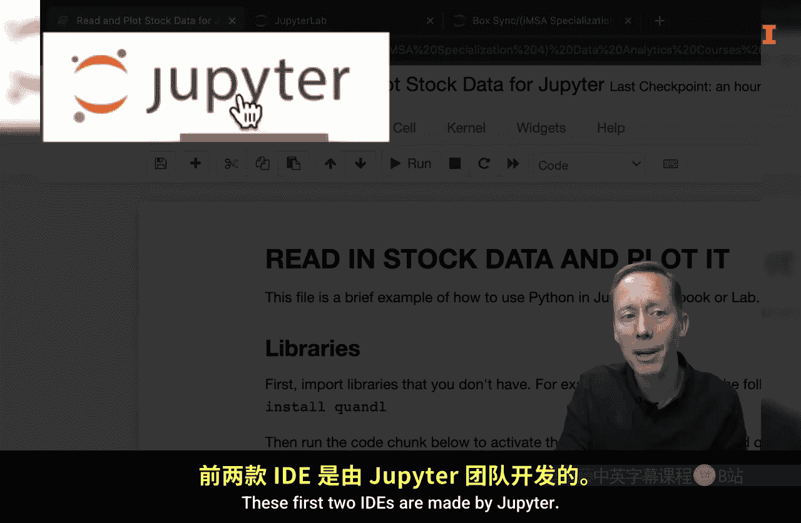
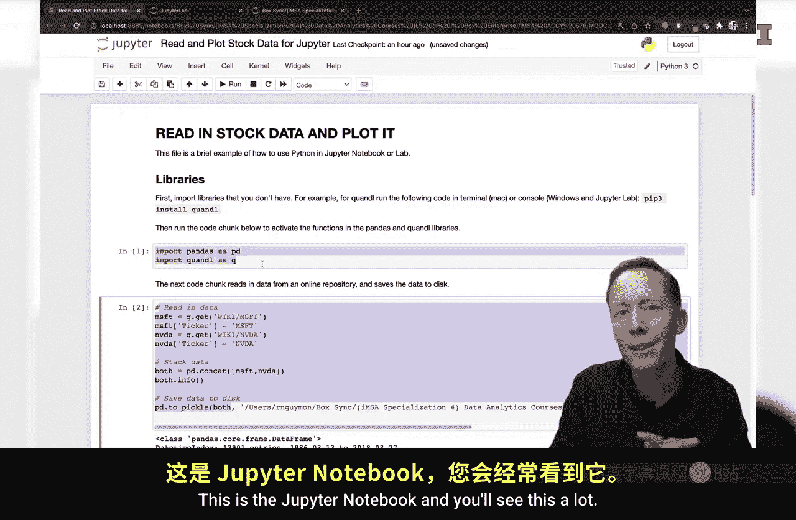
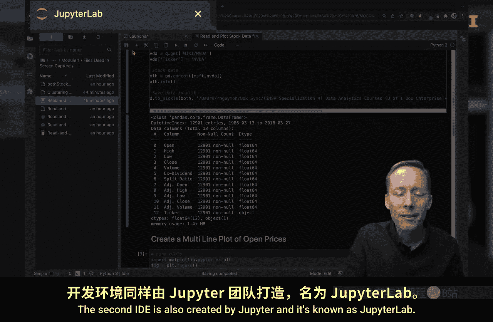
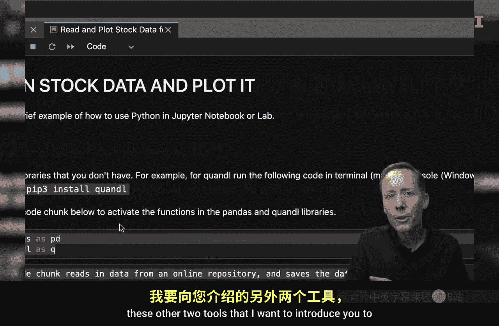
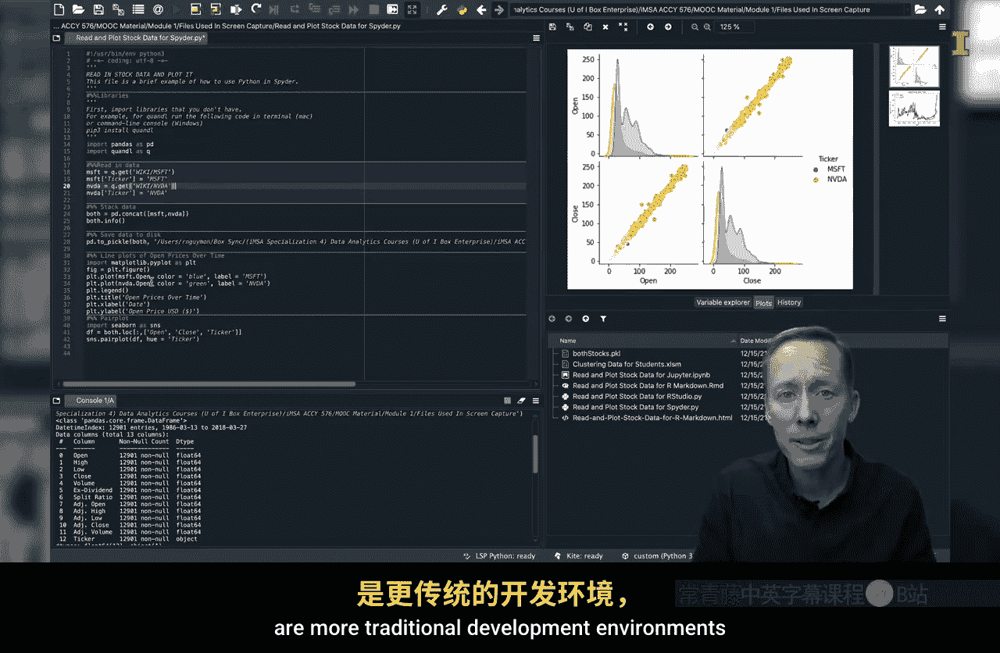
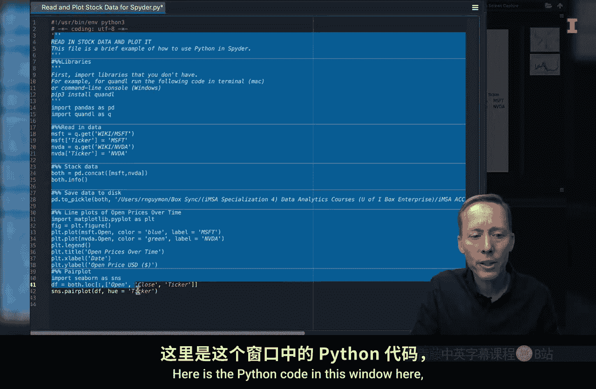
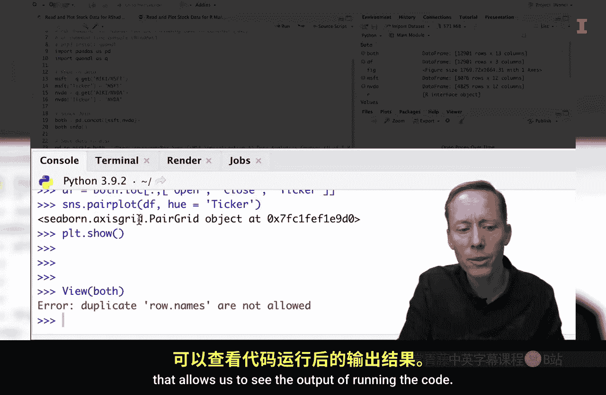

# 伊利诺伊大学【中英⚡商业分析｜Business Analytics Specialization】 p10 P10 06_Python与集成开发环境（IDE） -BV1z86nB9EGz_p10-

In this lesson， we want to distinguish between Python code and the integrated development environments or IDEs that are used for helping to create the Python code。

Now， in a previous course， I introduced very briefly the Visual basicic editor。

 which is an integrated development environment for running the Vis basicsic for application language。

 which is used in Excel for creating macros。 Now what you see on the screen here is the visual basic editor。

And in this particular box right here， this window is the visual basics for application code as well as comments that performs Kine clustering。

Now this environment is really helpful and let me just quickly illustrate why in this code。

 if I want to see how it's working， I can set a break point， for instance。

 and then I can click the play button and now you see in this locals window the different variables that I have created and the values that are assigned to them。

And if I click the play button again， it will go through and if there are any values that get updated。

 then I can scroll through and see what those are in here All right。

 so this is really helpful as I walk through the code and make sure it's doing what I think it's doing。

Another great thing about using the visual basic editor in Excel is that they're in different windows。

 So if I have two screens or I want to split my screen。

 I can actually step through the code and see what is happening with the data itself。

 or maybe the charts that are created in the Excel worksheet。 So notice when I click the play button。

 a new cluster assignment is made。 and I can even remove this break point。😊。

And run through the rest of the macro and it tells me it's done and you can see that it has gone through this cluster。

 this K means cluster analysis and assign each observation to a cluster。All right。

 so it's really helpful to be able to see the output as you run the code。

 especially when you're developing that code。Now， this idea of having software for creating and troubleshooting code and stepping through it is so important because it is very unlikely that you're ever going to create code that does not have any type of error in it。

 It's also very unlikely that you'll be able to remember。All the code itself。

 and so it's really important to have tools to help remind us of what we need to run and to be able to see what we're doing。

So for the rest of this video， I want to introduce you to four IDEs that are used with Python。

And we will talk about how to install these IDEs and the strengths and weaknesses of them in later videos at this point I just want you to see that there are different environments so that you can really distinguish between Python itself and the code。

All right， so these first two IDEs are made by Jupiter。

And this first one is called Jupiter Note。And you can see it's a browser based tool。

And this looks really nice in here， and you can format text in here so that it's easy to read。

And then you can have other code chunks or cells that contain the Python code。 right。

 so this first chunk in here， this first cell is really just text， it's not code。

But that helps me present the code and the output of the code so that it's easy to read and this is the Python code itself all right。

And similarly， here's some more Python code in this particular。

Set of code reads in stock data and plots it so I can just scroll briefly down through here and see a multiline plot of Microsoft and Nvidia stock prices over time。

 as well as what's called a pair plot。 All right， so this is the Jupiter notebook and you'll see this a lot and it's really simple and easy to use。

The second IDE is also created by Jupiter and it's known as Jupiter Lab。

Also a browser based tool and it actually looks very similar to Jupiter notebook。

 although this has a black background， we can set it so that it's white just like the Jupiter notebook。

 but it has more tools that are integrated into it so it has windows within this environment itself as well as a file Exper。

And this is one that we hope that you become familiar with as well。

And the benefit of this is that it looks a little more complex。

 but as you get more experience with Python， you will really like havinglving some more tools that are available to you。

Now these other two tools that I want to introduce you to are more traditional development environments that resemble the visual basic editor。

 so this IDE is called Spider。

And here is the Python code in this window here， then down here there's a console so that you can see the output of running that code。

 then we've got the plots that we can see over here and then the file Explorr here and there are several other tools in here for reading about help and I should just pause here and say knowing how to find help in an IDE is critical。

And that's one of the key things to know when you're coding。

 a key secret is that you don't have to memorize everything。

 you do have to learn a lot and remember it， but knowing how to use the built- in help is the most important thing I think you can do at this point。

All right， so this is the spider integrated development environment。

 The fourth one I show you is actually very similar to Sp， although this one has a white theme to it。

This IDE is our studio。And this one is useful for those of you who want to learn how to use R and Python together。

So this is the code window over here， the editor where this actually contains a Python code。

 and then we've got a console window down here that allows us to see the output of running the code。

 we've got the file Expr here as well as the plots。

 we can go through and see the plots and then the environment where we can see the variables that are created and we can even open them and explore them as we would in an Excel worksheet。

So these are the four IDEs that we wanted to introduce you to。Like I said。

 these Jupiter IDEs are the key ones for this course， but you will be exposed to these other IDEs。

 so we will explore the strengths and weaknesses of all of these IDEs in later videos。

