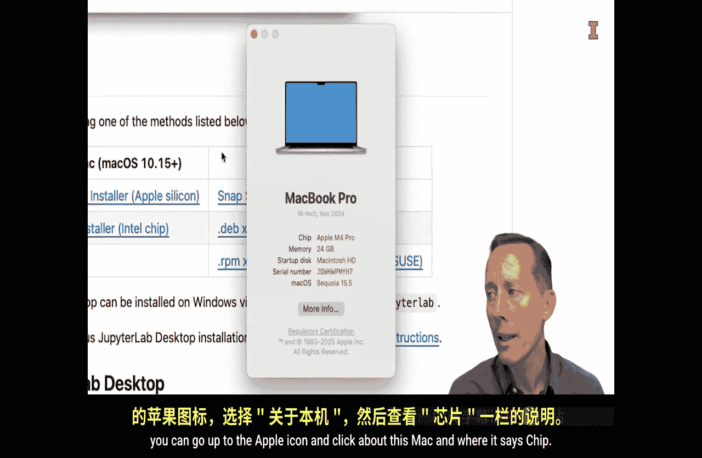
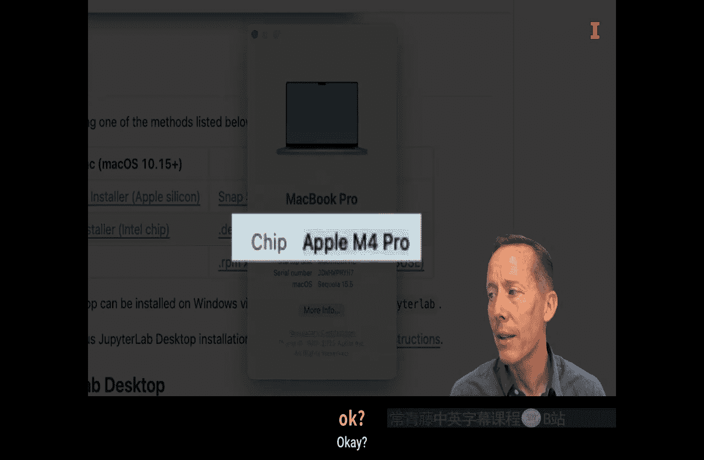
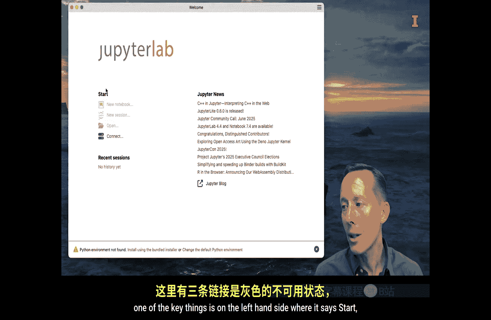
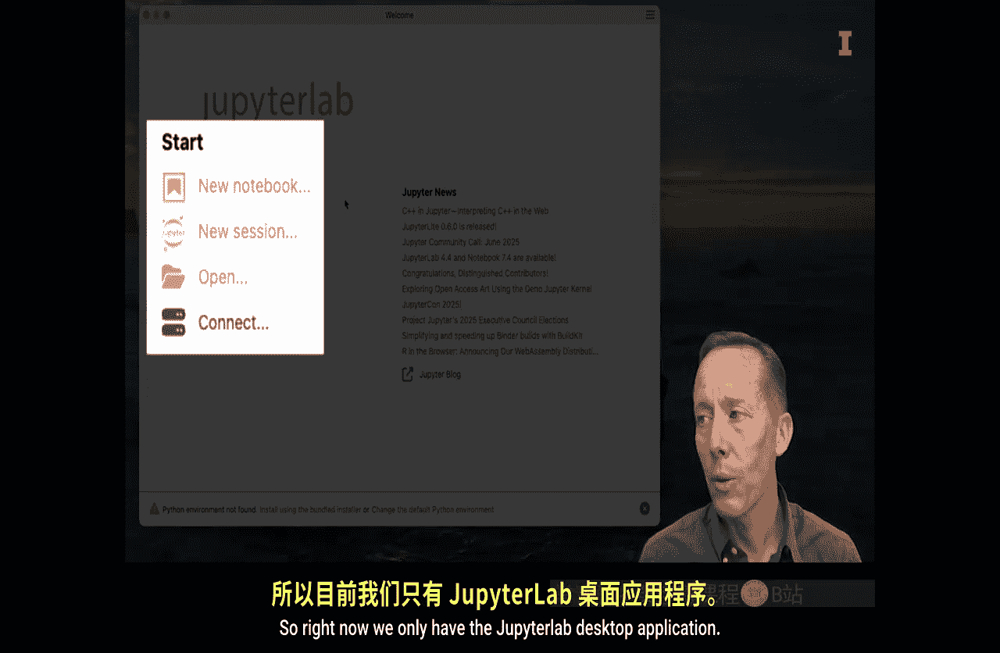
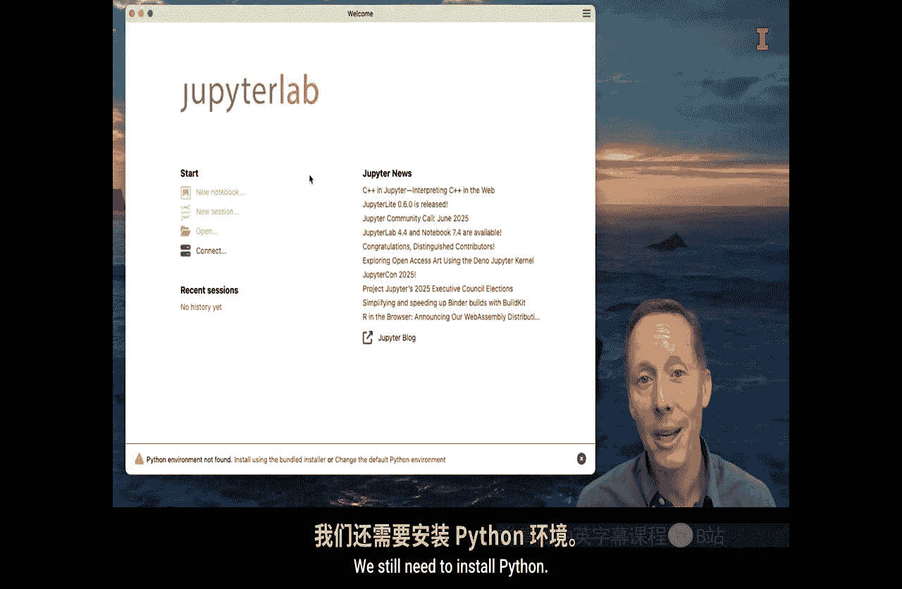
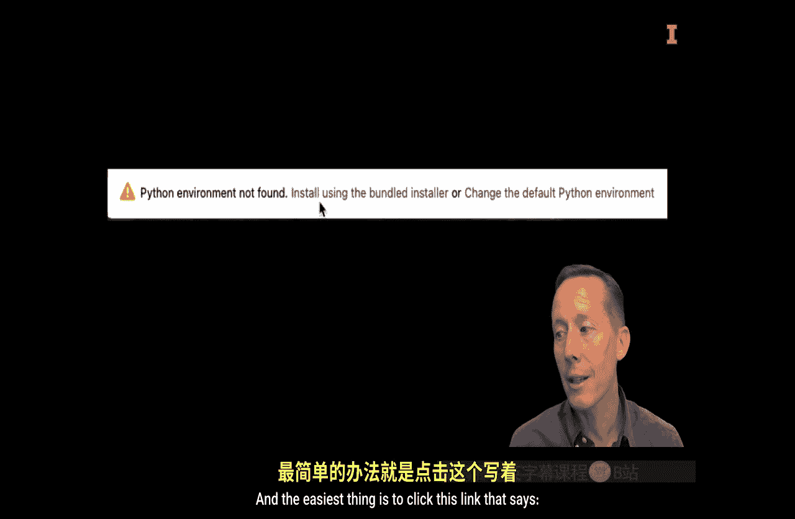

# 伊利诺伊大学【中英⚡商业分析｜Business Analytics Specialization】 p100 P100 03_安装演示 -BV1z86nB9EGz_p100-

In this video， we will walk through the steps for downloading Jupiter notebook and Python on both a Mac and a PC。

First， we will walk through how to download Jupyter Note and Python on a PC。

So we're going to need to have both Jupiter notebook and Python downloaded on our PC。

 We're going to download the Jupiter notebook desktop app and this is a really great application because it's a desktop application so we can open up Jupiter notebooks just by double clicking them and it will open up the desktop app and the notebook file so this is a lot like how Microsoft Word Microsoft Excel。

 those applications function where you can either click on the application and it opens up or you can click on the associated file type and it will open up in the application so we're going to download first the Jupipyter labb desktop app and then we have to get a Python environment in because I don't currently have a Python environment on this computer you may have one on your computer in which case you may not have to do that second step。

😊，So I'm going to navigate to this webpage Github。com/jupiterlabs/ Jupiterlab desktop。

And then i'm going to scroll down to the installation there's a few links here。

 we're working on a PC right now so i'm on a Windows machine if you have a Mac。

 these are the links that you can use we'll talk about that in a little so I'll just click on the Windows installer so it takes a little bit of time to download so don't worry if it's kind of taking some time I've already downloaded it just so that we can do this video a bit faster so once it's downloaded you'll click on this file to execute it。

😊，And it will ask you if you want to install this application， make changes to your device。

 so I'm going to say yes， agree。😊，And then this is a pretty quick installation once it just reaches the end there。

 then it's completely set up， so I'm going to run Jupiter Lab， this is automatically clicked。

 so I'm going to click it， finish and it will open up my Jupiter labb desktop application。😊。

So if I were to go to my desktop， I could see it right here。

 it's showed up now as an application on my desktop。

So one thing you'll notice or you may notice is a lot of these options are grayed out and the reason for that is I've only installed the Jupiter Lab application desktop application I haven't installed a Python environment yet。

 and so there's a number of ways we could do this but I'm just going to use their bundled installer so that's what it suggests at the bottom it says Python environment not found so I'm going to install using the bundled installer。

😊，And I'll overwrite that。So this can take a little bit of time。

 so we might jump ahead to what you'll see next in this installation。

So that only took a couple minutes to install so once you have it installed that your Jupiter lab desktop application won't have that little warning at the bottom anymore and these options here for creating a new notebook opening a file those shouldn't be grayed out anymore so this is how you can click on create a new notebook and then it will open up a new notebook you can say what Python you want to use so we're going to use Python 3 and then you have this new notebook that you can edit and work with so this is the environment that we are going to use as we're working with our Jupiter notebooks。

Now we will move on to installing this using a Mac。In this video。

 I'm excited to show you how you can get started using Python using one of the easiest approaches possible。

 and that is by downloading and installing the Jupiter Lab desktop application。

 One of the great benefits of this approach is that it's nearly identical。

 regardless of whether you're using a Windows or a Mac operating system。

So let's jump over to a web browser and talk about how to do this。

The first thing that you could do is search for Jupyter Lab desktop and make sure that you spell Jupiter Lab correctly。

 noticeice that it's all one word and Jupiter is spelled JU P Y T E R。

 and that name is paying homage to the fact that Jupiter works with various data analytic languages。

 including Julia Python and R。 Now， one of the links you should see is a link to a Github repository。

 and it'll say Jupiter Lab desktop application based on electron。 So if you click on that link。

 it'll take you to the Gitthub repository。 Now， Github is a website where developers share the code if they want to make it freely available。

 And Jupyter Lab desktop is an open source free application。

So once you get here， you can scroll down。And there's a little bit of information about what this application is and a lot of other information。

 But we're going to just stop at this installation section。Now， in here。

 there's a table and we've got three columns， one that pertains to the three main operating systems。

 So Windows， Mac and Linux， if you're a Linux user， you probably know what to do from here on out。

If you're a Windows user， then you'll want to click the link for the X 64 installer。

 and that will download the installer onto your computer。

If you're using a Mac like what I'm using in this video， then there are two links。

And one is for the newer version of Mac， Apple Sil。

 The other is for the older version that uses an intel chip。

If you're not sure what version of Mac you have， you can go up to the Apple icon and click about this Mac。

And where it says chip， if it says Apple M something， then you're using a newer version。

 These are the Apple silicon versions here。 Okay M 1 and 2 and 3 or M 4 or something else。

Okay， so since I'm using a newer Mac， I'm going to click on that link I already did that。

And it downloaded the installer。 Now， this installer was 300 megaby。

 So depending on your internet connection， you may have to wait a little while。

But once you've downloaded the installer， then go ahead and double click on it。And for Mac users。

 this is kind of the standard。 You just take this icon and drag it to your applications。

And it doesn't take very long at all for it to install on your computer。 Once you've done that。

 you can X out of here。 you can delete the installer if you want。

 and then you can open up the Jupyter lab desktop application just like any other application。

 So I'm going to go to my application section of my finder here。

 and I can see that I've got Jupyter lab。 So I'm going go ahead and double click on that。

 And if this is your first time opening it， then Mac requires you to indicate that you're okay opening this。

 And I am。 So I click the open button。Okay， now this brings us to the welcome page。

And in the welcome page here， one of the key things is on the left hand side where it says start。

And there are three links that are grayed out， and then a fourth length that you can connect。

We want to make these grayed out links available for us to use， so。Right now。

 we only have the Jupiter labb desktop application。 We still need to install Python。

 So at the very bottom， we've got this warning that says Python environment not found。

 And it gives us a couple of links down here。 And the easiest thing is to click this link that says install using the bundled installer。

 So I'll click that。

And then this may take a little bit of time， not too long， but it's installing Python。

 as well as some commonly used Python modules for data analysis。So。

We'll just wait for that to complete。Okay， it said the installation has succeeded。 And in okay。

 in just a few seconds， then these grayed out links now become clickable。

And you could just create a new notebook， but if you do that， it'll create it in your root directory。

 which is probably like your users slash your name folder。

And so what I'm going to do instead is click on this new session， that's what I usually do。

And this will open up the Jupiter lab environment。 You can decide whether or not you want to get notified about official Jupiter news。

 I'm going to click no。Okay， now if your environment doesn't look exactly like this。

 one thing you could do is go to settings。I'll actually go to view and then go to appearance。

And you can see what I have selected and unselected here。

 So I have unselected the simple interface and the presentation mode。

I think I also just clicked on the reset default layout。 it made it look like this。

 so this may be the easiest thing is just click on this reset default layout and looks like it brings us to here。

Okay， now this is all ready to go， you can navigate to different folders。On your computer here。And。

I've got this test folder once you get into here， you can meaning the folder that you want。

 you can create new files by clicking this plus button and we'll talk about how to use Jupyter Lab in another video。

 but anyway， this is how you can download and install Jupyter Lab and Python in a really easy to use way。

 so I highly recommend this approach if you're just getting started using a programming language。

Jupiter Note is a free widely used open source interactive development environment。

 therefore there are a lot of online resources out there to help you with any issues you encounter。

Once you have Jupipyter notebook and Python installed。

 we can get started on our data analysis using Python。

