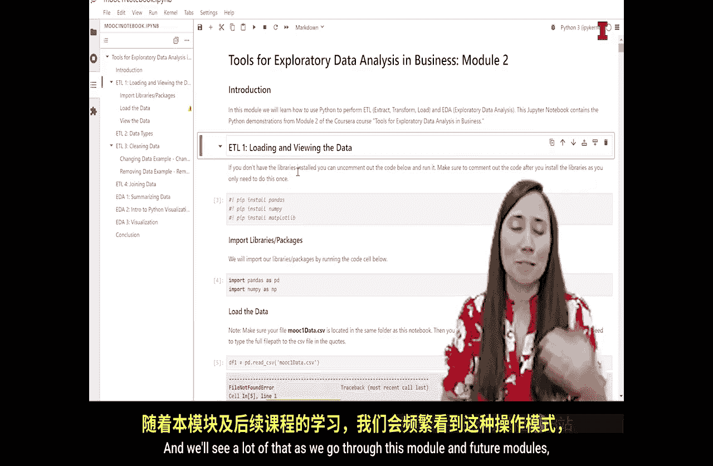
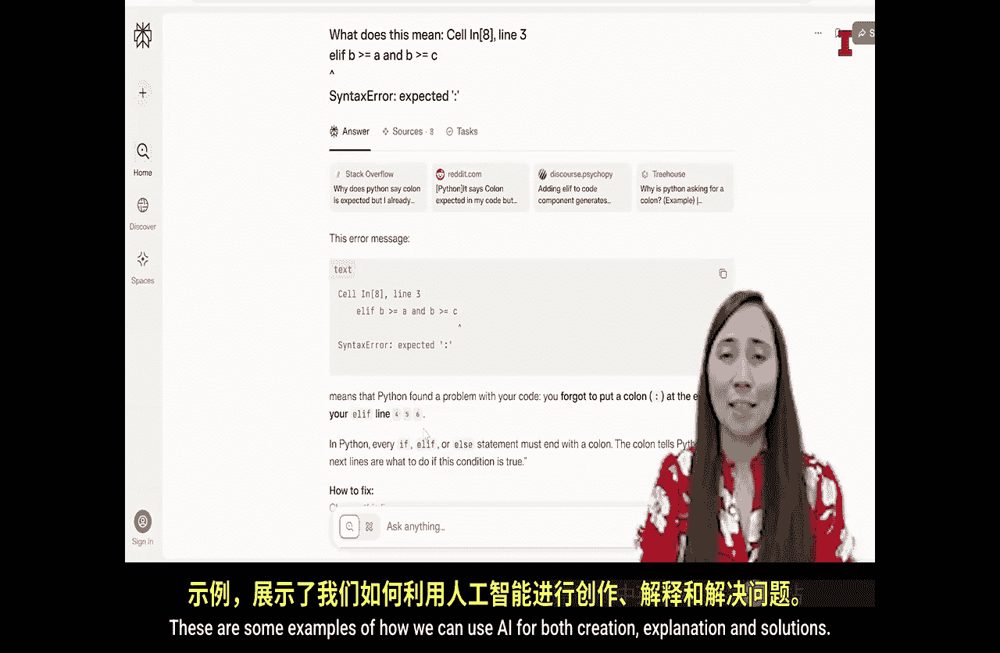

# 伊利诺伊大学【中英⚡商业分析｜Business Analytics Specialization】 p101 P101 04_Jupyter Lab入门和使用AI -BV1z86nB9EGz_p101-

Now that we download a Jupiter Lab， let's see how this tool works。Alright。

 so I'm showing my desktop here， I've got my Jupiter Lab desktop application。

 and then I've also put a notebook a Python notebook in on my desktop。

 so that is our MOO one notebook that's the notebook we'll be going through on this module。

If I want to open it up， I can double click on the notebook itself or I can open Jupiter Lab and navigate to where that file is。

 I'm just going to double click on the notebook itself and so that's going to open up the Jupiter labb app。

And I should see my notebook here so I've got all of my information。

 I've got the markdown text so that's the text here。

 it looks like a document and then I have code cells so that is designated by these gray boxes the gray boxes are where we have code and they have these little brackets next to them so sometimes they have numbers in them sometimes they don't so right now I want to change one thing with the view because I really like to have kind of this there's a left toolbar and when you first download Jupiter lab the desktop application it doesn't give that to you so I'm going to go to view parents。

😊，Show left activity bar。And so that we can see the file so where this notebook is。

 we can see the table of contents， which is really useful if we want to say jump to a different part of our notebook so I'm just here at the top of our notebook and I want to introduce you to the Jupiter notebook file format and how to use it。

😊，So the first thing I want to discuss is running code。

 so running a cell and the great thing about Jupiter notebooks is you can have text that will not that the computer will not assume is code to be run and it will only run the cells that are designated as code cells。

 so here we see this is a code cell。While this is a markdown cell now if we wanted to change it to a code cell。

 we could。And it would change from a markdown to a code cell so I can this is a markdown cell。

 so if I want to run that there's a few ways I could run it。

 I can select the cell that I want to run and press play。😊，And it'll just move to the next cell。

 or I can press control or shift enter。😊，And that will run the cell and move to the next cell so if I want to。

 if I run markdown cells， nothing happens， but if I get to a code cell and I run it。😊。

You'll notice that for a moment I got this little star in the brackets here to the left。

 that means the code cell is running， once it turns into a number。

 it means it's done running and it's completed the code。If there is an output。

 it will show directly below the code cell if there's no output， you won't see anything。

The next thing I want to discuss is how you can run the whole notebook。

So if you go up here to the run dropdown， you can run a selected cell you can。Run all cells。

 if you have。If the notebook isn't working and it's kind of stuck。

 you can restart the kernel and run all cells， so this will restart。

 you might have to select Python again as the what you want to use。

 but this will restart it as kind of like rebooting your notebook。So you can run all cells。

 what we'll do a lot in our notebooks is run all above selected cell。

 so if I've selected a certain cell。😊，Say this one now it's going to look for some data that I don't have loaded in the same folder。

 so we'll get an error， but if I say run all all above selected cell。

 it's going to run all of the cells before this cell。

So it ran these two cells and then I could run this cell。

 so it's going to say an air air look like this， sometimes they're shorter， sometimes they're longer。

 but you'll have a big sort of light sort of pink box。😊。

The last thing I want to talk about are our markdown cells。

 so you'll notice that mark these text boxes here。😊。

These are what we call our markdown cells and what's great about them is if we double click on them。

 we can edit them， but we can also use a lot of formatting in them so it looks really nice so you'll notice that this text was really big because it was my title and so there's a lot of symbols and things we can use in these markdown cells to designate that we want the formatting of our text so this number sign tells。

😊，Jupiter notebook that we want this to be a large title。

 And so that's one of the items in our table of contents。 And then we sort of have a hierarchy。

 So this is three number signs。 So it's a slightly smaller heading so that comes in later and using those heading。

Those number signs here， those allow us to have this table of contents to the left。

So if we don't have the number signs here， we can just type in text when we double click in the cell。

 it allows us to edit the cells， if we just select the cell， we can't edit it。

 but if we want it to look nice again， we have to run it and that makes it look with all the formatting that we may have put in there。

So this is the really nice thing about Jupiter notebooks is that we can have both text and our code in the same file so it's really easy to read through and understand what's happening and we can put some descriptive information in there。

 we can write about the output， explain what the code is doing。

 and then also have the code in there separately。😊。

You'll also end up having the output within the notebook files as well。

 and we'll see a lot of that as we go through this module and future modules because we're going to be working with Python a ton in this course。

Now that we understand what Jupyter notebook looks like and how to use it。

 I want to take a moment to talk about AI There are a lot of AI tools out there that are incredibly valuable for performing data analytics with Python nearly all of these tools have been trained on a variety of programming languages and Python is no exception。

AI can help create programs to explain programs and to debug programs when you run into issues as an example of creation。

 you can ask AI to write a program and do a specific task and it will give you the code to do this as an example of explanation you can take code that's already written or an output from code that's already run and ask AI to explain the code or the output to you。

😊，Finally， as an example of solutions， if you're getting an error in your program and it's not running correctly。

 you can ask AI to help solve this issue。As you can imagine， and as you've probably seen。

 these AI tools are incredibly powerful and helpful。

 but it's also important to understand the output that you decide to use from AI。

AI is not always perfect， therefore make sure to critically evaluate and even test the AI output。

Let's see these three methods of using AI to help with data analytics by opening up a new Jupiter notebook and your favorite AI tool。

I will use perplexity for this demonstration， but you can use whatever tool you would like。

Let's start with the creation of a program。Let's say I have three variables， A， B， and C。

 and I want to create a program that will determine which number is the highest out of those three variables。

 so I'm going to use perplexity to do this。So let's say I have A， B， and C， so I have A。

Which is equal to 13。 B is equal to 11， and C is equal to。32。Now these are my variables。

 but I want to create a program that will determine which variable is the highest。😊。

So I can ask perplexity。嗯。What is the Python code？4。Determining which of three variables is the。

Highest。Value。So this is an example of creation， it will give me one way I can do this。

 so I can copy this， it said it's given me three variables but I only want this last part。

 find the largest value。😊，And so， I。Can run this here。

The largest value is 32 and so that's correct if I change these around， say I change this to 52。

And I run it， now it says the largest value is 52。So this wrote all this code for me here。

 perplexity， the AI tool wrote this code for me here。😊。

Say I actually wanted it to tell me the variable name， so I could modify my code here。

 or I could ask perplexity to do something slightly different instead of the value。Print the very。

Print。The variable name。This is one way I could do it using a dictionary。

 the other is just using some logic， maybe this one's a bit simpler， so I'll use this one。😊。

But if I run this。Then it says B。So the largest value is B52。

 but if I change this to 93 and I run this， so now a is equal to 93。😊。

It will change what value is there。All right， so this is an example of creation。

 so using AI for creation。Okay， so now let's talk about using AI for explanation。

So anytime you have code that you are borrowing or even writing or you see online。

 you can use AI as almost a tutor， you can copy the code and ask AI to explain the code to you。

 so let's say I found this code online and I wanted to understand it because I didn't really understand what's happening。

I can go to my AI tool and use AI to help with the explanation。Please explain this code。

And I can paste the code in。And so here's the explanation of the code。So it goes line by line。

 So if a is greater than equal to B and a is greater than it equal to C。

 So this checks if a is greater than or equal to both B and C。 If this is true。

 it means a is the largest or tied for the largest value。 So it prints a。

 and then it goes to the next line and it explains what happens with the next little bit of code。

 And finally else， if neither of the above conditions is true， it runs this block of code。

 So it gives us an explanation。 So we could say。😊，嗯。Explain it to me in different ways。

Explain this to me。Like， I。Have never。Programmed before。Al right。

 so then it tries to break it down in a much simpler way。 This code looks at three numbers。

 which we call A B and C and tells you which one is the biggest by printing its name。

So imagine you have three boxes， each box has a number inside。

 you want to find out which box has the biggest number。And so then it breaks it down again。

 so you can ask it to make things more simple， you can ask it to make you can ask about specific lines to give more detail。

 and so this is how you can use generative AI or these AI tools for explanation。

 which is the second way that we talked about how you can use AI tools。😊。

The last way for using AI tools that we'll discuss is for solutions。

 so if you are running into a roadblock if you have a problem with your code。

 so say you get an error say I。😊，Run this， I'm going to delete something so that it doesn't run。

I can copy this error。What does this mean。So， this means that。Python found a problem with your code。

 You forgot to put a colon at the end of your L if so。You've got this here。

It's pointing to where you need the colon so you can use AI tools to help with solutions and solving problems if you have bigger errors。

 you may not post the entire thing but maybe just the end where it explains the error in Python and then it'll kind of help you debug your code。

 so these are the three ways that we can use these are some examples of how we can use AI for both creation。

 explanation and solutions。😊。

With programs like Jupiter and the many AI tools out there。

 we're able to create programs and perform data analysis efficiently and effectively。

 while these tools are powerful， we still need a human in the loop we as the data analyst must determine what to examine how to clean and prepare our data。

 what analyses should we do and what do these analyses mean we must also determine if the output from AI is achieving our goal correctly。

Thus， it's important to know these building blocks of how to create Python programs and how to perform and interpret data analyses。

 even if we use many of these tools available in the process。

