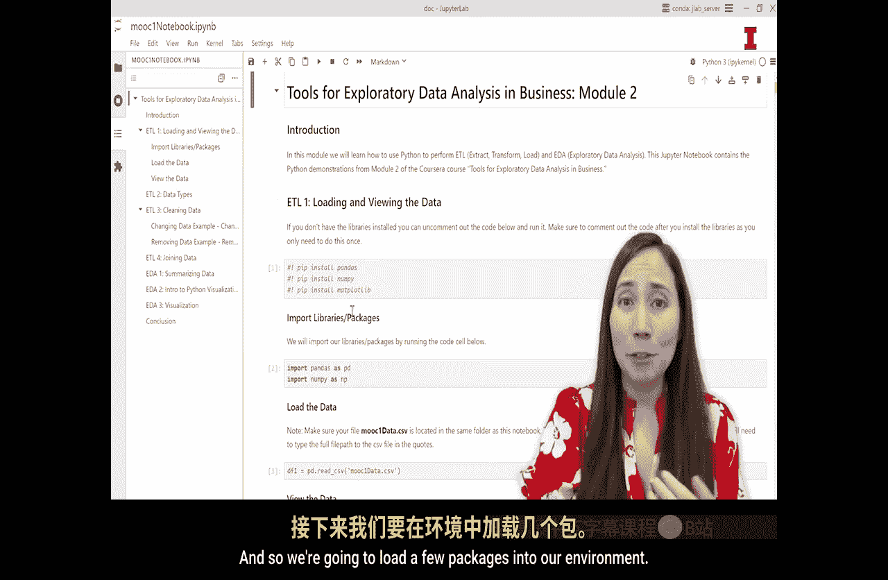
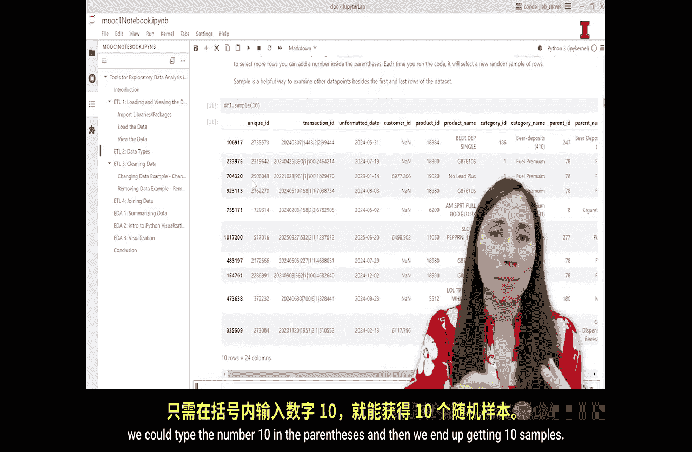

# 伊利诺伊大学【中英⚡商业分析｜Business Analytics Specialization】 p102 P102 01_加载和查看数据 -BV1z86nB9EGz_p102-

Many business data analysts claim that 80% of their job is extracting data from its native setting。

 loading it into the data analysis tool that will be used and transforming it or preparing it so that it can be analyzed These procedures are often called ETL extract transform and load data wrangling or just cleaning data among other things whether the 80% number is accurate or not there is no doubt that getting data ready to analyze takes significant time and resources and expertise This video will give you some handson practice with ETL Let's use our techca data set If you can follow along in the Jupiter notebook that is encouraged learning by doing it will help you become familiar with Python much faster than learning by viewing。

We have provided you with two files， the first is a data file calledOC1data。csv。

The second file is a Jupiter notebook file called MOone notebookbook。pyynb。

Okay， so now we want to open up our Jupiter notebook。 So how can we do this？ Well。

 you want to navigate to where you have saved your Jupiter notebook file and your data。

 So wherever in your folder system， you've saved that。 you can navigate to that。

 And then if you have downloaded the Jupiter desktop app， the Jupiter Lab desktop app。

 then it's really easy to open up these files， you can just double click on the notebook files and they will open up just the same way。

 a Word document or an Excel file would open up。So I'm going to double click on this。

 The other thing I want to mention is you want to make sure that your data files are also saved in the same folder as your notebook file。

 this will make opening up the data much easier or loading the data into our environment much easier if they're not saved in the same place you'll probably get an error in your notebook Al right。

 so I'll double click on that and this is going to open up Jupiter lab。😊，I'm going maximize this。

 I really like to use this table of contents tab， So it looks like three bullet points with lines。

 If I click on it， it opens up the table of contents。

 And so what that has done is it allows me to navigate through my notebook just by clicking So instead of scrolling down and trying to find where I am I can just click on a header to jump to that spot。

 And so that's gonna to be really useful for us because this is the Jupiter notebook for our entire module that means when we're like several videos in。

 we're gonna have to use the code towards the bottom of this notebook。

 And so instead of having to scroll we can say， okay。

 let's jump to ETL for joining data And so you look here on the on the left here and you click on joining data and it jumps right to that spot。

😊，Al right， so let's jump back to the beginning here and the first thing we want to do once we have our notebook open is we want to load our libraries and our packages so that we can have the functions that we need to use in our Jupiter in our environment and so we're going to load a few packages into our environment。

Some of you may be wondering what are functions while functions are chunks of code written by someone else that we can call on to use for our own purposes。

 so instead of having to write a whole bunch of complicated code from scratch ourselves we can just use someone else's function to sayMake a histogram or filter this table of data functions make our lives so much easier to use a function though we have to tell the computer which Python libraries we want to use we have to do this every time we have a new notebook or environment。

That's right every time。There is a reason for this there are hundreds of thousands of Python libraries and packages out there。

 so if every single time we opened up a notebook and the computer。

 we had to load every Python library into the environment， our programs would be really， really slow。

So to keep things efficient， we just tell the computer which specific Python libraries we plan to use of the hundreds and thousands of Python libraries that are available。

This way， our computer only needs to bring in the necessary libraries into our environment。Okay。

 so let's import our libraries first。

Alright， so we are the first library we are going to import is the pandas library。

 and then we're also going to import the NI library。

 so the pandas library is a library that's used in data analysis all the time。

 it's a really popular library for working with tables of data。

 so to do this we are going to go to this import libraries and packages portion of our notebook so I'll talk about this code here。

 it's commented out which means it's not going to run。

 I included this here in case you get an error but I'll talk about that。

 Okay so to import a library we need to write the word import。

 and then the library we want to import。😊，If you want to。

 you can also include an as and then an alias。 So a shortened name or a nickname。

 The alias is really nice because sometimes we have libraries with really long names。

 And so instead of writing the really long library name。

 we can just give it a nickname that we can refer to every time we want to use a function from that library。

😊，Pands is pretty short， but we're going to use the alias as PDd and nuy is also pretty short。

 so we're going to use the alias Np， so it shortens it just a tiny bit。

 but I do this because it it's standard online when you look at people's code online and you're trying to troubleshoot your code。

 If people are using pandas， they often use the alias of PD。

 So this way you're familiar with the concept of aliases and you'll know what to look for or what you're looking at。

😊，Alright， so import pandas is P D。 import Ny as NP。 When I run this。

 this is going to bring those packages into our environment so we can use all of the functions in the pandas library。

 all of the functions in the Ny library。 So I run this。 There's a few ways I can run this。

 I can either press this play sign。 You have to make sure you have the cell selected。

 I can press the play sign， or I can press shift enter。

 and that will run the cell and then bring the selection down to the next cell。

 So I'll press shift enter。😊，Okay， so we have our libraries loaded into our environment。

s that means we can tell the computer that we if we want to use any of the functions from pandas or Numpy。

Next we want to load the data， so to load the data。

 were going to use a pandas function called read CSB。

 so you'll notice here we have that PD that's that alias for the pandas library。

I'll mention this again， I'll reiterate it again， you want to make sure thatO1 data CSV file is in the same folder as the notebook you have open alright。

 so to load the data， the CSV file that we have， we are going to create a variable called DF1 so this is a variable that's going to contain our data。

😊，Then we set that variable equal to this function that's a pandas function called read CSV。

 so to call the function we say from the pandas library PD dot read CSV。

 that's the function we're using and then we say what's the file that we want to read In this case。

 our data file is called MOO1data。 CSsV。So when we run this。

 we should see a little star here while the code is running and then the number two will show up or whatever sequence of code you run。

 if you run other cells before this， you'll see a different number。All right。

 so this is maybe a bigger file， it's not huge， but it's it's a number of it's a million over a million rows。

 so we're going to see a little star show up and depending on how fast or slow your computer is this may take a little bit of time。

 but just be patient。Alright so I'm going to run this。 we see the star there。

 This means that the code is running and it is now loading the data。 Once I see a number up here。

 I now have a variable called DF1 and what DF1 is is a data frame so a table of data。

 this is a pandas data type， so a table of data that is just our MOOC1 data table。

The first thing we might want to know about our data is how big it is。

 So how many rows do we have in our data or how many columns do we have in our data。

 One way we can do this is by using the shape attribute。 So if we go down to the next code cell。

 we can use what's called the shape attribute or the word shape。

So what this does is it gives us an output where we have the number of rows and the number of columns just listed as two numbers when we run it。

 Now， there's a lot of ways we can do this， but I like the shape attribute because it's small and concise。

 And so it doesn't really clutter your notebook if really the only thing you're looking for is the number of rows in columns。

 All right， so to use the shape attribute， we say D F1 dot shape。 So if I run this。😊。

I see two numbers show up。 So the first number is 150000。 The second number is 24。

 So what these two numbers represent are our rows first， and then our columns second。

 So this means we have 1000 or 150000 rows and 24 columns or variables in our data set。

The next thing we might want to know about our data set is what are these 24 variables that we have。

 So one way we can do this is by using the info method So the next code that we have uses this info method。

 So the info method is going to list out all the variables in our data frame and give us a little bit of information about these different variables。

 Allright， so let's run it so that we can talk through what we're seeing to run the info method we first have to say what data frame do we want to get the information about because sometimes we're working with a lot of different data frames so we might have Df1 Df4 Df20 So we want to say which data frame are we looking at。

 So in this case， we only have Df1。 So Df1 dot info。

 And so this says we want the information for this data frame。😊。

So I have to have this cell selected and I can press either play up here or a shift enter。

And we can see the output for this directly below the code cell。 Okay。

 so we can see that we have our 24 columns。 Python starts with zeros when it's counting。

 So we have0 through 23。 That's the number of columns。 That's our 24 columns。

 We have the name for the columns。 So this is the the header from our CSV file。

 So we've got unique I transaction I， unformatted date。

 customer I all the way through units and gross profit margin。 So that's the column name。😊。

Then we have this other column called non null count。

 So this tells us for each of our columns or each of our variables。

 how many of those items in that column are non null。 So they're not missing values。

 And so for most of our variables， we can see that they have the right number or there are no missing values。

 because we saw that the number of rows in our data frame was 150000。

 And so we see that a lot of these variables have150000 non null values。

 So that means that there are no missing values。 But we do actually see that for some of our of our columns。

 we do have missing values。 So take customer I here。  customer Id has 267000 non null values。

 That means the rest of the rows are missing or null values。 Now， this isn't surprising。😊。

Actually because customer ID is only there if that customer is a loyalty customer and so not every person or every transaction or item purchased is going to be a loyalty customer。

 In fact， a lot of the transactions are not loyalty customers and we can see that represented here。

The final column here is the data type column。Another way that we could examine the data is by looking at some descriptive statistics for the data。

 So there is a method called describe where it will look at all of the all of the columns and try and provide some descriptive statistics about those columns。

 So to call this method we need to say， well， what data frame are we looking at。 So in this case Df1。

 then dot describe and we've got the parentheses here。 So when we run this。

 we can see all it tries to get descriptive statistics about all of the variables in our data frame。

 but it really only can can calculate these descriptive statistics on our numeric variables。

 So we have unique I customer I， all of those numeric variables。

 it calculates some descriptive statistics。 So specifically it calculates8 statistics it gives us account the average。

 the standard deviation， the lowest value， the minimum， the highest value。😊。

Maximum and then the 25th， 50th and 75th percentile。

 so it gives you some information about how your data is distributed。😊。

So we can see this for some of our numbers or for some of our variables。

 this can be really useful information like revenue， what's the average revenue。

 what's that max revenue or min revenue， same with gross profit margin。But then for other variables。

 it may not be as helpful。 So say unique I D。 That's just the I D that's been attributed。

 attributed to a given row。 So that doesn't actually have a numeric value， so。Calculating the mean。

 the minimum， the standard deviation really isn't that useful or helpful。

 but if you have a numeric variable that the values matter， then mis described can be really helpful。

The fourth way that we can examine our data is by actually viewing the data frame itself。

 so there's a few ways we can do this， but we're going to use what's called the head method So the head method allows us to see the very top of our data frame so we see the first five rows is the default so to call the head method we say what data frame do we want to look at then we write dot head with op close parentheses When we run this we're going to see in our Jupyter notebook the output which is the first five rows of our data frame。

😊，So we ran it， shift enter， and we see the first five rows， so row 0，1，2，3，4。

 and we've got the columns。I use this method all the time because it allows me to quickly view what's happening to my data。

 so as I'm cleaning it or changing things about it， say deleting a column or doing a calculation。

 I can quickly see has that column been added to my data frame is the calculation being done correctly so it's a really useful method to use when you're working with data。

😊，Now it shows you by default the first five rows， but if you wanted to display a different number。

 say you only wanted three rows inside the parentheses here， you could just add a three。

 and then it would show you three rows。The last way that we might want to view our data is by looking at a sample。

 So this is pretty similar to the head method in that it allows you to actually view the data frame itself。

 but what's different here is sample grabs a random row from your data frame。

 it's called in a similar way。 So we say Df1 dot sample， and if we don't have a number in here。

 So say we have no number inside the parentheses， then it just gives us one sample。

 it grabs one row from the data frame。 but if we wanted to say grab a sample of 10 rows。

 we could type the number 10 in the parentheses and then we end up getting 10 samples。

These are just a few common ways to view our data using Python and Jupiter Note we will use these functions a lot in the ETL phase of our data analysis because we are cleaning。

 preparing and manipulating our data， so we often want to view it to make sure our code is working correctly while we want to view our data a lot for ETL being familiar with these concepts will help you as you conduct data analyses。

