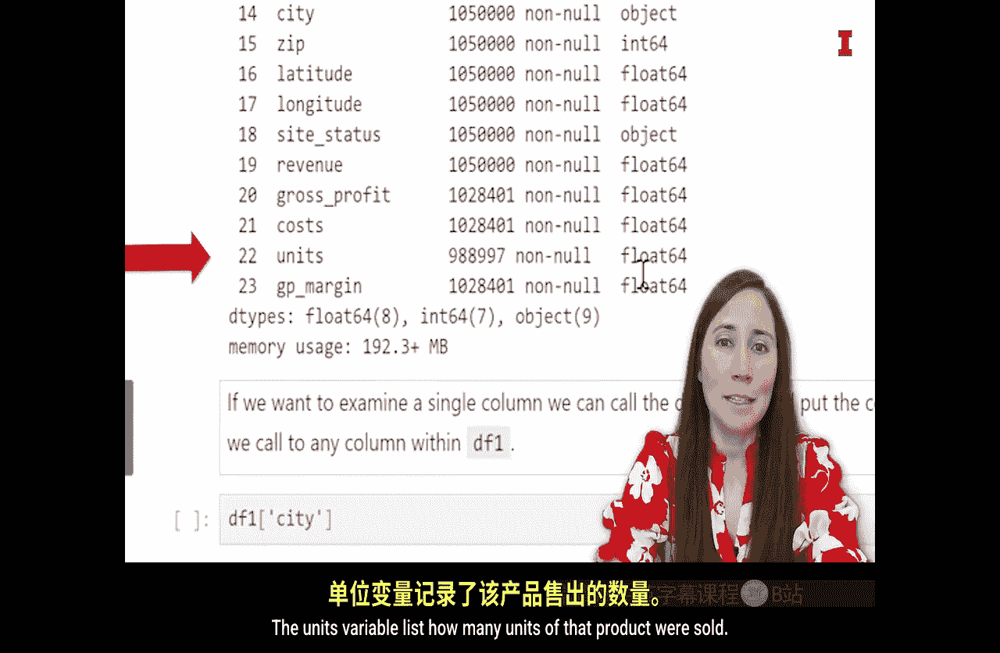

# 伊利诺伊大学【中英⚡商业分析｜Business Analytics Specialization】 p103 P103 02_可选视频数据类型 -BV1z86nB9EGz_p103-

Let's take a moment to talk about data types when data is stored in the Python environment。

 the value of the data is stored along with the data type。

 the data type lets Python know how to treat the data when it's used in a program。

 there are many data types out there， there are data types for specific values like a number versus text。

 and there are data types for larger collections of data like a data table or a list of data。

In this video we will focus on the common data types for individual data values here are the common data types we will cover in this video integer。

 float， string， datetime and Boolean first up is integers。Integers are a numeric data type。

 but they can't be just any number， they must be a whole number or numbers with no fractional component。

 integers can be negative numbers， positive numbers， or even the number zero。

These top numbers are integers， while the bottom numbers with decimals are not integers。

Another numeric data type is the floatat Float is short for floating decimal。

 this data type can be any number from negative infinity to positive infinity。

 and as the name suggests it allows for decimal places。

All of these numbers are floats you'll notice the last two， 0。0 and 42。

0 have a decimal place of0 Who numbers can be stored as integers or floats when they're stored as floats。

 you will see the 0。0 following the whole number。The third data type we will discuss is the string Strs are text data。

 text data includes letters， numbers， punctuation， spaces， characters。

 basically anything you can type on a keyboard can probably be a string。

All of this text to the left can be string data type。Often， when we think of text data。

 we think of words， but numbers and dates can also be stored as strings。

 sometimes this can be an issue and we want to convert the data to the correct data type。

 but sometimes storing a number as a string can actually be helpful。

Another common data type that we will use is the date time data type， as the name suggests。

 the datetime data type is a date and a time and represents the exact moment in time down to the microsecond。

While you could store dates as strings， storing them as date times。

 lets Python Note to order the data chronologically。With the daytime data type。

 Python can also determine how much time has passed between one daytime and another daytime。

This is something that would be difficult to do when the date time is stored as a string。

It is also an incredibly useful data type because it stores a lot of information about the date。

The datetime data type imp pandas looks like this while this may not look that special with the datetime object。

 we can use special functions to extract important things like the month， the day， the year。

 the hour， even the day of the week， This allows us to do some really interesting analyses。😊。

The last data type we will cover before looking at our real world data is the Boolean。

 a Boolean is a data type that only takes on two values， true and false。

This data type is used for logic in our programs， so when we use things like if then logic。

Now that we've talked about the common data types， let's look at these data types and how they're represented in the techA data for this module。

You can open up your Jupiter notebook and then we want to run all of the cells before our ETL2 section so if we go to the table of content so we have this sidebar here。

 if you don't have that you can go to view appearance and show Left activity bar。

But I want to click this table of contents here And when that opens up that shows me all the different headers that I have in my notebook。

 so we're going to be on ETL2 data types， so I'll go ahead and click on that。 All right。

 so I want to run all of the cells up through that come before this ETL2 data types So that's all of the things we did in the last video where we were loading and viewing the data the reason that we have to do this is because anytime we shut down Jupiter or anytime we close our computer。

 we actually lose our environment， our environment holds all of the libraries that we were going to be using for this notebook。

 any data that we've imported any variables that we've created and so。😊。

All of that information goes away and is only temporary in our environment while we have that environment running and open。

 but if we close the computer， we turn off Jupiter。

 then that environment no longer exists so we have to reload all of our libraries into our environment and reload the data in so that we can start working with it again。

So to do that， we want to run all of the cells before this ETL2 data types。

 so I like to do it this way where you select run and then you go down to run all above selected cell。

 so you want to make sure that ETL2 data type cell is selected。😊，And when I run this。

 we're going to see that it is running the cells。Alright。

 so now that we have run all of the data are all of our cells before this we have our libraries loaded and we have our data loaded。

 We are now going to look at all of the different variables that we have in our data frame if you remember from the last video we actually looked at a bunch of different ways to view the data so we could view the whole data frame we could view aspects of the data frame so we're going to use one of those methods now if you recall the info method so the info method gives you a listing of all of the different variables in your data frame and then it tells you a little bit of information about them so it tells you whether there are any the non null rows in for that given variable as well as the data type。

😊，So we're going to walk through and just talk about all of the different variables in our data frame using this info or info code。

😊，So I will click or select on this cell and if I want to run it。

 I could either press this play button or shift En。And then I get the output directly in my notebook。

 so I have this output of all of the columns in my data frame。

 so there are 24 columns from column0 which is unique ID all the way through column 23 which is gross profit margin and I've got a bit of information about that so let's talk through what each of these variables are。

😊，This first column in our notebook is called unique ID， and we see it's an integer data type。

 so the D type is the data type and we have INT 64。

 so unique ID is a unique identifier for each row in our data frame。

 so there are no duplicates Every single row has its own unique ID。

 This is how we can identify a given row or observation in our data set。

The second column in our data frame is transaction ID so transaction ID has no missing values。

 so there are 150，000 non null items and that's how many rows there are in our data frame。

 it is an object data type so in this case this means that it is saved in our environment as a string data type。

😊，So what is transaction ID transaction ID is an identifier for what transaction that item was a part of so there are duplicates in this transaction ID column and that's because sometimes a transaction has multiple items and so the transaction ID for a purchase of three items。

 the transaction ID will be the same for all three of those items so that's why we might see it duplicated that's distinct from unique ID those three items would have unique ID but their transaction ID would be the same to represent that they were part of a single transaction Our next column is called unformatted date。

So unformated date is also not missing any values， it is an object。

 so it's saved as a string currently and so what unformatted date is the date that that item was purchased so the date that the transaction took place it is not formatted as a date data type and so we'll get to that eventually。

 but were so we're going to need to change that but right now we just know that this is the date that this purchase took place。

😊，The next column， so the fourth column is customer ID。

And so for customer ID we actually see that there are some missing values for customer ID we only have numbers for 26 or 267104 individuals or transactions this is saved as a float data type。

 so it is it has a decimal or fractional component to the data type customer ID is missing in some cases because this customer ID is only known for loyalty customers so if。

😊，For that transaction， the customer used their loyalty card or typed in their loyalty number then that customer ID number would be tied to that transaction and all the items that they purchased however。

 there are a lot of people that go into these convenience stores and gas stations that do not buy or do not have a loyalty card or a loyalty number and so their purchases don't have a customer ID tied to them or perhaps a loyalty customer doesn't enter their number or use their loyalty card then we wouldn't have a customer number attached to that transaction or that item。

The next column is product ID。Product ID doesn't have any missing value so every row in our data frame has a product ID number and it is an integer so product ID is an ID number for the actual product that the customer purchased so each row is an individual item purchased in a transaction so that item has an ID for that product there's also a product name which is what that item is actually called so the ID is a number whereas the product name is what it's called so let's say I buy jelly beans that would be the product name but there would be a product ID or number tied to the jellybean product type or product the individual product。

😊，Al right， so that covers product ID and product name。

 we've got an integer numeric object for the string if it's words like jelly beans。

 so the next two columns that we have are category ID and category name。😊。

For every single product that techka sells there is those are grouped into categories。

 so these categories are similar types of products。

 so if I take my jellybean example again that jelly bean is the actual product。😊。

The individual product， whereas the category might be fruity candies。

 so we have an ID number for that fruity candy category and then we also have a name for that category。

😊，Then our next to。Columns are parent ID and parent name。

 so this is an even broader category grouping for our individual products。

 so I said I have jelly beans。 they might be fruity candies a broader category for jelly beans might be all candies so this would include chocolates caramels other candies that maybe weren't in the more specific category。

 so the we call this the parent category， so that's why we see parent ID and parent name so each each。

😊，Parent category also has an ID number associated with it as well as a name which is text or this is shown listed the data type as an object that's a string data type the next variable product count represents the number of different categories or items within each parent category。

😊，Then we have site ID， so site ID represents a specific ID number for the convenience store where that item was purchased so this is a numeric data type as well site name is the name of that location so' typically named based on where where that。

The convenience store or gas station is。We also have the address city and zip code。

 so these are location variables address and city are both string data types。

 we see that as an object here。😊，Zip is an integer， it's a number。

 so it ends up getting saved as an integer data type。😊，Importantly。

 these are not the true addresses for our convenience stores since we wanted to mask the data to protect the identity of this company。

😊，Then we have the latitude and longitude， so these are float data types。

 they're numeric data types that can have a fractional or decimal component to them。

 latitude and longitude are also location variables for figuring out where a store is located。😊。

Our 19th variable is site status， so site status is。Whether or not the store is active or closed。

 so we know the status of that store。Our next variable is revenue。 Reven is a very useful number。

 It shows us how much revenue was earned for the each product。 So there are no missing values here。😊。

It is a float data type， so it has a decimal component you can earn dollars as well as cents。

 so we see this decimal or float data type。😊，Gross profit is also a very useful number for us gross profit is the financial concept of the profit that's remaining for the company after the direct costs are subtracted so gross profit essentially is just the revenue minus the costs of selling that product so I'll jump down to grosspro margin since that is related to gross profit that is our last variable gross profit margin is the percentage so it's a financial concept it's calculated as the revenue minus the cost so that's our gross profit divided by the revenue so gross profit represents the percentage of profit for each dollar of revenue so it's a very important metric for measuring profit of a business as well as individual product categories so we're going to use those measures。

😊，a lot in our class。Cost is the cost of the product that was sold。

 so that is the cost to the company we can see that we have some missing values here so there just might be some information that we maybe don't have cost information for and we see that also impacts gross profit and gross profit margin because we need cost to make those calculations。

Then the last variable we will discuss is this units variable。

So the units variable lists how many units of that product were sold。

Now that we discuss the different data types and the variables in our data set。

 we can move on to cleaning the data in the next video。

