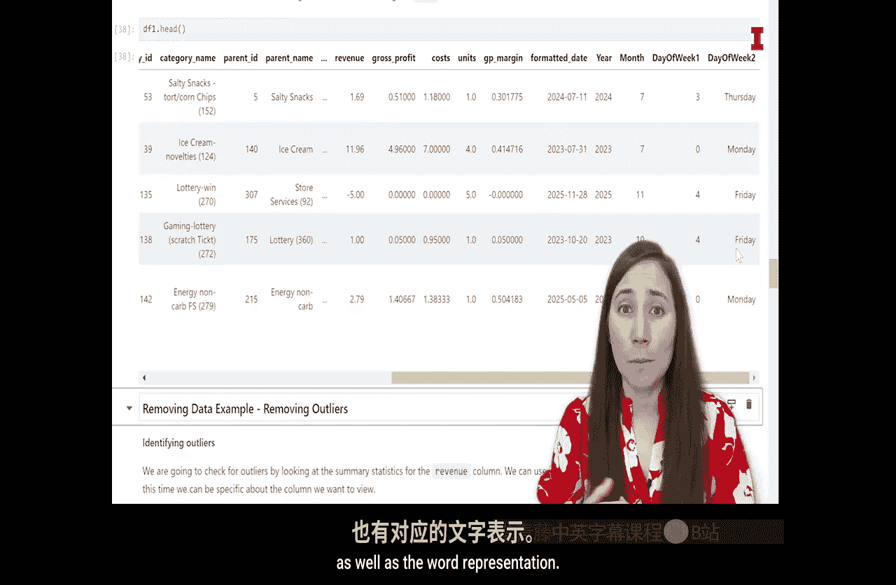
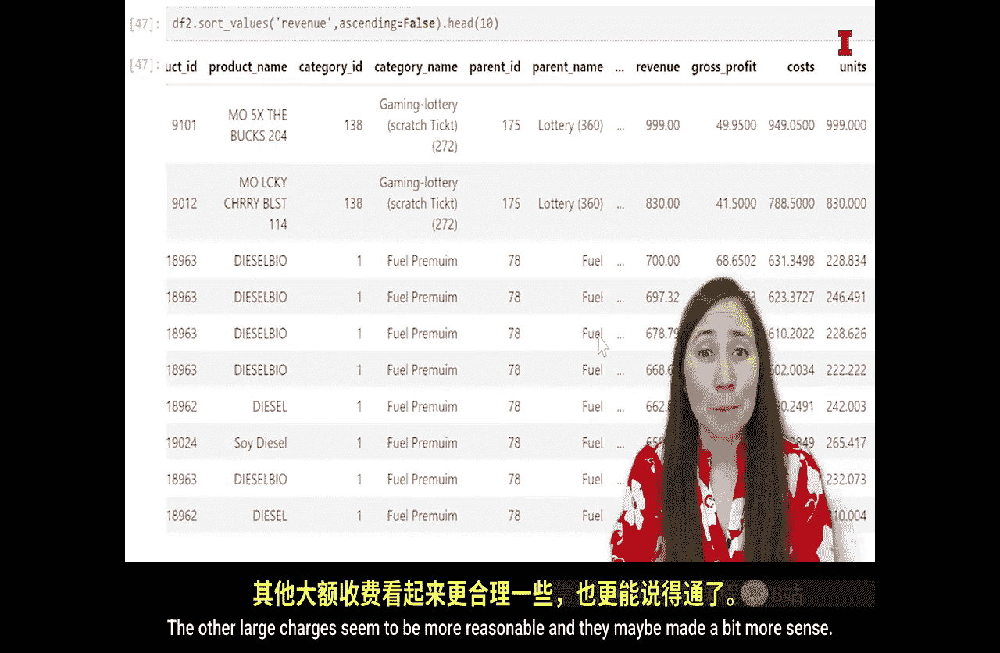
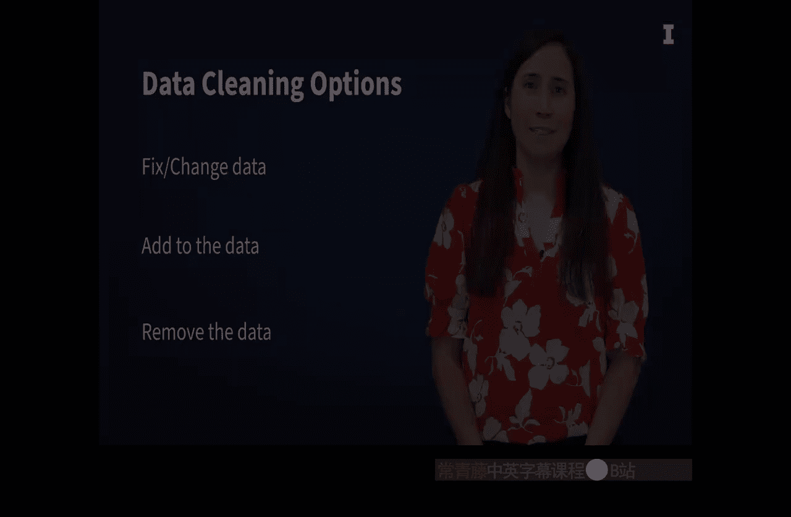

# 伊利诺伊大学【中英⚡商业分析｜Business Analytics Specialization】 p104 P104 03_数据清洗 -BV1z86nB9EGz_p104-

In the previous video， we examined each column of our data set calledOO1 data。 In this video。

 we will clean or tidy that data set。 I'm starting this video at the Orange County Great Park Farm and Food Lab。

 because I like the analogy of growing a garden when thinking about working with data and data analytics to make a beautiful garden。

 It takes a lot of preparation and work。 We must water the plants， fertilize them， prune them， and。

 of course， weed the garden。 Even before these steps， we need our inputs to be of high quality。

 We need good soil。 We need high quality seeds or good location for planting。

 The high quality inputs and the work that we put into taking care of our plants will lead to a beautiful output or a garden just like this one。

😊，This preparation is akin to data cleaning， the inputs like the soil， the seed， the fertilizer。

 that's our raw data， the weeding or picking up debris we do is akin to data cleaning。

 There are multiple ways that a data set can be messy， including， but not limited to the following。😊。

You might have column headers that don't have names。

 There might be multiple variables storeded in a single column。

 You might have outliers or extreme values that are either very large or very small。

 You might have mistakes in typos。 You could have columns that have the wrong format or the wrong data type。

 There might be missing values or missing columns in general。

 You might need to join together data from an other source to your a current data set。

We'll return to this garden in a later video， but for now。

 let's get back to the studio to start cleaning our data。When we have dirty data。

 we can typically take one of three routes to cleaning the data。

 the first route is fixing or changing the data， so for example， we could correct mistakes。

 change the data type， or make all the data the same format。For the second route。

 we can remove the data， so if we have some observations or rows that don't make sense or are missing most of the data。

 we can typically remove these rows， or if a column is not needed。

 we can drop that column from the data。Finally， the last route is adding to the data， for example。

 we could create a new column that we need for an analysis based on the existing columns。

 or we could merge data from another data set so that we have all the data we need in one data。

Relatively speaking our tech data is quite tidy， for example。

 each row is already one observation and each column is already one variable， however。

 there are a few things that we can tidy up。In this video。

 we are going to cover one of each of these cleaning routes， Let's go to our Jupiter notebook。

Navigate to the section ETL3。Cleaning data， so you can do this by opening up your table of contents and clicking on ETL3 cleaning data。

 this will jump you all the way down to this portion of the Jupiter notebook。

So the next thing we want to do is make sure that we've run all of the cells before this section to make sure that we have everything loaded into our environment that we want to use。

 so to do that we'll select this run dropdown and we'll go to run all above selected cell that's going to run all of the code cells prior to that ETL3 cleaning data cell。

😊，The first thing。We're going to start with the first route of fixing a column。

 So we're going to fix our date column。 As we saw in our last video。

 our date column is a string data type。 So we can also see this by returning a specific value from one cell in the entire data frame。

 but we want to look at one cell in the unformatted date column。 So using。😊，Dot at。

 we can actually reference which column we want to return so this this code cell here。

It says we want to look at data frame one。And when we say dot at。

 this says return a specific point in the data frame， data point。

 and we are kind of using coordinates， so we're going to say row3。

And then we want the column unformatted date。So when we run this， it will pull the exact cell。😊。

At row three in the unformatted date column。So we can see it's 2023， 1020。

 and so we can tell this is a string because it's in these quotes we see quotes on either side and that's。

😊，That's how when you pull or return that a string value。

 you'll often see those quotes on either side。Okay。

 so we want to change this to be a datetime object instead of a string。

So as with anything in Python there are many ways to accomplish the same task。

 so there are many ways to create a datetime object this is true because Python is open source so anyone can come up with a library a package a function to make it easier to do something like converting dates to date times。

😊，So we are going to use the date to underscore date time function from pandas。

 this converts string dates to date time objects， so this next code here allows us is going to convert our unformatted date column to be formatted dates。

😊，So we are going to actually create a new column called formatted date。 So in our Df1。

 that's our data frame where we have saved our data。

 we are going to create a new column with our called formatted dates。

 and so to do that we have open square brackets the name of our new column and a closed square bracket。

 we're going set that column to be this and so what is this this is actually taking our formatted unformted date column and then converting those string dates into datetime objects。

 So from the pandas data frame。 So the PDd here is our alias for pandas we're going to use the two date time function So we're saying from pandas use two date time and then what do we want to convert in our case we're going to convert an entire column So the column is from data frame1 and it's the unformted date column。

😊，So what this code all does is it takes the unformatted dates。

 so the dates that are saved as string data types， and it converts them into datetime objects and it saves those datetime objects in the formatted date column。

😊，All right， so if I run this。I don't have an output in my notebook because it is just changing things in my environment。

 so it's just adding a column to that DF1 data frame and so I haven't asked the computer to show that to me so we don't have the output in our notebook。

But if we wanted to take a look at these two columns next to each other。

 we could pull those columns from the data frame and show them side by side。

 so that's what we'll go ahead and do next so from DF1 we're going to take a list of two columns and we're going to show them or display them in our notebook so when I run this it's going to show me those two columns side by side。

😊，so I've run it and I've got the unformatted date here and the formatted date here。

 so if you look at them， you probably are thinking those don't look different at all。

 they look really similar and that is true， they are dates， there are both date representations。

 but in the unformatted date representation， it's saved as a string data type。

 whereas in the formatted date representation， it's saved as a date time object。😊。

If we want to see the specific value of a formatted date in the formatted date column。

 just like we saw a specific value of an unformatted date in the unformatted date column。

 we could again use the dot at method， so we want to reference the data frame that we're going to look at so DF1。

Then we say dot at。And then we say the coordinates within our data frame。

 so where do we want to look， what do we want to look at in DF1 so we want to look at row 3 again。

 but we're going to look at the formatted date。 so if we recall our unformatted date。

 if I scroll up just a little bit， our unformatted date was in those quotes because it's a string。

But our formatted date should not be a string anymore， so we're saying rowow3。

 the formatted date column when weve run this， these are saved as date time objects so it will look a little bit different instead it's saved as a timetamp of 2023。

 October 20th and the time there is no specific time listed for this transaction it's really just the date。

😊，Alright， so this looks a little bit different， the datetime object can give us a bit more information or we can more easily extract information from it compared to a string date。

😊，All right， so we can also see that these are two different data types if we look at that info method again。

 remember the info method gives us a listing of all of the variables in our data frame as well as the data types and so we should see for our unformted dates we see an object data type which is a string and then for our formatted data types it should be a date time。

😊，So we see our unformatted date up here is an object so it's a string。

 and then the formatted date that's the most recent column that we added。

 this data type is a date time， so we know that we have converted that date to be a date time object and we've saved it as a new column。

😊，The wonderful thing about datetime objects is that we're able to extract a lot of information from the datetime object that would be more challenging to do if the date was saved as a string。

 So， for example， there are a lot of methods， date methods that can be applied to a datetime object that will get that information so we could extract the year we could extract the month。

 we can extract the day of the week。 So Monday， Tuesday， Wednesday， Thursday， Friday。

 we could extract the minute， the millisecond， all of that information can be very easily extracted from a datetime object and while you could do it with a string date。

 it is a little bit more challenging than just saying。😊。

Get the day of the week for me or get the month for me from this data point。All right。

 so we are going to create three more columns， we will create a year column。

 a month column and a day of the week column。😊，So are to do that， we are going to。

We're going to use some date time object methods， so using dotDT。

 this will extract this information from our date time。😊。

Also for day of the week there's a couple ways we could do this you could get the actual name of the day of the week。

 so Monday， Tuesday， Wednesday， Thursday， Friday， or you could get the number associated with that so01 two。

34 five6 so we're going to extract both we'll end up using one a bit more than the other but I wanted to show you you could extract both of these。

😊，All right， so to create new columns， we say what data frame do we want to add this column to。

 in all cases we're adding to our DF1 that's the only data frame we're working with。

And then to create a new column， we have our square brackets and then the name of our new column。

 so we have the first row we're saying in DF1， we want to create this new column called year。😊。

The second row we're saying in DF1， we want to create this new column called Month。

And the third and fourth row we're saying in DF1， we want to create a new column called day of week1 and another column called day of week two。

 so when we run this code， we should have four new columns for a year month and then two ways to represent day of the week。

😊，For each row， we're setting it equal to。Our formatted date， because that's the date time。

 but then we're going to extract something from that formatted date。😊。

So we're saying go to DF1 formatted date， and for our first row。

 we're taking the date these functions that extract information from date time， so doDt。

y that extracts the year from our datetime object。So it will save the year to that year column。

The next row will extract the month， sodt。month takes a datetime object and extracts the month from that datetime object。

dt。day of week will extract the day of the week， so day of week will give us a number for each day of the week。

😊，And then day name will give us the name， so Monday， Tuesday， Wednesday， Thursday， Friday， Saturday。

 Sunday， instead of a number representation。😊，All right， so let's run this。

One method that we can use to view our data frame and a method that many people use a lot because you just want to see a little bit of your data frame to kind of check the cleaning that you're doing is the head method。

 so if you recall from an earlier video the head method allows you to see the first five rows of your data frame that's the default so we're going to say from DF1 I want to see the head or the top of my data frame。

 so I'm going to run this。😊，And I have now the first five rows of my data frame and if I scroll all the way to the right。

 I should see the columns that I've created， so those new columns。

 I have the the year which is 2024 for this first row 2023 for the second row and we can see that that's actually extracted from the formatted date。

 so that formatted date column， the year function extracted that year and it's saving it now as its own column of years。

😊，Then we have the month， you can also see that it correctly extracted the month 7 or July from that first row and second row。

 the month 11 or November from that third row and so on。

 so you can kind of check whether or not your code is working correctly。

Then we have our two day of the week columns so in Python the first day of the week is Monday。

 so zero is the number that is tied to Monday， and then six is tied to Sunday。

 so we can see here we've got day of the week， three is Thursday， zero is Monday， four is Friday。

 and so we have the numeric representation for day of the week as well as the word representation。😊。

Okay， so we've covered the first route for cleaning data which is changing the data and our example for the techA data was to change the data type we also added data by creating the new year。

 month and day of the week columns。The second route for cleaning data is removing the data one kind of data we often need to remove are outliers outliers are extreme data points。

 which often don't provide an accurate representation of the data。

 they can be extremely high compared to the rest of the data or extremely low。

Let's turn to our Jupiter notebook to look into Outliers for techA's revenue。

First， let's make sure that revenue has no missing values。

 we could actually see whether there were missing values above when we ran that info method。

 there are 150000 rows in the data frame。 and revenue has 150000 nonminal values。

 So there are no missing values。 Now， let's check for outliers。

 We can see if there are any really high or really low values to do this。

 We're first going to look at some summary statistics。 So if you recall from our earlier video。

 we learned a method called describe。😊，So describe is a method that provides some summary statistics for our data for the numeric columns in our data frame we could also just provide the summary statistics for a single column in our data frame by referencing that column instead of the whole data frame and so that's what we're doing here with this code so looking at the summary statistics we can see that there are probably some outliers we see our minimum value is we've got some negative numbers so negative 1680 for our maximum we have a really large number so 4500000 and then we can see that our average and our median are kind of different from one another and that tells us that there's maybe a bit of skewedness in our data 4。

5 million is，😊，A really big number so we are going to look at those high revenue observations to kind of see what's going on so the original data frame we will sort it using the sort values method so what's important to note with sort values is it displays the sorted values but it doesn't actually change the original data frame so unless I set the new sorted value that we see to a new variable or to that data frame。

 it's not going to change that original data frame to the new sorted values。😊。

So I'm just going to sort the values here， I've got Df1 and I'm using dot sort values and I'm saying what what column do I want to sort the values by。

 and so it's going to look at that column and it's going to order those values either from smallest to largest so that's ascending order or largest to smallest。

 the default for sort values is ascending order， so from smallest to largest whereas we want to look at those big number。

 so I'm going to say ascending is equal to false that means sort it from largest to smallest so descendending order。

😊，And so this is going to display my data frame sorted， it's going to when we sort the values。

 it doesn't just sort that column， it's going to move every row in the sorted order。😊。

For this revenue column。Alright， so I'm going to run this and it displays my data frame so if I go to my revenue column which is right here。

 I can see that we've got that really big revenue of 4 million500，000 3 million2 million。

2 million2 million these are some really big values but then when I look at what they are I see that they're all related to this okay lucky red gaming lottery Scer so this appears to possibly be some kind of air we also can see since we see the end of our data frame to the negative values are lottery wins and so the convenience store is paying out money for people who've won lottery scratchers or tickets or。

😊，Have some prepaid cards。Just displaying the data frame in the notebook allows me to see the first five and last five rows。

 but say I wanted to see more than these first five rows。

 I could do that by taking that same code and writing dot head。

 say I want to see the first 25 rows so I can sort the values again for revenue in descending order and show the first 25 rows。

And so then I can see。I saw the first five were related to lucky red。

 but now I'm seeing that this is really a big problem all of these 25 biggest revenue observations are due to this okay lucky red scratch ticket。

 so it looks like there might be something wrong with how this was recorded in the in the system it's unlikely that someone bought $4。

5 million of a scratcher and that there was another transaction for $3 million and a bunch of $2 million and 1 million transactions to purchase this Scer ticket。

😊，So we can probably safely say that these are outliers and these are not actually representative of the purchase of that okay lucky red。

😊，We we might want to remove these outliers because they are going to skew our data when we start looking at things like how well a store did or the revenue that a store is making。

😊，So next we are going to look at all of these okay lucky red。Lucky red rose。

 So we're going to find the product ID for this particular product， which is。17628。

 and we're going to filter our data frame so we're going to create a new data frame that we'll call outliers and we're just going to keep all of the rows that are this product ID and so we can look more closely at these all of these okay lucky red purchases。

😊，So to filter a data frame you want to determine what characteristic or what condition do you want to filter on so I'm going to create a new variable called outliers I'm setting it equal to Df1 but filtered and so my filter is inside these square brackets here so I'm saying what do I want to look at within Df1 and for filtering purposes I'm saying look at the product ID column so Df1 product ID says look at the product ID column and only select when that is equal to so this double equal sign means equal to this number 17628。

😊，So we are going to what the computer will do is it will go through all of the rows and it's only going to keep the rows where product ID is equal to 17628 it's going to save those all in the outliers variable that I've just created so it ran it now I have this outliers variable in my environment if I want to see it I can call that outliers data frame。

😊，And it shows me， I said， show me outliers， the outliers data frame。

 and so I can see this is all of the okay lucky red rows in my data frame and so if I look at them and I look at the revenue I can see for all of them it's really high and so this seems to be a pervasive problem for our lucky red product。

😊，So what I can do then is I want to take the lucky red product out of my data frame。

 and so to do that I can do basically filtering， but I'm saying keep all the rows that are not my lucky red product。

😊，So I'm going to create a new variable called DF2。

 so this will be my new cleaner filtered data frame， and I'm going to set it equal to Df1。😊。

But filtered。 And so what am I filtering on in this case。

 I want to keep all of the rows that are not that product Id 17，6，2，8。 And so to do that， I can say。

 look at D F1 product I。😊，But anything that's not equal to so to say not equal to when you're filtering you have an exclamation point and an equal sign。

 I'm saying anything that's not equal to product ID 17628 and so that will keep every single row that's not one of these outlier rows so it's now now that I've run it it's saved that new variable DF2 and that's my cleaner data frame that doesn't have all those outlier game Scer tickets。

😊，Alright， so this should have removed 39 rows and so we want to if we want to make sure that DF2 has removed those rows。

 we could check the shape of our data frame， so it should be that 150，000 less 39 rows。

 so when I run this I have 149961 so that's perfect。😊，All right。

So now we're going to check our new data frame， so DF2 to see if they what our describe or what our statistics look like。

 now that we remove those really large revenue items where we had 4。5 million， 3 million 2 million。

All right， so now we see we've got， if we again look at our minimum and maximum。

 we didn't get rid of the negative values， these negative values look like they were lottery payouts so that's something that is it makes sense。

 it's not an error， it's not an issue that the company is paying out for lottery tickets。

 that's a part of their business。😊，For the max though， that used to be $4。5 million。

 but now it's only $990， so that's a lot more reasonable than in the millions。

 we're now just in the hundreds of dollars that's still large for a convenience store but we can take a look at maybe what that is so to do that we're going to look at that DF2 sort values and we're going to again look at the revenue we're going to look descending orders so the largest items first and we'll look at those top 10 and we'll see if those make sense if they're outliers are maybe maybe they're just large purchases。

So the first one， we see revenue of $990， $830， these are purchases of lottery tickets again。😊。

This could be reasonable， it's possible someone might have purchased almost $1000 in lottery tickets。

 it looked like they。Let's see if we look at the units， they purchase 999 of these lottery tickets。

 So we've got1$1 lottery tickets。 the units kind of match up with the revenue。

 So that maybe makes sense similarly with the 830。The next biggest ones are fuel， so diesel fuel。

 soy diesel， those that's expensive if they're filling up a huge semi truck。

 maybe they have a giant tank or extra tanks that is going to cost a lot of money。

 so that also is maybe a reasonable amount for revenue to be in the hundreds of dollars。😊，All right。

 so we've looked at these outliers in our。In our data frame。

 we removed outliers and when we looked back at those really large numbers again。

 we saw that maybe we got rid of those big outliers。

 the other large charges seemed to be more reasonable and they maybe made a bit more sense。😊。

In this video， we learned about ways to perform data cleaning。

 and we walked through an example of each of these ways to clean our techA data。

We changed the dates that were imported as string data types to be a datetime data type。

 then from the datetime objects we added to the data by creating year month and day of the week columns。

We also remove data by searching for and removing the outlier revenue data。

