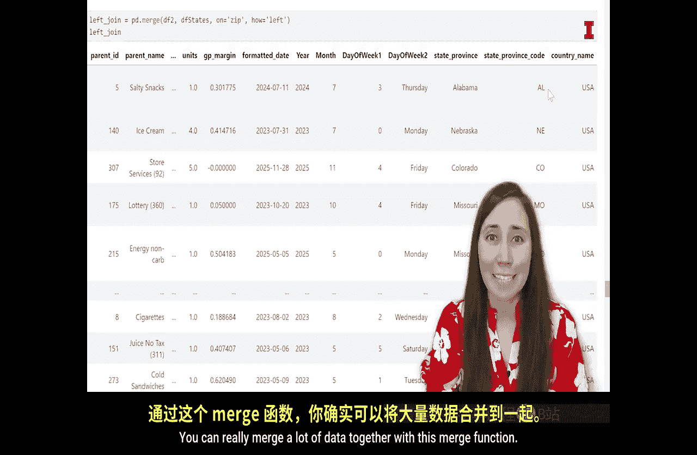

# 伊利诺伊大学【中英⚡商业分析｜Business Analytics Specialization】 p105 P105 04_可选视频合并数据 -BV1z86nB9EGz_p105-

Sometimes when we're working with one data set， we do not have all the data we need in that data set。

But we might be able to get that data from a second data set。

 so what we can do is merge or join the data from these two data sets together。

 This is another way to prepare or clean the data before we jump into merging data with the techca data we've been working with。

 let's first just talk about the concept of merging data。😊，There are four common types of merges。

 the inner join， the left join， the right join， and the outer join。

Let's say we have our two datasets， dataset A and dataset B， generally。

 the rows in data A will not perfectly match the rows in data B。

 So this is when we need to think about the type of merge that we want。

 Do we want to keep the rows from data A， Do we want to only keep the rows from data B。

 Do we want to keep the rows that we see in both dataset sets。😊。

Let's see some examples to illustrate what this means。

Imagine we have data set A with Professors Ron Park and my favorite Candies。

 then we have data set B with Professors Nadi Park， Ashishish and Ron's favorite colors。

If we want to join these two data sets based on the column professor。

 there are different joins we could do， let's see how different joins would affect what our final data looks like。

First， let's see what a left join looks like if dataset A is our left dataset or our first dataset and dataset B is our right dataset or a second dataset set。

 a left join would keep all of the rows in data A and add the data from data B that corresponds to the rows and dataset A but any row and data B that doesn't correspond to a row and data A would not be in the final merge data。

 so the final data set looks like this， and we don't have a row through unnati and aishish because they were not in the left dataset。

Okay， so let's try a right join again if data set A is our left data set and data set B is our right data set。

😊，And we want to join on the professor column， a right join would keep all of the rows and data B and add the data from data A that corresponds to the rows in data set B。

 but any row and data set A that doesn't correspond to a row and data set B would not be kept in the final merge data。

So Ron and Park's favorite candy would be included in the final dataset set。

 but I would not be in the final dataset set because my name Kim， is not in the right dataset set。

 also because Unnadi and An Asshish are not in dataset A。

 their favorite candy is a missing value or NAN。Let's do an inner join next。

 an inner join only keeps rows for the professor column that exists in both dataset sets。

 so if we again have data set A with Prosors Ron Park and me and data set B with Pros Unnaati Park and Ashshish。

 and Ron， there are only two common professors between the two professor columns in dataset set A and data set B。

 Ron and Park。Therefore， the final dataset set only has two rows。

 one for RA and one for PA there are no missing values this time with the merge data because we didn't keep rows we only kept rows that existed in both datasets Finally let's do an outer join and outer join keeps the values from both datasets for the column we are joining and in this case the professor column so if we again have data set A with Ron Park and me and data set B with Unnaati Park and aishish and Ron our final data set will have all five professors Any missing data for favorite color or favorite candy will show up as missing in the final data。

So our data would look like this。Okay let's take these merging concepts to our techA data set In our techA data。

 we have the zip codes and the city for each row， but we don't have a column for the state if we wanted to add a column with the state。

 we would need to get that data from somewhere else since it isn't in our techA data so we have a second file calledOOC1 state csv which has a row for each zip code。

 the corresponding state and the country which in this case is USA for all rows。

 we can merge our techa data with the zip code data and state dataset。

If our left data set is our techA data set and our right data set is our state data set。

 what kind of merge would we want？Well， let's think through which rows we want to keep if we want all of the techer rows with the corresponding states。

 a left join would add the states to the techca data。

Let's go to our Jupyter notebook to see the code for this。

Navigate to the section ETL4 joining data using your table of contents to the left or scrolling down through the notebook。

So when I click that， I just jumped straight to the ETL4 joining data。

I next want to run all of the cells above this above this cell Now this is if you have closed your Jupiter notebook or turned off your computer if you've just been running straight through you don't have to run all the cells again because everything's still saved in your environment but if you've closed Jupyter at all make sure that you rerun the cells so I click this run dropdown and I click run all above selected cells so because I have this ETL4 cell selected I can run all the cells above it and it will go through and load the data you can kind of see what it's doing over here load the data view the data just going to change the data。

 we kind of cleaned it a bit right we converted our data types from a string date to a date time we extracted things like the year the month the day of the week and then we also removed some outliers so we。

😊，It kind of jumps around a bit sometimes when you do that and that's because when you don't have the output in the notebook it's much more scrunched together and then when you add the output so all of these rows that you're suddenly seeing because you run the code。

 the notebook jumps around a bit so you'll just maybe scroll a little bit to get to ETL for joining data。

😊，This first code cell that we have here is going to load our states data set into our environment。

 so that's that data that has the zip codes and the associated states for those zip codes we're going to create a variable called Df states and so that is our the variable that will be saved on our environment that houses the data so Df states and we're setting it to our read CSV function。

 so that's a pandas function So PD says from the pandas library use the read CSv function。

 so that's going to read the CSV and save it as a data frame so that's why we use that pandas it's going to save as a data frame and then what CSV file are we going to read in this is our MOO1 states do cv。

 Now you want to make sure that this file is saved in the same folder as your notebook if it is not this code will likely not。

😊，Run correctly because it's looking in the same folder as your notebook when you say this file name。

 if you have it in a different folder then you have to write out the full path for where that file is located。

 but if it's in the same folder you can just directly reference the name。😊，Al right。

 so when I run this， I have now saved a variable， created a new variable called DF states。

 and the data from the MOC1 State CSV file is saved as a data frame in that variable。😊。

So we talked about the different types of joins or merges we could do with our data and we're going to be performing that left join that's because we have our techA data and we want our our techAada to be joined by to be our main data and then just add any rows from the state data so the number of rows we want to end up with our just the rows of techAada we have so we are going to use the merge function from pandas we're going to what the merge function is going to do is it's going to use the zip code column from both our DF2 our techAada and our state data so in both of these data frames there's a zip code column and so it's going to take the techA data set look up the zip code。

😊，はい。That is for a given row and find the zip code in the state data set and then grab the rows from that data set or data frame and just tack it on as additional columns in our techA data frame。

All right， so the code to do this uses this merge function。

 we're going to create a new variable called left joint。😊。

And I'm going to set it equal to that pandas function merge， so PD。

 mergege says from the pandas library use the mergege function what two data frames am I going to merge so I have DF2。

 this is my left data frame and then I have DF states that's my right data frame。

So I'm merging it on the。😊，On the column zip。 So both of them have a column called zip。

 This is really zip codes。 That's the column of zip codes that they each have。

 And then how is what kind of joins。 So we talked about the different types of joins。

 And we want a left join。 So that's going to keep all of our all of。Our techca rows。

 that's our left data frame。 So we're keeping all the left rows， and we're just merging。

 grabbing data from our right data frame to merge in。😊，So or to tack on to the end。

So we when we run this， we're also going to call the data frame and so it'll show us the beginning and end of our data frame。

 so we've joined the two data frames together with the left join so we have all of our techcker rows which we see here。

😊，And then if we look to the far right， we also now have our state， so Alabama， Nebraska， Colorado。

 we also have the country which in this case all of them are in the United States。

 but it would have added all of the columns from our right data frame to the end of this tech of data frame。

 so if our state's data frame was pretty small， but if it had a lot of columns then it would add all of those columns in。

 so you can really merge a lot of data together with this merge function。😊。

So now our data frame is cleaned up， so our ETL phase is done for now importantly we started with a relatively clean data set so we only had a few things to clean。

 typically we would clean our data much more we might have also needed to clean the states data still this gives you a sense of the routes for cleaning。

 fixing or changing the data removing the data or adding to the data。

And it gives you a sense of how to use Python to perform some of these cleaning tasks。

