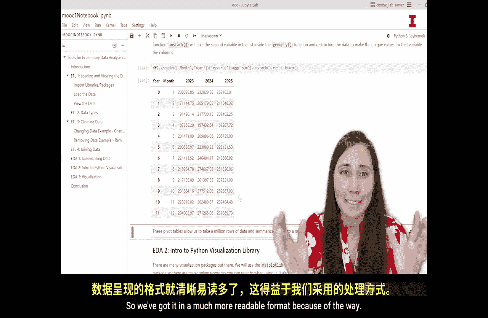

# 伊利诺伊大学【中英⚡商业分析｜Business Analytics Specialization】 p106 P106 01_可选视频：数据汇总 -BV1z86nB9EGz_p106-

In the last several videos， we focused on ETL or extracting， transforming and loading our data。 Now。

 we're moving on to viewing， understanding and exploring it。

 This is sometimes called ED or exploratory data analysis。

 I want to continue with our garden analogy。 So I'm back at the Orange County Great Park Farm and food lab。

 Once you've put in the raw materials cleaned and cultivated a garden。

 you can begin to explore what you find before harvesting a gardener surveys the garden to see how the plants have grown。

 surveying maybe how tall the plants are， examining the colors and the different types of plants。

 perhaps counting up the fruits and vegetables。😊，Similarly in Python。

 you use functions to get a sense of your data's yield and diversity or how much data you have and what it looks like。

 A gardener might examine how many flowers there are in bloom。

 may be determining how many fruits and vegetables。

 grouping them into different categories and types。

 They might count or estimate the weight of each group。In Python。

 we'll use functions like group by and summarize from the Pas Library to summarize our data by categories。

For example， we might want to find the total sales by region。

Let's get back to the studio and actually summarize or harvest some of our techcaada。

The point of examining data and having data in the first place is to gain business insights from it。

 Thus， after we have extracted and cleaned our data， it's time to start exploring it。 However。

 it's important to note that the process of first cleaning the data and then exploring it is not linear or sequential。

 Rather cleaning and exploring is almost always iterative。

 That is we will get the data clean and start to explore it and then we'll notice that we actually need to do some more cleaning。

 Then we'll go back and clean that data set a little bit more。 move towards understanding it。

 and then we again realize we have more to clean。 So it's an iterative process。

 When we look at the data， it's important to have a goal in mind。

 will'll examine data for at least two broad reasons。 First。

 we may have some specific questions to ask the data。

 The second reason might be that we have a new data set and we're not really sure what we can tell from the data。

😊，The approach we will take today is to focus on that second reason。

We need a better understanding of the data and what it tells us we're continuing in our Jupiter notebook from the prior videos where we are working with the techA data set。

 which is convenience store data from a US convenience store chain for the years 2023 through 2025。

First， we'll learn how to summarize the data， and then we will learn how to use a Python visualization library to create various visualizations。

The EDA technique we will learn in this video is a method of grouping data together and summarizing it for example。

 one thing we might want to know about this industry in all of tech stores is in which months of the year do they make the most money。

😊，Looking at the million rows would be challenging to determine the revenue for the data。

 we could filter the data for each month and then add together all of the rows of revenue manually。

 but thankfully there are functions that can do this all for us and it can return a nice data frame with all the aggregated data。

There are many ways to do every task in Python and transforming and summarizing data is no exception。

 we will pick one way of grouping and summarizing data， the group by method or the group by function。

So let's turn to our Jupiter notebook to examine techA's total revenue by month。

 this will tell us which months of the year are the best for our techka stores and will help us understand the industry overall better。

Once we have our notebook open， we will want to make sure to navigate to EDA1。

 this is summarizing data and we want to， if we have closed our notebook at any time。

 we'll want to run all of the code above the cell that we have selected in this case EDA1 summarizing data。

So we want to group by month so to do this we are going to transform the data so how are we going to do this we said we're going to use the group by function so we do this in four parts first we are going to say which data frame are we going to group by so we have DF2 and we're going to use dot group by that says I'm going to take DF2 I'm going to summarize in some way。

😊，Next， we want to say the column that we want to use for our rows and in this case we want our rows to be the month。

 so that's what we want to get our aggregation for so we want it by month。😊。

So whatever we want to be our rows， that's our the first thing we put inside the groupI function so what group I does is it's going to find the unique values in this month column and then it's going to list them one row for each unique value。

😊，What this means is we may have the month January listed thousands of times in the data。

 so if we looked at that month column we might see January January repeated a bunch。

 but it's only one unique value January so in our summarized pivot table it's only going to be one row in the group by parentheses we also need to say this as index equals false so this just ensures that our month variable represents is represented as a column in our final summarized data。

😊，The next variable， the third part is after the group by function so we want to put the column that we want to make a calculation over in this case we're trying to get the sum of revenue so revenue is the column that we want to make the calculation over so in brackets we say what column do we want to make the calculation over it's revenue and then the fourth piece of this group by function is what is the calculation we are doing we're going to use the sum so we're saying we want to aggregate by what by doing the sum so when we do this what Python and what the computers going to do is it's going to get each month so it's going to first go to January and then it will calculate the sum of all the January revenue then it'll do February。

 March April and so we run this。😊，And we can see that our output at least looks like what we said we wanted it to look like。

 so we have two columns， a month column and a revenue column。

And then we have 12 rows so from January through December looking at the numbers here。

 we can see that in that second half of the year， we seem to maybe have slightly higher revenue than in the first half of the year we're able to gain some insight into our revenue。

 which would have been impossible to do if we were looking at our a million row of data and so this summarization of our data just gives us a little bit more clarity into what's going on with our data。

😊，So importantly the code we just ran returns a pivot table， so this is a pivot table。

 it's pivoted our data， it returned it in the notebook。

 but it didn't actually save the pivot table anywhere to be used for future use so if we wanted to actually save this pivot table we would need to set it equal to a variable in this case our next line of code is going to create a variable called DF rev by month。

😊，And then I'm going to set it equal to that exact same code we just ran。

 and so we won't see an output in our notebook when we run this code。😊。

So all that it's done is it's now saved that pivot table in our notebook so that if we wanted to。

 we could use it later。All right， so as I mentioned before。

 you can also use other aggregation functions， so there's a mean function。

 so the calculating the average revenue for every month。😊，There is a count。

 so counting up how many transactions are in each month。

We could actually combine all of these into one pivot table where we have the sum of revenue。

 the average revenue， and the count of revenue as different columns in our data frame。😊。

So our code looks pretty similar， we're saying what data frame do we want to aggregate D youF2？

Then we have our group by function and we want to say。What is the。

What is the unique values that we want to look for。

 so what do we want our rows to be in our pivot table or in our final output？In this case。

 we want it to be month。Then we want to say what column are we going to use for doing a calculation over so in this case it's revenue and then what are we going to do what's the calculation that we're going to do this is our aggregation functions and in this case we used to we previously said just do the sum but if we want to do multiple we have to include it as a list so we have the square brackets that say I'm going to list a couple things so I'm going to list the sum the mean and the count and so that gives us a column for sum average and count。

😊，And then dot Reet index is just another way to so that we don't have some weird things happening with our index。

😊，All right， so if we run this， we're going to get an output in our notebook because we're not saying save it somewhere else。

 we're just saying display it in our notebook。😊，And we're aggregating the data。

 so we have a column for month， January through December， we have the sum of revenue。

 we have the average revenue， we have the count of revenue so we can kind of see some similar patterns here where we see maybe in the later part of the year our revenues are higher even the average revenue is maybe a bit higher in some cases and then our count of the number of transactions all right so we've learned how to create a pivot table which is one aggregation function the sum we can have multiple columns for different aggregation functions what if we didn't want to just look at all of the months for the three years all together as all Januarys。

 all Februarys， all marches and so on we could actually say I want each row in my data frame to be both the year and month and so to do that。

😊，Instead of saying we just want the month to be each of our rows within our group by function。

 we're going to change it and give a list of values or list of column names we're going to say I want to group by both the year and month。

 and so this is going to give me 2023， January， 2023 February。

 2023 March 2023 April all the way through 2025 January， 2025， February and so on。😊。

And then we can say as index equals false then we want to say what what variable do we want to do a calculation over in this case we want to do a calculation over revenue and we're just going to get the summer revenue again so this table is going to be really long actually because we're going to have 36 rows because we have 12 months for 2023。

 12 months for 2024 and 12 months for 2025 so I run this。😊，I've got 2023， January through December。

 2024， January through December， and 2025 January through December。Alright so this is a bit long。

 maybe we want to kind of shift this around a bit so that we have our months as our rows。

 but maybe we want a column for each year instead of having to read it this way where we've got 36 different rows so we can actually do that using a little bit more code using something called an unstack function。

😊，So in this case we want our months to be listed first。

 so that is the main unique value that we're interested in。

 so we're going to say again DF2 that's the data frame we're using using the group by function。

 we're going to do month and year， but month is what we want listed first。😊。

We also want the year information so each month year is what we're doing the calculation for。

 and then the column we're doing a calculation over is revenue。

 we're going to sum up revenue so revenues listed outside the group by function and we're saying the aggregation function so dot ag that we want to use is sum。

😊，And then we want to unstack and so what this is going to do is it's going to take that year unique value and instead of listing it as all of the rows。

 it's going to unstack it and list it as three different columns so I run this。😊。

And now we see I've got my month here。And then I've got the years 2023， 2024-2025。

 so I've got a column for each of these years and that is the sum of my revenue for January 2023 and here's the sum of my revenue for April 2024 and then the sum of my revenue for July 2025 so we've got it in a much more readable format because of the way the columns and the rows are displayed。

😊。

There are all kinds of pivot tables we could create with this data to help us explore the data and hopefully you can see the power of pivot tables pivot tables are an incredibly useful tool。

 especially when you're trying to explore data as they quickly summarize the data and perform calculations for you。

They allow you to put your data into a more easily digestible format and help you understand what's going on with the data。

This level of understanding would be challenging when you're looking at the unfiltered and non aggregateated data set。

