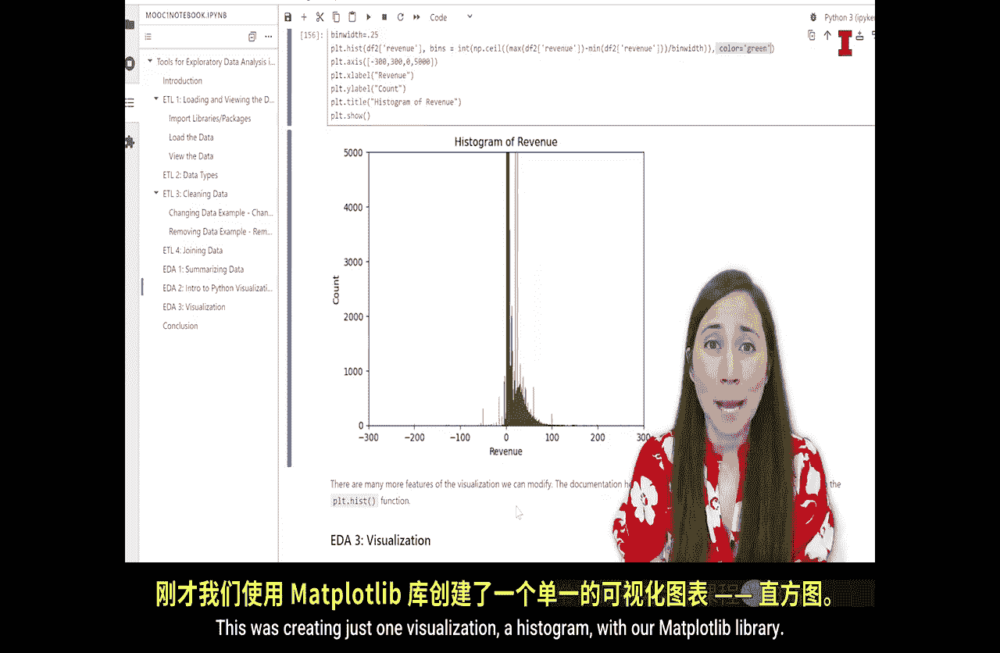

# 伊利诺伊大学【中英⚡商业分析｜Business Analytics Specialization】 p107 P107 02_可视化入门-python库 -BV1z86nB9EGz_p107-

Summarizing data like we did in the last video is incredibly helpful。

 but a picture is worth a thousand words， or maybe in this case。

 a picture's worth a million numbers in this video and the next we will be performing EDA with visualization in this video I will introduce you to a Python library that quickly and easily creates visualizations Then in the next video we will create a bunch of visualizations using this library。

I'm now at a botanical garden， the Neel botanical preserve to continue with our garden analogy。

 The gardeners here have planted the seeds。 They've watered the garden。

 and they've surveyed to figure out what they have。 Now。

 they can highlight and enjoy the fruits of their harvest。😊，As the gardeners take care of a garden。

 they may need to dig up and prune plants， they might need to replant a plant somewhere in a different spot to get the garden to look exactly the way they want it to look。

They might put some shorter plants in front and maybe larger plants further back。

 they might try to arrange these plants in a visually appealing way。

Once the garden is organized exactly the way they want。

 then a lot of people like you or me can walk through and enjoy the garden。 We can enjoy the flowers。

 see the patterns and the plant growth。😊，This process of organizing a garden so that it can be enjoyed visually is similar to data visualization because we're gaining an understanding of our data or our garden with our visual。

We use tools in gardening to trim， dig up， and replant things。

 which is akin to the Python tools that we will use to create charts and graphs。

The tool we will use in this video is Maplloot Libb。 This is a library that is used in Python。

 Let's get back to the studio to introduce this Python tool so that we can transform our data into useful visualizations。

Matpllotlibb is one of the many visualization libraries out there。

 We've chosen this library for visualization for a couple of reasons。 First。

 it is a commonly used library that has been around for over two decades。 Therefore。

 there is a lot of documentation and information online about that library to help with any questions or problems that you might encounter。

😊，Second it's a straightforward library for creating visualizations， for example。

 you might want to create a histogram if you want to do that with MatpllootLi you can just call a histogram function to create that visualization in other Python packages you might need to tell the function the exact height and with the V bar to create a histogram。

Other packages may have more customization， bells and whistles。

 but MatpllotLib is an important library to be familiar with to start creating visualizations in Python。

Third， it is intuitive as you can add layers to your visualization like you would add paint to a canvas。

Let's jump into our Jupiter notebook we've used in the prior videos with the techA data set。

If you're just opening up this file or you've closed Jupyter or closed your computer at any point。

 you'll want to run the cells over again up until our intro to Python visualization library so we want to navigate to Intro to Python visualization library so you can select it on that table of contents which is a window or a menu you can open to the left it will take you right to the section that we're working in and if you haven't just been working through the videos and you had to close your computer for any reason。

 we want to make sure to run all of the code before the selected cell so that we can make sure to tell the computer which libraries we want in our environment what data we are going to keep our load into our environment and the cleaning all the cleaning that we did up through this point。

Alright， so the first thing we are going to do is to import the Maplotlibb library and so that's what this first line of code does here。

 We want to import the library because we're going to be using functions from Maplotlib that allows us to create a bunch of visualizations so we're going to import that's what we say when we want to import a library mapplotlib do piplot and then we're going to use an alias so that as Plt So we've used alias is before this is just a way to shorten our code So instead of having to say the whole library name every time we want to reference a function from this library we can just say PLt and that then the computer knows that we're going to be using that Maplotlibb library。

The reason MAplloot Libb is such an easy library for visualizations is because it's pre programmed with functions to create a variety of plots。

😊，So we're going to demonstrate how to use this mapplotlib library by creating a histogram。

 A histogram is a type of visualization， so a histogram shows the distribution for a single variable。

 So in our case we're going to be looking at revenue so each bar represents a range of potential values that revenue could take the height of a given bar represents the frequency with which you see an observation fall in that particular range。

 So creating a histogram using matplotlib is really easy because we just tell mapplotlib we want to create a histogram and they have a histogram function。

 which is really nice， So we just say I want to call the histogram function from matplotlib So PLt is our little alias or nickname for Matplotlib。

😊，Use the histogram function and then what column do we want to do a histogram over。

 so we're saying we want to use the DF2 data frame and the revenue column。

The next thing we have to do is show the visualization。

 so we want to show our histogram so we use PLT。 show when we run this we end up getting this histogram。

 it is a histogram， but it doesn't look super useful。

 We've got this one bar and it's really concentrated around zero。

So we can do several things to adjust our visualization using the Maplot Live library。

 and that will hopefully make it a little bit more useful than this one bar histogram we're seeing here。

So we can add an argument to our histogram function if we scroll down a little bit。

 we have pretty much the same code that we just ran except for we're adding one argument inside the histogram function we're going to say we want the bins to be equal to 100 and so if we run this。

😊，We can now see that our， our one column is divided up a little bit more。😊。

We again see this spike around zero， but it's divided a bit more。

 which is helpful in seeing that there's at least some variation in where revenue is falling。😊，Okay。

 so it's still not super helpful because we have all of this white space to the left and all of this white space to the right。

 So what we can do next is we can actually zoom in on a specific part of our plot by adding a new layer to our code。

 So with PLT dot axis。 This is you this is saying we want to not use the full X and Y axis values。

 but we want to zoom in。 In this case， we want to use our X minimum of negative 300。😊。

And then our x maximum of 300。 And then we're going to go from 0 to 5000。

 So we're really going to zoom in on this right around 0 or this portion of our histogram。

 So when we do that。😊，We kind of see a little bit more so this is just a zoom in of what we were seeing here。

 so we see that there are some really small bars in here。

 but it's really kind of dense right around zero。😊。

So another thing we could do is maybe we want to specify our how wide our bin is。

 so right now we said the number of bins， but we want to specify the width。

 And so we could actually do that by making a calculation so we want to calculate the number of bins given a specific bin width so our bins。

Our bins argument is here。 And we previously said we want 100 bins。 but if we want bin width。

 we can instead make a calculation so we can take the maximum value。

So the maximum value for our revenue column and we can subtract the minimum value。

 So this is just getting the range from our maximum to our minimum value。

And then we want to divide that by the bin width that we want。

 So whatever we want this been width to be。 in this case， Im saying I want been width to be 0。25。

 I'm making a variable called bin width。 I'm setting it to 0。25。

So this is going to take our range of revenue values and divide it by 0。

25 so that's going to tell us essentially how many bins or how many columns are we going to get if we were to use a certain bin width。

And then we're going to make this into an integer because bins has to be an integer。

 you can't have a partial bin。Now， when we run this， it's doing the calculation。

 So it's getting our maximum revenue minus our minimum revenue。 And then it's dividing that by 。25。

 And that's the number of bins we have。 So we have a lot more bins。

 So each of these lines is a little tiny bar or column in our bar chart or histogram。

 And we can see a little bit more granularity in our data here。😊，More specifically。

 we're seeing this bunch around 0 again。 And then we're kind of seeing a small sort of hump in the data here。

 And so if you think about what's being sold at a convenience store。

 you have a lot of things that are pretty cheap。 say a candy bar or something really small。

 that's maybe only a couple dollars。 So that's a lot of what's in here。

 And then we have some larger revenue item。 So if we think about， so this is up to $100 in revenue。

 we think about fuel。 fuel is a really big portion of techs revenue。

 And so the amount someone fills up on fuel is probably in this range here。

The last thing we'll talk about for this introduction to Matplotlib is adding features to our chart。

 So， for example， let's say we wanted to add labels for our x and y axis。

 or maybe we wanted to add a title to our chart。 we could actually do that by adding layers to the mapplotlib code。

 So we're going to use pretty much the same code as before， but we're going to add three layers。

 So these three layers are our x label our Y label and our title。

 So we are saying from the mapplotlib library。 we're going to use the X label function。

 we're going to label X， which is our x axis as revenue because that's what our revenue is。

 And then our y label is our count。 So that's the count of how many items fall into that revenue。

 So when we run this we should see the same exact visualization but now with labels。

 So it takes a little bit of time because it's doing that calculation。😊。

And I also added this color green just to show you a little bit more about the features that we can play around with for Mattpltlib。

 but we've got now this title of histogram of revenue we have the Y axis label of count and the X axis label of revenue。

😊，So this was creating just one visualization， a histogram with our Maplloot Lib library。

Of course there is a lot more we can do with MaPlotlibb and this was only one introduction As you can see MaPlootlibb is an easy to use visualization library one drawback to Maplotlibb is the visualizations it creates are relatively simple and plain There are other visualization packages out there that you can use to create more engaging visualizations and if you dive into Python visualizations more I encourage you to look at these other packages that are out there。

😊。

