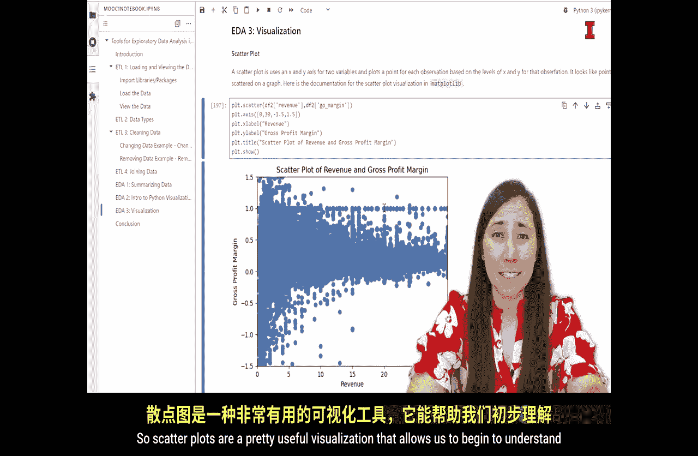
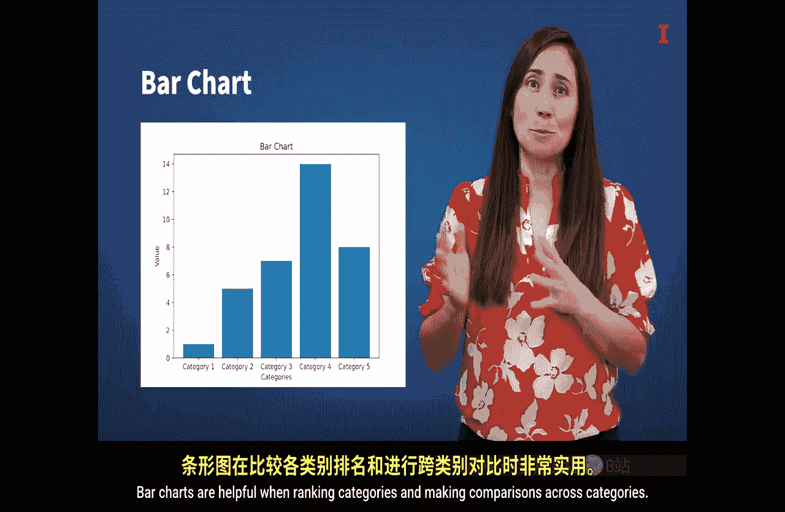
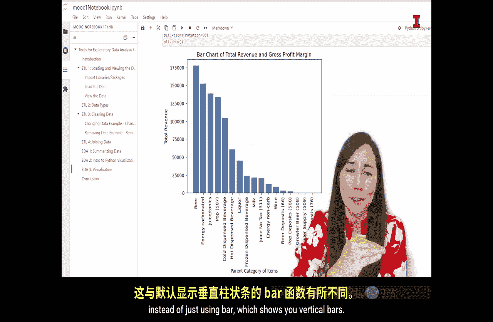
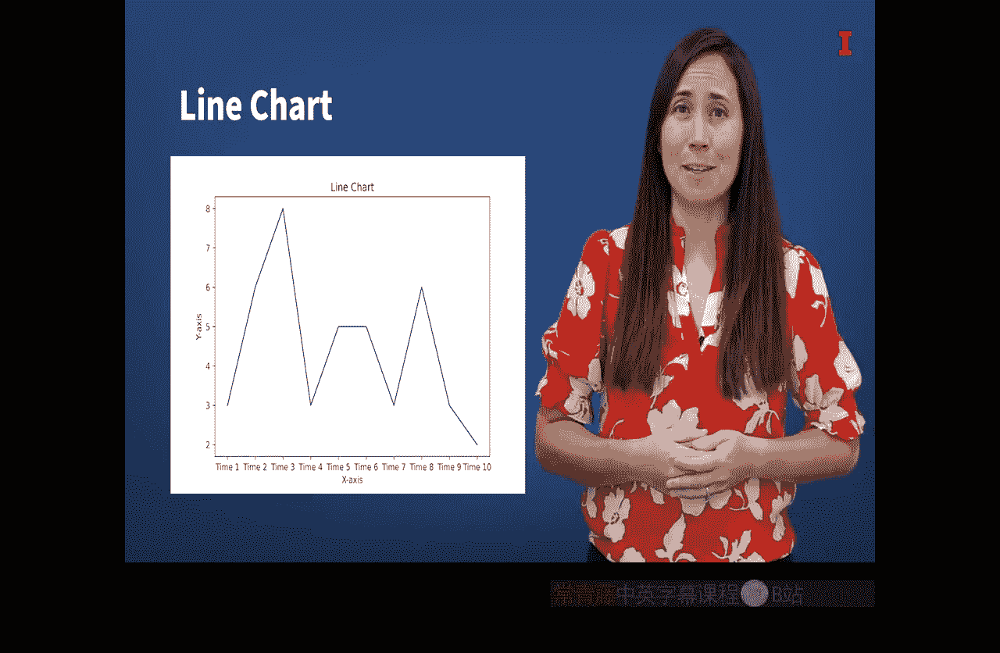
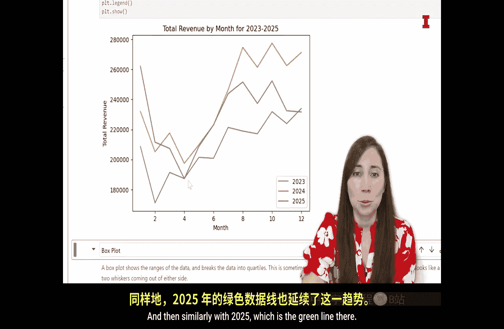
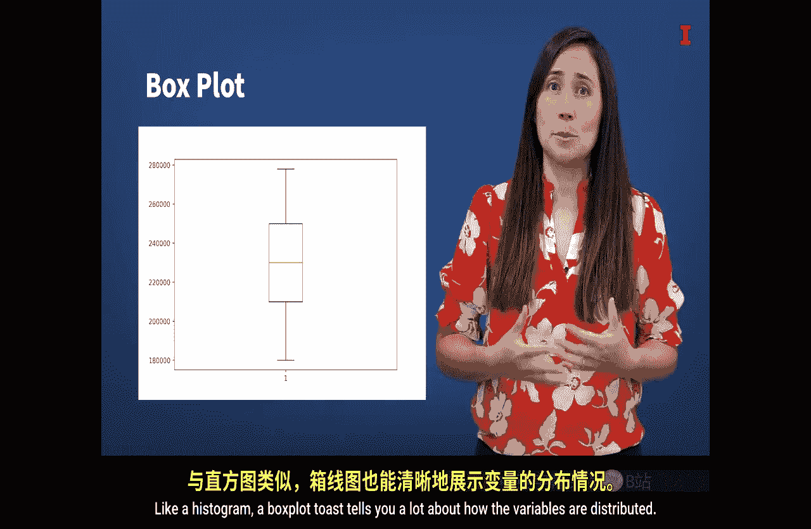
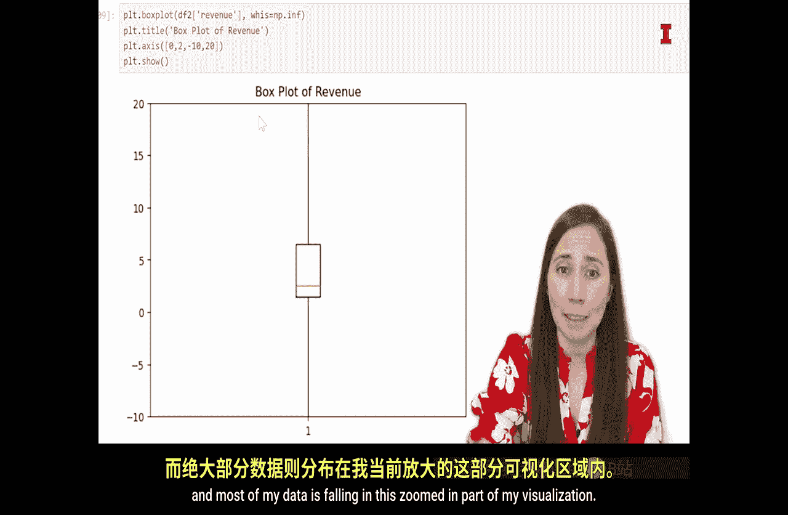

# 伊利诺伊大学【中英⚡商业分析｜Business Analytics Specialization】 p108 P108 03_在Python中创建可视化 -BV1z86nB9EGz_p108-

In this video， we will use the mapplot Lib package that we introduced in the last video to create a bunch of visualizations with our techca data。

 We've got a lot to cover， so let's jump right in。😊。

The first visualization we will create is called a scatter plot。

 A typical scatter plot is a set of points plotted on a horizontal and vertical axis。

 also called an x axis and a Y axis。 Sc plots use two continuous or discrete variables。

 These two variables represent the X variable and the Y variable。

 Sctter plots show you the relationships between two variables。

 There are different kinds of relationships that two variables can have with one another。

 but the most commonly evaluated relationships are a positive relationship。

 a negative relationship and no relationship。😊，In a scatter plot。

 we can often see if two variables are positively related， negative related。

 or have no relationship by looking at how the points are scattered on the plot。

If we have points on a scatter plot that look like this。

 we can see that the points are trending upwards。This means that as the variable on the X axis increases。

 so does the variable on the y axis。 If I instead have a scatter plot that looks like this。

 we can see that the points are trending downwards。

 This means that as the variable on the X axis increases， the variable on the Y axis decreases。

 So the two variables move in opposite directions。😊，Finally。

 if we have a scatter plot that looks like this。We can't really see that there's a clear relationship between the two variables。

 so we might say that there is no relationship between X and y okay。

 so let's create a scatterplot with Python and MapllootLi go ahead and open your Jupiter notebook。

First， we want to navigate to the visualization section using our table of contents。

So this menu at the side here will navigate to EDA3 visualization this will take us straight to our visualization section if you have closed your notebook for any reason or your computer you'll want to make sure you run all cells above your selected cell so once you've done that you are ready to create some visualizations。

😊，So for our first scatter plot， we're interested in the relationship between revenue and gross profit margin。

 so do larger revenue items have a larger or smaller profit margin。

 We can begin to explore this relationship visually with our scatter plot。So I'm going to use PLT。

ca and inside the parentheses we want to say what do we want our x axis and our y axis to bees the x variable comes first so we want we're going to put revenue on the X axis and GP margin or gross profit margin on our Y axis so we're getting revenue from DF2 so that's data frame2 that's our cleaned data frame and we're getting gross profit margin also from DF2 that's our cleaned data frame。

😊，I've added some other layers to our visualization， so you'll notice I've got this axis layer。

 I've added layers to give labels to our visualization。😊，All right。

 so then we want to show this scatter plot。So if I run this code。

This is what my scatter plot looks like。So there's some interesting things that come out of this visualization。

 We can see this is our scatterpl。 Maybe there is a slight positive relationship some of the time between revenue and gross profit margin。

 So it's difficult to say for sure。 We might want to do some statistical analysis over it。

 We see a wide variance of gross profit margins。 So there's a lot of different gross profit margins for different levels of revenue so。

😊，The higher for those higher revenue products which are probably almost all fuel。

 so this higher revenue products， we see some pretty low margins。

 so we're not seeing a whole lot of the high gross profit margins that we're kind of seeing up here。

 so scatter plots are a pretty useful visualization that allows us to begin to understand what is really going on in our data。

😊。

The next visualization we will create is a bar chart or a column chart in a bar chart。

 each bar typically represents a different category while the size of the bar represents the value for that category。

 so in the example here， category1 is the smallest value and categoryory 4 is the largest value bar charts are helpful when ranking categories and making comparisons across category。

When creating a bar chart， we often need to restructure our data so that each category is a row and then we have the value that represents the height of the bar for each of those rows so let's say we want to create a bar chart that shows us the total revenue for each beverage category so I've listed the beverage categories here。

😊，There are many ways we could do this， but we'll start with a pivot table using group by and then we will filter only the beverage rows so we're going to this first。

😊，Sell here is going to create a pivot table of all the different categories we have。

 and then this next code here is going to just filter only those beverage categories。

So to create the pivot table， we're going to create a variable called DF parentent。

 that's where we're going to save the pivot table or the aggregated data we create。

Then we're going to set it to the data frame that we're going to aggregate。😊。

So DF2 dot group by and then we are going to say what do we want each row in this pivot table to be so we're taking our millions of rows and we're going to aggregate them so that each row is just one of those parent categories so that's this parent name column。

😊，And then we have index equals false that just helps make our data frame look cleaner。😊。

What do we want to aggregate， So we're actually going to look at the total revenue for the different categories。

 So we're going to say。Outside of the group by we want revenue and what aggregation function。

 what do we want to， What calculation do we want to do， We want to get the sum， So if we run this。

 then we actually have a data frame with a lot of parent categories。 So we've got。😊，Autommotive。

 bakery， beer， toys， wine， all of these different rows， of parent categories。

 and then the total revenue for each of these categories。

 but we want to only create a bar chart for those beverage categories。

So we're going to create a DF beverages variable and we're going to set it equal to DF parent。

 but we're going to filter only those beverage names。

 so I'm saying in the parent name column from DF parent that we just created earlier here。😊。

I only want to keep row if it's in this list of names so when I run this。Now I've got parent name。

 so only the beverages and the total revenue for those beverages。Alright。

 so now we want to create our bar chart， so Mapllootlib as we've seen is really great to create a bar chart we just use the function bar so from our Maplotlib library which we've shortened as PLT use the bar function and then the inputs for our bar function are what do we want our bars to be and in this case each bar is going to be one of these parent name so if we look back at parent name each of these rows is going to be a bar so that's what we will list as the bars in our bar chart。

😊，And then the height of our bars or our y axis is our revenue and so that's how big each bar is going to be The rest of this is just formatting and making our bar chart look better the last thing we're going to do is our X tickers so these names of hot dispened beverage juice liquor milk pop all of those default to be horizontal and they're going to be overlapping and so to make our visualization just look a little bit nicer I'm just telling matplotlib or the computer to rotate those names so that they are rotated 90 degrees and not overlapping so x ticks rotation equals 90 just flips those so if I run this and I show my bar chart I can see I've got the bars for which represent the total revenue for each of these categories of beverages。

😊，So we can see the highest one here is beer and the lowest ones we can't even see。

 so it's somewhere between growler， beer or supply or wine deposit， so those are pretty small。

Now one thing we could do with our bar chart is right now it's doing things in alphabetical order for our X axis。

 so it's maybe a little hard for us to know well is which one is smaller is beer deposits or pop deposits smaller because they're both pretty small。

 but we can't see them side by side because the bars are in alphabetical order。

So one thing we could do is we could actually sort the data first before graphing it or before visualizing it。

 and so I have some code up here that I commented out。

 but if we want to get rid of the comment or the number sign we can delete that and that will take our DF beverages data frame and it will sort the value so it's saying set DF beverages to itself but sorted and I'm going to sort on revenue and I'm going to make it in descending order and so that runs that sorts the data frame before creating the visualization because that code comes before it。

😊，So now if I run this， my visualization will be of the same information。

 but the bars are going to be in descending order。So I run this。

 now I've got descending order here then it's really easy to tell， okay。

 beer deposits is larger than pop deposits， and even though we can't see these last three values because they're probably we saw that that growler was only $68。

 we know that growler beer is larger than growler supply which is larger than wine deposits。Alright。

 so this is creating our bar chart and ordering and descending order for our beverages for techA now this bar chart shows our bars vertically you can also create bar charts showing the bars horizontally and so we can just do that by choosing a slightly different function from MaplotLib there is a function called bar H which shows you horizontal bars instead of just using bar which shows you vertical bars。

😊。

Our second to last visualization is a line chart， a line chart displays how information is connected over a continuous interval。

 a common example is time， so how does something value change month over month or year over year？

In a line chart， data points are plotted on a graph and connected by a line in a dot to dot fashion a line is a good depiction of how a variable moves over time as the lines either increase or decrease when moving from dot to dot。

 which represents whether the variable increases or decreases over time。

For this line chart， we want to know if revenue is seasonal。

 so we will examine how revenue changes each month， so we can see that here in our first line。

 we're creating a variable called DF line and we're going to rearrange our original cleaned or our cleaned data DF2 using group by we're grouping by month and year。

 so we did this before when we were doing our summarizing of data。😊。

We're going to get the total revenue， so sum revenue and we're going to unstack。

 which means we're going to have a row for each month and a column for each year。

 so we'll have January through December as our rows and then 2023， 2024， 2025 as our columns。😊。

To plot the line， we use PLT。plot， and so we're actually plotting three lines。

 so that's why we're having it repeated here。We first select the X axis value。

 in this case it's going to be month， so along the X axis we're going to see1 through 12 so that's our X axis value and then we're first going to plot the 2023 column so we have our y is DF line 2023。

😊，And so that's taking the 2023 column from that DF line data frame that we created。

Then we're going to just add a label so that we know which line it is。

 We're going to do the same thing for 2024。 Then we do this a third time， but instead。

 we are looking at the 2025 column。 All right， then these other three。

Three layers are adding our labels， The additional thing we're going to do here is we're going to add a legend to our visualization and so that will just label the different lines in in our visualization so we'll be able to see which line is 2023。

 which lines 2024， which line is 2025。😊，So when I run this。I have a really nice visualization here。

 so I can see 2023 is blue and we see kind of this pattern where。😊，In late winter， early spring。

 total revenue is lower and then it increases as the year goes on， we see the same pattern for 2024。

 which is our orange line here， and then similarly with 2025， which is the green line there。

Our last visualization is a box plot。 A box plot displays the distribution of a variable or variables by showing several important statistics。

 a minimum value， a maximum value， a medium value， 25th percentile and 75th percentile of the data。

 It's sometimes called a box and whisker plot because the visualization looks like a box with two whiskers coming out of it。

😊，Each section of the plot represents a quartile or one quarter of the data。

 so the top whisker from the whisker to the top of the box is 25% of the observations。

 the top 25% the largest from the top of the box to the line that runs through the center of the box。

 this represents the second highest 25% of observations from the middle of the box to the bottom of the box。

 this is the third highest 25% of observations and then finally that bottom whisker from the bottom of the box to the bottom is the lowest 25% of observations like a histogram。

 a box plot toast tells you a lot about how the variables are distributed。😊。

To create a box plot， we call the function PLT。t box plot。

In the parentheses we put the variable that we want to create a box plot for。

 so that's the first variable we put in our case we want to create a box plot for revenue from our data frame DF2。

😊，I also included this whisker argument so Wers equals infinity as the default for Matplotlib's box plot function。

 it's not to extend the whiskers to the minimum and maximum so this code actually allows us to extend the whiskers to the minimum and maximum of revenue we then add a title to our box plot and then we show the box plot I've commented out this code here because we'll talk about it in a little in just a moment but if we just run those three lines of code。

 the commenting out means that it's not going to actually run that line of code we'll see something kind of funny so we have this show up as our box plot and this happens a lot when first running box plots and the reason for this is we actually do have a box plot here but it's really compressed and so our box plot is actually this line。

😊，Right in the center of our towards the middle of our visualization。

 but because our whiskers go to the minimum and maximum， the box itself gets very compressed。

 so a lot of our data falls right in here， but it's hard to see because of we've got some really extreme values in there。

So if I wanted to zoom in on my box plot， I could use my PLt。ax， so PLt。ax。

 I'm going to say I want my X axis to be between 0 and 2， so that's just right here。

 my y axis to be from negative 10 to positive 20 so really zooming in on this part of the box plot。

So I'm going to delete this number sign。Which was commenting out this zoom。

 so now it's going to actually run the zooming in code， so the access function。So when I do that。

 I've zoomed in and I can see I do have this box here so this box plot is where 50% of my data is falling。

 so that is an important to know that most half of my data is falling in here and most of my data is falling in this zoomed in part of my visualization。

😊。

In this video we created a bunch of visualizations using the Python visualization library MapllootLiB we explored our data bit and learned a few things about revenue in particular there are many other variables we could explore and a lot of other visualizations we could learn but with these visualizations and the MaplotLi package。

 you have a good base for conducting exploratory data analysis over your data。

