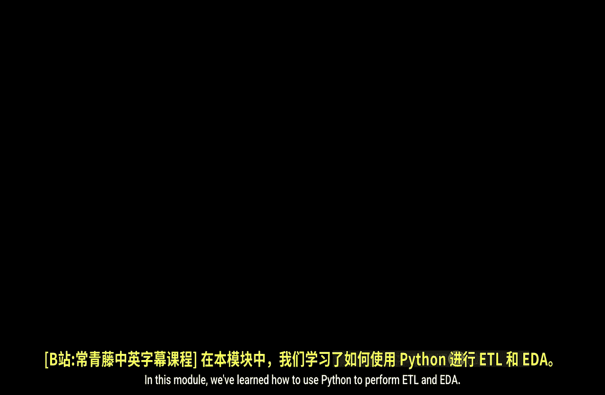
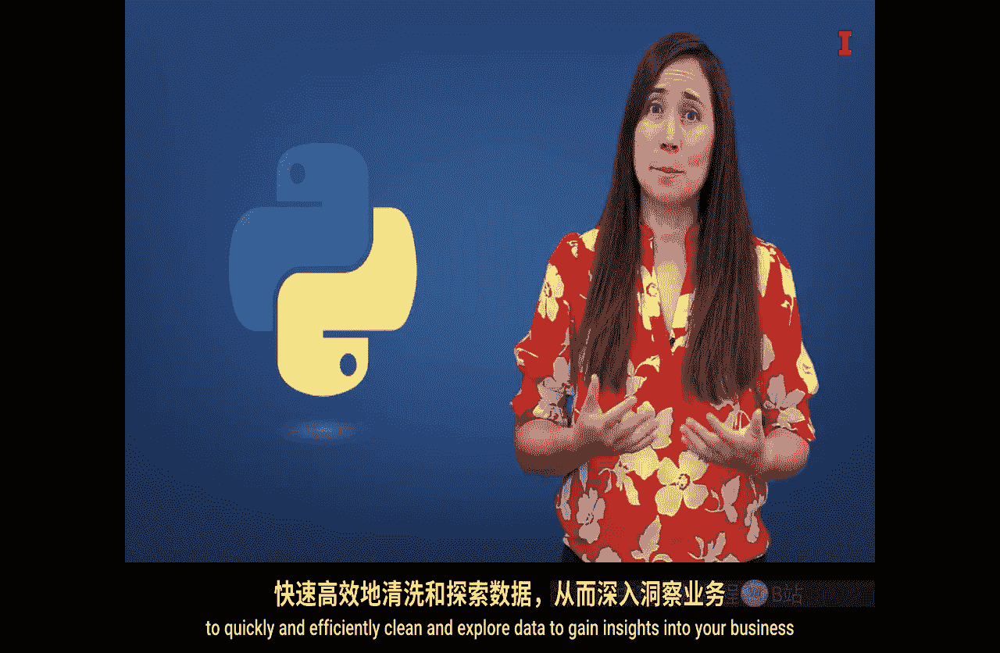

# 伊利诺伊大学【中英⚡商业分析｜Business Analytics Specialization】 p109 P109 01_第二模块-结论 -BV1z86nB9EGz_p109-

In this module we've learned how to use Python to perform ETL and EDA。

 I want to take a moment to recap what we've learned in the videos and summarize the benefits of Python。

Python is a general purpose programming language and it's one of the most popular programming languages used for data science We've only just scratched the surface of what Python can do。

Python is open source， so this means that it is free to use and there are a lot of people out there online who've asked and answered questions related to all of the packages we are using and packages we haven't even explored yet。

 so if you are running into a roadblock you can typically find the solution to your problem online。

 or you can use many of the AI tools available to help create code。

 find solutions by debugging your code and explain your code。😊。

Because it is a programming language as opposed to a point and click or drag and drop software。

 it's very flexible and it can be used throughout a wide variety of data analysis tasks。

In this module， we used Python to begin exploring and understanding the techA data， however。

 before we could even start to explore the data， we needed to clean it up so we needed to fix or remove errors and outliers as well as add to our data。

We found that Python was a very useful tool for cleaning and wrangling our data。 First。

 we found some useful functions to summarize and view our very large data set Python enabled us to examine the data easily。

 for example， we could not view this CSV file in Excel since Excel only allows about a million rows。

 which is less than our dataset set hass。😊，Next， we learned about different data types in our pandas library。

 and this led us to different routes for cleaning the data。

The first route for cleaning our data is fixing or changing the data。

And the example we used for this was cleaning up our date column and changing our data type。

The second route for data cleaning is removing the data and the example we used to do this was removing our outliers from our data。

 Finally， the third route for cleaning our data was adding to our data Our data started out relatively clean but normally data analysts spent a significant amount of time cleaning and preparing their data for analysis once the data was relatively clean。

 we were able to start extracting business insights from the data with EDA or exploratory data analysis。

😊，We used Groupby to summarize our big data and we learned how we can restructure and aggregate our data in different ways。

Once we learned how to summarize and aggregate our data， we moved on to visualizations。

We learned about the package Maplot LibB， and we created a lot of visualizations which helped us begin to gain business insights about techA's revenues。

We learned about the seasonality of their revenues and which products might generate more or less revenue。

We also used a garden as our analogy for data cleaning and visualization， and just like a gardener。

 we were able to get our hands dirty with real world data by exploring this techca data set。

You are now able to use a premier statistical tool， Python。

 to quickly and efficiently clean and explore data to gain insights into your business and the challenges and opportunities that it faces。

