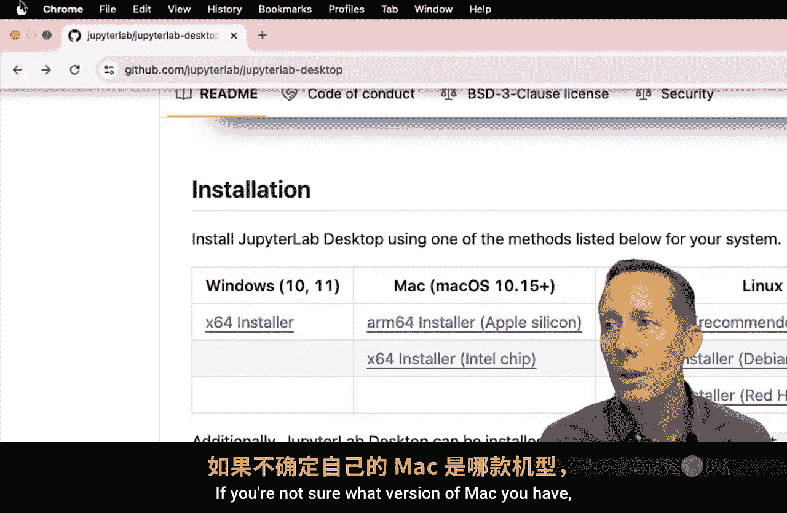
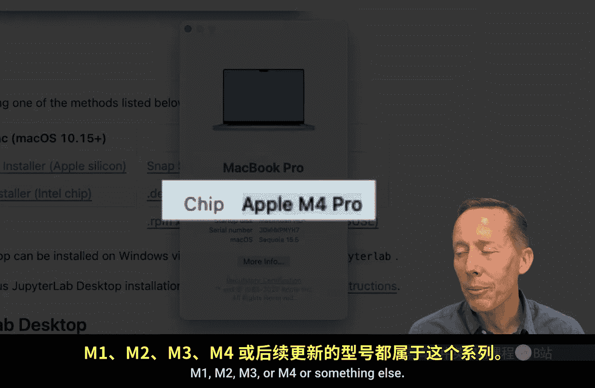
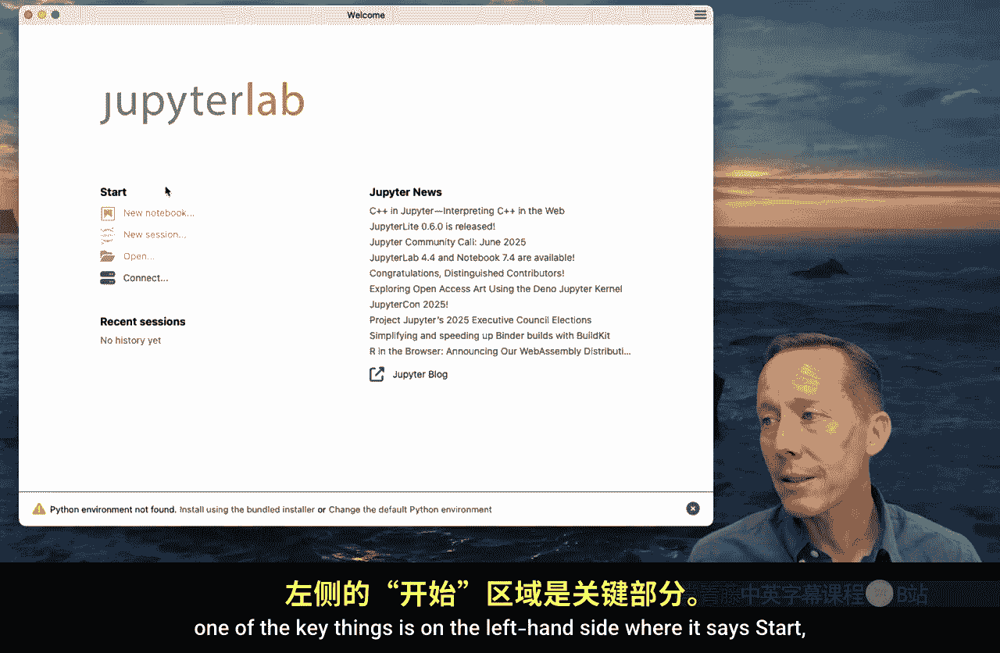
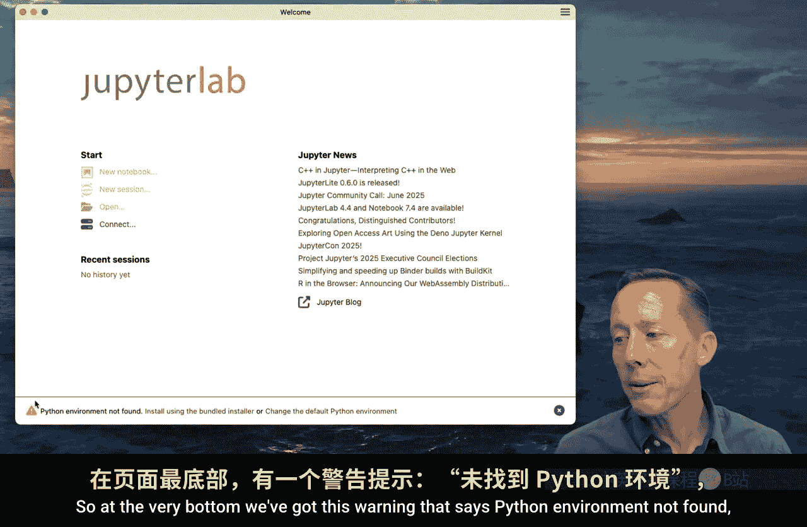
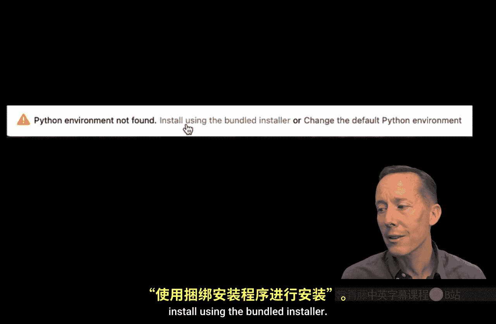
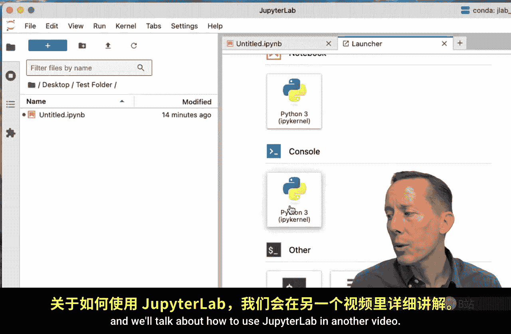

# 伊利诺伊大学【中英⚡商业分析｜Business Analytics Specialization】 p11 P11 08_使用JupyterLab桌面安装Python（推荐Windows和Mac用户） -BV1z86nB9EGz_p11-

In this video， I'm excited to show you how you can get started using Python using one of the easiest approaches possible。

 And that is by downloading and installing the Jupiter Lab desktop application。

 One of the great benefits of this approach is that it's nearly identical。

 regardless of whether you're using a Windows or a Mac operating system。

So let's jump over to a web browser and talk about how to do this。

The first thing that you could do is search for Jupiter Lab desktop and make sure that you spell Jupiter La correctly。

 Notice that it's all one word and Jupiter spelled JU P Y， T E R。

And that name is paying homage to the fact that Jupiter works with various data analytic languages。

 including Julia， Python and R。 Now， one of the links you should see is a link to a Github repository。

 and it'll say Jupyter Lab desktop application based on electron。 So if you click on that link。

 it'll take you to the Github repository。 Now， Gitthub is a website where developers share the code if they want to make it freely available。

 and Jupyter Lab desktop is an open source free application。So once you get here。

 you can scroll down。And there's a little bit of information about what this application is and a lot of other information。

 But we're going to just stop this installation section。

Now in here there's a table and we've got three columns。

 one that pertains to the three main operating systems。 so Windows， Mac and Linux。

 if you're a Linux user， you probably know what to do from here on out。If you're a Windows user。

 then you'll want to click the link for the X 64 installer。

 and that will download the installer onto your computer。

 If you're using a Mac like what I'm using in this video， then there are two links。

And one is for the newer version of Mac， Apple Sil。

 The other is for the older version that uses an intel chip。

If you're not sure what version of Mac you have， you can go up to the Apple icon and click about this Mac。

And where it says chip， if it says Apple M something， then you're using a newer version。

 These are the Apple silicon versions here。 Okay， M1 M2 and 3 or M 4 or something else。

Okay， so since I'm using a newer Mac， I'm going to click on that link， I already did that。

And it downloaded the installer。 Now， this installer was 300 mebys。

 so depending on your internet connection， you may have to wait a little while。

But once you've downloaded the installer， then go ahead and double click on it。And for Mac users。

 this is kind of the standard。 You just take this icon and drag it to your applications。

And it doesn't take very long at all for it to install on your computer。 Once you've done that。

 you can exc to here。 You can delete the installer if you want。

 and then you can open up the Jupyter labb desktop application just like any other application。

 So I'm going to go to my application section of my finder here。

 and I can see that I've got Jupyter lab。 So I'm going to go ahead and double click on that。

And if this is your first time opening it， then Mac requires you to indicate that you're O opening this。

 And I am。 so I click the open button。Okay， now this brings us to the welcome page。

And in the welcome page here， one of the key things is on the left hand side where it says start。

 And there are three links that are grayed out。 And then a fourth length that you can connect。

We want to make these grayed out links available for us to use。

Right now， we only have the Jupiter Lab desktop application。 We still need to install Python。

 So at the very bottom， we've got this warning that says Python environment not found。

 And it gives us a couple of links down here。 And the easiest thing is to click this link that says install using the bundled installer。

 So I'll click that。

And then this may take a little bit of time not too long。

 but it's installing Python as well as some commonly used Python modules for data analysis。So。

We'll just wait for that to complete。Okay， it said the installation has succeeded。 and in okay。

 in just a few seconds， then these grayed out links now become clickable。

And you could just create a new notebook， but if you do that， it'll create it in your root directory。

 which is probably like your users slash your name folder。

And so what I'm going to do instead is click on this new session， that's what I usually do。

And this will open up the Jupiter lab environment。You can decide whether or not you want to get notified about official Jupiter news。

 I'm going to click no。 Okay， Now， if your environment doesn't look exactly like this。

 one thing you could do is go to settings。I'll actually go to view and then go to appearance。

And you can see what I have selected and unselected here。

 So I have unselected the simple interface and the presentation mode。

And I think I also just clicked on the reset default layout。 It made it look like this。

 So this may be the easiest thing is just click on this reset default layout and looks like it brings us to here。

Okay， now this is all ready to go， you can navigate to different folders。On your computer here。And。

I've got this test folder。 Once you get into here， you can meaning the folder that you want。

 you can create new files by clicking this plus button。

And we'll talk about how to use Jupiter Lab in another video。 But anyway。

 this is how you can download and install Jupiter Lab and Python in a really easy to use way。

 So I highly recommend this approach if you're just getting started using a programming language。

