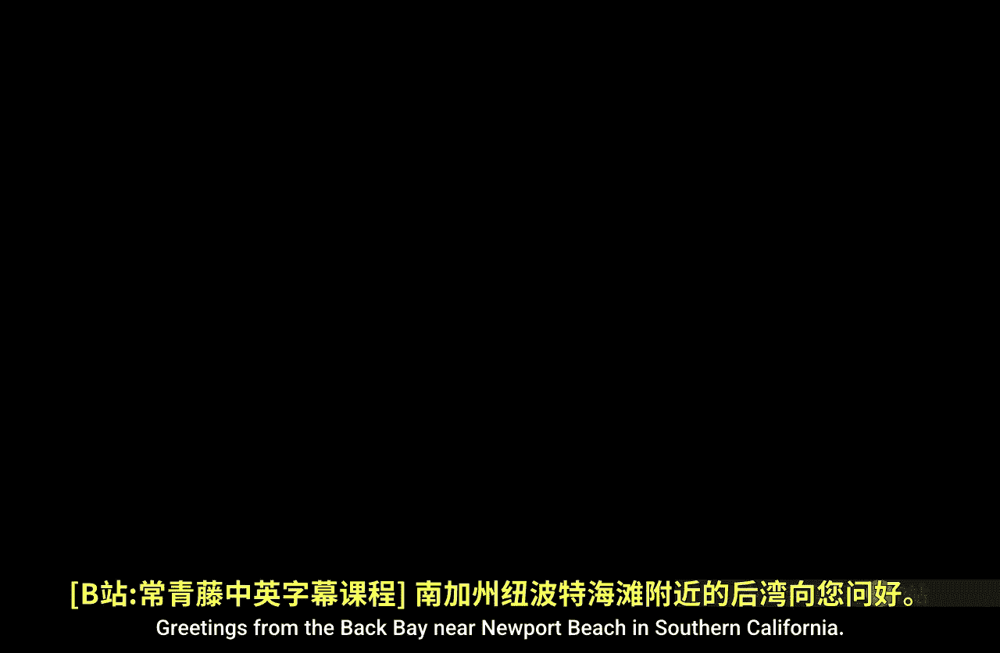
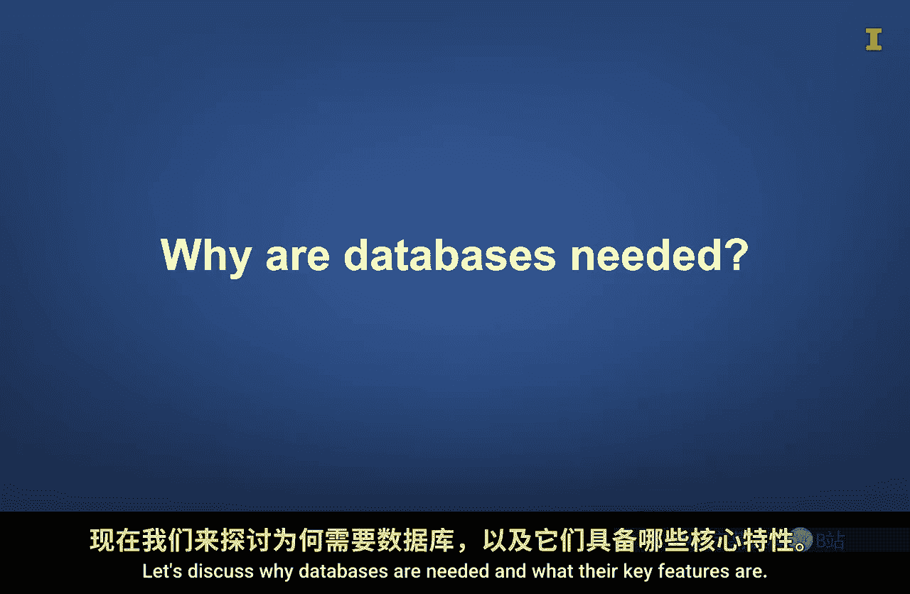
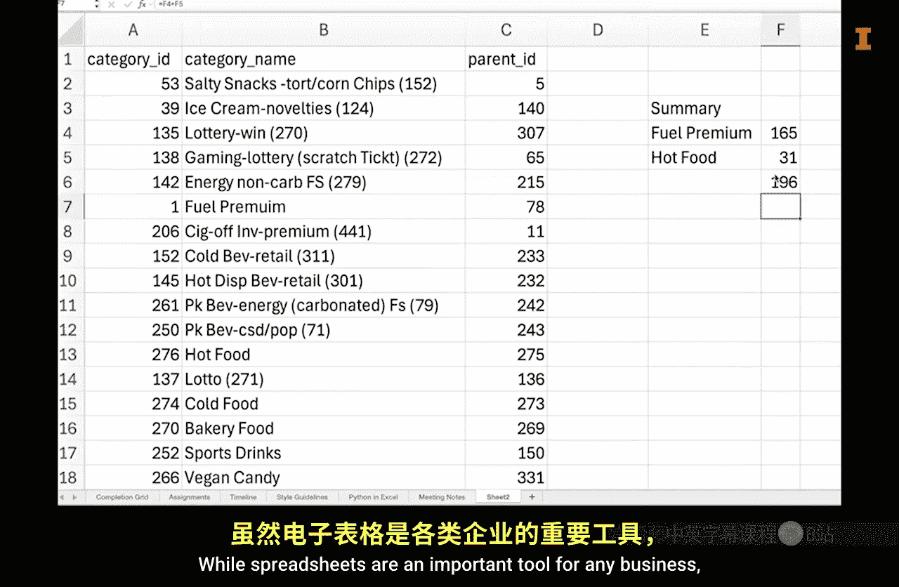
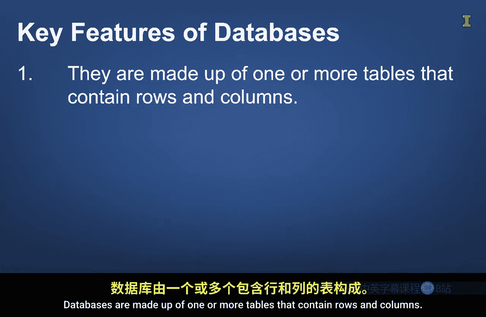
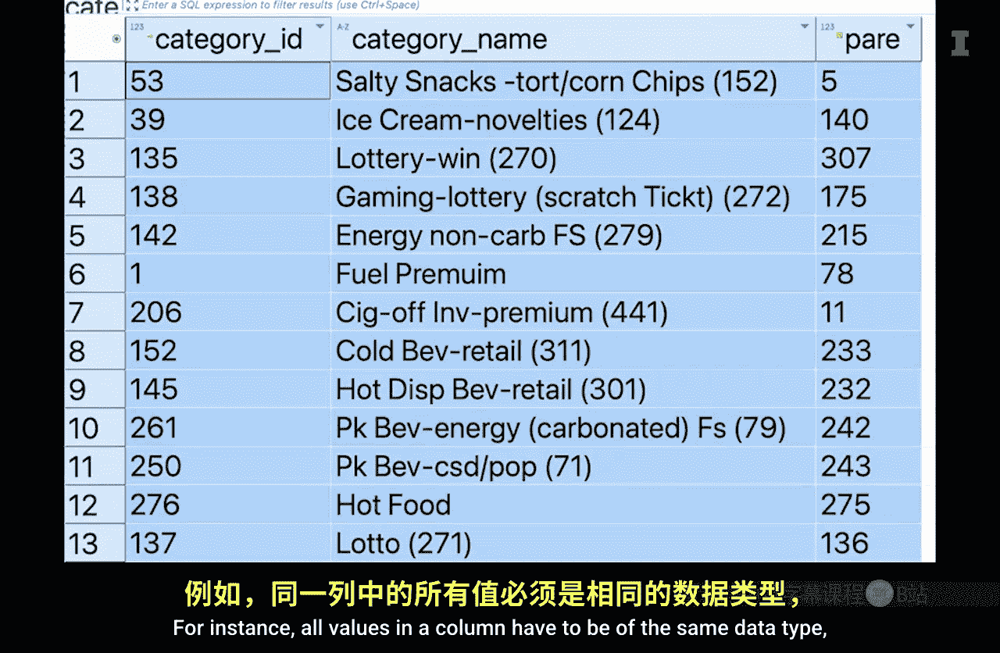
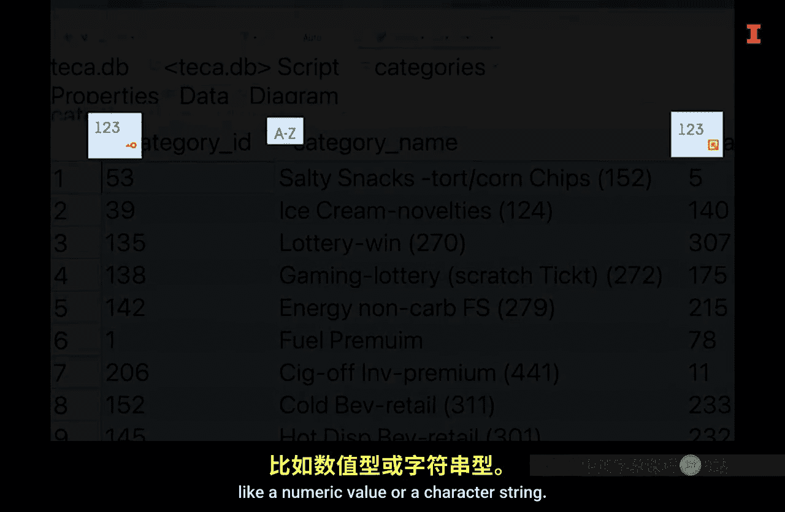
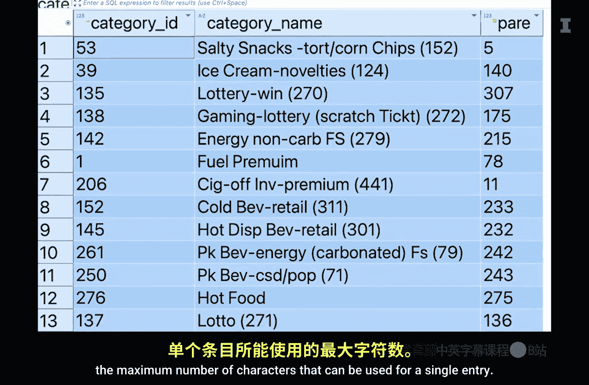
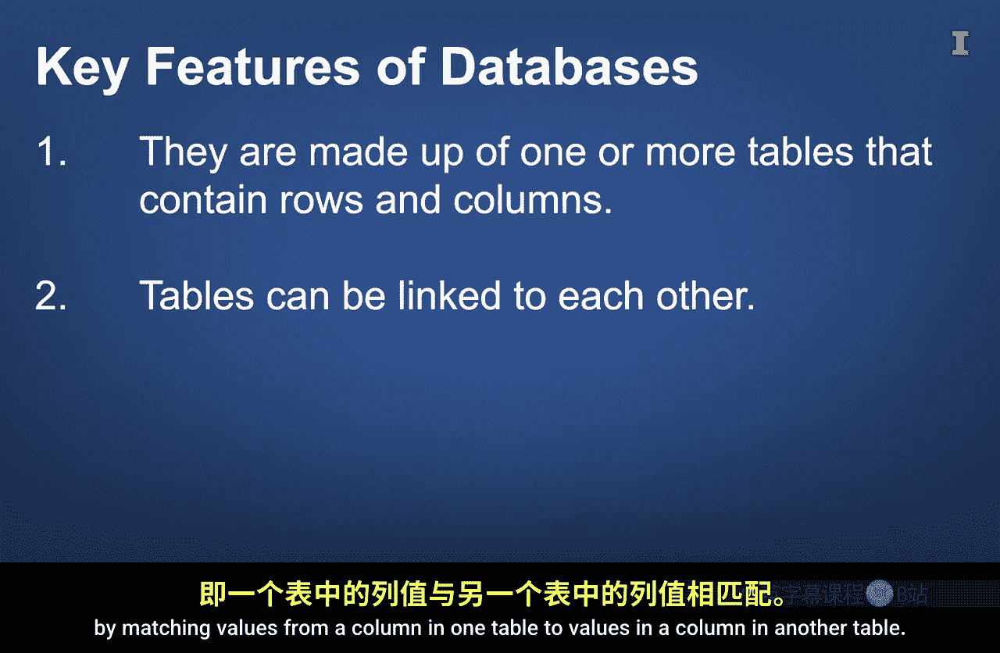
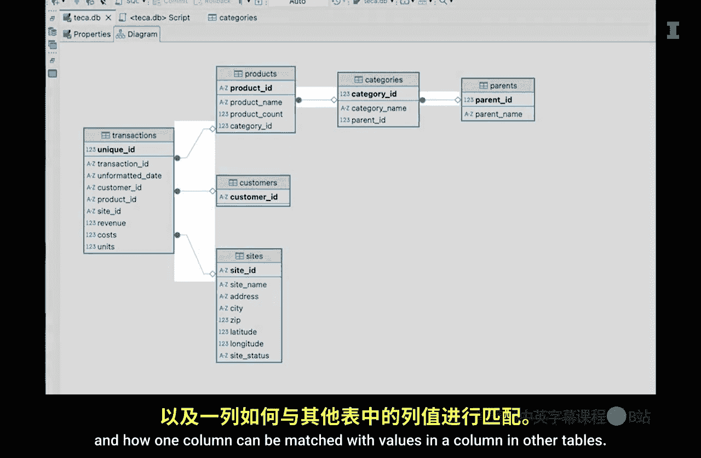

# 伊利诺伊大学【中英⚡商业分析｜Business Analytics Specialization】 p111 P111 01_数据库导论 -BV1z86nB9EGz_p111-

Greetings from the Back bay near Newport Beach in Southern California。

This vast inland Dlta is a place where saltwater from the Pacific Ocean mixes with fresh water from inland sources。

This water provides vast amounts of resources that make it ideal for birds to live in。

 as well as for humans to recreate in。It also used to be a source of commercial activities。In short。

 this vast amount of water contains lots of known resources and unknown treasures。In this lesson。

 we want to talk about relational database management systems。Frequently referred to as RDBMSs。

 relational databases， and simply databases。Like the back Bay and the Pacific Ocean。

 databases contain lots of known information and often contain some unknown treasures。

Datases have existed since the 1970s and continued to be an important way to store data because they've proven to be reliable。

 secure and scalable。Let's discuss why databases are needed and what their key features are。

So why are databases needed？To help answer that question。

 let's think about some problems that you may have faced when storing and sharing data in spreadsheets like Excel。

While spreadsheets are an important tool for any business professional。

Spreadsheets have some weaknesses when they are used to store large amounts of data that need to be accessed by many people。

One weakness is that they are limited by how much data they can store。For example。

 Excel worksheets can only contain about 1 million rows of data。 Now that's a lot。

 And for most spreadsheet use cases， it's more than enough。However。

1 million rows of data is just a drop in the bucket compared to the amount of data stored by medium sized and large organizations。

A second weakness is the possibility of having different versions of the data。

You can appreciate this if you've ever worked on a project with a team and multiple people want to change the spreadsheet file at the same time。

Reflect on what your experience was like to manage the contents in the spreadsheet file。

If you're like me， you've experienced major frustration when you realize there are multiple versions of the file。

 each one containing information that is not in the other versions。

A third weakness is the lack of structure for the data that is stored in the worksheets。 Now。

 for many people， that can be a strength because you can create artisanal looking tables。

 hide worksheets and include multiple tables on the same worksheet。However。

 when you are working with data that is constantly being updated and that many people need to use。

 the lack of structure can be frustrating。A database can solve all three of these problems。

 so let's talk about key features of databases。Databases are made up of one or more tables that contain rows and columns。

You can think of tables much like a single worksheet in a spreadsheet tool。However。

 unlike spreadsheets， there are strict requirements about the type of data that can be stored in each cell。

For instance， all values in a column have to be of the same data type。

 like a numeric value or a character string。

If it's a character string， you often have to identify the maximum number of characters that can be used for a single entry。

Importantly， database tables can contain millions and billions of rows of data。

The limit is more likely to be based on the amount of data that can be stored on the server where the database is located。

Another important feature of databases is that the tables can be linked to each other by matching values from a column in one table to values in a column in another table。

These relationships are often defined when creating the database and are summarized in the database schema。

These schemas are often visualized with an entity relationship diagram， or ERD。

Which lists the table names， the columns included in them and how one column can be matched with values in a column in other tables。

The relationship among tables in a database is important because it allows you to create new data sets that combine columns from multiple tables on an as needed basis。

This is typically done by using a query which we'll talk about extensively in other lessons。

A desirable feature of a database structure is that data should not be repeated。For example。

 rather than storing a customer's address in multiple tables。It should only be stored in one table。

This makes it easier to update a database and it also reduces the storage needs。

Another important feature of databases is that they maintain consistency in the data。

 despite many interactions with it， as well as errors。

They do this by incorporating what are known as acid properties。 Now， acid is an acronym。

The AN acid stands for Atomicity， which means that each interaction with the database is treated as a single unit。

In other words， the entire interaction works or it fails。 There's no partial completion。

The sea in acid stands for consistency。An important implication of this is that when adding new rows to a table in a database。

 you have to make sure that the data type is consistent with the data type required by each column。

The ion acid stands for isolation。Which means that when changes to the database occur at the same time。

 the result is the same as if they had happened sequentially。For example。

 consider an online transaction in which I completed transaction to buy a bike at the same time as another customer。

 Rick。If isolation did not exist， then the inventory level would incorrectly decrease by one unit rather than by two。

The presence of isolation ensures that this type of event doesn't occur。Finally。

 the D in acid stands for durability。This means that changes to the database are stored in a way such that if a power outage occurs after the transaction has been started。

It will complete once the power is regained。Okay， that's a quick overview of some key features of databases。

Just as we could say a lot more about the Pacific Ocean and this beautiful back bay。

 there's a lot more that can be said about databases like how to connect to them and how to interact with them。

We'll talk about those things and more in later lessons。

