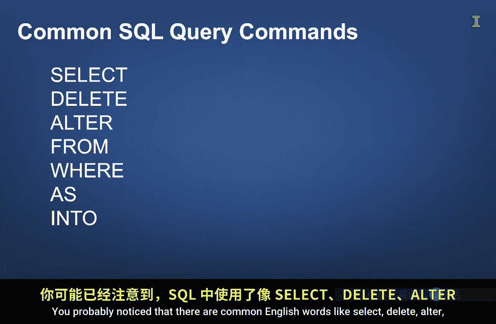
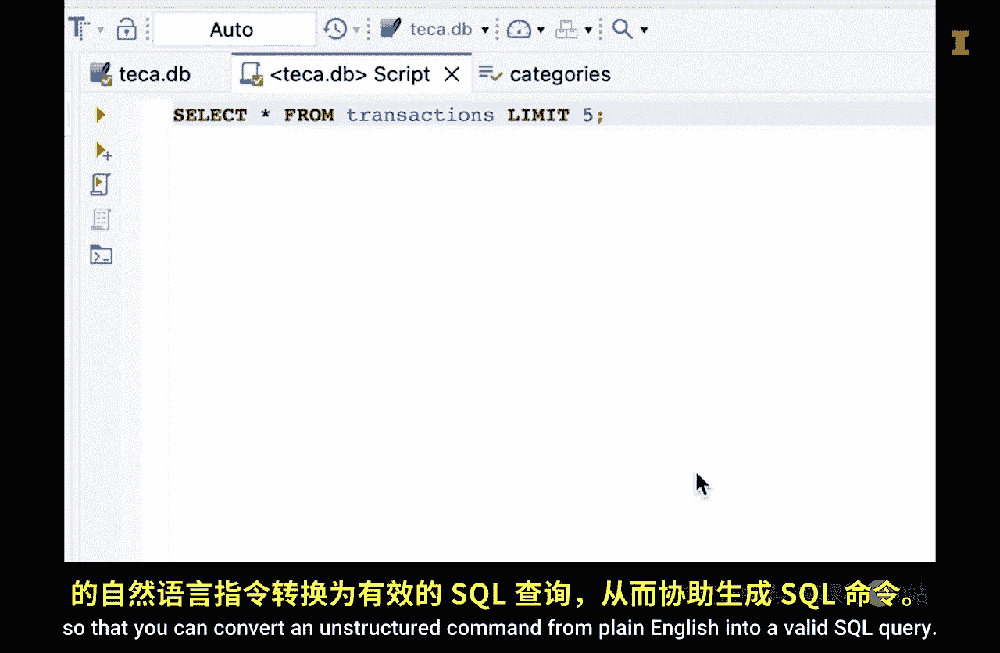

# 伊利诺伊大学【中英⚡商业分析｜Business Analytics Specialization】 p112 P112 02_结构化查询语言（SQL）概述 -BV1z86nB9EGz_p112-

I'm at a dock on Baboa Island right next to the Pacific Ocean。

 which is a source of vast amounts of productivity and beauty。

 These waters are used for many purposes， like fishing， boating and transportation。

 But to use the full benefit of the ocean， you have to have some way to navigate the waters like a kayak。

 a sailboat， a yacht or a paddle board。😊，Similarly。

 relational databases have vast amounts of potential in them。

 but you have to be able to navigate them in some way。In a prior lesson。

 we talked about relational databases Now that you have an introductory knowledge of what a relational database is in this lesson。

 we're going to focus on how to interact with relational databases by using an easy to understand language。

 which is known as structured query language and is typically abbreviated as S Q L。

 and referred to simply as SQL。While the terms structured and language should be pretty straightforward。

You might be wondering why the word query is a part of the SQL name。Well， in general。

 a query is a question。So in the context of relational databases。

 you can think of a query as a question that you are asking to the database。In response。

 the database will return a portion of the data as an answer。

You can also create queries that do more than just return a portion of the data。For example。

 you can create queries that will use the relationships among the tables to return a data set that combines the data from multiple tables。

You can also create queries that will return some calculations about the data like the average and median values。

Let's listen to Tucker Campamp at data analystly at Qualtrics， discuss how he uses SQL。

My name is Tucker K。 I work as a data analyst at Qualtrics。 I work on the services operations team。

 We， we support the customer operations teams with their insights and analytics and create dashboards for them。

 That's kind of a little bit of what I do。😊，Yeah， the main tool that that I use as a data analyst is SQL。

 It's a tool that helps extract， retrieve data， manipulate data and。

 and present data in a way that that is effective and useful。 That's the main tool I use。

 Another tool is Python。 to do some more heavy statistical analysis and visualizations。

 So those are probably the main two tools I use。 And then a lot of just spreadsheets and。Google Docs。

In， in terms of technical tools that I use。 Yeah， the main SQL commands that I use obviously。

 select statements。 That's just retrieving。Data that， that I need。Deleting from altering， let's see。

 like an al statement in SQL， for example， If I need to add in a new column to a table。

 I can use an al。Alter statement。 Or if I need to delete certain rows that may have bad data or missing information or things like that。

 I can use a delete statement。 But the main 1 I use is is a select statement。

 selecting columns that I need fields that I need， the ones that I'm trying to create insights from。

Yeah， AI plays a big role in in helping me with SQL queries and Python code。

 The main thing that AI has helped me with is debugging and finding errors in my code。

 I feel like usually when when there's an error in my code。

 It takes a long while for me to figure out where that error is happening。

 Sometimes the error message doesn't give me a lot of detail。 The AI。

 I'm able to kind of upload this and say， hey， I'm seeing this error， can you help me detect where。

 where it's coming from。 And it really helps me debug things and and move along in the process a lot quicker。

 whereas if I get stuck on that like myself， it's gonna take a long time to work through it and and figure out where that error is。

 It also AI also helps me。😊，Make my code more efficient and run quicker。

 Sometimes when I come up with the code on， on my own， it's really inefficient。 It does。

 It does the trick， but it doesn't do it very fast。

 And so AI really helps cut down that time and make it more efficient。As Tucker mentioned。

 SQL can be used to edit tables， remove tables， add data to tables， and read data。In this course。

 we are going to focus on using SQL to read data from a database。

Tuckcker mentioneds several commands that he uses。You probably noticed that there are common English words like select。

 delete， alar， and from。

Other key words include where as and in to。So one of the advantages of SQL is that it's pretty easy to understand。

Once you become aware of some of these key commands and their required structure。

 you can use them with table names and column names to create queries。

You'll see that just a handful of commands will allow you to complete many queries。Moreover。

 as Tucker mentioned， AI tools are super helpful for debugging SQL queries and improving their efficiency。

AI can also be used to generate SQL queries。Now， you should note that there are a variety of implementations of databases。

 each of which has its own slightly different set of SQL commands。 For example， SQL light。

 Post GsqL and MysqL are examples of open source databases that do not require licensing agreements and fees。

On the other hand， Oracle Dataase， Microsoft SQL Server。

 and IBM DB2 are examples of commercial databases that require licensing fees。

Each flavor of database has its own advantages and disadvantages。Importantly， though。

 the SQL commands for interacting with any of these databases is mostly the same。

This means that the experience you gain from working on an open source database like SQLL will largely transfer to working with a commercial database like Oracle database。

You should also know that there are integrated development environments designed specifically for working with databases。

For instance， D Beaaver， MySQL Workbench， Oracle， SQL developer。

 and Data gripip are just a few of them。They help to create SQL commands by highlighting the syntax。

 by creating a visual representation of the schema， by previewing the data from the query。

 and by integrating AI tools into the environment so that you can convert an unstructured command from plain English into a valid SQL query。

While we probably won't work with these IDs， hopefully understanding some of the common ways that people you SQL will help you interact with them in a more productive way。

So now you have a solid overview of SQL's purpose and potential。

 SQL is like the boat that allows us to navigate the ocean of data stored in a relational database。

 The real learning begins with hands on practice， which we'll explore in our upcoming lessons。

 See you there。😊。

