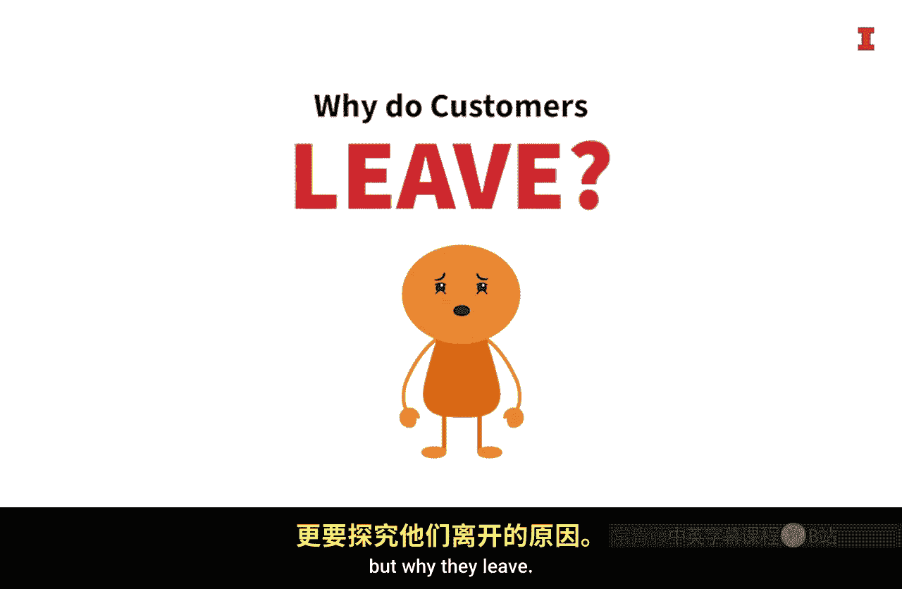
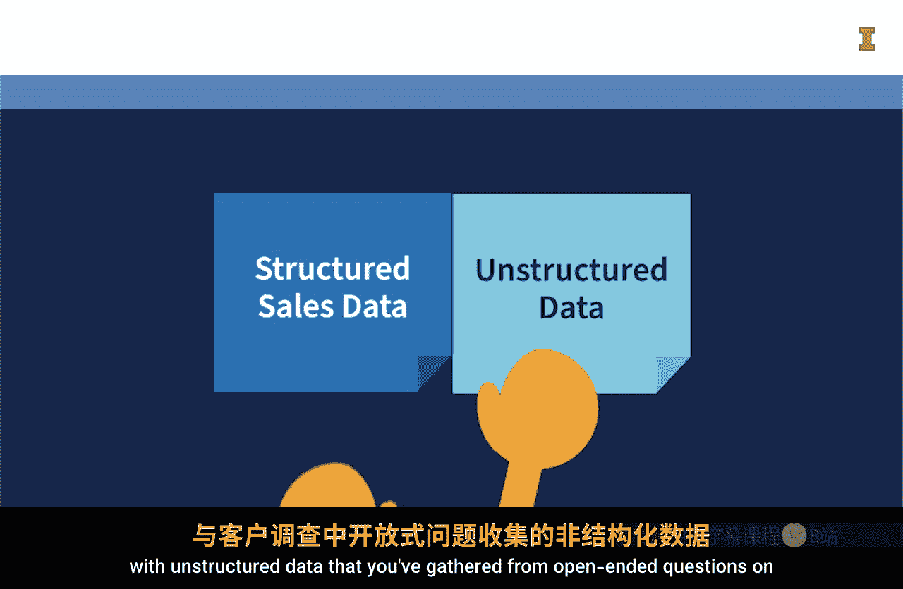
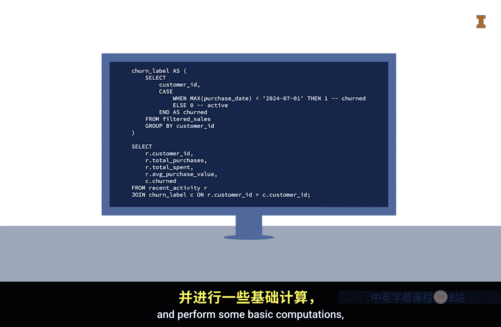
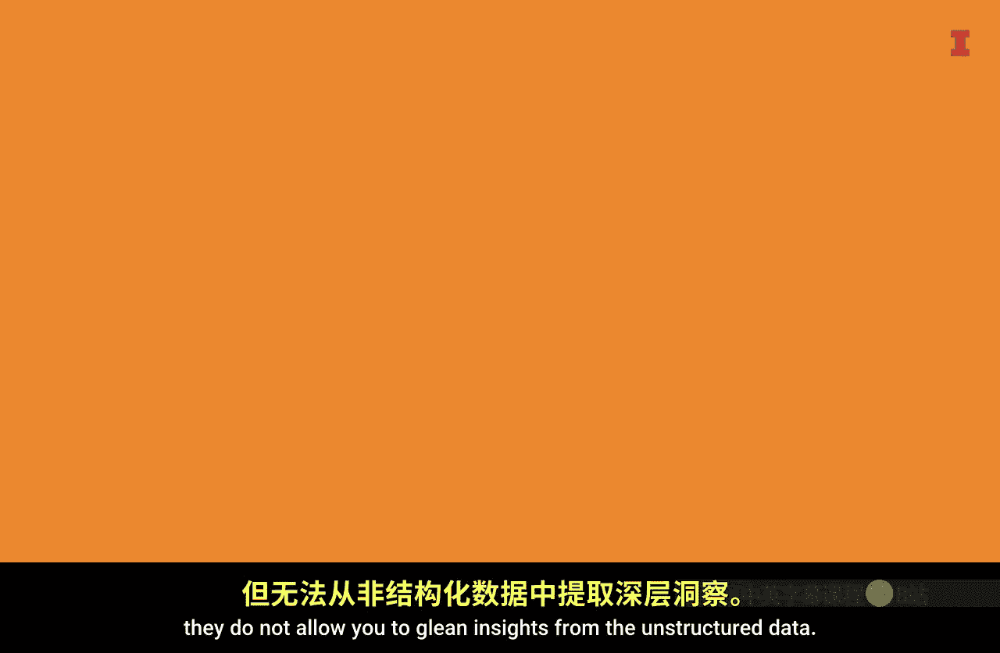
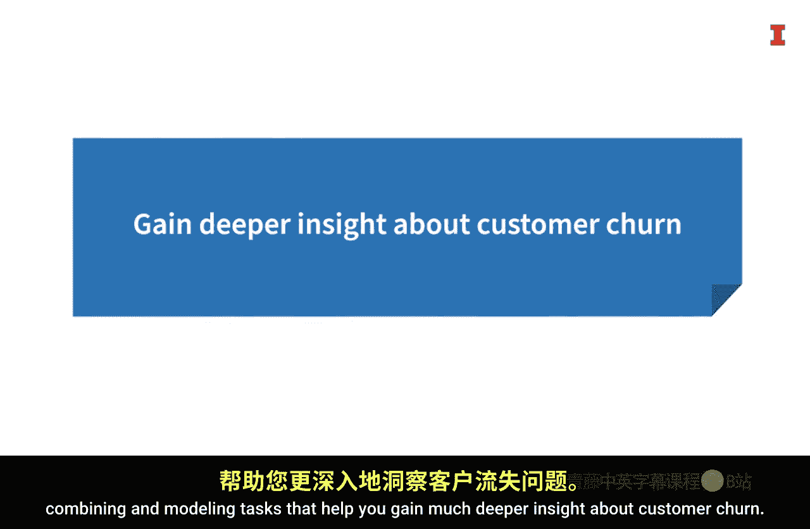

# 伊利诺伊大学【中英⚡商业分析｜Business Analytics Specialization】 p114 P114 01_为什么我们需要SQL和Python -BV1z86nB9EGz_p114-

There are some things that are just meant to go together like sand and water。

Combining sand and water allows you to make some really cool things like sand castles and other sand sculptures。

Another powerful duo is Python and SQL。 In this lesson。

 I want to talk about why it's powerful to know how to use Python and SQL together。

Imagine with me the following scenario。You have had a lot of hands on experience。

 and you are now a SQL expert。Do you need to get sales data from last quarter or a list of customers for a specific product from a certain region。

Not a problem because you can write queries to gather that data in your sleep。

One day you get a new challenge。Your team wants to understand customer churn。

 not just which customers leave， but why they leave。

So you want to combine structured sales data about customers' purchase history with unstructured data that you've gathered from open ended questions on customer surveys。

You then want to create a model to predict the likelihood that a customer will remain a customer for the next year。

While your SQL skills allow you to read the structured data and perform some basic computations。

They do not allow you to glean insights from the unstructured data。

So you reach out to the data science team and they show you how Python can be used to gain a lot more insight from the two data sets。

For instance， they show you how a few lines of Python code can clean up and structure the messy survey data。

 Understand the sentiment behind the words。Quantify that sentiment， and visualize it。

They then ask if you'd like to combine that data with the data that you retrieve using your SQL skills so that you can create a model to predict the likelihood that customers will leave。

You are so excited。 However， your excitement fades as you think of how complicated the workflow will be。

😊，You ask if you'll have to create SQL code in one file， Python code in another file。

 and then schedule one platform to run SQL and another platform to run Python。

But then you learn that with just a few pandas functions。

 you can perform SQL queries and save the data as a data frame。

This nearly brings tears of joy to your eyes， because you now realize that you can easily use your sequel skills in a Python environment。

 drastically reducing the complexity of the process to complete the data cleaning。

 combining and modeling tasks that help you gain much deeper insight about customer churn。😊。

Okay， what did you think of that scenario？One purpose of it is to highlight how combining SQL skills with Python skills dramatically increases the insight that you can gather from data。

While SQL is a trusted， well known proven language for retrieving structured data。

Python is more versatile and can be used for cleaning， combining。

 and making more advanced calculations with the data。

Another purpose of that scenario is to highlight that you can embed SQL queries within your Python code。

 making the whole process much easier because all of those steps can be stored in one file and run with one platform。

Since you can filter and summarize data using SQL queries and Python commands。The next question is。

 how much of the data filtering in summary should you do with SQL and how much should you do with Python。

I spoke with Jeff Campbell， a senior software developer who has extensive experience using SQL and applications that he develops。

Let's listen to his perspective on where to clean and summarize the data。

 So my name is Jeff Campbell。 I have been。Working in the software engineering arena。

For probably 30 plus years now。I've currently worked for the Church of Jesus Christ of Laity Saintts as the most senior software developer for the mobile team working on mobile apps。

Throughout my career， I've worked both nonprofit and for profit type of businesses。

 I've worked in Noval。Work that into it， working on Quickbooks。I've worked for the state。

 and I've worked for startups。'， I've kind of gone the rounds of。Yeah。

Corporate type of business to startup type of business， to personal things and all the like。

SoLo of experience programming and for lots of different types of companies。

Different companies doing different things。 I've done web development， I've done desktop development。

 I've now doing mobile development。 I've been doing mobile now for。

1516 years ever since the first versions of， of the mobile apps have come out and back end services。

 database type of things， endpoints， I mean。嗯。And multiple languages along the path of doing that。

 too。What kind of data cleansing or data preparation do you go through。

 what kind of tasks or even combining data do you do that？

I try to do as much from the data source as possible。Because usually the source is much faster， like。

 for instance。If I'm doing， I have large data set come from a SQL database。

It's going to be way faster， way more performant for me to do as much as I can in that SQL query。

To trim things up， combine them up and then hand it to me。

 Then for me to get a mountain load of data。And then have to go hand through and parse these through together。

Because one， I've got way too much more data than I need in the first place。

And these databases are highly performant compared to what I can do on post processing。

 especially because it's going to take a lot more memory because I'm going to have to hold state as I'm doing this。

Now， one thing that we have to be careful of is whether it's from a database。Or an API。

And you're not the person that supplied the data in the API。Or the database。

 you just don't know what you're going to get。 So you have to play extra cautious on it。

 Like you may say， hey， I just looked at this database。And say， oh。

 look at everybody's got a first name。Right。But what you didn't know is that 100000 rolls down in the database。

 It's got a batch of people with missing first names。And they're just null。

 and that will totally crash that you're at potentially because you didn't expect for a null patient。

 So we tend to always be over cautious on the data that we're getting unless we have a hard contract from the data provider saying。

 I guarantee you。That we will never return an empty first name on any individual we pass back。

And you have to have that agree。 But if they， if I， if I don't get that。

 that confirmation and of that contract， then we typically say， it could be no。At any time。

 So you gotta think ahead to what。Possible problems。

 There could be in the data and either guarantee they won't happen or build something in so that it doesn't crash。

 but when when you get into the real world as things and you're dealing with hundreds of thousands and millions and billion of rows of data。

 my saying is I always say to myself is what can happen will happen。

And they should just plan for that。And fine， you add just a little bit of extra code to handle those situations。

 but it's going to save you in the end。Type type of thing。

 So by either do bulk L processing at the core as the source。

You' have to do always sometimes you have to do post processing yourself because you're also handling for null cases or things that unexpected cases。

 but that is to a minimum。And that that will help tremendously for high performance applications and or high performance processing of。

Bloads of data， especially in analytics and analysis and things like that。 Awesome。

 As Jeff pointed out， it makes sense to do as many calculations as possible。

 as close to the data source as possible。That means that if you can do a calculation with the SQL query。

 then it's usually best to do so because it will be faster。However， at this early stage。

 as long as you're not reading in more data than your computer can handle。

 don't worry too much about whether you filter and summarize the data with SQL or with Python。Also。

 as Jeff pointed out， you should expect some errors in the data。

 even when it comes from a structured table in a relational database。Thus。

 the skills that you have learned for assembling data with Python will still be needed when reading in data from a database。

Now that you have a better understanding of why we need SQL and Python。

Let's get some hands on practice， using the two languages together。

