# 伊利诺伊大学【中英⚡商业分析｜Business Analytics Specialization】 p115 P115 02_在Python中连接和断开数据库 -BV1z86nB9EGz_p115-

嗯。

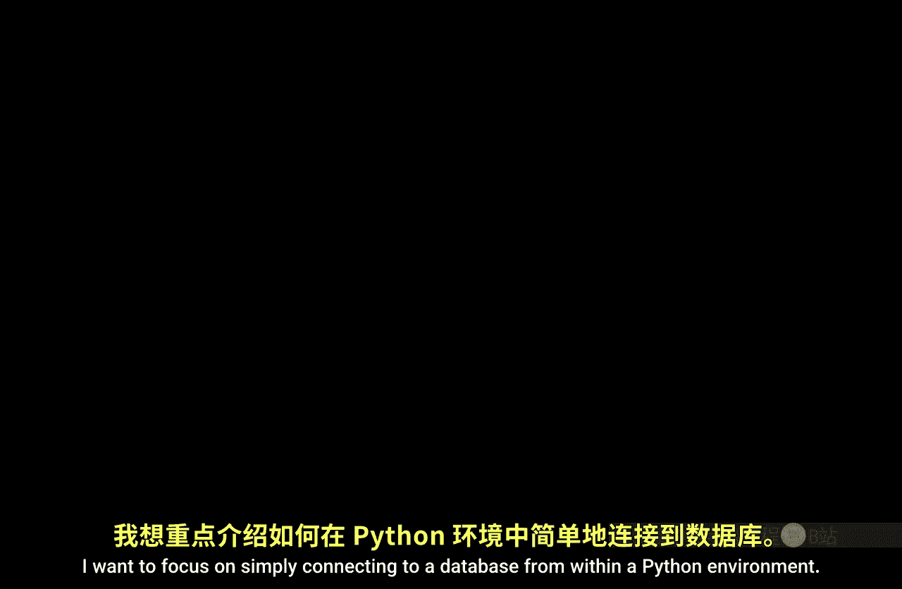

In this video， I want to focus on simply connecting to a database from within a Python environment。

 so I'm first going to show you two different ways of doing that for a SQLite database。

And I'll then talk about how that connection would differ if you were using a different type of relational database management system like MySQL or Microsoft SQL Ser。

So let's go ahead and look at this Jupiter lab environment。

 Before I start going through the code for this to work。

 it's important that you have this techca do Db file in the same folder as your Iy and B file。

 And so you can see if I click on the file Expr here。 I've got the techca do DB file in there。

 That's the SQLite database file。 The first thing I'm going to do is import functions from the pandas module。

 I'll talk about why in a minute。

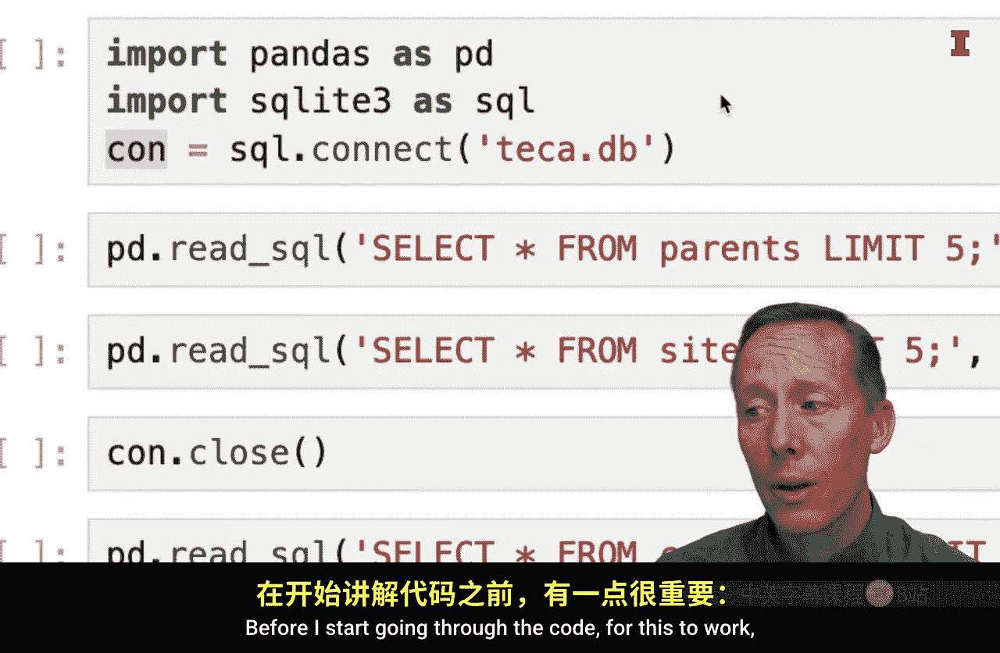

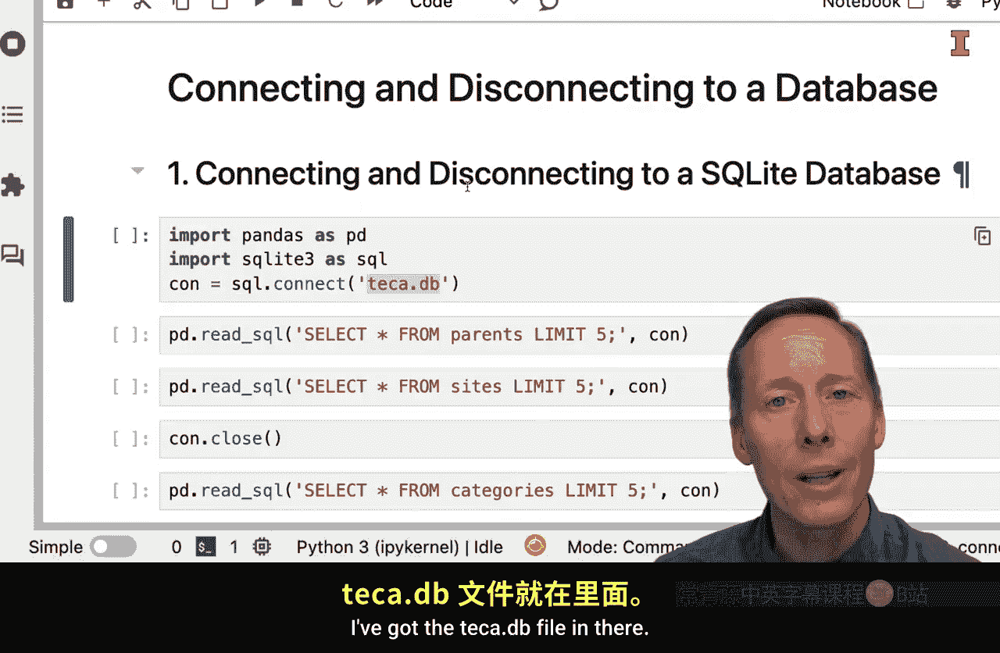

And then here's the new thing is we want to import functions from the SQLite 3 module。 Now。

 this is a programming module that comes with the standard distribution of Python。

 so you shouldn't need to have to install this。 Once we import functions from the SQLite 3 module。

 we can use the connect function and simply give the name of the database file that we want to connect to and we're going to store as a connection object。

 which I will label as con。 so if I run that， you really can't see that anything has happened。

 but now I have established that connection with that techca database file。And then after that。

 I can use the pandas read SQel function。Now， this function is really great because it does a lot of things in the background that we don't have to worry about。

 So let's look at the arguments for this function。 You can see that this first argument is a simple query where I'm going to select every column from the parent table and then limit what is returned to only five rows。

And importantly， I need to also include this connection object as an argument in this function。

 So if I do that。

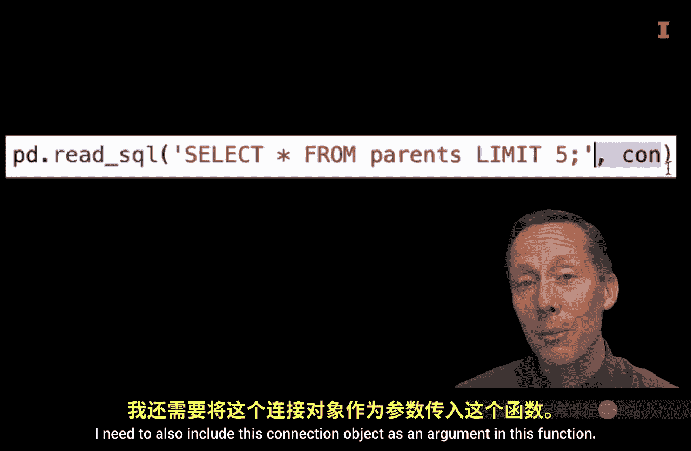

You can see that what it returns is a data frame。 Now this is really important because most of the time we work with data frames in this Python environment。

Now， if I weren't using the Read SQL function， I would have to use several other functions。

 go through three or four steps to read in the data and convert it to appenddas data frame。

So this read SQL functions is really awesome because it does it for us。Alright。

 so I can then just perform another similar but different query。

 let's read in the first five rows from the sites table and display that。

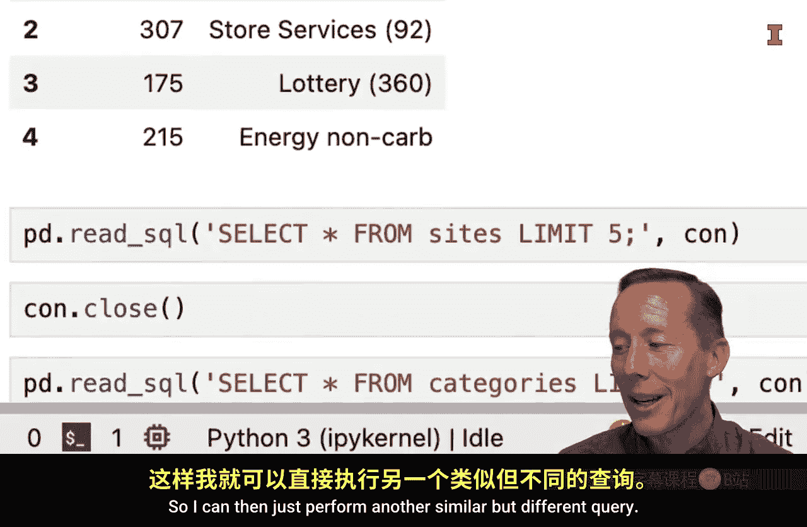

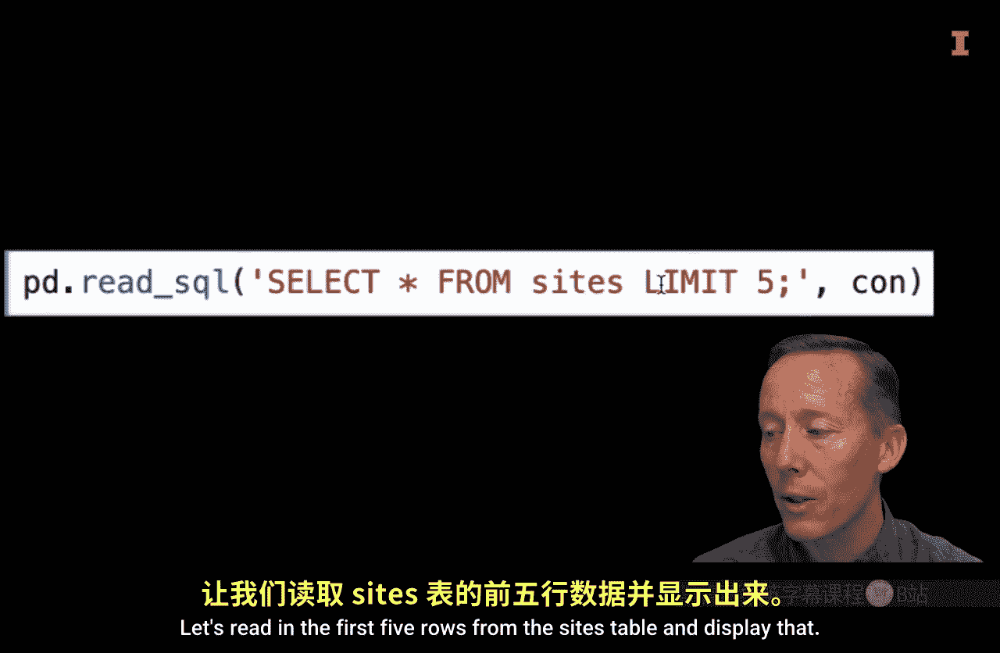

Alright， so it's pretty easy to connect to a SQLite database。 Importantly。

 you should also always disconnect from a database when you're done querying it。

 every connection requires some resources and if you forget to close that connection it could lead to problems。

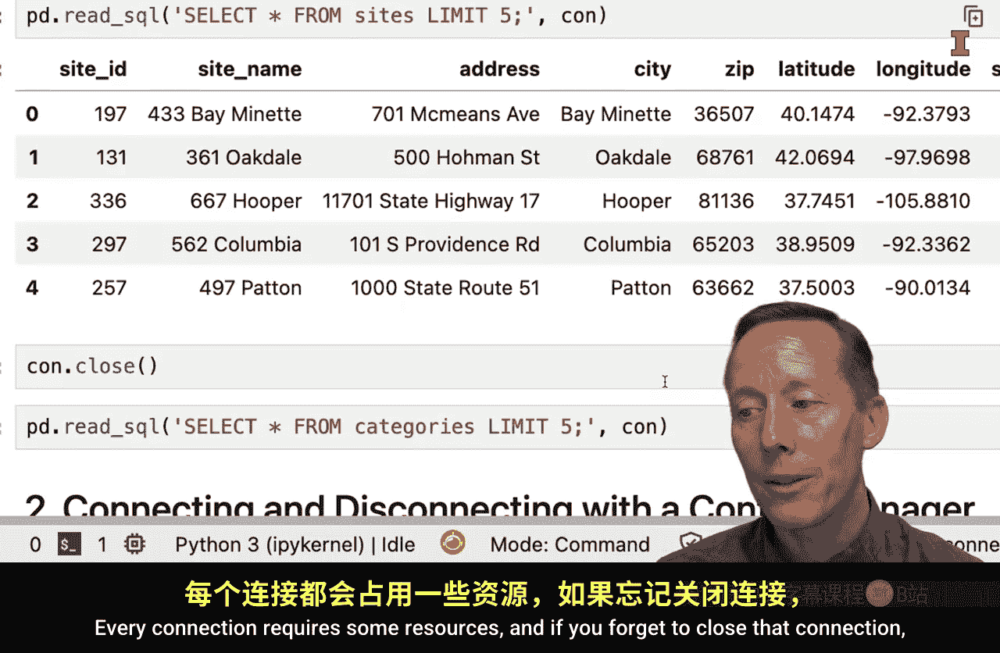

So to close the connection， we simply take that connection object and then use the close method on it。

 Okay， so if I do that。Again， you can't see anything。 Now。

 if I were to try to perform another query using that connection object， I would get an error。

 If I scroll down to the bottom of this， it tells me that the reason why I got this error is because it cannot operate on a closed database。

 and this manual opening and closing of the connection is really useful。

 If you've got several different queries that you plan on performing。

 like when you're first exploring a database。 If you just got one query that you want to perform。

 What's recommended is to use a context manager。

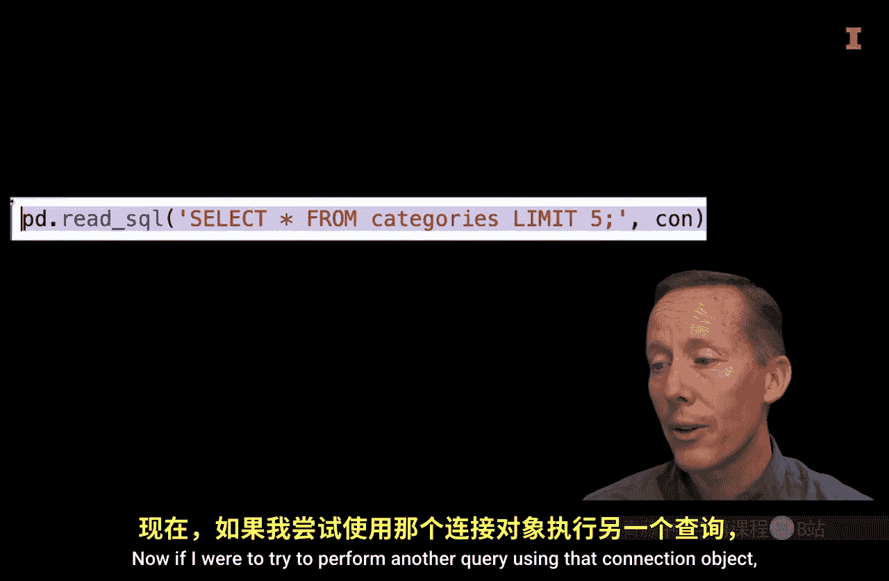

And let's look at how this context manager works。 So I've got this line of code here that starts with with。

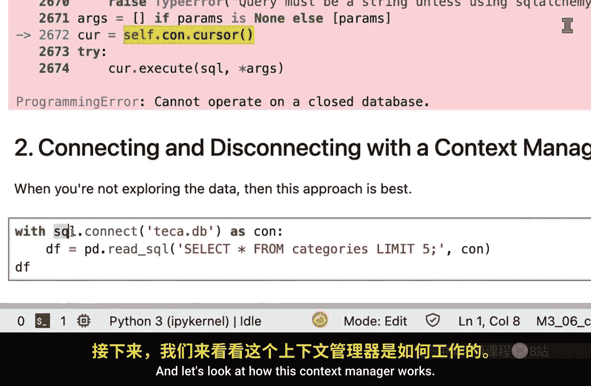

Okay， and that's a key word， which is why it's green。

 And then I've got that same SQL dot connect function connecting to the techca database。

Instead of setting it equal to con， I'm saying as con so I want to establish that connection as this object con。

And then I can go ahead and perform the same query， and I'm going to save it as a data frame D F。

And you can see that this line of code is indented。

 and what that means is that it's operating within this with statement here。

And so once I leave that with statement by unindenting the next line of code， this closes。

And that connection will close automatically。

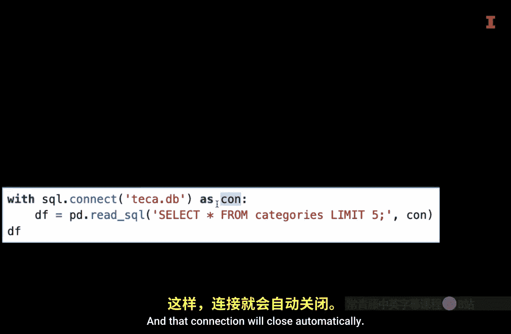

Okay， so if I run this， you can see that I get this data frame that's returned。

 but I don't have to manually close the connection。 Okay。

 so the main benefit of this is that it will automatically close the connection。

 You can use either approach， but I'd like to use this context manager if I'm just going to perform one query。

 Okay， so that's how you connect to and disconnect from a SQLite database。 many times。

 though production databases will not be SQLite databases and they will be located on a different computer。

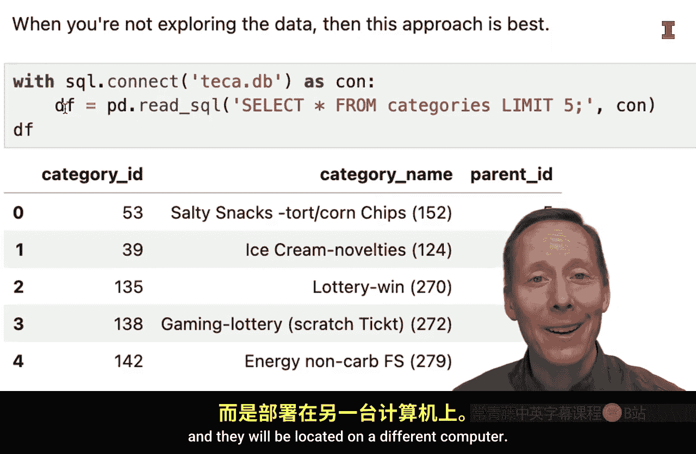

So let's talk about how the connection would differ。

 What you would want to do is identify the type of relational database management system that you want to connect to。

 and then you would need to identify what type of Python modules you can install on your computer for interacting with that database。

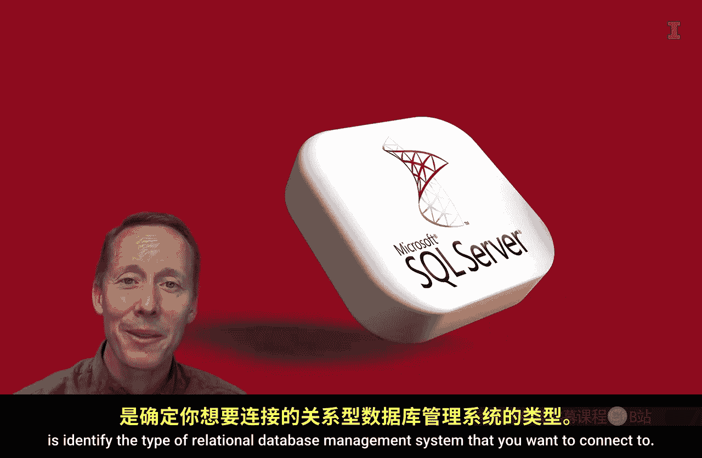

So let's say you know that your company uses a MysQL database。

Then you could install the MysQqL connector module。And then you'd want to import functions from that。

And then the connection would look a little bit different。

 so you'd need to use the appropriate function。And in addition to just the name of the database。

 which is in here。You would need to indicate a username and password。

As well as a URL R L for where that database is located。Okay， and then once you've done that。

 the other commands for reading data from the database would be the same。Al right。

 so that would be a MySQL type of database if it were a MicrosoftSQL server database。

 there'd be a different programming module that you'd want to install and then import functions from。

 and it might look a little bit different。 The keyword are a little bit different。

 but you've got the same basic elements there， the server， the database name。

 the username and password。

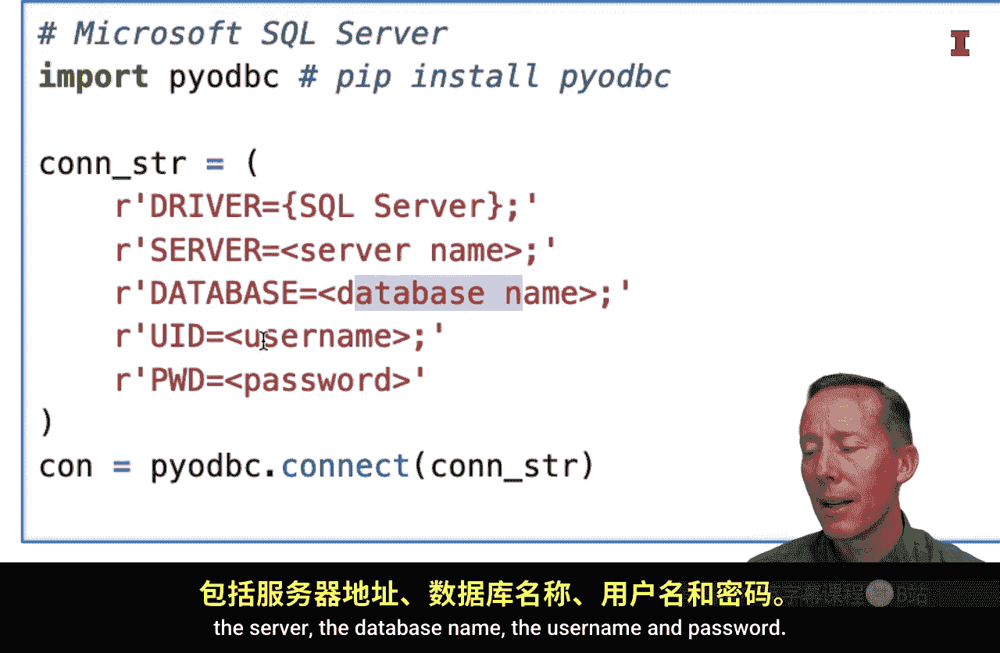

Anyway， there's two examples。 there could be many more depending on the type of relational database management system that you're trying to connect to。

 All right， so we've explored how to connect to databases in Python。

 both with the safety net of the width statement or the context manager and by manually managing the connections。

 We've also touched on how the specific code might look slightly different。

 depending on the database system you're using， whether it's Postgres， Q L， MysqL SQLite。

 MysQL server。Primarily， the difference is the libraries that you would use and the specifics of that connection。

 The key takeaway is understanding the fundamental steps。 establishstlish a connection。

 performform the query or queries， and then make sure that connection is closed。

 The width statement just allows you to handle that last step more gracefully。 So keep practicing。

 And with that practice， you'll become more comfortable connecting to and disconnecting from relational databases from within Python。

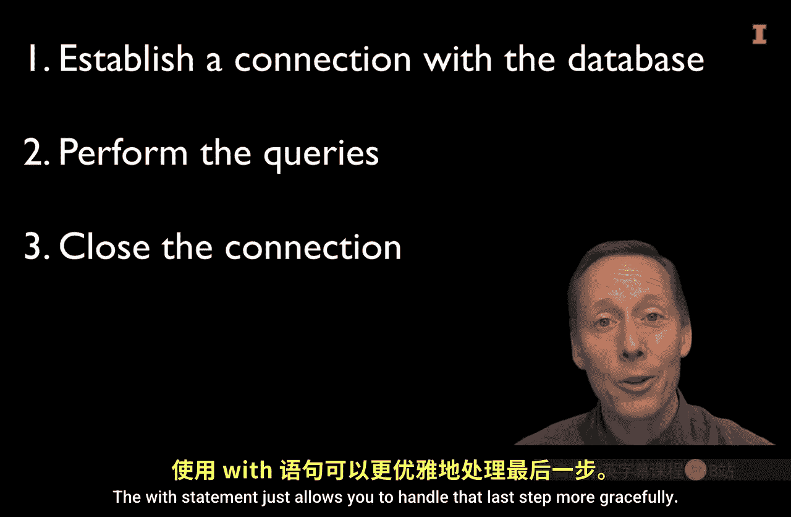

