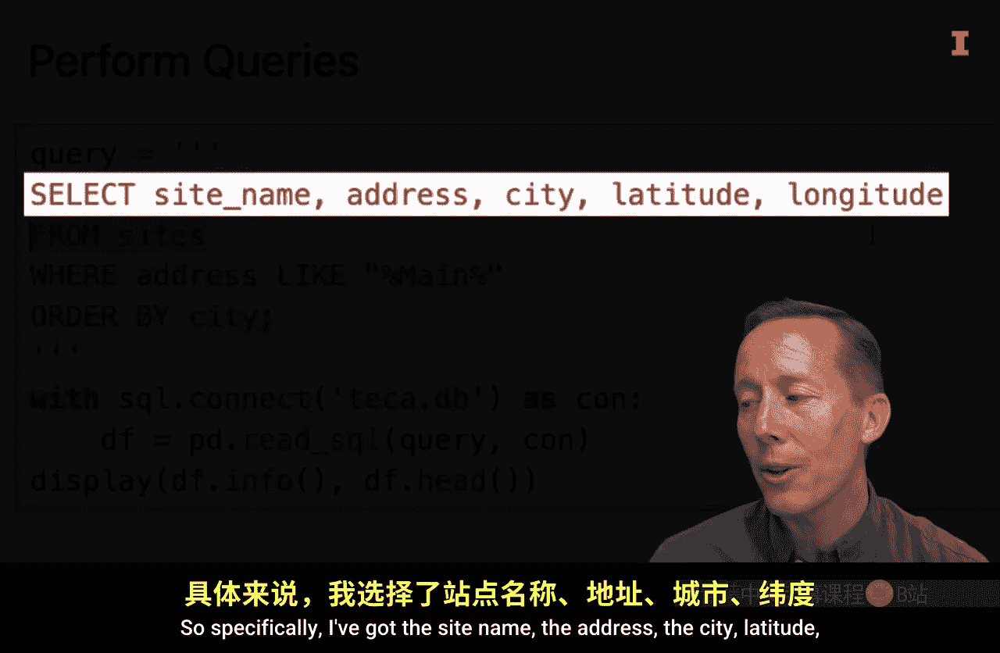
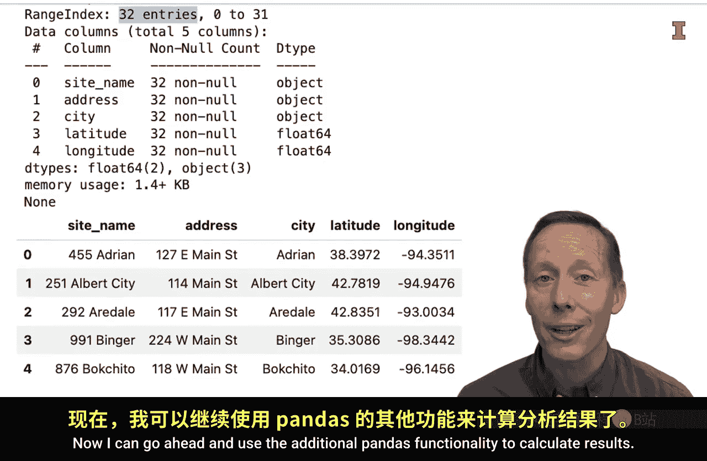
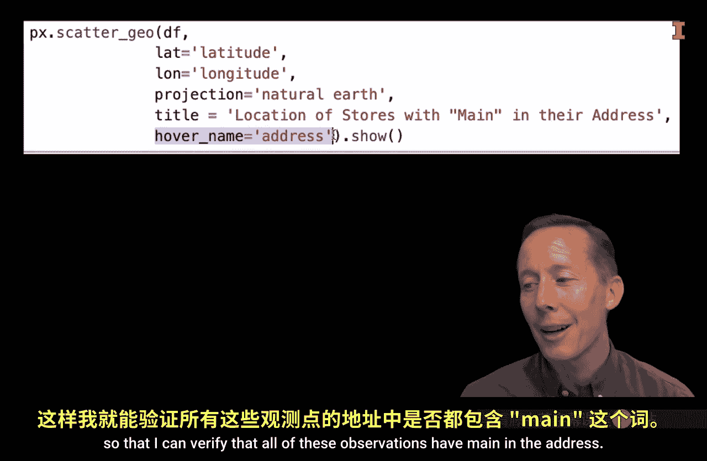

# 伊利诺伊大学【中英⚡商业分析｜Business Analytics Specialization】 p116 P116 03_Python 中的基本 SQL 工作流程 -BV1z86nB9EGz_p116-

Yeah。In this lesson， I'm excited to demonstrate a pretty simple workflow that really highlights the value of being able to access data from a SQL database。

 from a Python environment。So I've got this Jupiter lab environment open。

 and I have this IPY and B file。And let's go through the four steps of the fact framework。

 The question that I'm asking here that I'm framing is。

 where are the stores located that are on a street with the word main in the address。

Al right， so in other words， I want to be able to visualize where they are located。

 so let's go ahead and assemble the data now because I have this data in a SQL database。

 I need to connect to the data and bring the data into this environment。

So I'm going to import functions from the pandas and SQLite 3 module。

 and then I'm going to perform this query。Now， let's highlight a couple things about this query。

 This is kind of a long query。 So rather than put it on a single line of code。

 I've broken it into multiple lines so that it's easier to read。

And that's really valuable when you can make your code easy to read。 Now。

 the way I'm doing that is I'm using two sets of three quotation marks。

 and that allows me to put this text on multiple lines of code。

 And it doesn't think it's a different string。 Okay， it's all the same string here。

 And then I'm saving that as this variable named query。All right。 so then let's look at this query。

 So I'm selecting only certain columns from the site table。 So specifically， I've got the site name。

 the address， the city， latitude and longitude columns。 I don't have to bring in all the columns。

And then I'm filtering the data by saying， hey， I only want those observations where there is a string main somewhere in the address column。

And then I'm sorting the data in alphabetical order by the city。All right， so that's my query。Now。

 rather than having to go to the terminal or go to a SQL IDE like D Beaavver。

I can just perform that query right here within Python。

 so I'm going to use this context manager to connect my teched database file。

 which is in the same folder here。 If this were on a MysqL database or Postgres database。

 then that connection would look a little different。

And then I'll go ahead and use the pandas Read SQL function and add this query that I created as the variable and con as the connection object。

And then this is really cool because it goes out， connects to the database。

 reads the data in and converts it to a data frame， which we will save as D F。 Okay。

 so it does a lot of steps for us in that simple function。

 And then you can see this next line of code is not indented。😊。

Which means that I have exited this context manager here。 So that has closed a connection。

 or it will close the connection when I run it。 And then I'm going to use the pandas functions to do a little bit more of analysis on this data。

 which is to show information about the data frame and the first five rows。

 So I'll go ahead and run this cell。Okay， it works really quickly。

You can see that I've got 32 rows of data and I can get a feel for what that data is like。 All right。

 now I can go ahead and use the additional pandas functionality to calculate results。

So specifically， I'm going to use functions from the plotly Express module。

And I had to install this by using Pip install plotly hyphen Express。And once it's installed。

 I can import those functions， and I'll refer to functions from that module just PX。

Then I'm going to use the scatter underscore geo function。To basically create a scatter plot。

But it will put those points on a map。All right， so I need to go through and indicate the data frame name。

 the latitude and longitude， column names。The type of map that I want。

 and I'm just using a natural earth map。I'm going to give it a title。

And then I'm going to add some information to the hover。 So this is going to be an interactive map。

 And when I hover over the points， it will show the address so that I can verify that all of these。

Observations have main in the address。 And then I need to add on the show method here。

 So I'll go ahead and run both of these cells。

Okay， so here's my map and this is interactive， so I'll go ahead and scroll in here。

And you can see that as I hover over these data points。

 they all have main in the title there in the address。Okay。

 now I'd want to tell others about the takeaways from this and there's no significant takeaway here。

But maybe one thing is that these are all located in the Midwest， approximately。

 maybe some that are west。Okay， so then I could go ahead and tell others with formatted text that there are 32 stores with the word main in the address。

 and they're all located in the Midwest。Okay， so it's a pretty simple workflow。

 but I really wanted to highlight how beautiful it is that I don't have to use two different Is or use the terminal。

 I can just have all that coding in here。 So this makes it really easy to replicate and even adjust。

😊，So hopefully with that， you can appreciate more the value of being able to work with SQL databases from within a Python environment。

