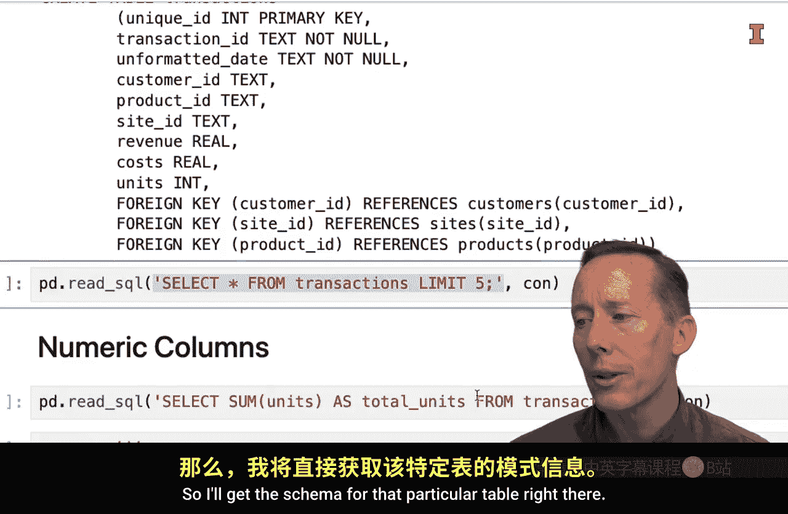
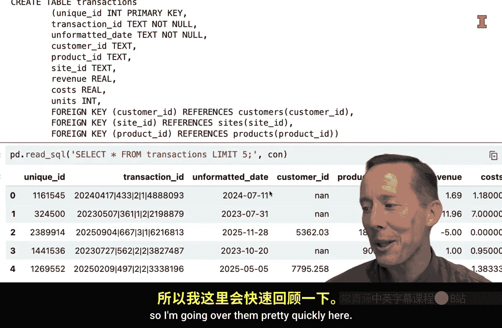
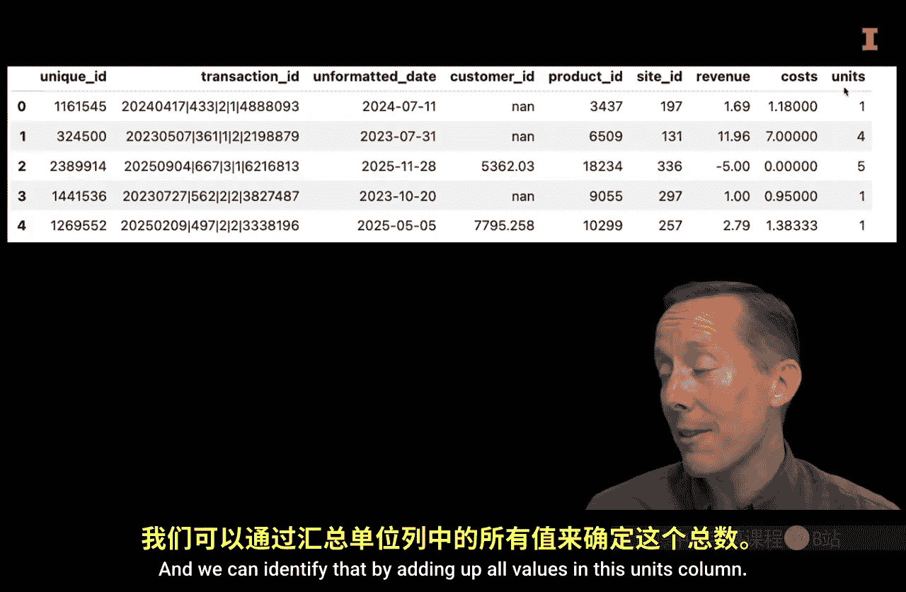
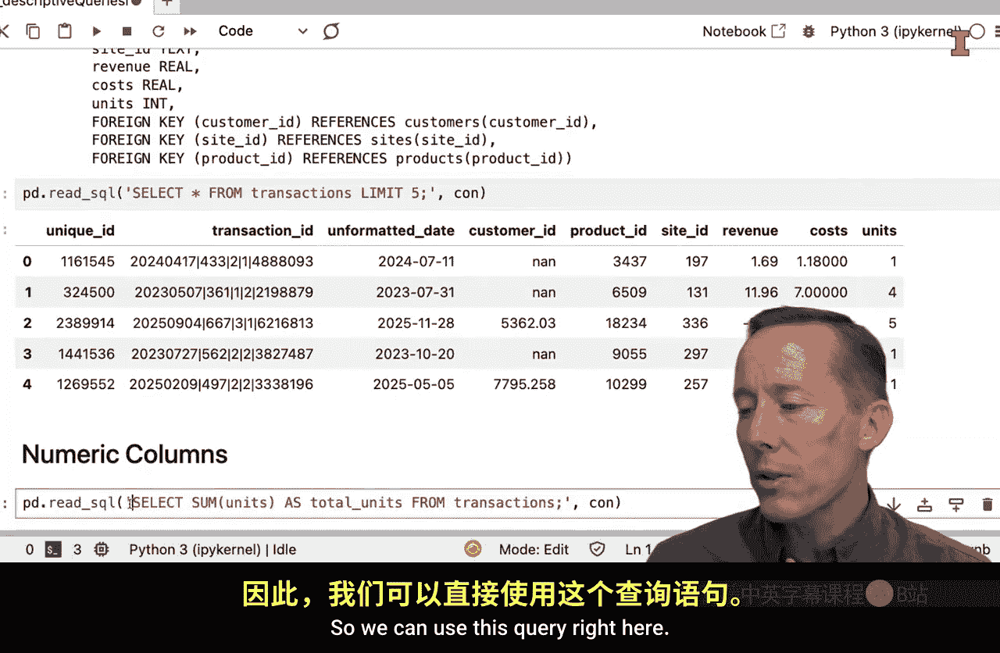
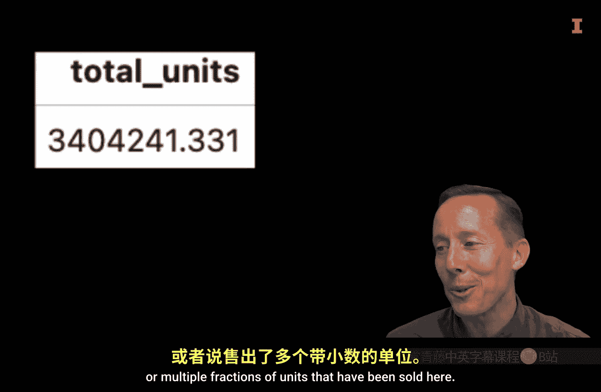
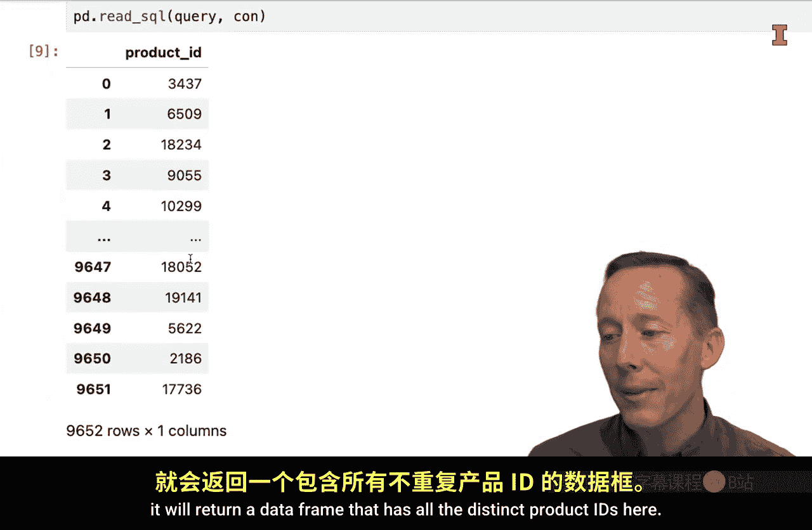
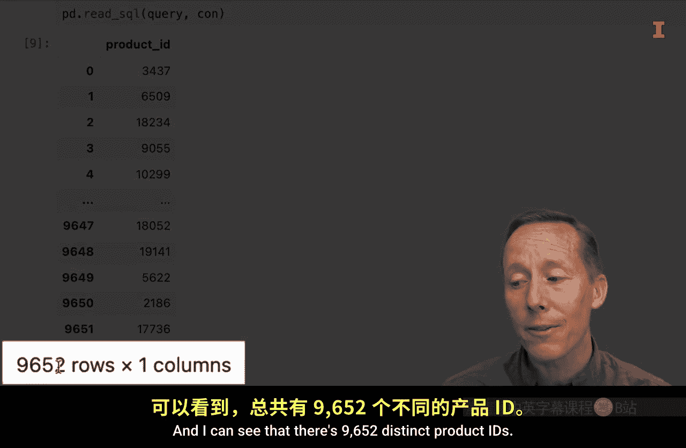

# 伊利诺伊大学【中英⚡商业分析｜Business Analytics Specialization】 p118 P118 05_Python中的SQL描述性查询 -BV1z86nB9EGz_p118-

One of the important ways for exploring data is by using descriptive statistics。

These statistics summarize key values about individual columns of a data frame。

 like the minimum value， or if it's a categorical column， the most frequently occurring value。

In this video， I want to demonstrate how you can gather some of that information using SQL queries。

Now， when we're working with a panda's data frame， we can simply use the describe method。

And while that's still a valid approach， it's useful to know how to do that with SQL queries。

 because oftentimes there's so much data in a single table of a production database。

That we can't read it all into our computer， Save it as a panda's data frame。

 and then explore it that way。 We need to first identify maybe what columns we want to read in。

 and then what rows we want to read in。So let's go ahead and go over to a Jupiter lab environment and demonstrate how we can do this all with Python。

So what I'm going to do is first recognize that I want to connect to a SQLite database。

 which is the techca database that we're using here。

 So I need to import functions from the pandas and SQLite 3 module and then establish a connection with that database。

 And those are things that we've talked about before。

Let's go ahead now and get the database schema， Also something that we've talked about。

This tells us the tables in that database。 And let's assume we want to explore the transactions table more。

 so。

I'll get the schema for that particular table right there。

 And I also want to maybe look at the first five rows of this table。

 So I'm going to use the SQL star from transactions。 limit at 5。

SQL query to read in just the first five rows。 Okay， so again。

 these are things that we've done before。 So I'm going over them pretty quickly here。

Okay， let's assume that we want to explore this data frame by looking at the units column。

Let's start off by asking ourselves how many units total have been sold。

 and we can identify that by adding up all values in this units column。

So we can use this query right here。

Okay， there's a sum function that's really easy to use。 And so we're going to create this query。

 select sum， and then we want to identify the column that we want to add up and we want to add up values in the units column。

 and then we can rename that column as total units。

And we're getting this information from the transactions table。 All right。

 So I'm going to skip over this con and the pandas Read SQel since we've talked about that before。

 just recognize that I'm performing this all from within Python。 So if I run that。

 look at the results here， it tells me the total number of units that we've sold。 A。

 there's a fraction of a unit or multiple fractions of units that have been sold here。

Now， the pandas described method can tell us a lot of information about a lot of columns such as the min。

 median， maximum values and more。 There's not something exactly like that in SQL。

 but we can take that sum function and use it in a similar way， but with other functions。 Okay。

 so there is a min average and max function。So let's create a longer query here。

 So I'm going to do this in a multi line query。 So I'm going to create a variable query and then use two sets of three quotation marks。

 And I'm going to start by saying I want to select the sum units as total units。

 as well as the minimum number of units。 And I'll call that min units。

The average number of units as mean units， the max number of units as max units。

 all from the transactions table。 And then I'll go ahead and perform that query。Allright。

 so this returns a data frame that tells me， hey， I've got that total there。

 The minimum is negative 200。 So apparently there's returns here。I've got the average， which is 3。

So that's the average for each row。 and then the max is 999。

 That's probably an indication that it's a missing value。 But anyway， that's the maximum value there。

 I can also use these types of functions on date columns as well。So in this query here。

 I am selecting the minimum and maximum value from the unformatted date column。

In the transactions table。And so from here， I can easily see that this data spans from January 1。

2023 to December 31 2025。 Now， notice that I don't have to rename the columns If I don't。

 it will give them these names right here。 They're not tidy。

 So I prefer to do as much of the work as I can in the query itself。All right。

 let's go ahead and now talk about some exploratory calculations using descriptive statistics for categorical columns。

So let's go ahead and refer to the product I column。

 And let's say we want to identify all the different product Is that I have。

 but I don't want to see duplicates in there。 So there's this distinct command。

 And if I use that for the product I column from the transactions table and then run that query。

It will return a data frame that has all the distinct product Is here。

 and I can see that there's 9652 distinct product Is。

 but maybe something that would be more important before actually looking at this with just being able to identify how many distinct product Is there are。

 so we can do that as well by modifying this query a little bit。

So specifically， all we'll do is we'll encapsulate that distinct product ID within the count command here。

And when I do that， I get a single value that tells me the distinct number of product Is，9652。

All right， so let's go ahead and close our connection。

And that concludes what I wanted to highlight here。

 there are some other queries that you could perform， but they take more effort。

 and I really just wanted to emphasize the importance of being able to explore data within a data frame using descriptive statistics before you read it into your Python environment。

This will help you so that you'll know what data that you should download and use in your Python environment。

