# 伊利诺伊大学【中英⚡商业分析｜Business Analytics Specialization】 p119 P119 06_Python中的SQL连接查询 -BV1z86nB9EGz_p119-

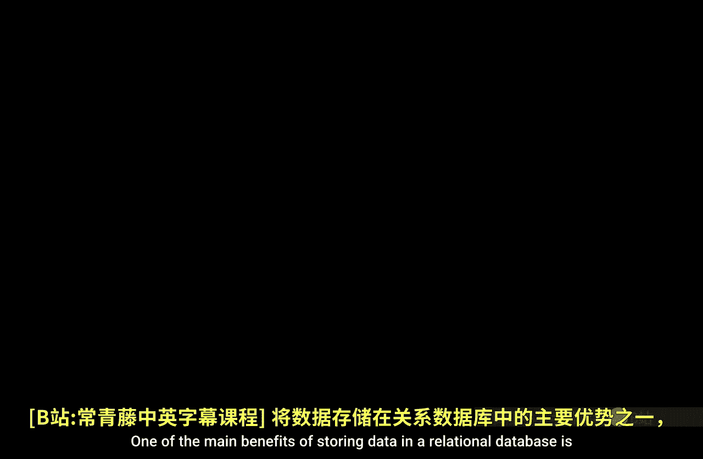

One of the main benefits of storing data in a relational database is that the various tables are related to each other。

 This means that you can perform SQL queries that will join data from different tables together and put it into a single table that you can then export to whatever environment you are working in。

So in this lesson， I want to demonstrate how you can perform join queries within a Python environment for creating tables that don't exist individually within the SQL database。

So I've got this Jupiter lab environment open， and I'm going to go ahead and import functions from the pandas and SQLite 3 modules so that I can connect to my techca database where I'll demonstrate these joins。

And then I'm going to create a connection to that techca database using the SQL connect function。

Let's go ahead and get the database schema so that we can see what tables are in this database。

 and I can see I've got six tables here。

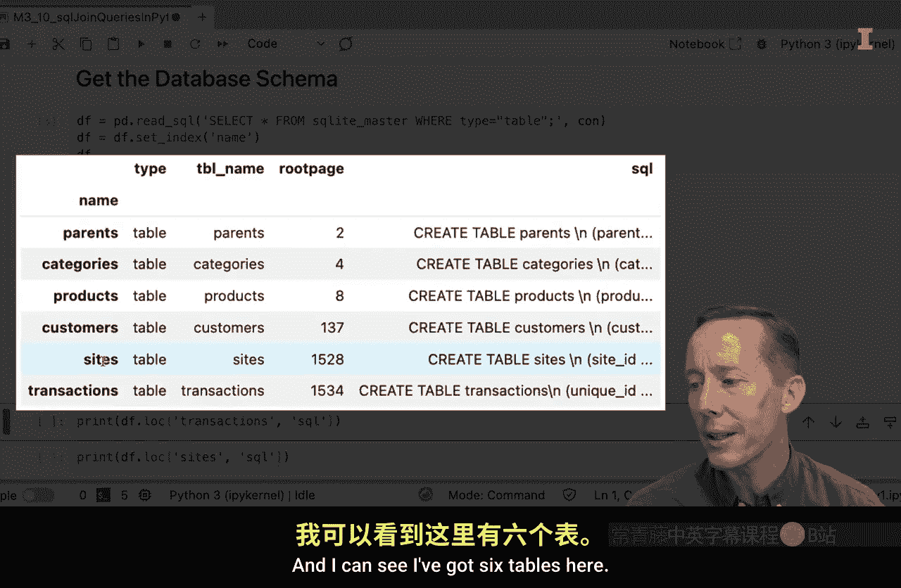

And then let's look at more information for the transactions table。

 So I can see that this table has a bunch of columns in here and that these columns here that have foreign key related to them。

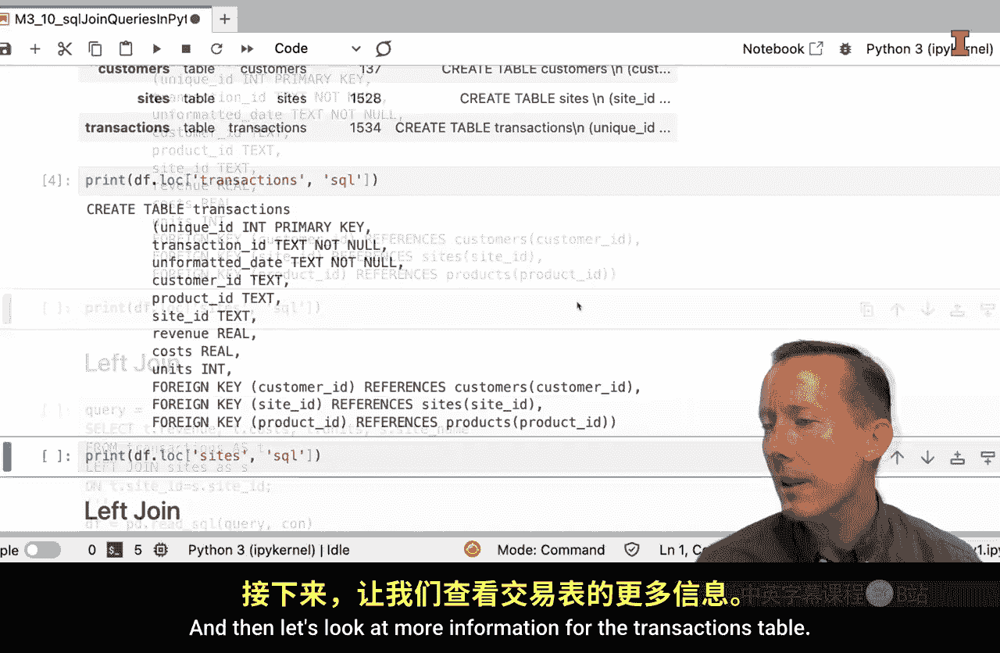

These are all related to different tables。 An easier way to see this is to look at an entity resource diagram。

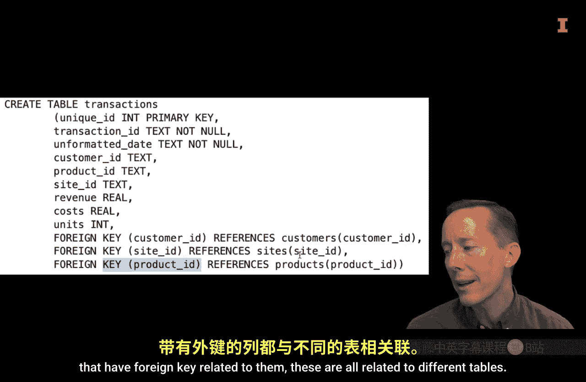

And I can see that the product ID column is connected to the products table。

 The customer ID column is connected to the customer table。

 and the site I column is connected to the site table。And then also this product ID column。

 which connects me to the products table， can actually be connected to a specific category and specific parent by going through the relations up here。

 let's go ahead and look at information about the sites table as well since we're going to look at that and this tells me the column names that I want to be able to connect to。

 All right， so really what I want to do here， as I want to read in data from the transactions and sites table and create a single data frame。

 Okay， so let's look at my query how I can do that。So we're going to perform left joins。

 there are inner joins that you can perform in outer joins。

 but the left join is the one that I use most often。

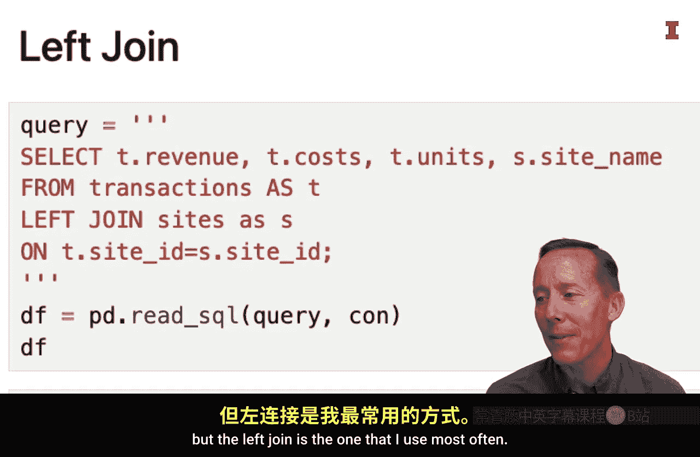

Let's look at this query here。I'm going to first look at the structure of this query。

 I'm selecting columns from one table left joining them with another table。

 and then I need to indicate what columns I want to join them on。

 And then before I talk about the columns up here， let's look at this。

 this is going to be my left table here。 So my foundational table。

 I'm going to keep every row from this table。 This is the transactions table。

And I'm going to abbreviate this table as T。And then I'm going to join it with data from the S table。

 which I will abbreviate as S。Now， that T and S are important because when I indicate the combs that I want。

 I need to indicate the tables that I'm getting them from。So you can see up here on this first line。

 I am indicating that I want the revenue column from the transactions table T。

The cost column from the transactions table and units column also from the transactions table。

But I also want to add in the site name column from the site table。

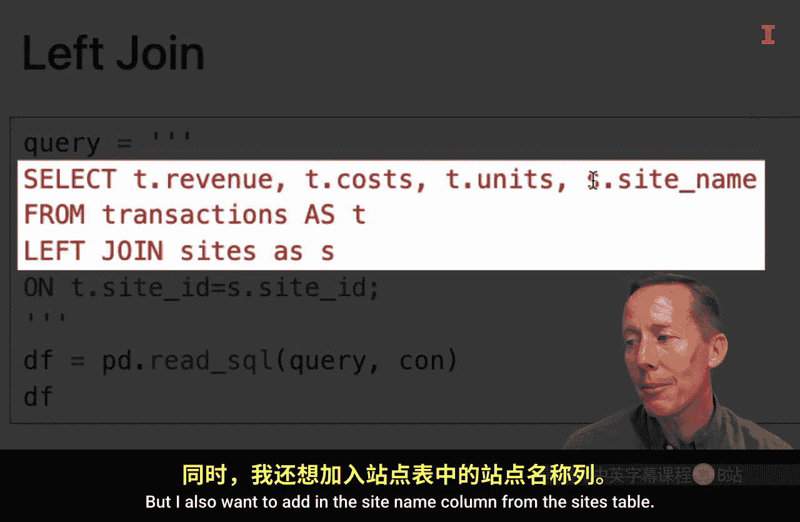

Okay， so that has a S dot before it。 All right， And then I need to indicate how I'm joining them together。

 What columns I'm using。 Well， I need to indicate that in the transactions table。

 the column is site underscore I D。 and in the sites table， it's also sites underscore I D。

 If the columns weren't name the same。 then you just indicate the column names and it would work out for you。

 All right， so I'll take that query， and I'll go ahead and perform it。

And read it in the data frame and display the data frame。

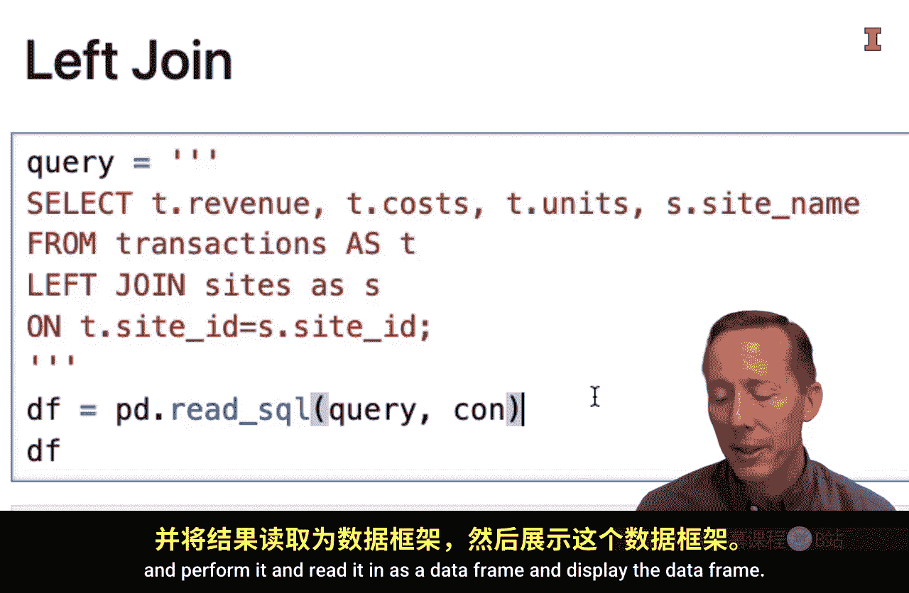

。All right， so you can see that I've got 150，000 rows here。

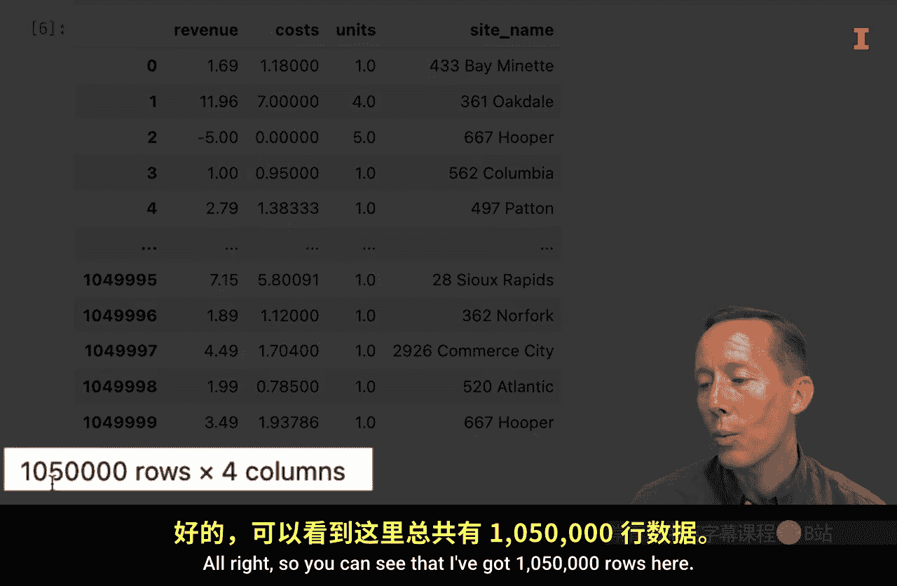

So it kept everything in the transactions table， and I've got this column that didn't exist in the transactions table。

 Let's go ahead and look at my entity resource diagram。

 You can see that I don't have site name in here， And so what it did is for every row。

 it took the site I， went to the site table， gathered the appropriate site name that matched that I and added it as a new column and then did that for every row and downloaded it。

 converted it to panda's data frame。

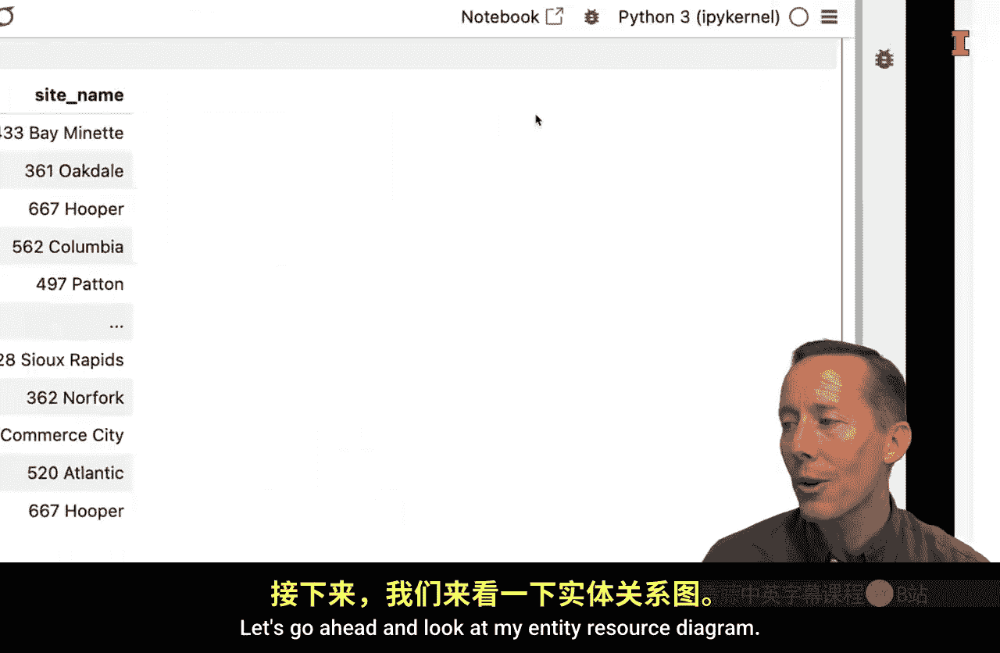

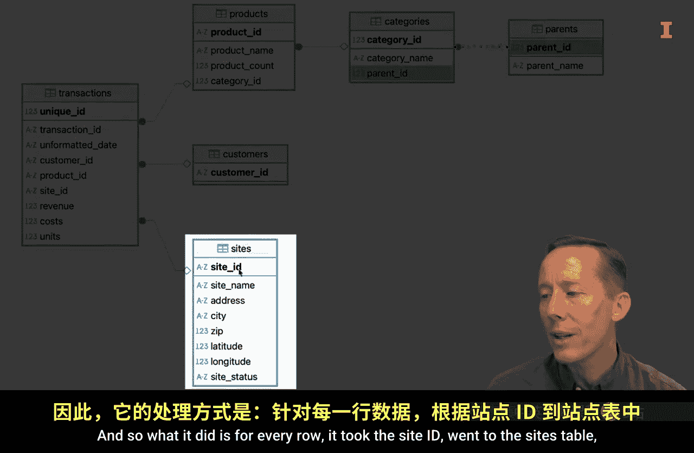

So that's really powerful because I can create tables or data frames that don't exist from a single table in my database there。

 Let me also highlight how we can add on to this left join some additional information so let's look at this query here。

 I'm going to take what I started with in the previous query and then I can add on some additional information so I can say。

 hey， I also want to only keep rows where the site name is equal to 433 bay Minet。

And then I want to order it by the values in the revenue column。

So I can go ahead and perform that and you can see that I've got all observations in here that are just for 433 bayonet。

 there's 8451 rows。And they're sorted in descending order in this revenue column。

 I forgot to mention that you can also sort things in descending order by just using the keyword DESE after the column that you want。

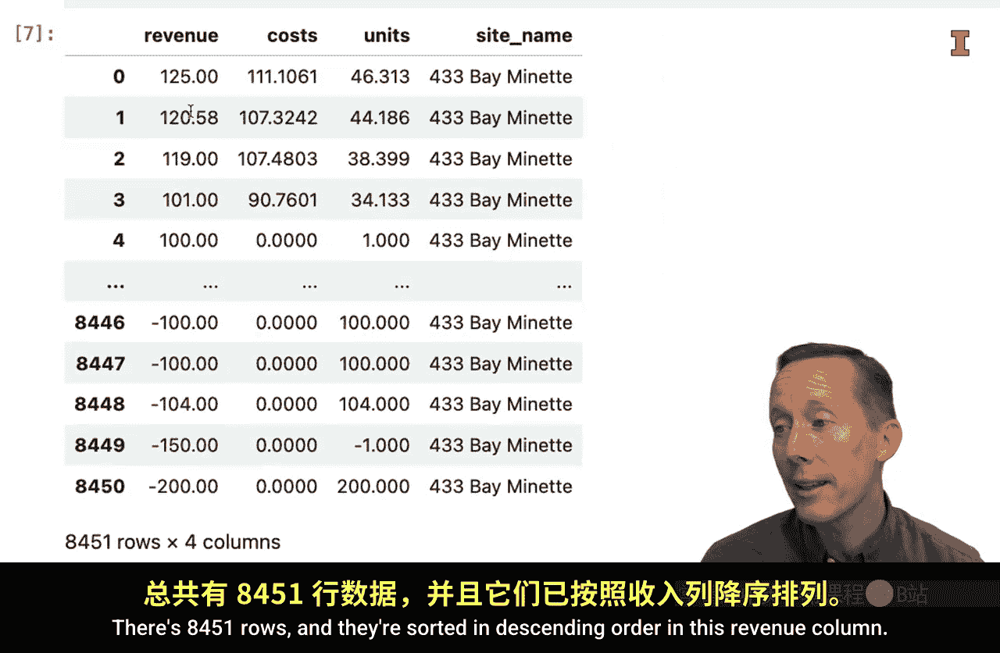

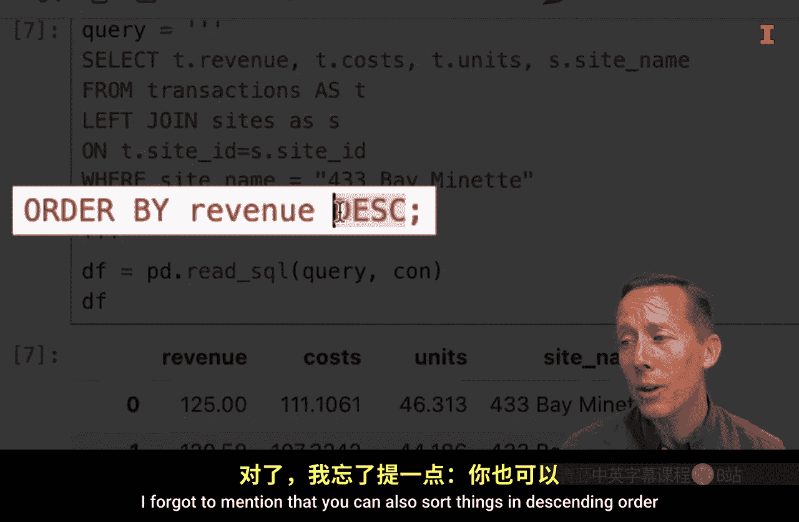

And if I want to sort it by multiple columns here。 So I want to sort it by revenue and then maybe by costs。

In us sending order， then I can。Do it like that。 And if there were ties， it would then sort by cost。

 Another thing that I want to highlight is that you can perform multiple joins in a single query。

 So this query here is almost the same as my initial query。 However。

 I'm also going to join on values from the products table。 specifically。

 I want the product name to be associated with each ruin in here。Alright。

 so I can say I'm going join on the product table as P。 I want that column from the products table。

 and then I'll just first perform a left join on the site table and then a left join on the product table and I'll join on the product ID columns I'll go ahead and run that and we can verify that we've got the site name now and the product name that is added into this here。

 All right， so join queries are really important and they can get really complicated。

 All right now let's go ahead and close our connection。

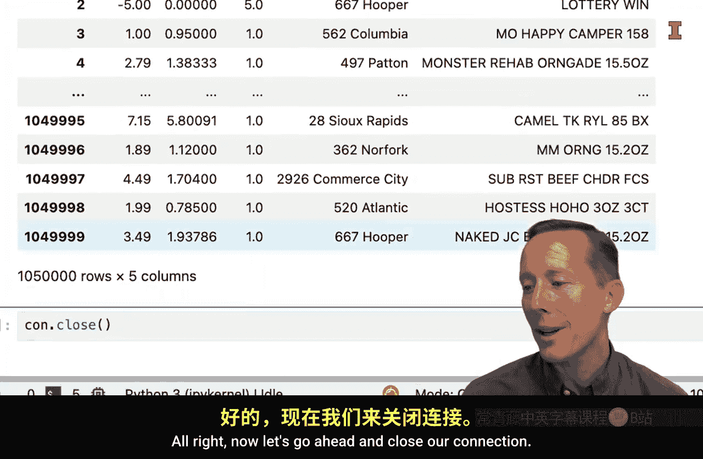

So the main takeaway for this lesson is that join queries are super important for interacting with SQL databases。

These are just a few simple queries， but if you plan on interacting more with SQL databases。

 it's definitely worth exploring these join queries in more depth。

