# 伊利诺伊大学【中英⚡商业分析｜Business Analytics Specialization】 p12 P12 09_高级Mac用户使用Homebrew和pyenv安装Python -BV1z86nB9EGz_p12-

In this video， I'll demonstrate how to install Python on a Mac operating system using Homebrew。

 which is a free and open source package manager that makes it easier to install and uninstall software on a Mac。

So the first thing we'll want to do is make sure that we don't already have a version of Python 3 installed to do that。

 let's go ahead and open the terminal application。 I'm going to use a spotlight search by pressing command in the space bar。

 and then type out terminal。Then hit enter， and then to see if we have Python installed。

 type out Python 3 space hyphen hyphen version and hit enter。 and if it's installed。

 then it will return a version of Python like in this case，3。12。0。

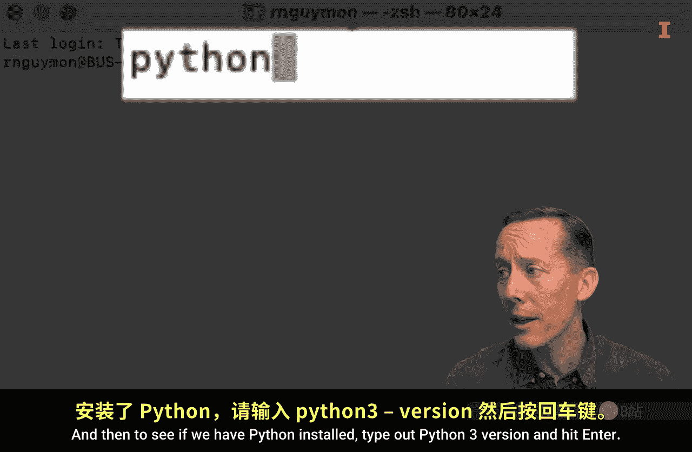

Okay， if it's not installed， then let's keep going through here if it is installed。

 then you may not need to do anything else。All right。

 so since we're going to use home brewrew to install it。

 let's see if we have homebrew already installed。 So in the terminal。

 I'm going to type out which brew。

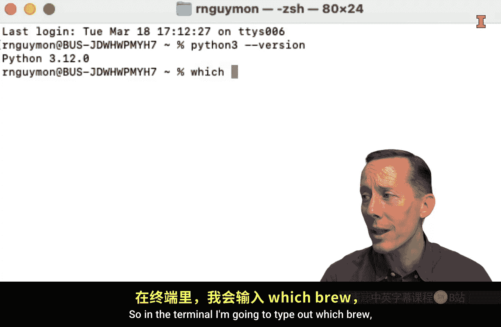

And if you get a a path to where it's installed at， then it means it's already installed。

 If it's not already installed， then you can navigate to B dot S， H or just do a search for it。

 And it'll probably take you to B dot S H。 And in here。

 it gives us the terminal command for installing homebrew。

 So all you have to do is click on this clipboard icon。 And then you can go back over to terminal。

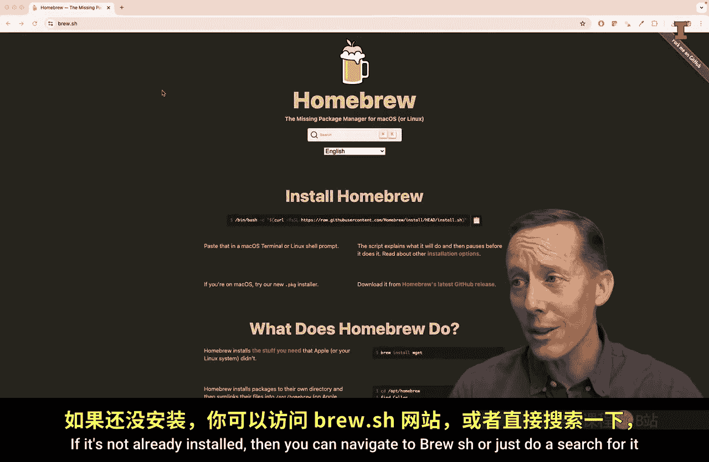

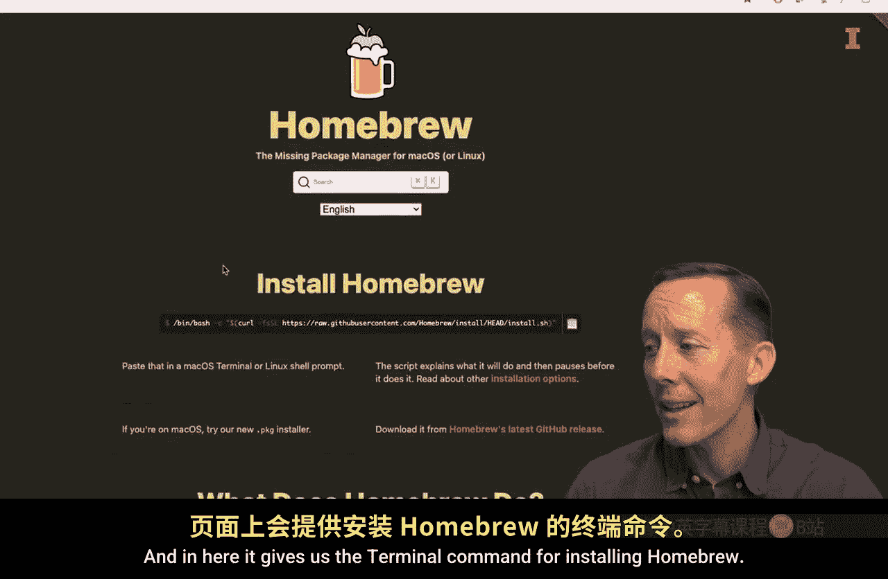

Paste that， that big， long command， and hit enter。Now you may be asked to enter your password。

 I'll go ahead and do that。And then it tells you what will be installed。

And it will install a variety of things， and it's okay to install all those things。

 I guess you can decide if it's okay， but I'm going to go ahead and decide it's okay and hit enter。

 Now I've already got it installed so it should go really quickly for me。

If it's not already installed on your computer， then you're going to be prompted to install some additional software。

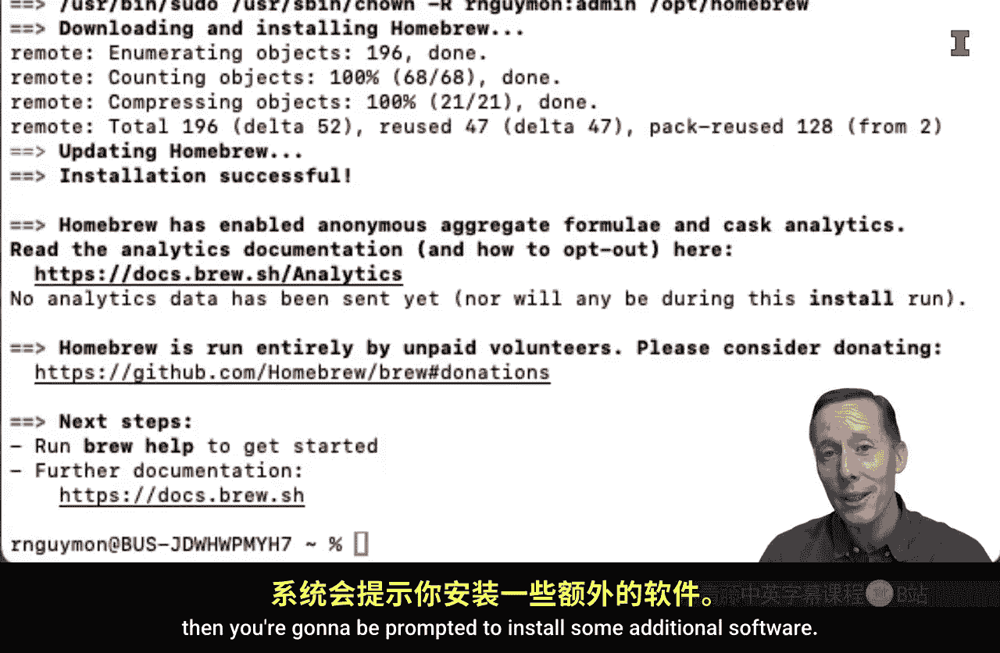

And if you're prompted to install Xcode， then go ahead and do that。

 That is Mac ID for creating software for Mac operating systems。 Now。

 as you're going through the installation process， you will be prompted to install homebw to your path so that you can easily access homebrew。

 So make sure and copy and paste the commands that it gives to you and run those in the terminal window as well。

 All right， and then once you've gone through everything and it says installation is complete。

 then you can check if homerews installed again by typing out which B。 So WH IC H and Bre EW。

 and you should see a path for it。 Now， at this point， you could install Python from here。 All right。

 now don't do it quite yet， I'm going to tell you another way。

 but you could use homebrew to install Python by just typing out B。

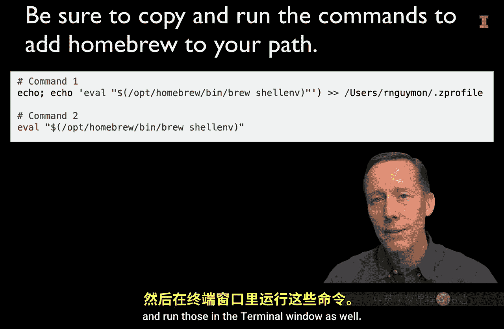

Install。Python 3。 So this would work， but I encourage you to install Python using another package called P M for P environmentron。

So to see if you have pi M installed， then you can type out P Y E N V spacehenhen version。

 and if it's installed， then it'll tell you a version number like this。 If it's not installed。

 then you can go ahead and type out B， install pi M and hit enter。

And it will go through the installation process with you。

 You can see that because I have it installed， it says it's already installed and up to date。 Now。

 at some point along the installation process for pi N。

 you will be prompted to copy and paste some commands that will make it easier for you to use pi M。

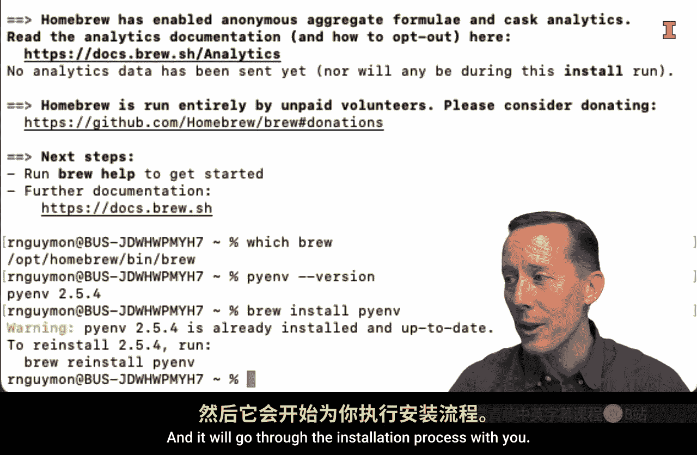

And so it's okay to go ahead and copy and paste those。

 And then as you hit enter and accept everything else。

 it should finish the installation process for you。 Okay， now， at this point。

 you can install Python using P M through Homeb。 It's kind of complicated。

 but it ends up making it a whole lot easier。 So the benefit of using P M or Python environments is that it allows you to quickly install different versions of Python and switch between those versions of Python。

 And that can be really helpful because not all modules that you'll want to use work with all versions of Python。

 So you may need to use an older version of Python for some projects。😊。

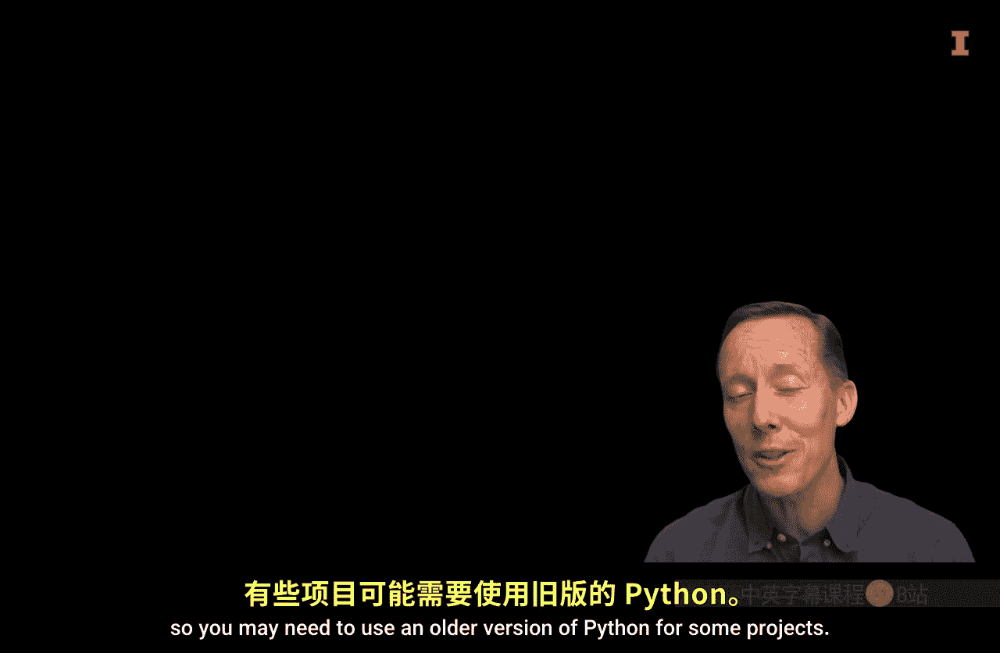

Al right， so let's see what versions of Python are available for us to install through P N。

 if we type out pi N。And then install， and then minus L for list。

It will give us a list of all the different versions of Python we can install。

 you can see there's a ton of them in here。We want the ones up at the very top。

That are just numbers here。 Then you can go down and you'd probably be okay getting the most recent stable release that doesn't have any letters after it。

 So 3。13。0， but there are often updates。 So it may be different when you watch this video。

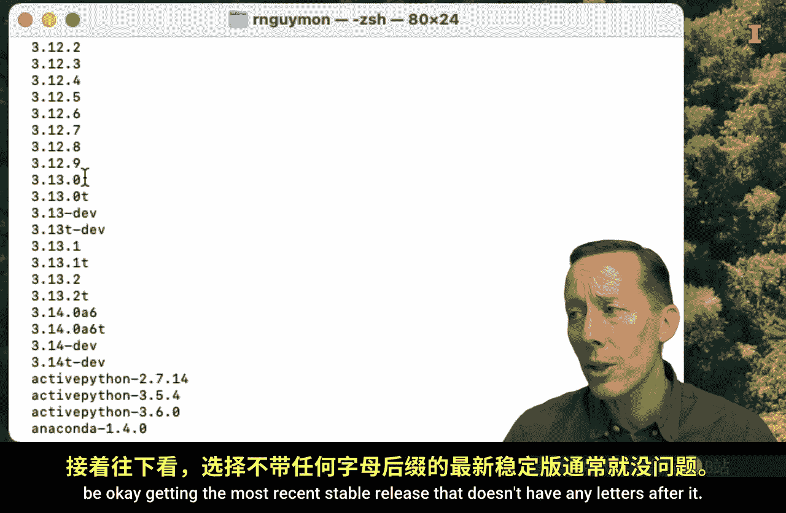

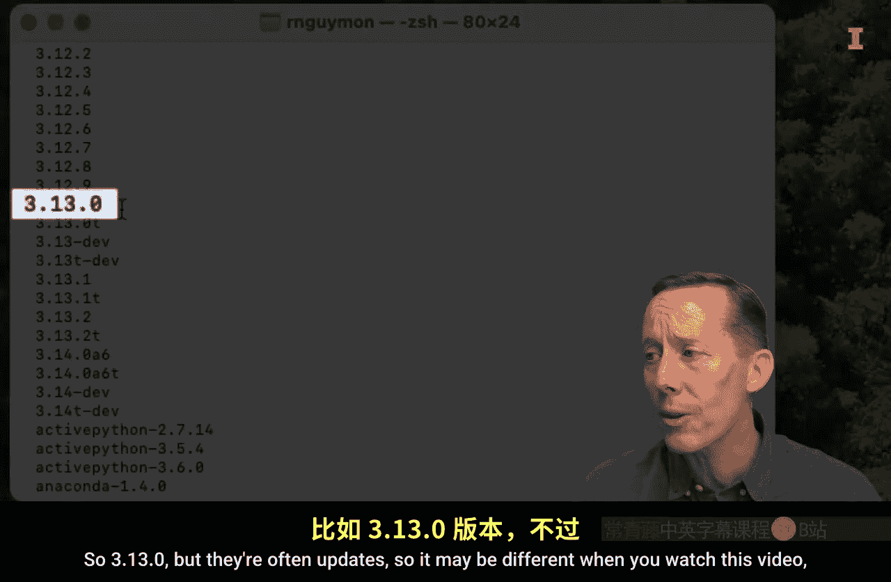

But you could probably go ahead and install that one。 So let's say I want to install Python 3。13。0。

 Then I can just start typing out pi N。

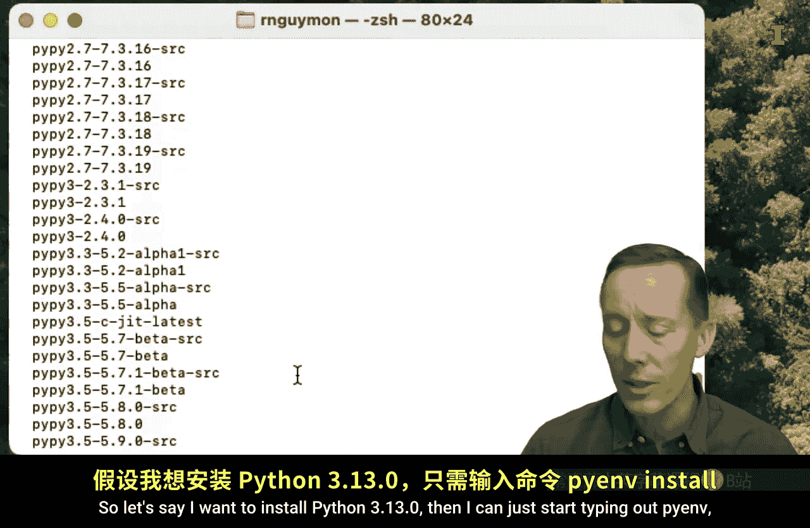

Install。

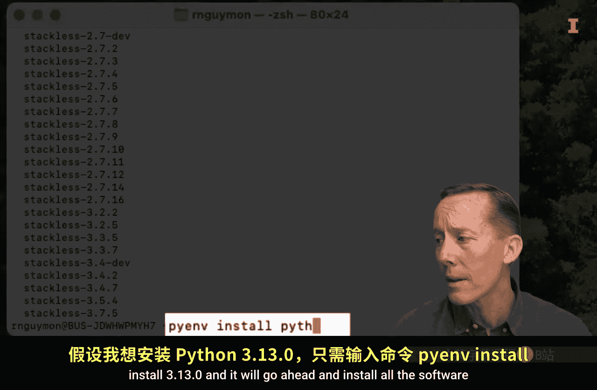

3。13。0。

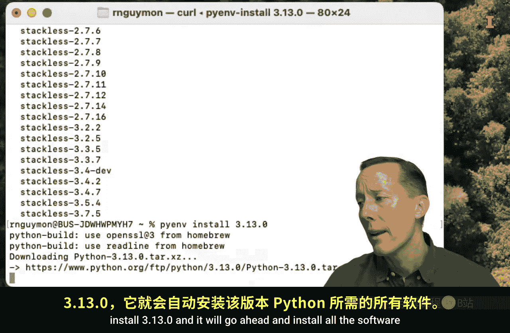

And it will go ahead and install all the software that we need for that version of Python。Okay。

 once it has finished installing Python， then you can。Type out pi M。Versions。

 no double hyphens this time and hit enter。 And it tells you the different versions that you have installed。

 and it'll have an asterisk next to the version that is being used by your computer。Al right。

 so you can see I've got version 3。12。0 and 3。13。0。

 If you want to switch versions that your computer uses， then all you have to do is type out pi M。老董。

And then the version that you want， so 3。13。0 and hit enter。

And now you can see if I rerun Pyen versions 3。13。0 has a star next to it。

 So I know it's more complicated to install Python this way on a Mac。

 but ultimately it makes it really easy because you can switch among the different versions of Python and it's also really easy to uninstall a version that you don't need anymore In another video we'll talk about how to install an integrated development environment like Viual Studio code or Jupiter Lab to make it easier to use Python rather than just using it in the terminal like this。

