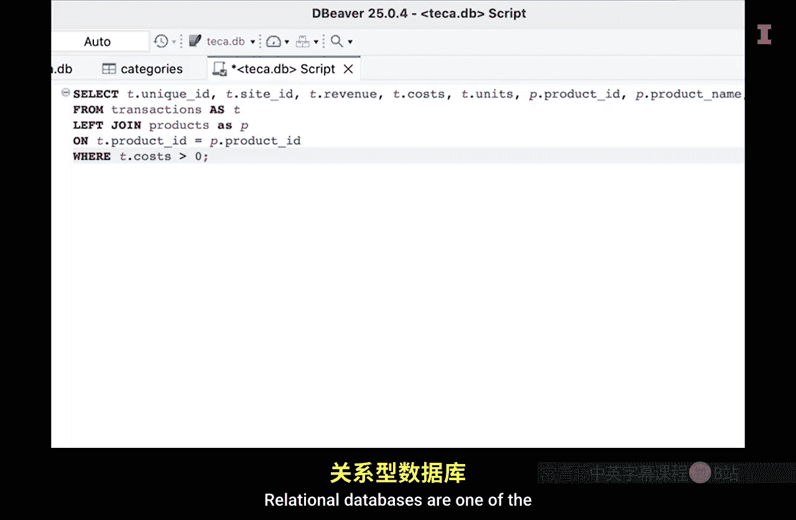
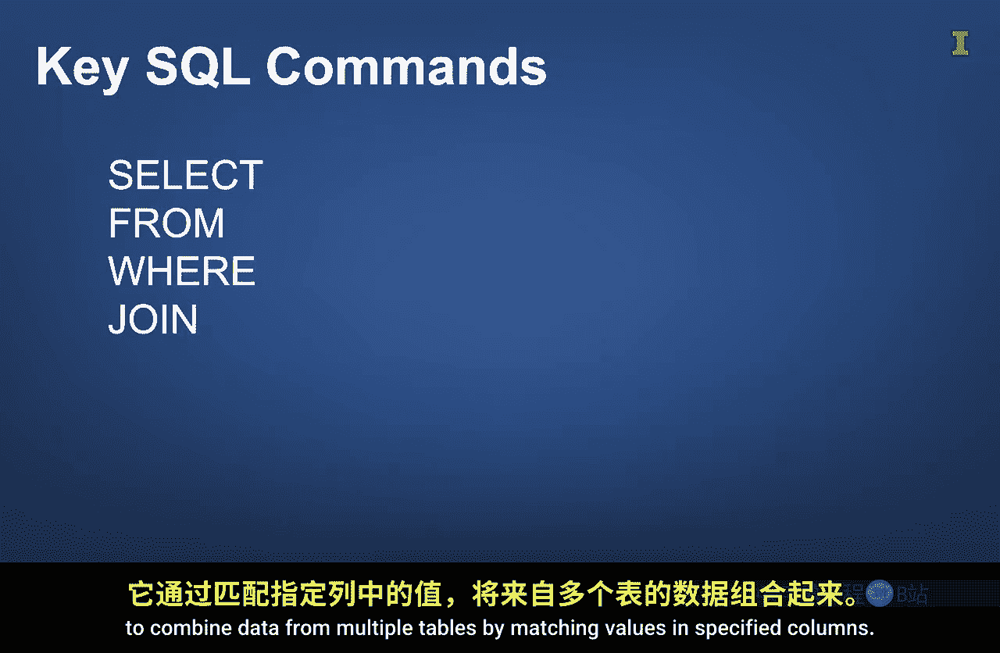

# 伊利诺伊大学【中英⚡商业分析｜Business Analytics Specialization】 p120 P120 01_第三模块-结论 -BV1z86nB9EGz_p120-

Let's briefly recap this module。Just as ocean waters contain vast amounts of resources。

Datases store vast amounts of database based resources that can be used for business purposes。

Relational databases are one of the most common technologies that businesses use to store large amounts of structured data。

Theyre made up of one or more tables that are related to each other。

 and they have a proven track record of being reliable， secure and able to handle many transactions。

Just as we need boats， paddle boards or other vehicles to navigate the ocean and harvest its resources。

We need a vehicle for navigating relational databases and harvesting the data resources in them。

SQL is that vehicle。It is the structured query language that is used to interact with databases。

It's easy to understand because it's made up of commonly understood words。

Our focus has been on introducing keywords for creating queries that will retrieve data from the database tables。

Some of the foundational SQL commands include the select command for indicating the columns that you want to see。

We also talked about the from command indicating the table from which you can find the data。

The where command is used to limit the data that is returned。

 such as customers that live in Illinois。The join command is important to combine data from multiple tables by matching values in specified columns。

Importantly， we hope that you better understand the benefits of using SQL， along with Python。

 as well as some of the technical details for using those two languages together。

This was just an introduction， but hopefully you now have a foundation that you can easily build on。

As you face real life projects that involve SequL。You will know what the next steps are for you so that you continue developing your SQL skills。

Also， as with anything， the more practice you get， the more comfortable you will feel using it。

So keep practicing and you'll become more fluent in this vital language of data。

