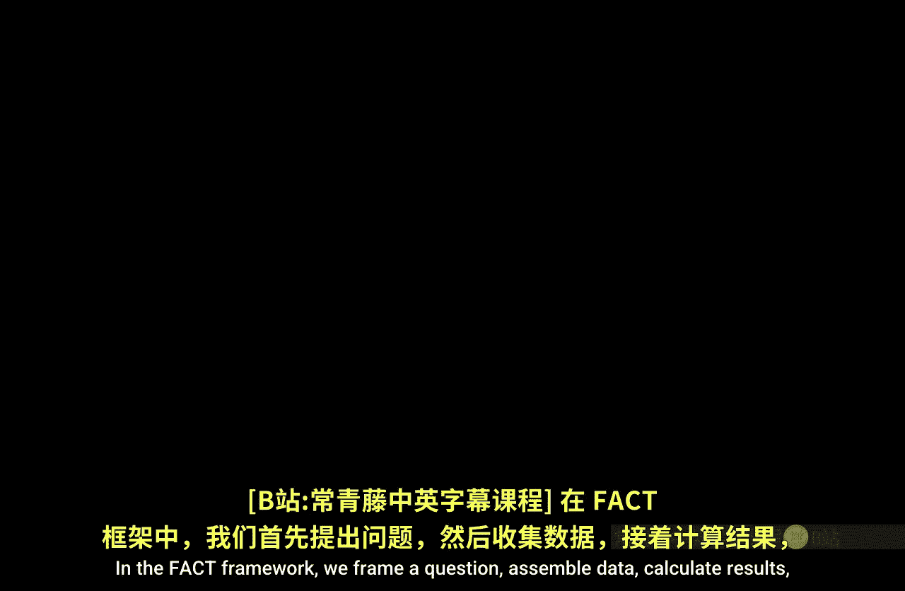

# 伊利诺伊大学【中英⚡商业分析｜Business Analytics Specialization】 p121 P121 03_第四模块简介 -BV1z86nB9EGz_p121-

In the fact framework， we frame a question， assemble data， calculate results， and tell others。

This module explores application programming interfaces or APIs。

 a category of tools that is used for connecting data from third parties。

 much like a waiter from restaurants connects customers to kitchen staff in one of the restaurants behind me here at the lab in Southern California。

Let's continue our introduction of APIs by listening to Josh Dabbin。

 executive vice president at Motive Health。I had a chance to talk with Josh。

 and one of the things we discussed is how they use As in the health insurance industry。

As we listen to portions of my interview with Josh， you'll hear more about the purpose of APIs。

 types of As， advantages of As， and some disadvantages of As。 my name is Josh Doubbin。

 I'm the executive vice president of Technology at Motive Health。

AI stands for application programming interface， and the APIs we use are generally web based。

 meaning we're using the rest or some other web based protocol and。Yeah。

 we use the request library in Python and many other libraries like it that help simplify the act of calling APIs and calling them securely there's a ton of inter communicationmunic going between our company and many others。

APpis are key to us getting fresh data。And。And helping us interact with those different companies。

One specific example is we have an investment platform and realtime trading data is vital for interacting with that platform。

 and we utilize several sets of APIs to help get that realtime data so our customers can make really good decisions when they try to invest。

APpiI's advantages really are in how real time the data can be， often with databases。

 you have a set data set， then if you need fresh data you have to get it shipped to you in some other way。

On the other hand， APIs do have the disadvantage of your ability to。

Pull and push as much data as you can through a database。Yeah。

 it it's a lot harder to push and pull large amounts of data or do a lot of complex analysis via API Yeah。

 and there's been attempts， yeah attempts have been made with things like GraphQL to help with that。

 but they haven't taken hold as much as just SQL has and so SQL is still a primary tool。Sa。

As you can probably tell， API is a broad term。Josh mentioned that at Motive Health。

 they use a certain category of APIs to send and request data。Specifically。

 he mentioned web based APIs that follow a RE protocol。

This specific category of API is the most common type for sending data back and forth。

 so it will also be the focus of this module， and we will explain it in more detail and compare it to other types of APIs。

Josh also mentioned that they use the requestquest library to implement APIs with Python。

After taking time to further explore APIs， how they are used for assembling data and key elements of APIs。

 we will demonstrate how you can also use the Python requestquests module to implement APIs to retrieve data from third parties。

Another thing that Josh mentioned is the APIs are limited in how much data that they can pass back and forth relative to SQL databases。

Therefore， an important aspect of using APIs is being able to make many requests if the data is larger than what can be sent with a single API request。

Now， rather than making many API requests manually or copying and pasting identical blocks of code to make the requests。

In this module， we will learn how to use loops in Python to make many API requests programmatically。

I'm excited for you to learn about APIs because they will enable you to access vast quantities of data that you can assemble to make your analysis more informative。

