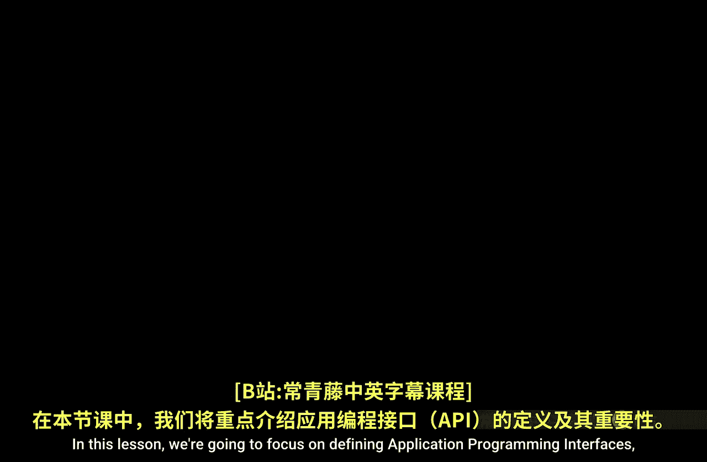
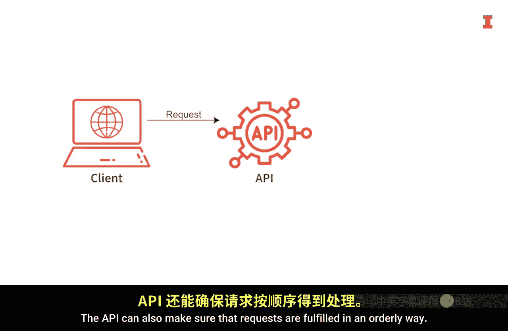
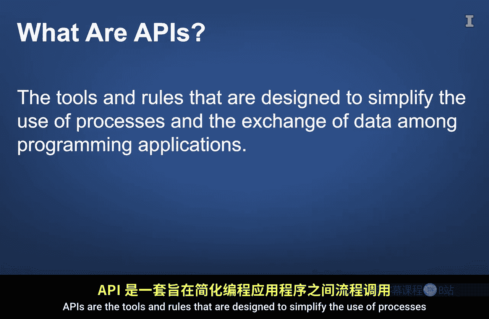
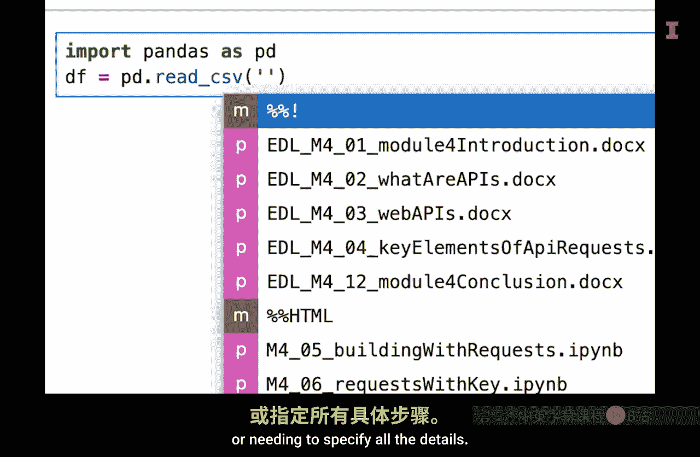
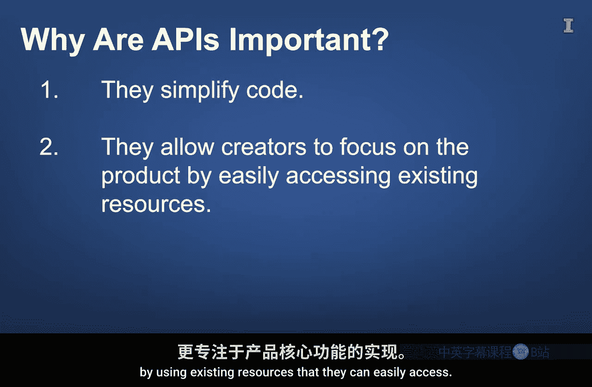
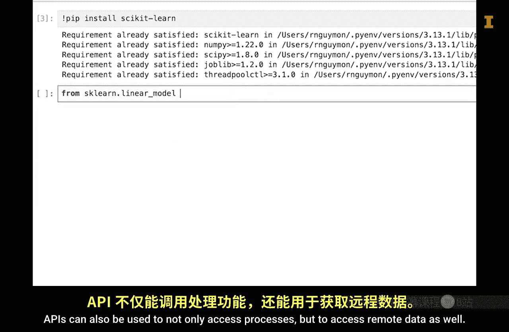
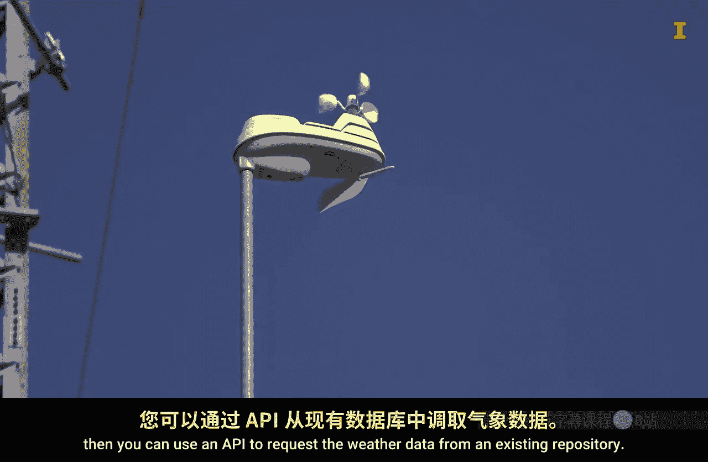

# 伊利诺伊大学【中英⚡商业分析｜Business Analytics Specialization】 p122 P122 01_什么是API -BV1z86nB9EGz_p122-

In this lesson， we're going to focus on defining application programming interfaces or APIs and why they are so important。

I'm standing in front of the lab in Costa Mesa， California because it's a unique destination that has an assortment of restaurants like the seabirds。

And we often use a restaurant analogy to illustrate the concept of APIs， here's the analogy。

Let's say a customer goes into a restaurant with the intention of getting some food that they don't know how to make or don't have the time to make。

The customer spends some time looking over the menu。

 and then the customer may have questions that they ask the waiter。Eventually。

 the customer places an order with the waiter， save for a pizza。The waiter interprets the order。

 gives specific instructions to the kitchen staff， and perhaps draws upon other resources to process the order and then brings the pizza to the customer。

Consider what it would be like to order food in a restaurant without waiters。

The customer would need to specify many details of how the pizza is made and send those specific directions to the kitchen staff。

Another benefit of waiters is that they can maintain order。Specifically。

 they make sure that customers are treated fairly， are given what they paid for in a timely manner and ensure that customers don't take more than what they paid for。

Okay， let's relate this restaurant analogy to APIs。

The customer that goes into the restaurant is like the computer application。

 which is also known as the client。The customer's order is like the API request。

 The waiter who receives the order makes sure that the order is fulfilled and then returns the order is the API。

It allows computer applications to get things like data by placing an order from the menu。

The API can also make sure that requests are fulfilled in an orderly way。

So with that analogy in mind， let's talk about APIs more directly。

APpis are the tools and rules that are designed to simplify the use of processes and the exchange of data among programming applications。

According to that definition， there is a good chance that you have already used APIs。For instance。

 if you've ever used functions from the pandas module， then you have used an API。

The pandas functions allow other applications to access the ability to perform data processes by simply using the function。

 rather than knowing what is going on behind the scenes or needing to specify all the details。

Let's look at a more specific example。Let's say that you're making a data analytics application that will simply read in data and display the first five rows of the data as a pandas data frame。

Well， the pandas Read CSV function and head methods make it possible for your application to complete that task with a couple of simple lines of code。

Your application doesn't need to be concerned with the many steps that go on to connect to your CSV file or the underlying memory representation of the data frame。

All it needs is to know how to access those processes by referring to the right functions。

So the pandas API is the collection of functions that are used to access many processes。

It prevents you from having to recreate the underlying code that performs those processes。

 which could be complex and even written in another language。Moreover。

 the underlying processes can change， perhaps to improve the efficiency。

But the function name can remain unchanged， so it allows for improvements to be made without requiring applications to change the details of how they work。

Okay， now that you have a better understanding of what APIs are。

 let's briefly consider why APIs are so important for software in general。

 as well as for data analytics task in particular。In general。

 APIs are important for software because one， they simplify the code， and two。

 they allow creators to focus more on the product by using existing resources that they can easily access。

So with respect to data analytics in particular， APIs allows us to focus on creating a data analytics workflow that is easy to read。

We can assemble all the data， calculate results， and tell others using a Python script that is relatively easy to read。

Moreover， we don't have to know the particular details about how those processes are accomplished。

 which allows us to focus more on identifying insights and making decisions。For example。

 if you need to perform a task that you are unfamiliar with， like image recognition。

You do not need to create your own algorithm from scratch using thousands of lines of code。

That would take years of learning minute details about algorithms and computer processing。Instead。

 you could simply install the right Python modules like PsyitL or Pytorrch。

 which have APIs that make it possible to use the algorithms with a simple function。

APpiIs can also be used to not only access processes but to access remote data as well。

So for example， if you need to evaluate the impact of weather patterns。

 then you can use an API to request the weather data from an existing repository。

Rather than needing to set up a weather station and gather the data yourself。In short。

 APIs are an essential part of creating any kind of application with code。

Just as waiters in a restaurant are an essential intermediary between the customer and the kitchen。

APpiIs simplify the interactions between software applications。

They package processes together into a set of functions that can easily be used。

As you continue on your journey of data analytics， you'll learn more about various types of APIs and how they can be used to easily access and process data。

