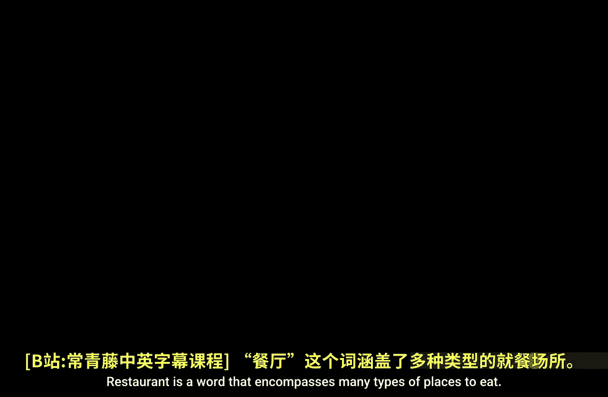
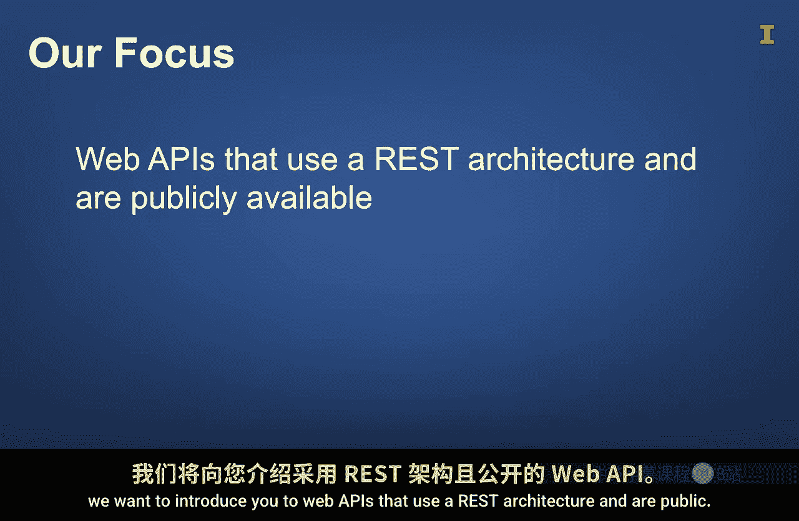
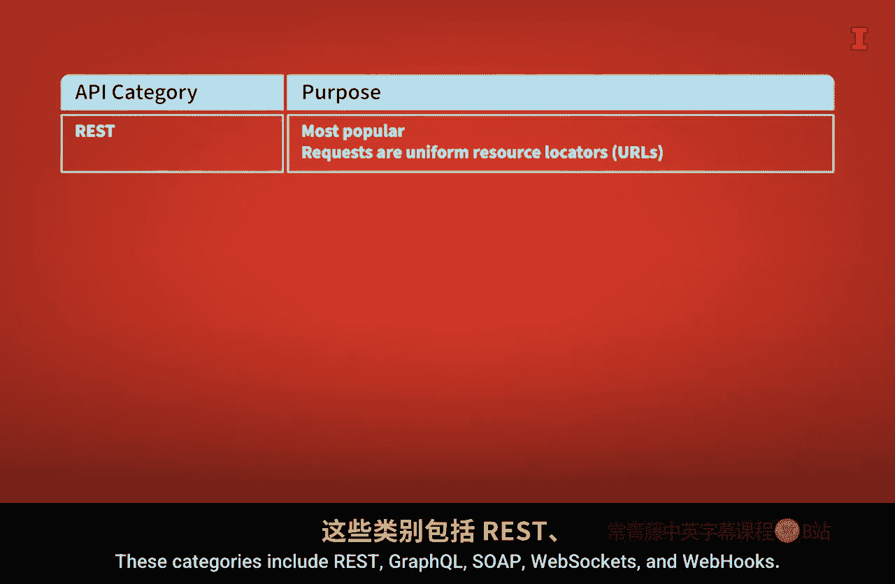
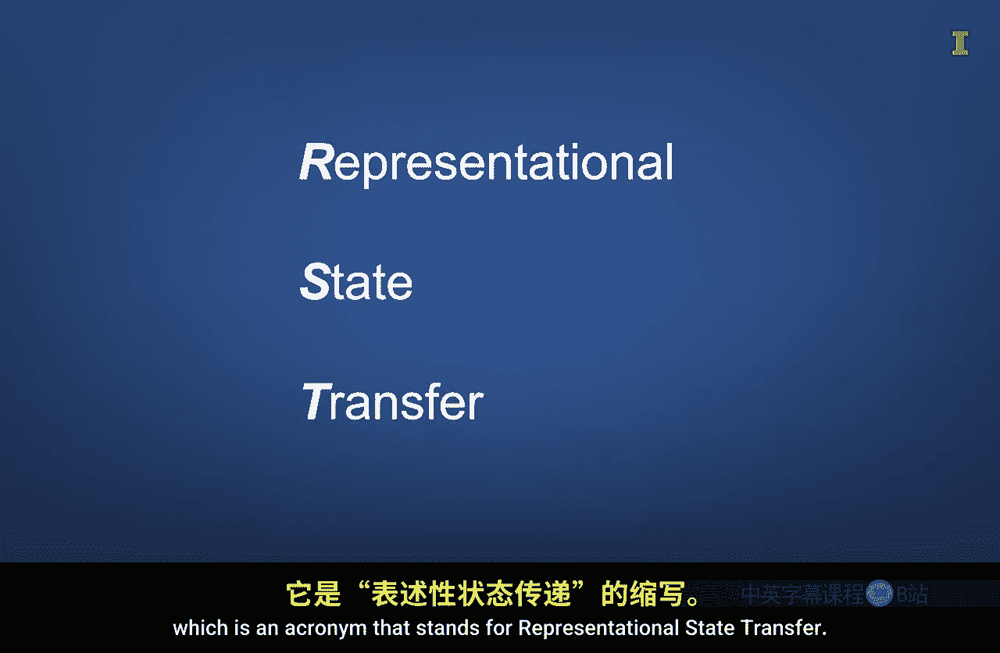
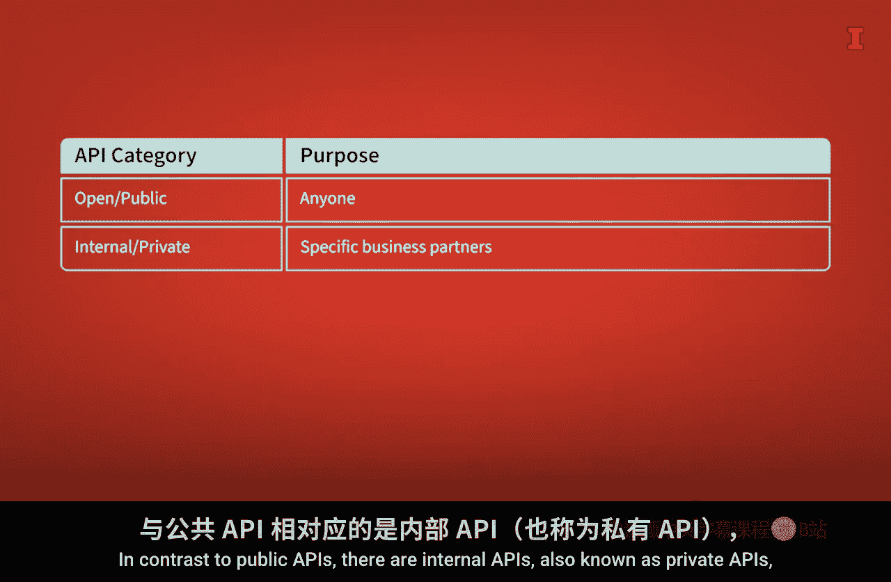

# 伊利诺伊大学【中英⚡商业分析｜Business Analytics Specialization】 p123 P123 02_组装数据的Web API -BV1z86nB9EGz_p123-

Restaurant is a word that encompasses many types of places to eat。

 On one end of the spectrum is fine dining restaurants。

 like those in this very busy South coast Plaza behind me。

 And those offer impeccable service from talented chefs and waiters on the other end of the spectrum is fast food restaurants where the food is mostly prepared in advance。

 and you may hardly ever interact directly with other people。

Because theres such a wide variety of restaurants， it's often important to refine the category of restaurants that you have in mind when communicating with others。

Well， the term application programming interface or API can also mean many things broadly speaking。

 APIs are tools that simplify the way that software applications interact with each other。

In this lesson， we want to focus on describing APIs that are commonly used for assembling data。

Specifically， we want to introduce you to web APIs that use a RE architecture and Republic public。

Now that's a lot of technical jargon that I just dropped on you。

 so in this lesson we want to briefly introduce three ways of categorizing APIs to help you better understand what that jargon means as well as the API landscape in general。

Let's start by talking about different ways that you can categorize APIs。

One way of categorizing APIs is by their purpose。 For example。

 the purpose of library APIs is to provide a set of functions for accessing processes provided by a specific programming library like pandas。

In contrast， the purpose of operating system APIs is to provide a set of commands for interacting with the computer's operating system like changing directories。

For our purposes， a particularly relevant type of API is Web APIs。

 which has the purpose of enabling software applications to interact with each other over the internet。

Web APIs are relevant because they allow the exchange of data between remote applications in a programmatic way。

For example， say you want to get financial data about a specific company that is publicly traded on a stock exchange in the United States。

A web API allows you to use code to access the data and bring it directly into your coding environment。

You could manually download the data from a website， but if you want to analyze the data with Python。

 then using a web API is often more efficient than manually downloading it。

This is because it requires less manual navigation， it's less prone to error。

 it's easier to replicate， and the process can be reliably extended to access data from other companies as well。

Now within the category of web APIs， there are different architectural structures that are each suited for different purposes。

These categories include RE， GraphQL， soap， web sockets， and web hooks。

By far， the most popular architectural structure for Web APIs is RE。

 which is an acronym that stands for representational state transfer。

Now， rest is a mature architecture that is well supported。

 relatively simple to understand and efficient for many applications。

It's kind of a general purpose architecture。This architecture is often used for the exchange of data that is intended for data analytics applications。

Using the rest architecture， data requests are made by essentially creating a uniform resource locator or URL that looks like the address of a website。

Upon receiving the request， the server would send back the relevant data in a variety of formats。

While rest is the architecture that is most frequently used for web APIs。

It's worth being aware of a few other Web API architectures。

One architecture that is growing in adoption is GraphQL。

 which has the advantage that requests can be structured to identify a precise set of data。However。

 the drawback of that precision is that the request can become more complex as you make requests for more specific data sets。

Another alternative architecture of Web APIs is So， which has a built in security。

It also has features like those of relational databases。

 such as the requirements of specific data types for each column of data and the requirement that transactions either fully complete or fully fail。

TheSoap has also been around for a long time， so it is a trusted technology。For these reasons。

 soap is used by enterprises that rely on secure， reliable transmission of sensitive data。

 such as financial transactions。However， soap is decreasing in popularity。

 It is often overkill for many data transmission needs。Moreover。

 the requests are verbose because they require a tag structure like hypertext mark language or HTML that is used for formatting web pages。

Other categories of Web API architecture include Web Socket。

 which is ideal for real time bi directionional exchange of information such as chat applications。

There's also the Web Hs architecture， which is ideal for when you need notifications to be pushed when an event is triggered。

Now let's talk about a third way of categorizing APIs， which is based on the intended audience。

On one hand， are open APIs， which are also known as public APIs。Like open source code。

 public APIs are available for anyone inside or outside of the organization to use。Governments。

 for example， may create public web APIs to make it easier for the public to programmatically access financial data or weather data。

In contrast to public APIs， there are internal APIs also known as private APIs that are intended to be used by specific business partners。

For example， a company may use an internal API to make it easier for the inventory management and sales systems to interact with each other。

Given that private APIs are typically used to share proprietary data。

 they are more secure than public APIs。The documentation for private APIs is also not widely available。

Okay， with those three ways of categorizing APIs， the type of APIs that we're going to focus on are web APIs that use a rest architecture and are publicly available。

The reason why we're focusing on this specific type of API is because it is often used to get remote data。

Knowing how to assemble data using APIs can really increase the quality of your analyses because you can combine distinct data sets with each other。

 broadening the ability to look for potential relationships among variables。Moreover。

 once you gain some experience with this type of API。

 you'll have a foundation that you can use to learn about other As like those available from Chat GPT。

 Google and Amazon。To sum up， API is a broad term that has many different categories。

 the type of communication that is being facilitated among software applications strongly influences the type of API that is used。

For many data assembly purposes， you will often see public web APIs that use the rest architecture。

Being aware of the other types of web APIs will help you know how to navigate the diverse landscape of data assembly。

