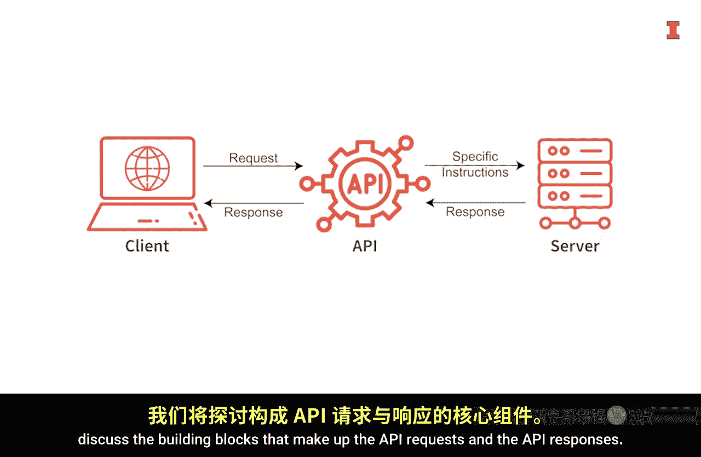
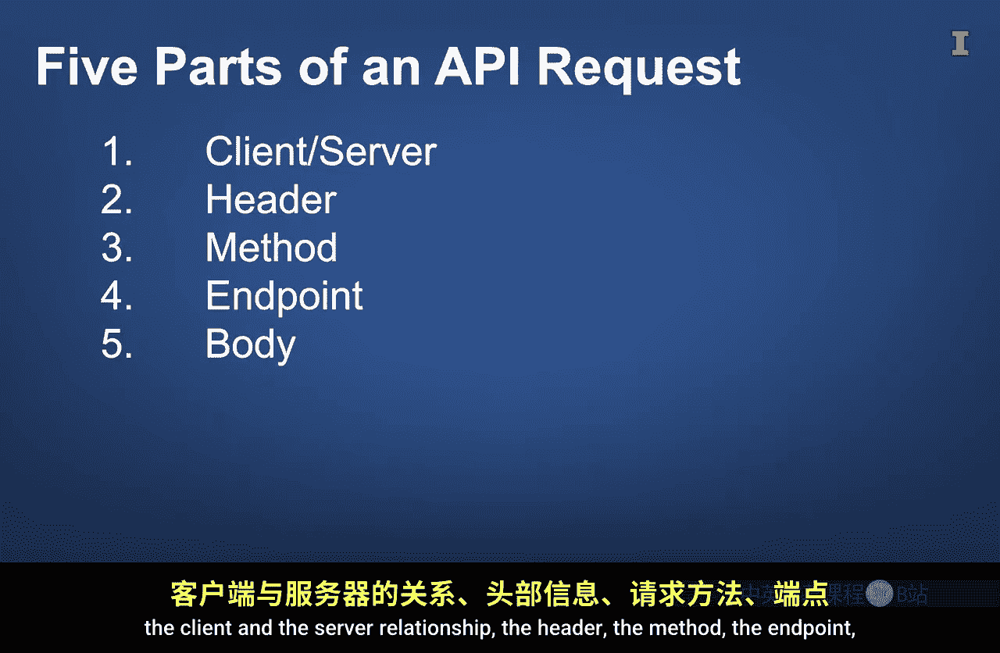
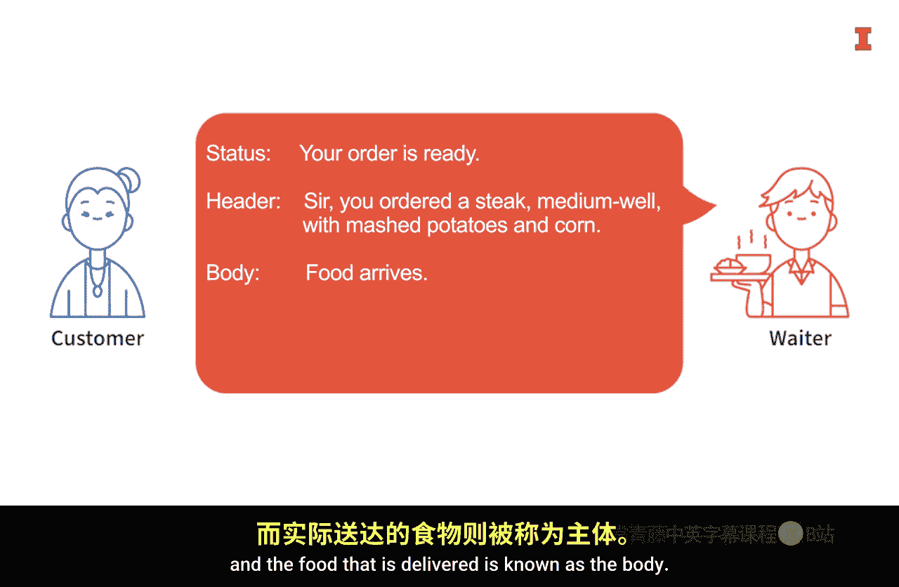
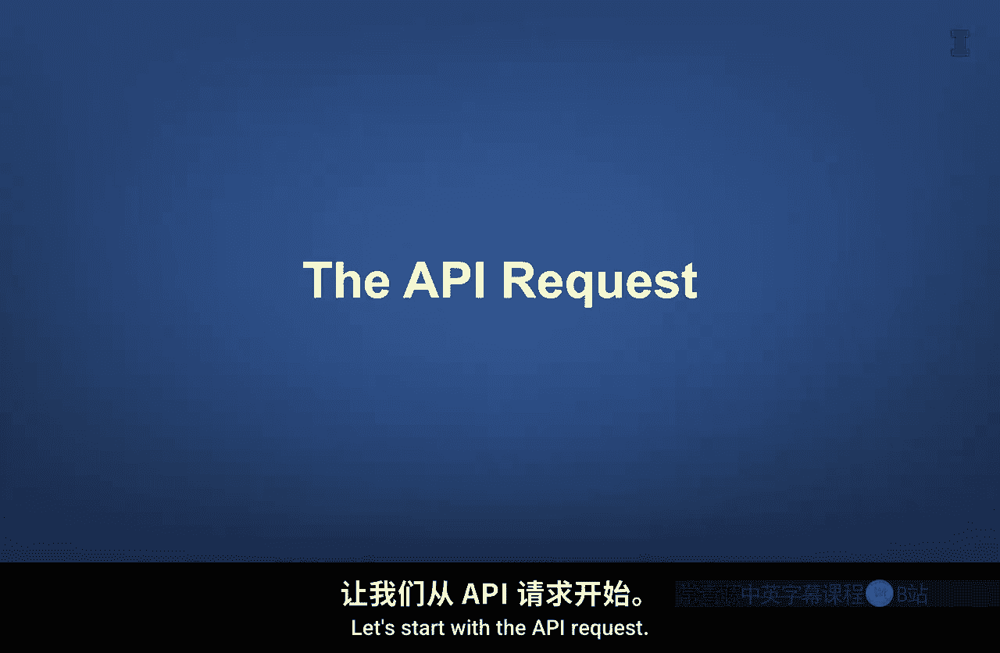
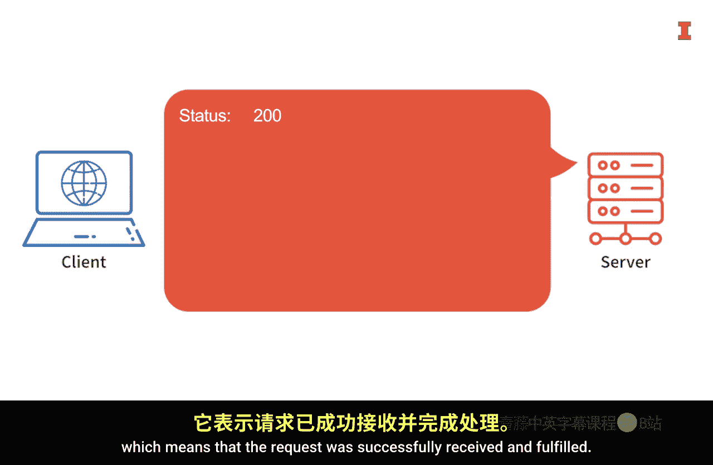
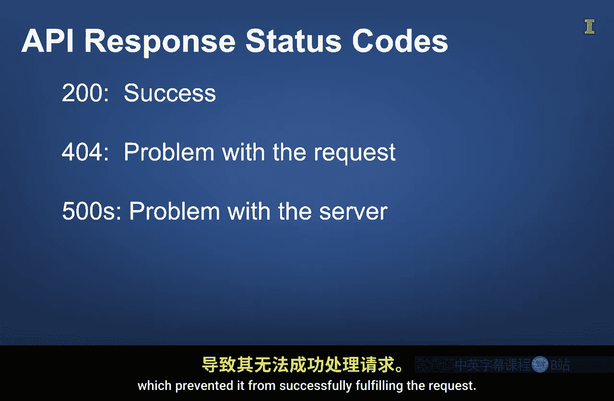
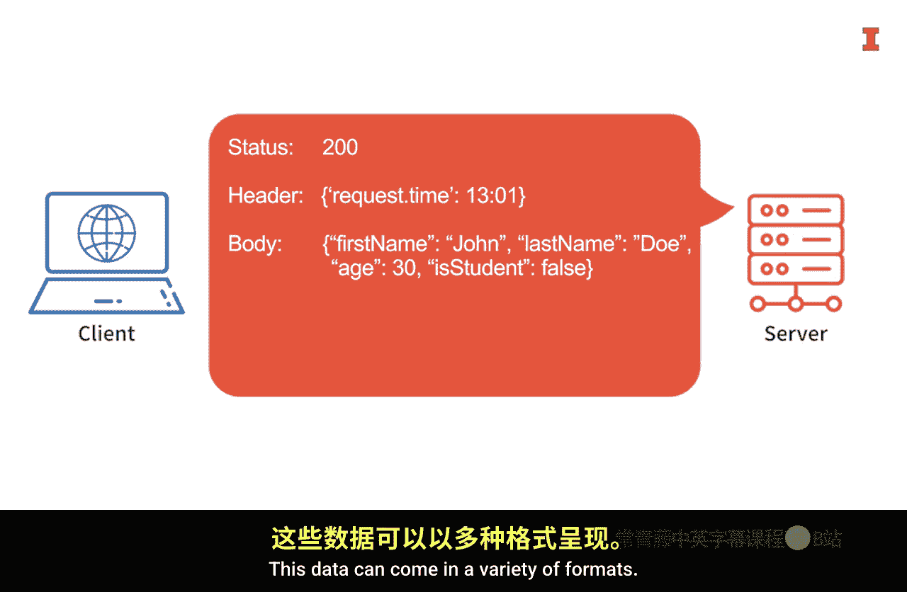

# 伊利诺伊大学【中英⚡商业分析｜Business Analytics Specialization】 p124 P124 03_API 请求与响应的关键要素 -BV1z86nB9EGz_p124-

I met Yukas， a popular taco stand in Southern California。 I just ate a couple of tacos。

 and they were delicious。 As many of you know， when you order something from a restaurant。

 you need to read the menu like the one behind me and then order something from the menu。😊。

The way you order things from a menu and then receive something back like food is similar to the way you make an API request。

So in this lesson， we want to discuss the building blocks that make up API requests or restaurant orders and API responses。

 which is like the food that you get from your order。

Let's briefly review the restaurant analogy that we used earlier when we first introduced APIs。

A customer goes into a restaurant and submits an order to the waiter。

The waiter then takes the customer's order and uses the restaurant's resources to fulfill the order。

 eventually delivering food to the customer。The customer doesn't need to know the specifics of how to create the food。

 They simply need to know how to interact with the waiter。

The customer represents the computer application and the waiter is the API。

The customer's order is the API request， and what the waiter delivers to the customer is the API response。

In this lesson， we want to discuss the building blocks that make up the API requests and the API responses。

Let's start with the API request， which is made up of five parts。

 the client and the server relationship， the header， the method， the endpoint and the body。

Let's see if we can take the restaurant analogy further and identify how these five parts can be likened to an order that a customer places in a restaurant。

Okay， first， there's a customer who decides to get food from a restaurant。

 and they go into a restaurant where they can interact with a waiter。With respect to API requests。

 we'll refer to this as the client server relationship。second。

 there may be important instructions before the customer interacts with the waiter。

 such as my name is Ron， and I have a reservation for two， or I want this order to go。

With respect to API requests， we'll refer to this as the header。Third。

 the client probably has a specific function that they want the waiter to perform。For example。

 they may ask about the soup of the day， so they just want information。

They may also indicate that they want the waiter to take their order， change their order。

 or cancel their order。With respect to API requests， we'll refer to this as the method。Fourth。

 there's the actual details of the order， like a steak with mashed potatoes and corn。

With respect to API requests， this is known as the endpoint。Finally。

 there are any other specific details that may need to be communicated like please cook the steak medium well。

With respect to API requests， this part of the request is known as the body。Okay。

 once the waiter receives the request， they take the action and eventually generate a response for the customer。

Most of the time they will translate the customer's order into instructions to the kitchen staff so that the customer's order is fulfilled。

The response generally has three main elements。 The status， the header and the body。

Let's consider how these elements would appear in our restaurant analogy。

The waiter may keep the customer updated on the status of the order by letting the customer know that theyre working on it or that it was delayed or that it has been fulfilled。

With respect to API responses， this is known as the status。Eventually。

 the waiter responds to the customer by telling the customer information about what they ordered。

 Sir， you ordered a steak， cooked medium well with mashed potatoes and corn when they delivered the food。

With respect to API responses， the message about what the customer ordered is known as the header and the food that is delivered is known as the body。

Okay， hopefully that restaurant interaction helps you appreciate the need for the various parts of API requests and responses。

Let's now look at the details of what the API request and response may look like when using web based RE APIs。

Let's start with the API request。

First， there's the client server relationship， which refers to how one computer interacts with another。

The client could be a line of code from a computer， or it could be triggered by an application。

The client needs to be able to connect with the remote computer， which is the server。

This is accomplished by making sure that the client has access to the internet。Second。

 there's the header。AI requests often have special instructions that the server expects before the request can be processed like authorization or how you want the data to be delivered。

This is the type of information often included in the header of the API request。

The header information is usually in a Python dictionary type of format。

An important piece of information that the client will often need is an authorization code known as an API key or a token。

This is used to keep track of how much information is being requested。Since information is valuable。

 there are often limits on how many API requests can be made or how much information can be extracted based on the rights of the client。

When APIs need to get access to personal information。

 then they will use a technique called open authenticuthation or OOth。

 in which the application uses a temporary token that grants authorization to personal information for a specific time。

Once the time is ended， a new token is needed。 It's a lot like a key card for a hotel room。

While most APIs require authorization， not all of them do， for example。

 governments and crowdsource projects have APIs that are open for anyone to use。Also。

 sometimes the API key is inserted in the endpoint rather than in a header。Third， there's the method。

 which is the specific function that the client wants the server to perform。

Rest APIs typically have four methods。Get， put， post and delete。

The G method means that you're asking for information to be returned and is typically the method that is used when you would like to get data from the server。

The post method is for adding a new item to the data repository。

 the put method updates a specific item， and the delete method removes a specific item。Fourth。

 there's the endpoint， which is a carefully constructed URL。

These URLs are often made up of a base URL that stays the same for all requests to that organization。

Then there will be a portion that points to a specific resource。 For example。

 if we're getting data through an API for a specific product。

 then we'll need to add that product's name and the type of resource that we want for the product like inventory levels。

The third portion of the URL will often include additional query parameters that identify specific subsets of the data。

 For instance， you may be able to include parameters that will reduce the data that is returned only for a specific time period。

And fifth， and finally there's the body of the request， which includes any other specific details。

When using the get method， the body is often empty。

 but when using the other three methods that will change the data source like put， post and delete。

 the body will have specific details about how to change the data。Okay。

 let's now look at the specifics of the API response。The first part of the response is the status。

Once the server receives the request and processes it。

 the API will send back a status code in the form of a number。

The status code that is most beloved is 200， which means that the request was successfully received and fulfilled。

The status code of 404 means that the server received the request。

 but there was a problem with the request， and it could not be fulfilled。In contrast。

 a status code in the 500s means that there was a problem on the server's end。

 which prevented it from successfully fulfilling the request。

The second part of the API response is a header that can provide a variety of pieces of information。

 like when the request was received and the way that the response should be delivered。

Third and most importantly， the response will contain the body。

 which will include the data that you requested。This data can come in a variety of formats。

The most common format is JavaScriptscript object notation or Json。

 which contains a lot of curly braces， much like a Python dictionary。

Other formats can include CSV and extensible market language or XML。At this point。

 just recognize that once the data is received， it often needs to be parsed and converted to a more useful format like a data frame。

I think we've reached a good stopping point for this lesson。In some。

 just like interactions between a restaurant customer and a waiter have predictable elements。

APpiI requests and responses have predictable elements。

We went into more detail about those elements for web based APIs that have a rest architecture。

Now that you've been informed about the details of API requests and responses。

 you should be better able to understand what you're doing when you get into the details of using code to create requests and process responses。

