# 伊利诺伊大学【中英⚡商业分析｜Business Analytics Specialization】 p126 P126 02_构建需要身份验证的 API 请求 -BV1z86nB9EGz_p126-

In this video， I want to demonstrate how you can perform secure API requests by including authentication in your request that is much like a password。

Except that this password is usually known as a token or a key。

And it's not something that the client or the user sets， but that the data provider sets。 Now。

 just like constructing the URL， every API has a different way of generating an API key and a different way of using it in the API request。

 So we're going to have to read documentation about how to use it。

So in a previous lesson I talked about how to get data from the city of Chicago's API without using any type of authentication。

 and we had a limit of 1 thousand rows of data。Let's go back to the API documentation。

And towards the top here， it talks about app tokens。

 And there's this big blue button right here that says， hey， sign up for an app token。

 So let's do that。 We'll click on that。Now I've already signed up for one。 This is an open data set。

 so you can sign up for one for free as well， but you do have to sign up for one。

 So let me enter my email address and password。All right。

 and then you have to explore about how to get your app token or your key。

And in this particular example right now， it's set up so that I've got kind this dashboard and right at the top it says developer settings API keys。

Now， we're looking for a token， it told us， so we're going to go to this bottom half where it says app tokens。

You can look around in here and look at more information about this。 But I've already created one。

 And the way I did that is I clicked on this create new app token。

 And then I gave it a name and a description。 Then it gives me this app token right here。 Now。

 this is my app token。 and you shouldn't use it。 Well。

 you might be wondering why I'm sharing this with you。😊。

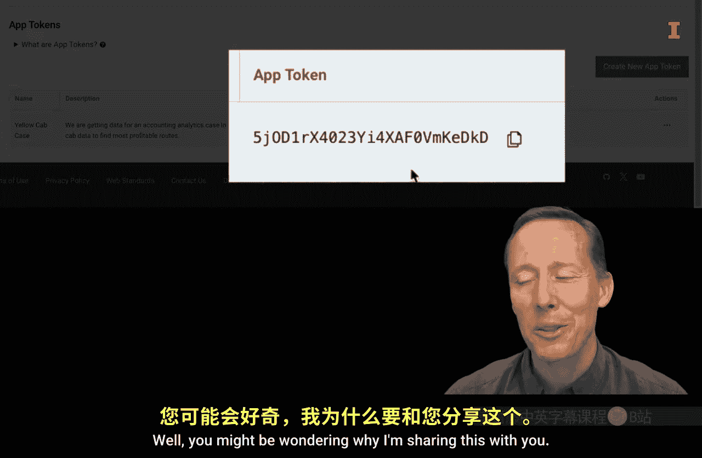

Well， you can delete these。 Okay， so you can come over here and just say delete this。

 And that's what I'll do before you see this video。

 But the key thing is to recognize you can get this app token。 Now， once you have it。

 you can copy that。And now I need to know how to use it in my API request。

 so let me go back to the documentation here。

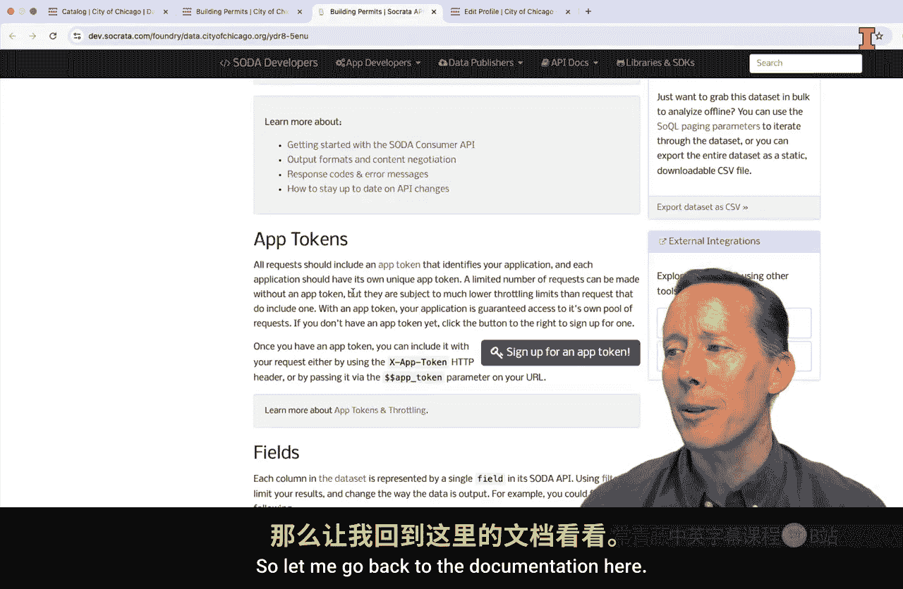

And down here， it says once you have an app token， you can include it with your request by either using the X hyphen app hyphen token H T TP header。

 or by passing it via the。Apppt token parameter in your URL。

So I'm going to demonstrate how to do it using the header approach。 Okay。

 so keep in mind that X hyphen app， Phen token。

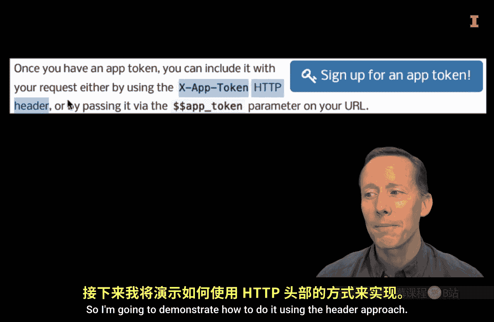

All right， let's go into a Python environment。

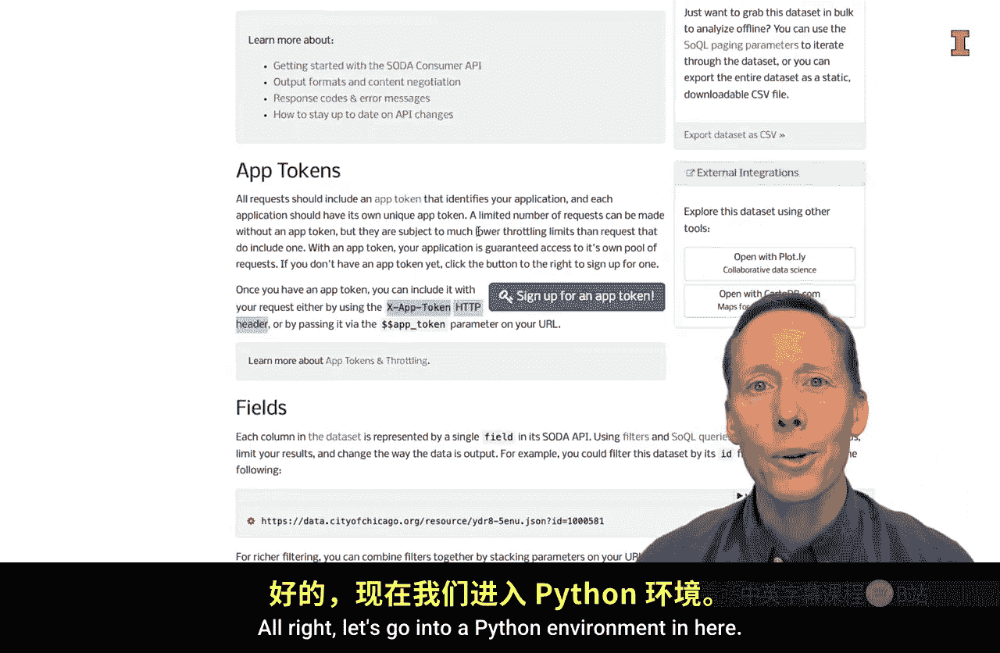

In here， I'm going to start by importing functions from the pandas and request module。

 And now I'm going to build my header。

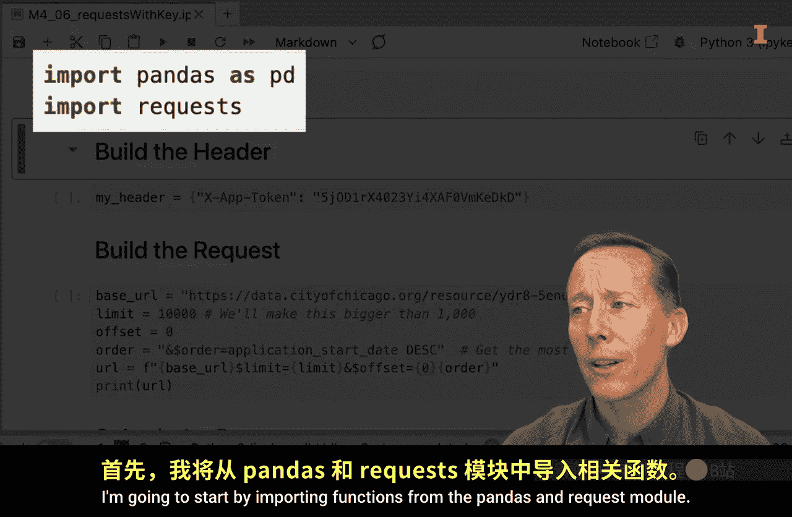

What I'm doing is I'm creating a dictionary， a simple Python dictionary where I've got this keyword in quotation marks。

 X hyphen app， Pyhen token， a colon， and then my token right there。 All right。

 So I'm going to save that as a variable called my header。 So I'll run that code cell。

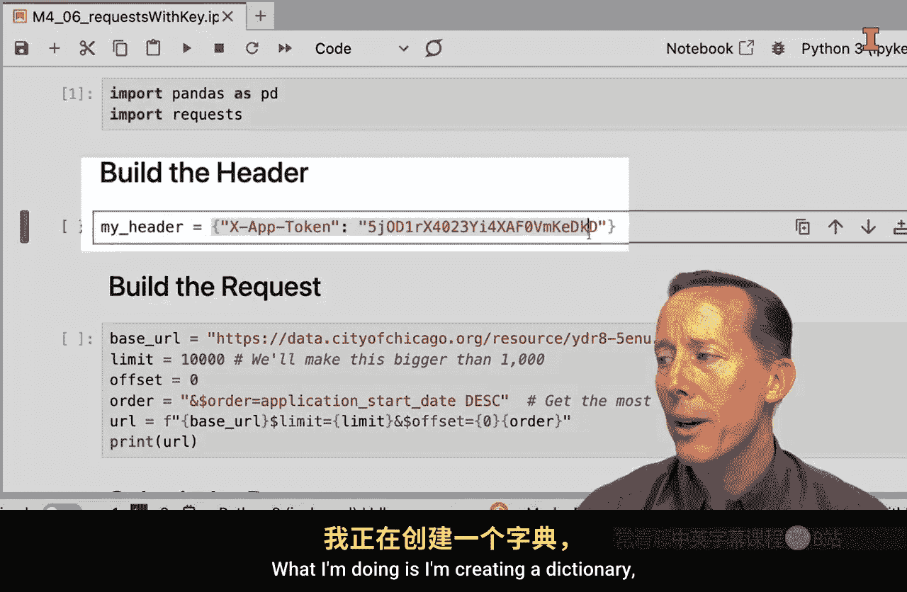

And now I'm going to build the request， and it's different in a couple of ways than in the previous lesson。

 the space U R L is the same， but the first difference is that I'm going to try and get 10000 rows of data at once rather than 1000。

And offset is the same。 Order is the same。 I want it in descending order。

It's also different in that I don't have any modifiers。

 I'm not trying to say it has to be greater than a specific date。And then finally。

 I'm constructing my URL。 So let me run this code cell and you can see my URL right there。

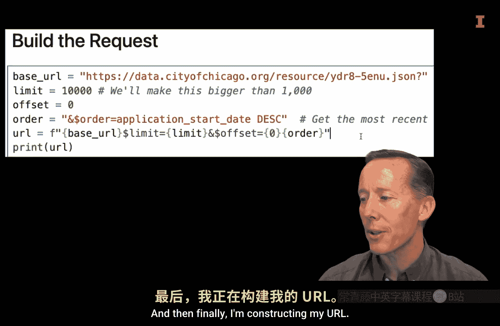

The token could be included on here at the end。 But again， I've got that in the header。

 So now let's look at the request。 I'm going to add this magic in here。

 This is something that Jupiter allows us to do。 I want to time how long it takes me to get 10000 rows versus 1000 rows。

 So I'm going to use that request dot get function again。 and URL R again。

 But now I've got an additional argument， which is headers。 and I'm setting that equal to my header。

 Okay， that that variable that I created up here。 that has my token in it。😊。

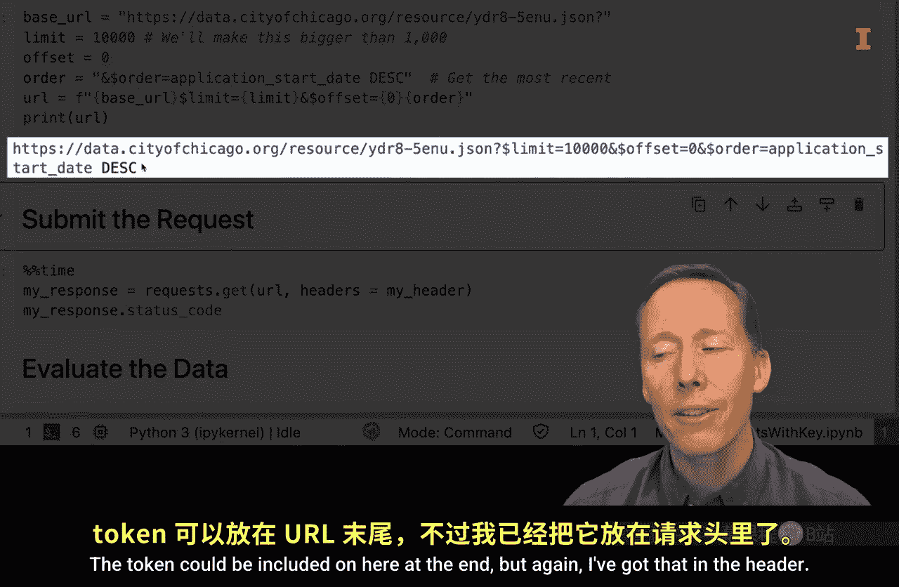

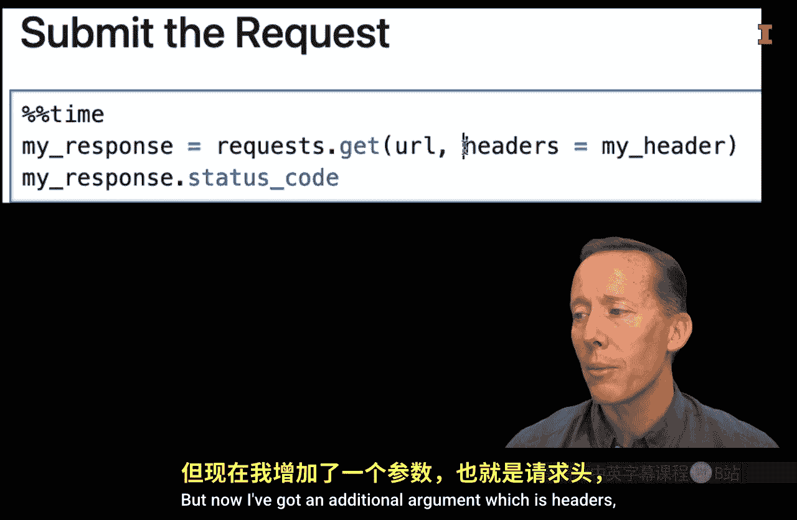

And so that's really the only difference。 So let's run this and see how long it takes。

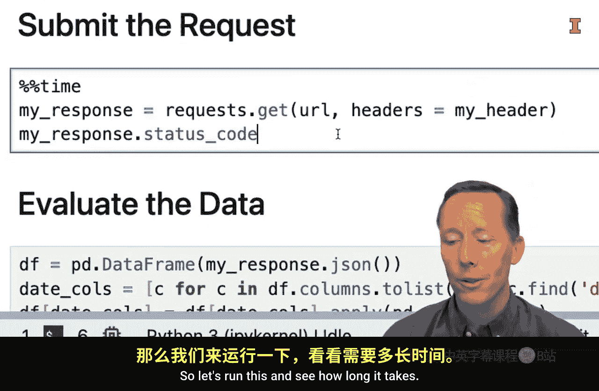

Okay， that took about 3 seconds，2。7 seconds。 I got a 200 response type。 So it worked。 Allright。

 so that's really the key thing that I want to highlight in this video is how you can add a header into your API request。

 And then after that， of course， we could go ahead and evaluate the data so we'll convert it to a data frame and create a plot so that we can see。

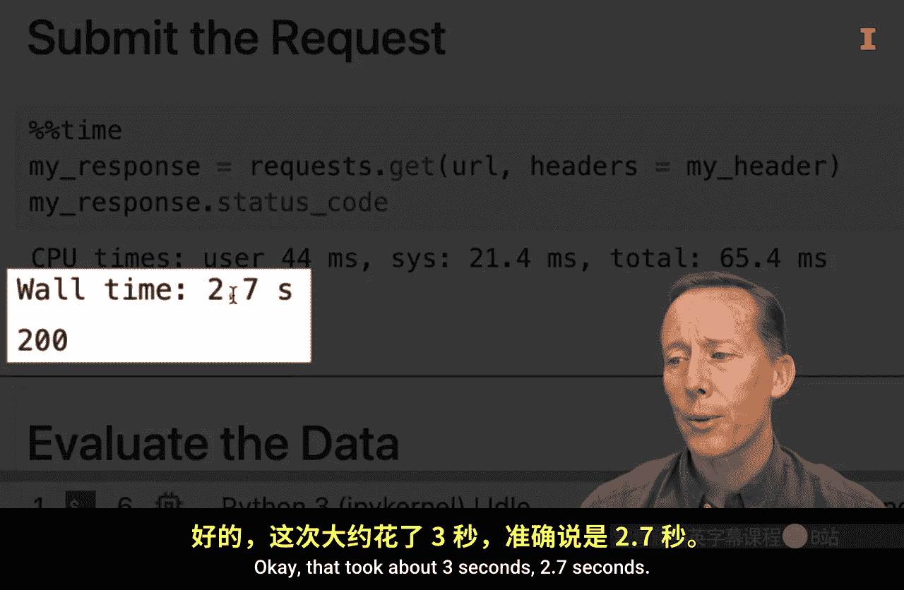

The weekly。Total fee by application start date。And perform some additional analysis on it。 All right。

 that's it。 You've successfully learned how to integrate your API key or token into your API requests。

 You're now ready to make more secure calls and get more data in a single request。

