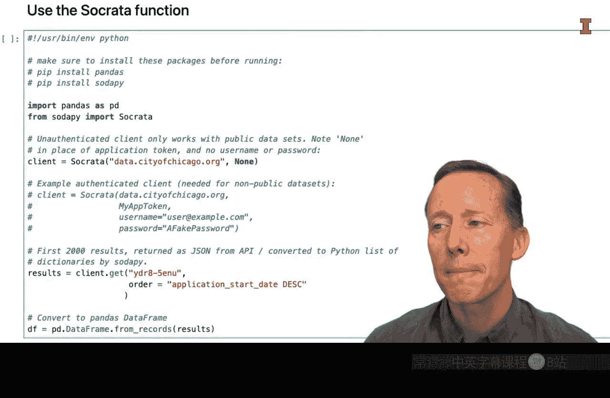
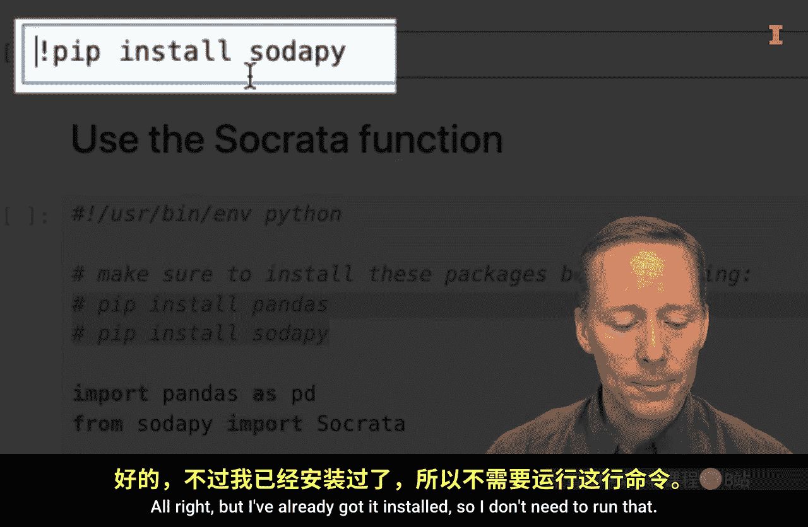
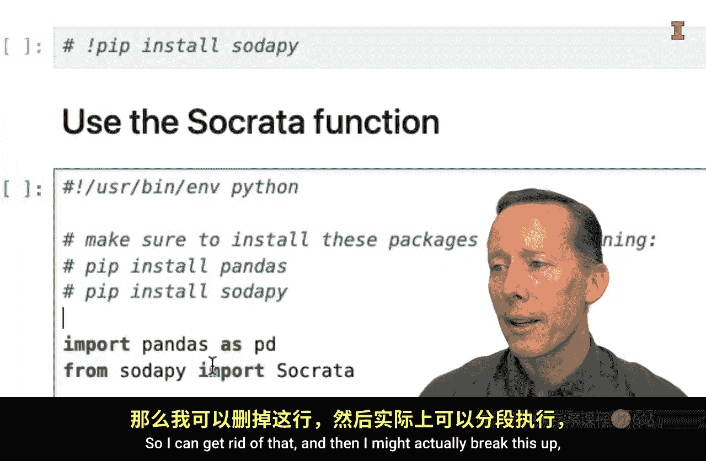
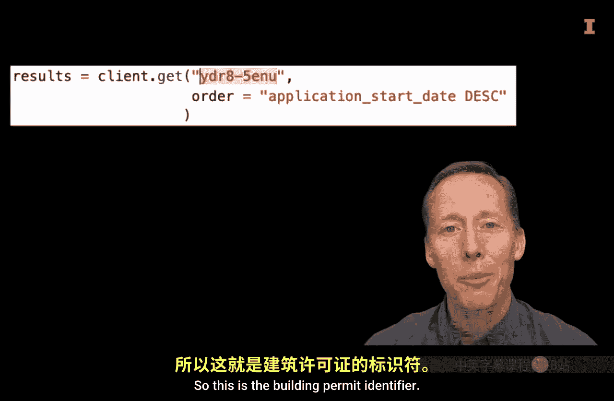
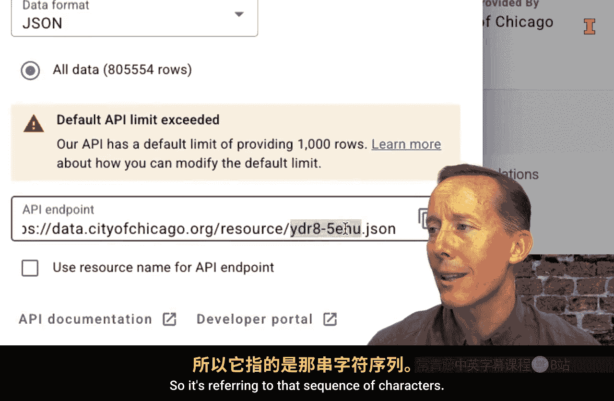
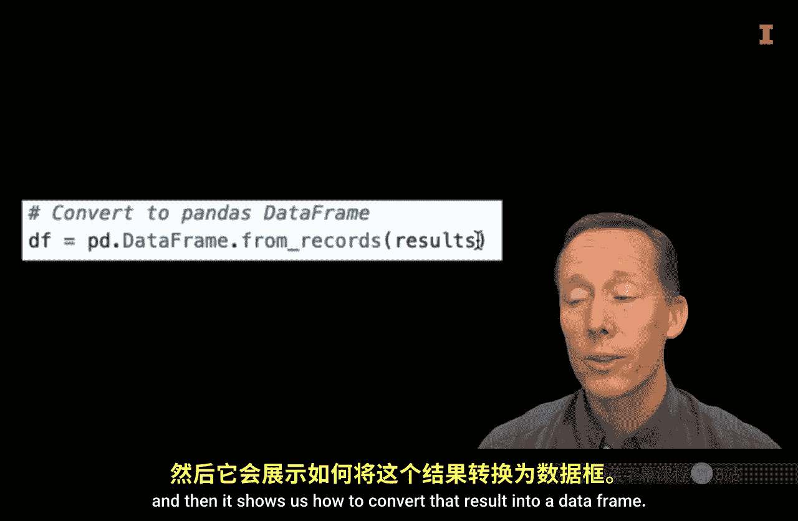
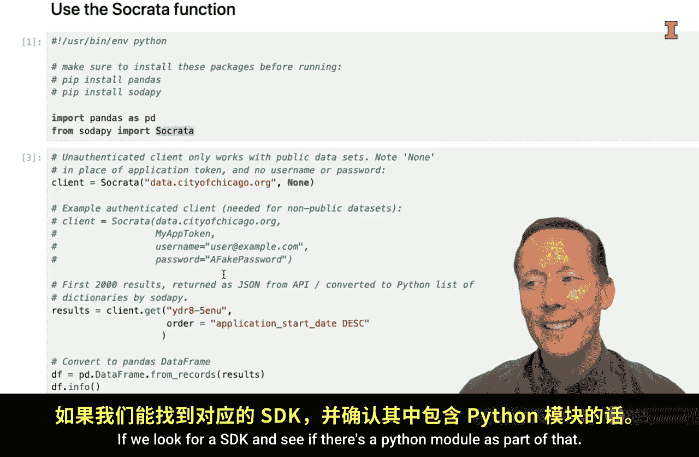

# 伊利诺伊大学【中英⚡商业分析｜Business Analytics Specialization】 p127 P127 03_使用软件开发工具包构建 API 请求 -BV1z86nB9EGz_p127-

嗯。

What if I told you that you could perform API requests without having to construct a URL？

Wouldn't that be great， That could save a lot of headache because you wouldn't have to worry so much about leaving out an important ampersand or adding in too many symbols。

Well， many data providers that have APIs also create software development kits。

And as part of that software development kit or SDK。

 they have created Python modules that you can download and install on your computer。

And those modules include functions for making it much easier to perform the API request。Now。

 just like everything else with APIs， it's not standardized。

 and so you're going to have to read about the API in its documentation and see if a Python module exists。

So let's look at an example and practice using it。We've been using the Chicago data Portal example where we've been looking at building permit data。

And if we click on this API documentation link。And then， scrolled to the bottom。

We find information about the SDK or software development kit， as it's often known。

 because Python is used so frequently， there are often modules for Python。

And so you can see that there's this tab， Python pandas。And in here。

We've got some code that we can copy。And then we can try it out on our own。Alright。

 so I've copied that and I'm going to go over into this Python environment。

And I've pasted it in here and made just a couple of minor adjustments。

But the first thing we want to do is read the comments at the top。

 We really don't need that up there， but it says that we need to make sure that we've installed the pandas and soda pi modules。

 So if you haven't done that， you'll need to run a line of code here that doesn't have a comment。

So that exclamation point at the beginning means it's a terminal command rather than a Python command。

 and it'll download。And install the soda pi module under your computer。Alright。

 but I've already got it installed， so I don't need to run that。

So I can get rid of that and then I might actually break this up。

So， I can。Just perform that part。 Okay， so I've imported functions from those modules。

Now I need to create a client， So I'm going to use this Sorata function that I imported。

And I need to indicate that I want data from the city of Chicago。So apparently。

 this module can be used for other cities or other data sets as well。

And then it tells me what this nun is that the nun is used in place of an application token。

And we don't need a username or password。So if we have an app token， which I do。

 you could put that in there， but I'm not going to demonstrate that here。

 And it even gives you an example of an authenticated client。 Okay。

 so you can just include your app token in there as the second argument。

And it says we don't need the username and password， so you don't even need that。Okay。

 so we can create that client and then we can use the client。ge， so it's kind of like request。ge。

 but client。ge。And then we've got just the key right there。

 So this is the building permit identifier。 And we found that。

Back in the documentation here， it， it told us that right there。 Okay， so it's referring to that。

Sequence of characters。 So we enter that as the first argument。

 And then if we don't want to bring in the full data set， but we want to filter it。

 we'd still need to go to the documentation and read about how to do so。

 And we could read about the common sequel light commands that are used。

 but it's nice because we don't have to use the ampersand dollar sign。In front of these。 Okay。

 it's just kind of basic arguments here。 So order equals and then。Applications start date。

 descending。Alright， so we'll perform that request。 We'll get the result。

 And then it shows us how to convert that result into a data frame。

 So let's just go ahead and run that right here。 Let's see if it worked。 Actually。

 let's rerun it and we'll。

Okay information。Okay， it's running， okay， it looks like it worked。

 and I got 1 thousand rows of data。All right， and just like before every column is a string。

 so we need to do some additional cleaning in here。

 So I've got some code cells to do that where we convert。Some columns to the correct data type。

 and then we can go ahead and analyze it using pandas functions。Okay， but really the。

 the key thing is just recognizing that。We can make it much easier on ourselves to get data from an API。

 if we look for。A SD D K。 and see if there is a Python module as part of that。

And oftentimes， there is。 So remember to look for the Python modules when you start using some other API。

 it'll make your life a lot easier。

