# 伊利诺伊大学【中英⚡商业分析｜Business Analytics Specialization】 p128 P128 01_循环 -BV1z86nB9EGz_p128-

In this video， I'm going to introduce you to loops。Now loops are really useful for creating dry code。

 Dr is an acronym that stands for don't Reat yourself。In contrast to dry code， there is wet code。

 and wet is also an acronym that stands for right every time。

Now it's really easy when you're first starting with code to create wet code。

Whenever you find yourself copying and pasting code， that's wet code。

 And it's undesirable for several reasons。 First of all。

 no one likes to do a mundane task like copying and pasting。But secondly。

 it's very subject to human error。 You may accidentally paste the code that you've copied in the wrong place。

 or you may copy the wrong code， or you may paste over some code。

And then the third reason why it's undesirable is because it's very hard to maintain。

 So if you've created wet code and you want to make a change to the process。

 you want to make it faster or there's a problem with it。

 you have to go find every place that you've hasted it and fix it。

 So loops can help us perform things in a much more concise and faster way。

So let's go into a Python environment and I'm going to demonstrate four different types of loops。

 and this is really just an introduction。 there's a lot more that we could say about loops。

 but I just want to demonstrate them here and then we can talk about them more when we apply them。

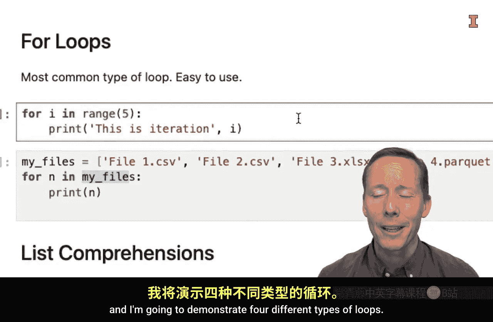

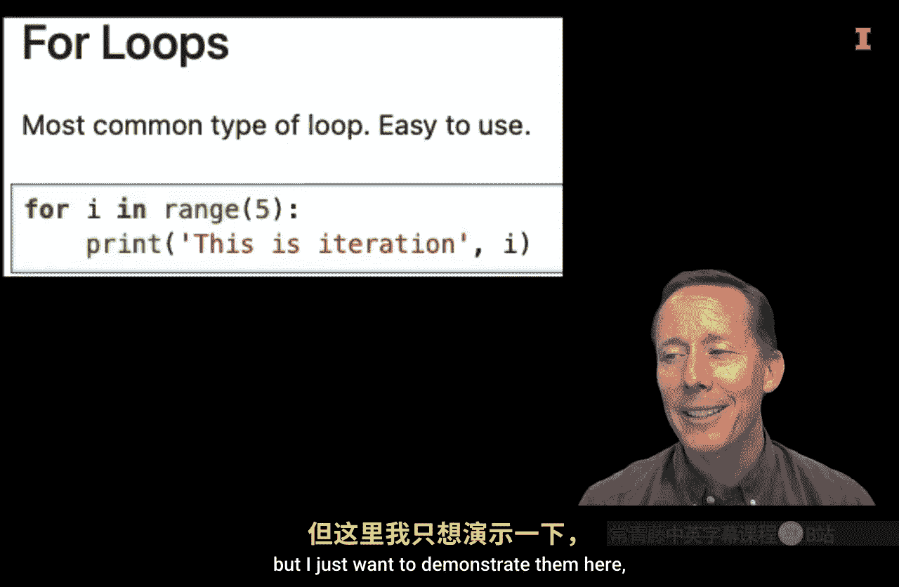

So this first code cell， I'm going to run。 And it's a very basic for loop here。

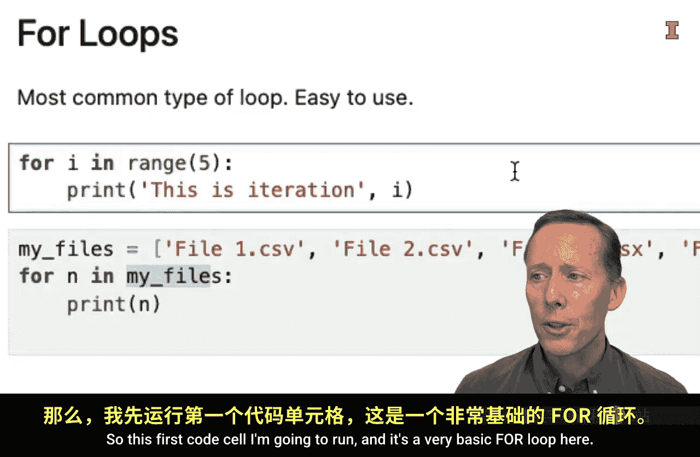

Alright， so maybe let's look at the output first。 you can see that what I have is five lines of output。

 but I created it by using two lines of code。 I didn't have to manually type out this is iteration0。

1，2，3，4。Instead， I created this four loop by using the keyword 4。

And then I've got some other key wordss in here。 So I in range 5， I is an arbitrary variable name。

That will represent every value in this list。All right， and。

This range 5 is just a function that creates a list of five consecutive numbers。So0 through four。

 Python is0 based， so 0 through4， not one through5。Alright。

 so then I've got a colon and then below here and indented。

 I can have multiple lines of code that are part of the process that I want to iterate through。

And this simple process will be just printing out this is iteration， and then whatever eye is。

So you can see the first time through I was 0， second time through it was1 and so on。 Okay。

 so I hope that demonstration makes sense in case you might be wondering about this range 5。

 let's look at another example where I create a list of hypothetical file names。

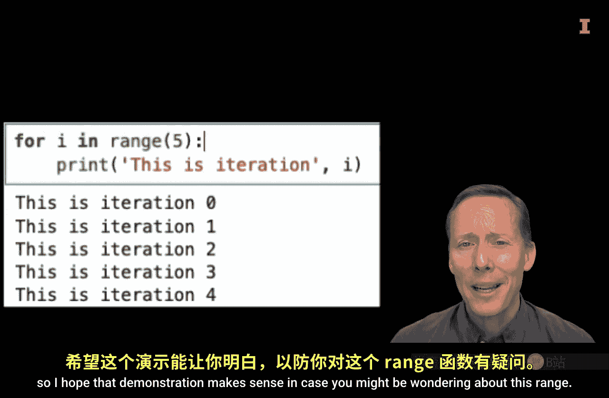

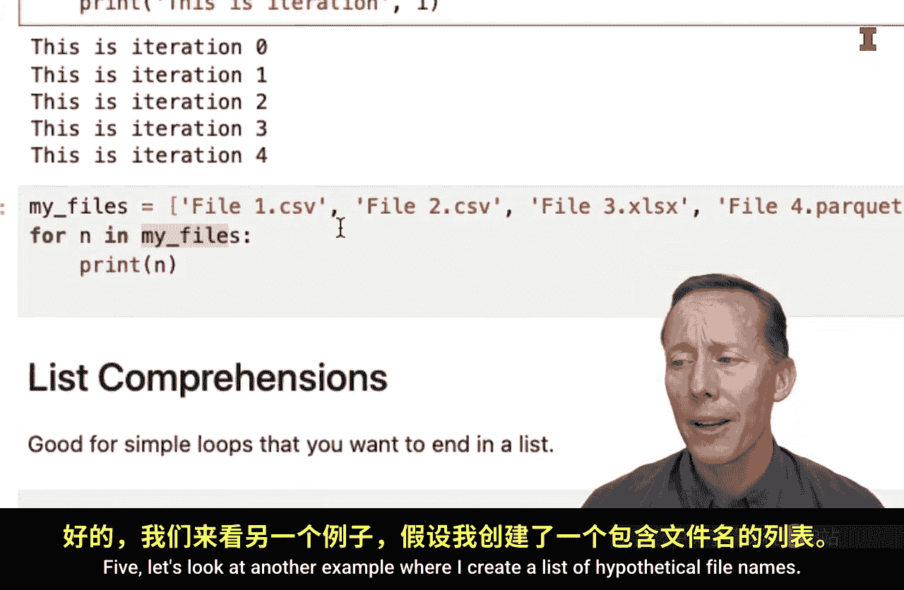

So I'm going to create this My files object that has names file 1。 CSsv， file 2。 csv， file 3。

 xsx and file 4。 partK， and I'll go ahead and run this and here we're not using I but we're using n to represent the values in this object here。

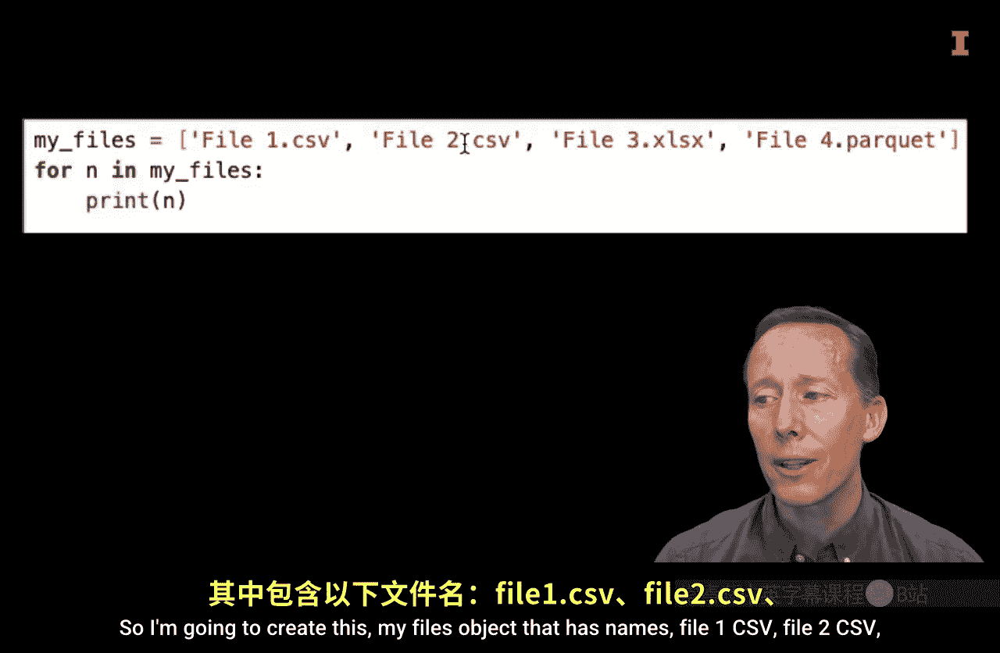

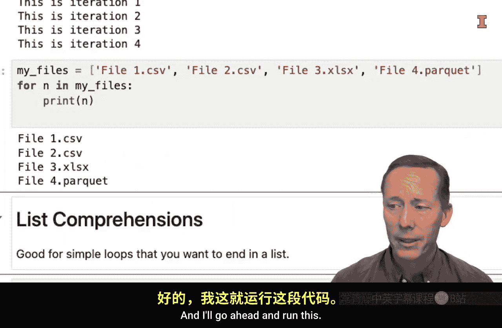

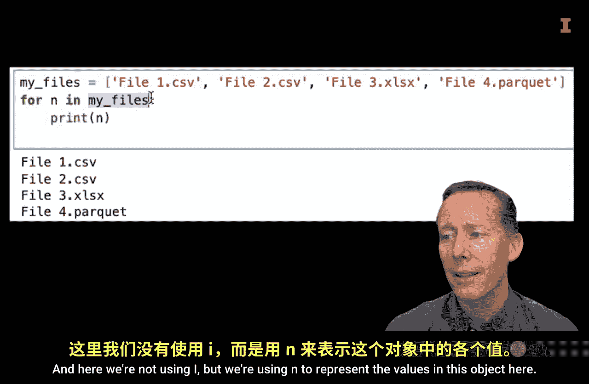

And then we're just printing out the file names。 Four loops， like I said， are used most often。

 but you'll also see other types of loops less frequently。

 So the second type of loop that I want to introduce you to is a loop called list comprehensions。

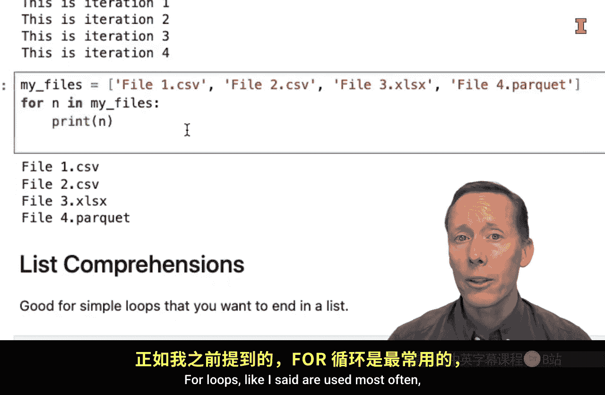

And list comprehensions are good for when you have a simple for loop。

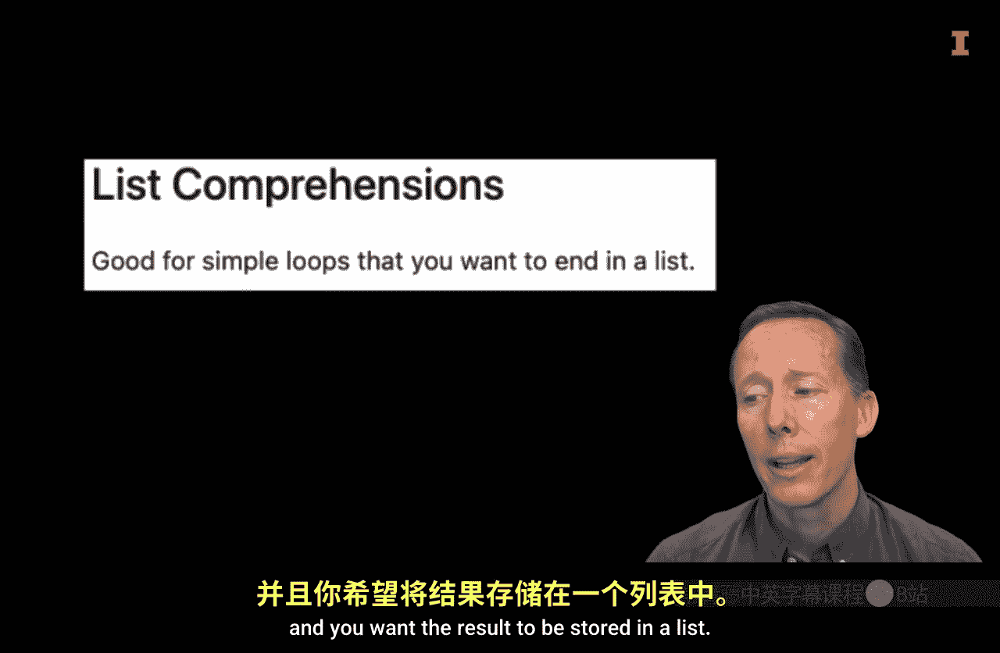

And you want the result to be stored in a list。 Allright， so let me demonstrate how I can create。

A list of these file names。I'll just recreate this list that we have。

 but I'll put them back into a list by using a list comprehension。 So I'm going to。

Copy and paste this4 n in my file。 So we're going to start with that same four statement。

 But I'm going to add open closed brackets and paste it in there。

 The thing that we want to save in the list comes before the for statement。

So if I want to save those values。

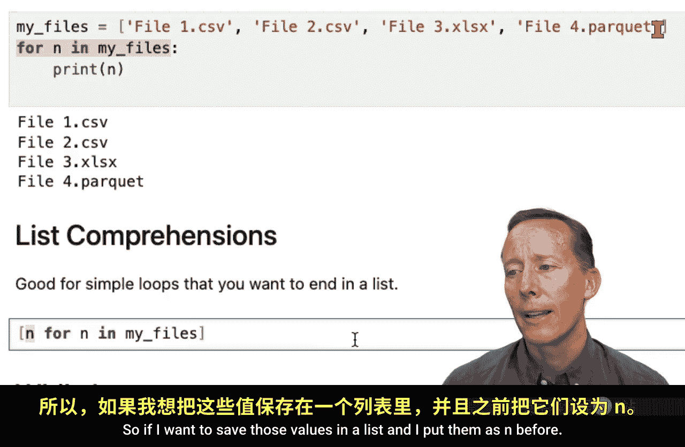

In a list and I put them as n before。 So now when I run that， you can see that I get this same。

list that we started with， but it's in a list format。Well。

 this can be useful because if like we want to iterate through。

The names of files that we have in a directory and only extract CSV files。

I can add in here a conditional statement， so。Okay， so I added if n dot find。

 and then in quotation marks， dot CSv is greater than or equal to 0。Then。What will I do， I'll。

 I'll save it in the list。 So now if I run this， you can see that I'm only getting files at end in CS SV。

 Anyway， list comprehensions， you'll see for very simple four loops when you want to save the output as a list。

 All right， And then there's also while loops。 So four loops say， hey。

 we've got to have a sequence of numbers and go through all of those。

 You can actually break out of those early。 But while loops allow you to perform a process while a condition is true when it's false。

 then the loop stops。

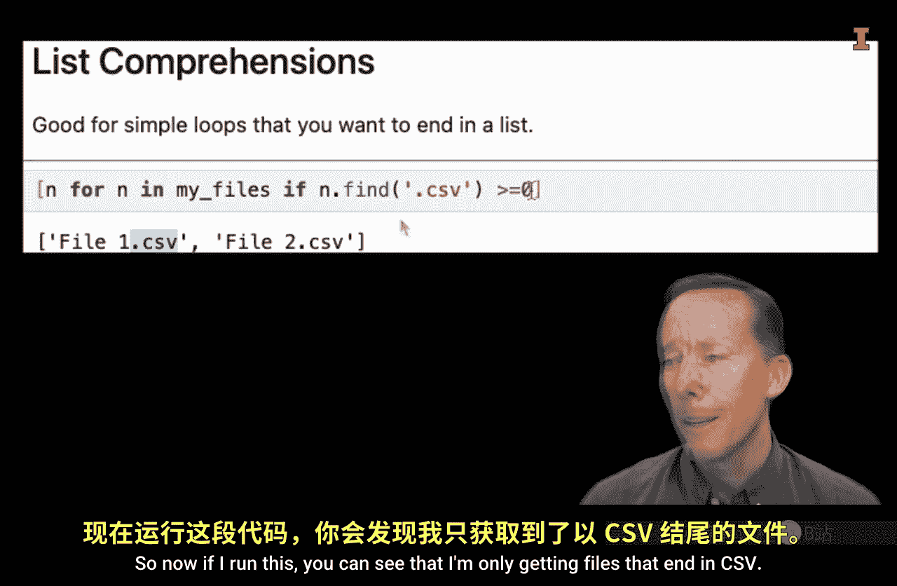

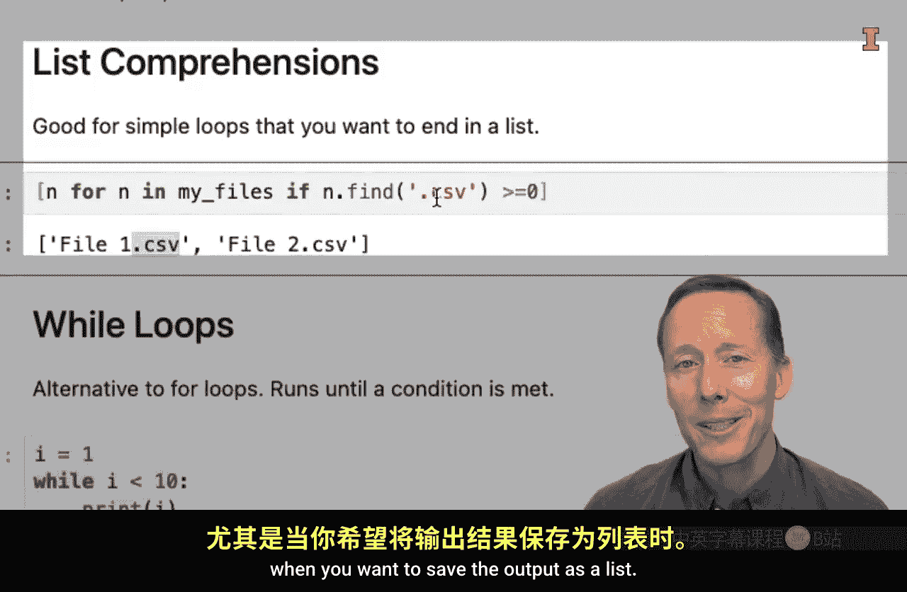

So in this case here， I'm going to set I equal to 1。 and I'm going to use this keyword while。

 And then while I is less than 10， I've got the colon， I'm going to just print out the number。

 I'm also going to increment I by one each time。 So this is shorthand notation。

For saying I is equal to I plus 1。

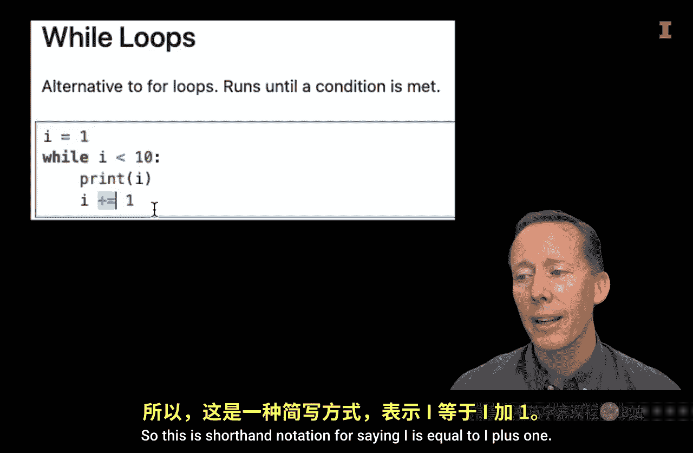

All right， so if I run this。You can see that this loop runs from one up to 9。

And then it ends because I is equal to 10。 And we could actually check that。AndThen I right there。

 we can see the I is equal to 10， so I was 10 and it stopped。All right， so that's a while loop。

The last loop that I want to introduce you to is the pandas App method。

And this is really helpful for when you want to iterate over multiple columns of a data frame or multiple rows。

 But anyway， so I'm going to create a simple data frame here that's got three rows in two columns。

 and you can see that the values in this data frame are all objects。

But I can see that most of the values are numbers。 I've got one that's not a number。 Well。

 let's say I want to convert multiple columns to numeric data types rather than object data types。

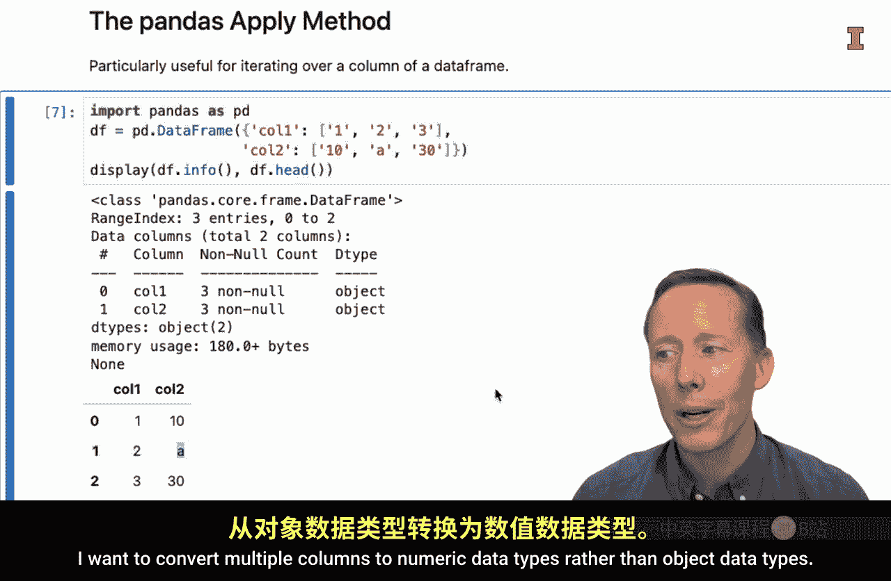

Here's how I could do that。I could use the apply method。 So I take D F dot apply。

 and then I indicate the function that I want to apply across multiple columns。

 And that's going to be the pandas two numeric function。

 And I don't have any open and close parentheses on it。

 That's indicating that what comes next are arguments within this function right here。

 So errors is equal coerce means that if it runs into something that is not a numeric value。

 it'll replace it with a missing value。

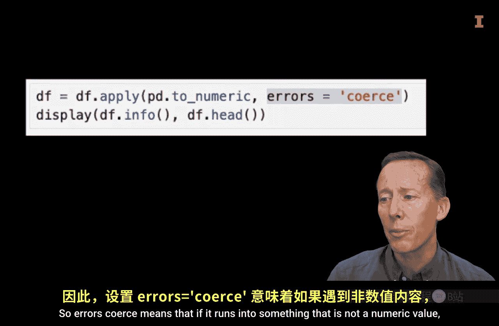

So if I run this and then inspect the data frame again。

 you can see that now I've got integer and float。 So they're non string data types。

 and I can it really doesn't look a whole lot different except that that a is replaced with the missing value。

 So that's your introduction to loops。 You'll see them used a lot。 and they're really valuable。

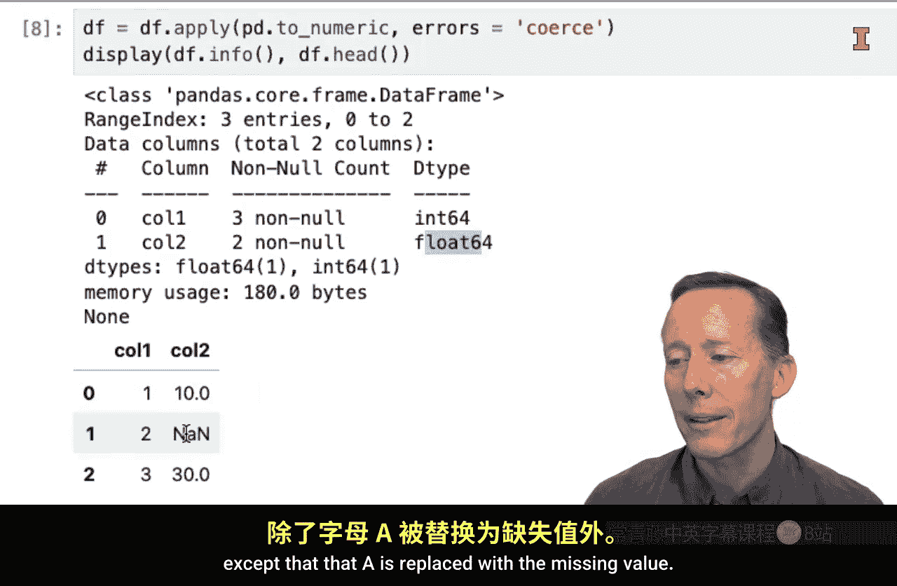

