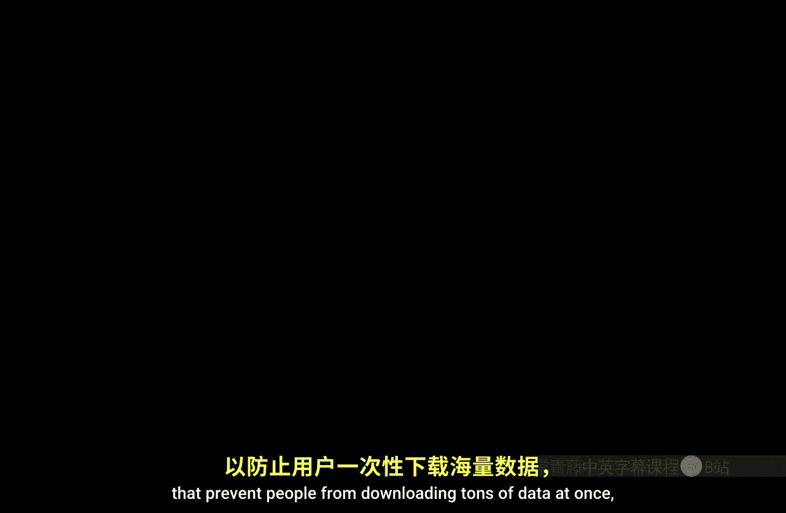
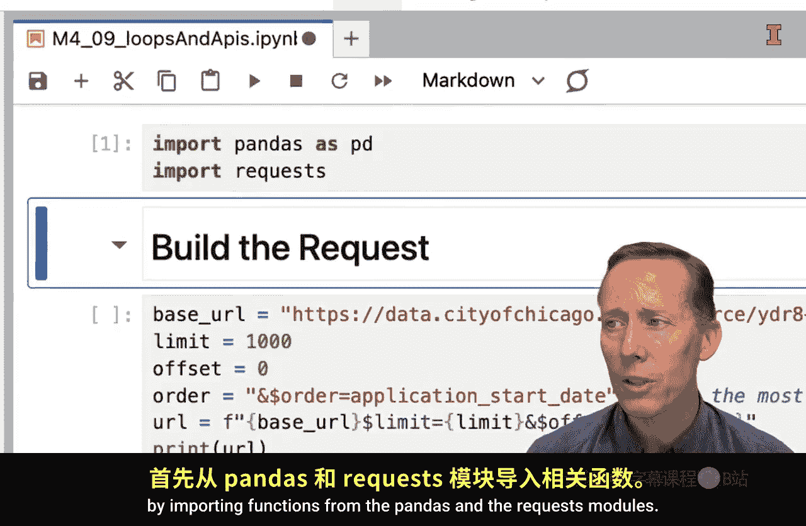
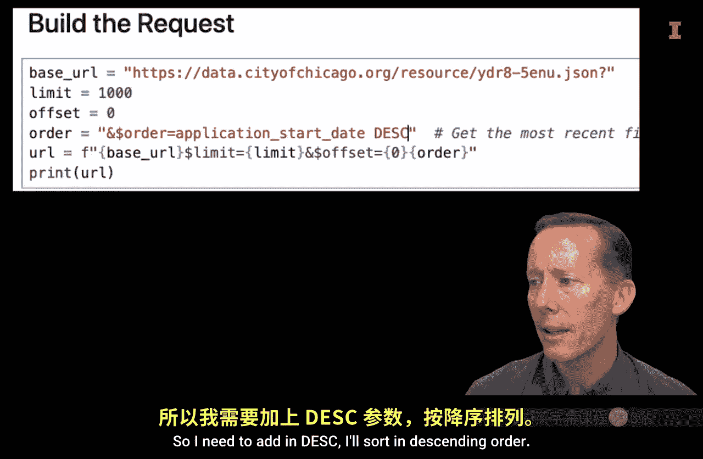
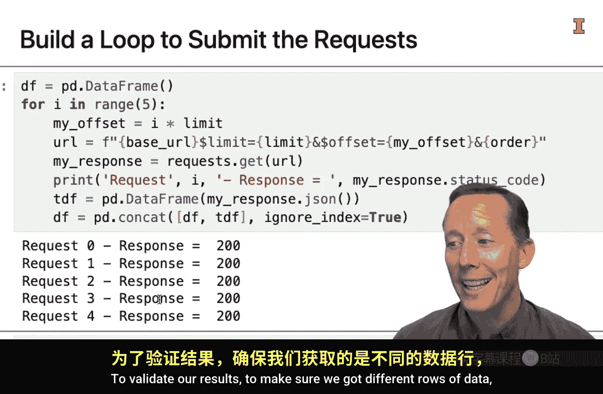
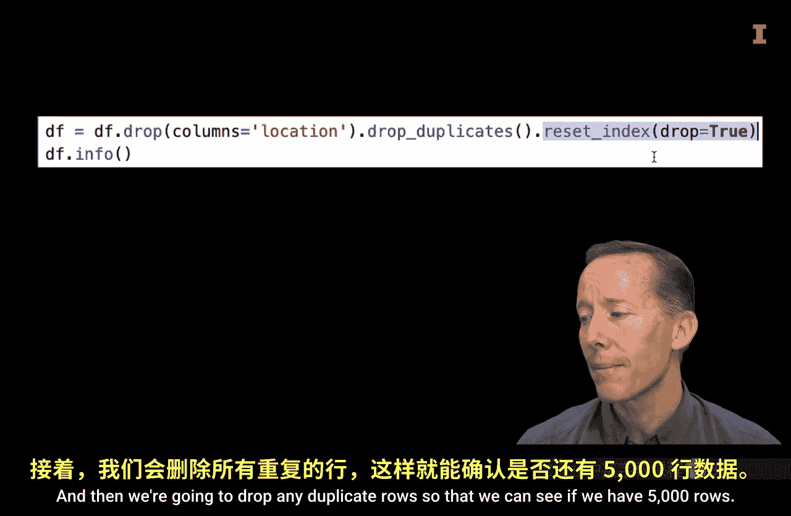
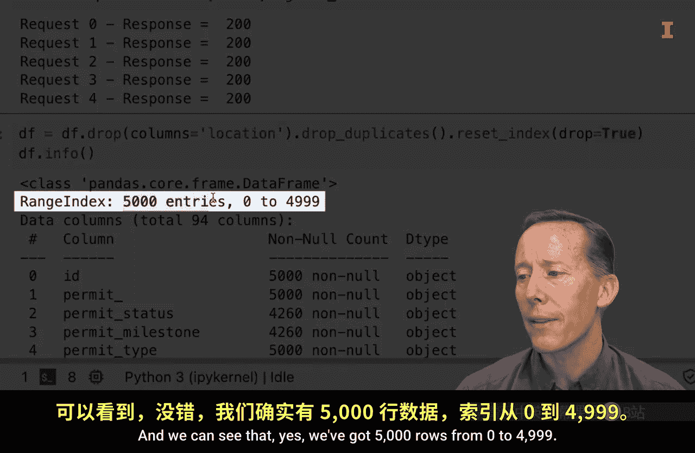
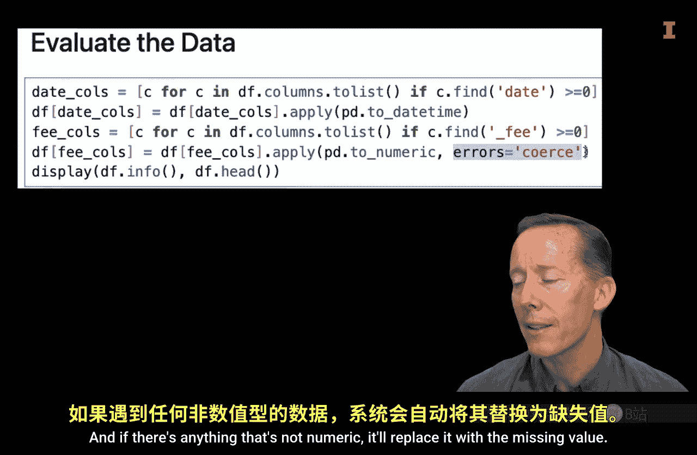
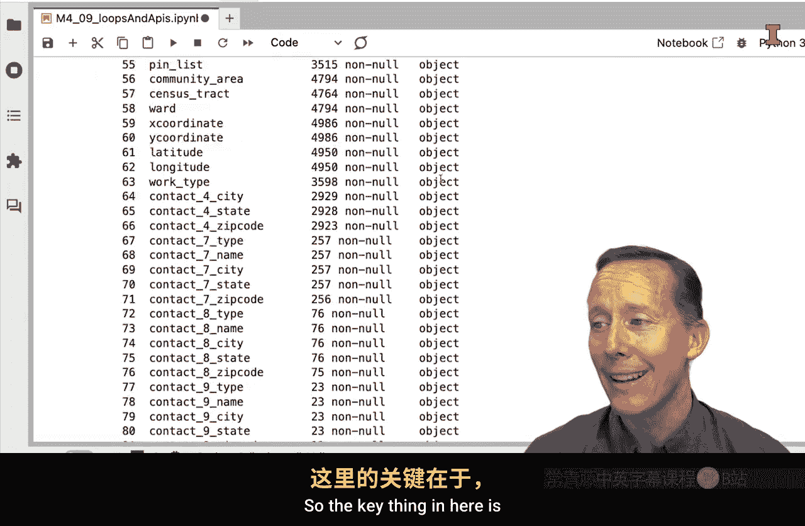

# 伊利诺伊大学【中英⚡商业分析｜Business Analytics Specialization】 p129 P129 02_循环与应用程序接口 -BV1z86nB9EGz_p129-

Apis often have controls in place that prevent people from downloading tons of data at once。

 because that may take up all the bandwidth。And so they often will put rate limits on the number of rows you can download。

 So in this lesson， I want to demonstrate how you can use loops to download all the data that you want by performing iterative API requests。

So we're going to build on the example that we've been using where we get data from the City of Chicago's API。

Specifically， we're going to get building permit data。

 The API without an app token has a limit of 1 thousand0 rows of data。

So let's go ahead and start in our Python environment by importing functions from the pandas and the requests modules。

And then let's build our request。 So I'll go ahead and build it。

 But let me highlight some things about this request。

 We're starting with our base URL that has the endpoint associated with building permits right here。

And then I've got this question mark indicating that we're going to filter the data。

And we're going to limit the number of rows to 1000。 That's a max we can have without an app token。

 And then I'm going to start with offset equals 0。And these two numbers are going to be really important。

 I'm going to sort the data so that I get the most recent data first。

 So I'm setting the order equals application start date。And actually， this is the oldest data first。

 So I need to add in D E S C， Ill sort and descending order。

 Then I'm going to combine that altogether using an F string and print it out。

 So we can only get 1000 rows of data at once。 but let's say I want to get 5000 rows of data。

 and I don't have an API key。

Well， it'd probably be faster to get an API key。 and then you could perform one request。

 but even with an API key or an app token， there will probably be limits。 All right。

 so we're going to build a loop to do this for us。 And let's look at how I'm applying a loop in this situation。

 I'm going to start by creating an empty data frame named D F。

And then I've got this for I in range 5。 Okay， so I'm going to perform what comes below here five times。

And I'm creating this variable my offset。 So remember that we've got this offset parameter。Well。

 I'm setting it equal to I times whatever our limit is。

 So the first time through I is going to be equal to 0 because the first value range 5 is 0。

 and then limit is 1000。 So 0 times 1000 is 0。 and then the second time through I will be 1 and limit is still 1000。

 So it my offset is equal to 1000。 second time through will be 2000 and so on。Okay。

 and so in this URL that we're creating， we're entering my offset into there。

 And that's how we page through the different values。 And then the rest of this is pretty similar。

 We're going to perform a get request and save the response。

 And then to help us know that it's working and to keep track of where it's at in the loop。

 we're going to print out just a status update here that'll tell us the request that we're on。

And the response， whether it was successful or not。 And then we'll print out the status quo。

 We'll take that data， convert it to a data frame called TDF for temporary data frame。

And then we're going to stack that temporary data frame below the data that's in D F。

 So the first time through， D F is nothing， but TDF will add some new rows。

 And the second time through just more rows。And we're ignoring the index。

 we don't have any repetitive row names。 So let's go ahead and run this and see if we get the updates。

Whoops， I have modifiers in here。 I can。Read that。Okay， let's run this。Okay， looks like it's working。

You can see it this time it didn't work as quickly so you could actually see it looping through and doing it。

 but it looks like it worked。 It got through all five requests。To validate our results。

 to make sure we got different rows of data， let's go ahead and drop the location column。

 That happens to be a dictionary column， in it。

Doesn't allow us to look for duplicates。 so we're going to get rid of that column。

And then we're going to drop any duplicate rows so that we can see if we have 5000 rows。

 and then we're going to reset the index。

Alright。So we'll go ahead and run that and we can see that， yes， we've got 5，000 rows from 0 to 4999。

 so it looks like it worked。 We could do some additional cleaning in this data。

And here's an application of list comprehensions。 So what I want to do here is I want to loop through。

Each value， each column name。 Okay， So for C in。Then my column names， I need to convert into a list。

 and then if we find the word date in the name， we're going oh then it'll be greater than or equal to0。

And so if that's true， if we find the word date in there。

 then we're going to save that in a list called date calls。

 and then we're going to apply this two date time function to convert any column that is in this list here to a date time format。

 so you can say I'm saying， hey， just the columns that are in this date calls list is what I'm going to perform this to。

 I'm going to save them back into themselves。And then I do something very similar。

 but I'm looking for columns that have the word phi in them。

I'm going to save them in a list called fee calls。 and then I'm going to convert those to a numeric data type。

And if there's anything that's not numeric， it'll replace it with the missing value。

So now if I run this， we can see that I've got。Issue date column that is a date time format。

 I've also got building fee paid， zoning fee paid and so on。 All right。

 And then I can go ahead and use Python and and dysfunction functionality to。Analyze this data。

And away we go。 So the key thing in here is that we're demonstrating how we can use a loop to iterate through multiple API requests to get the data we want。

 So hopefully that's a useful demonstration of four loops as well as list comprehensions and the apply loop and how you can really use those to help you in getting data with APIs。

