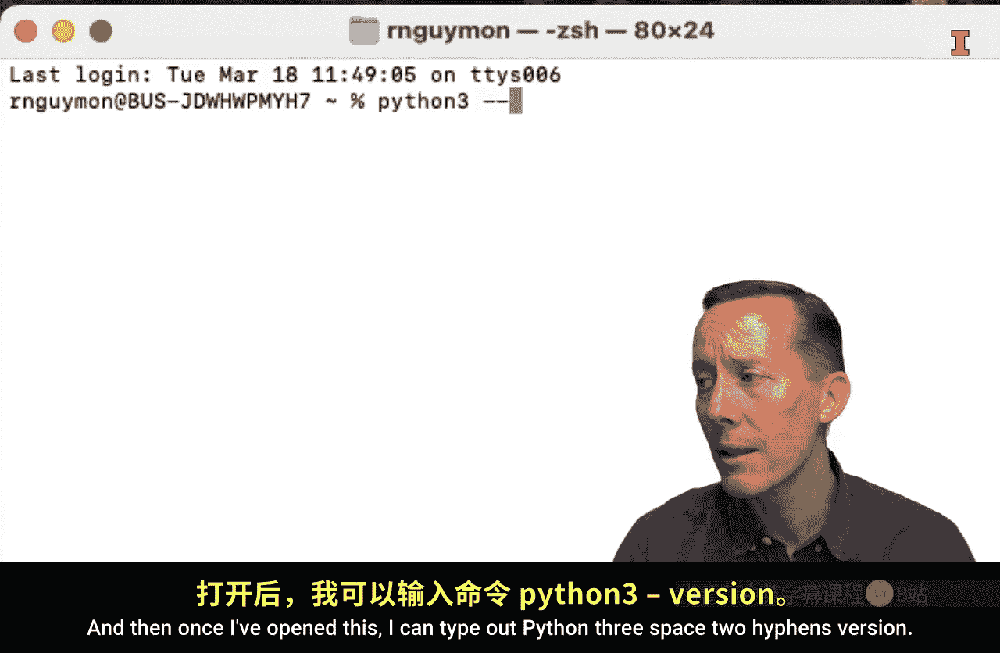
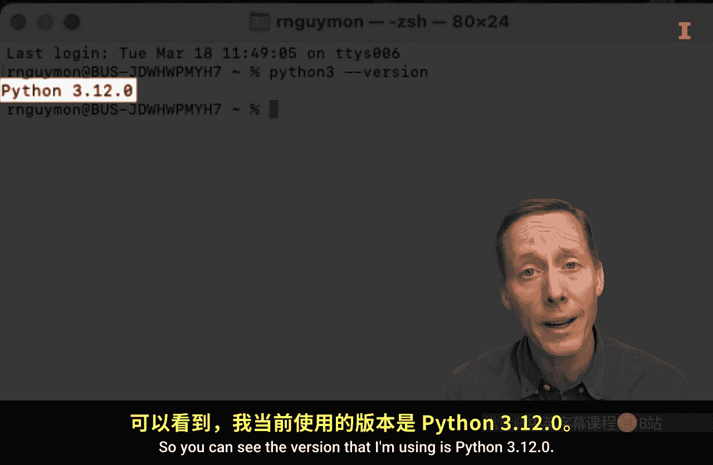
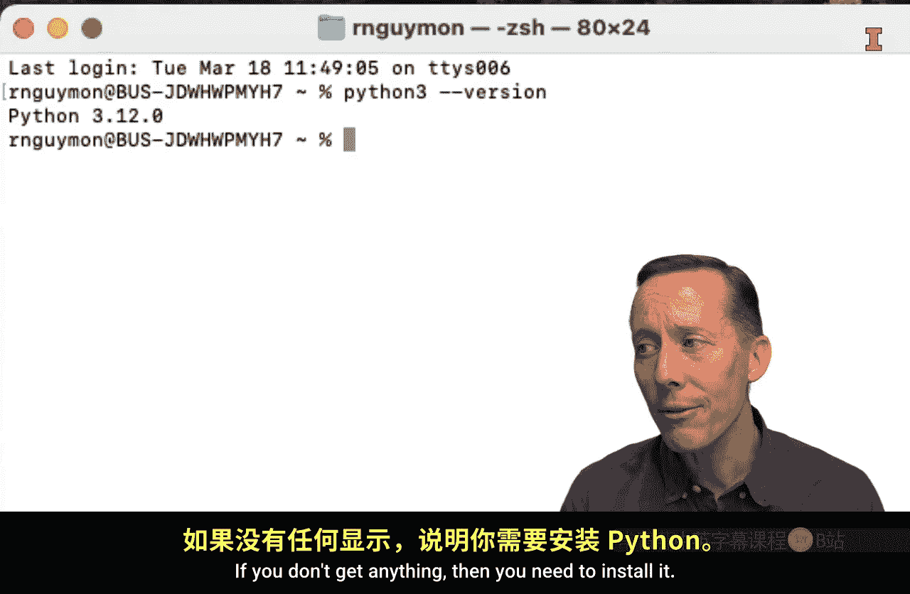
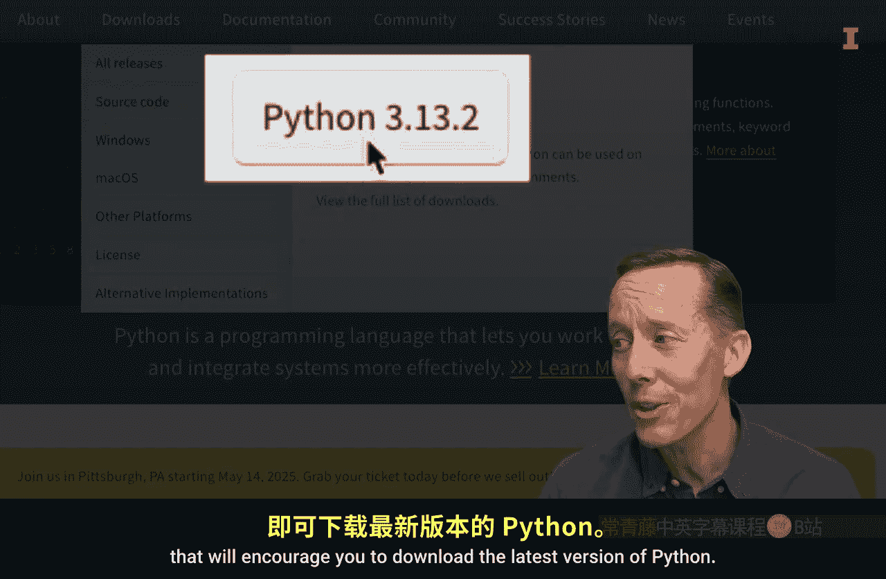
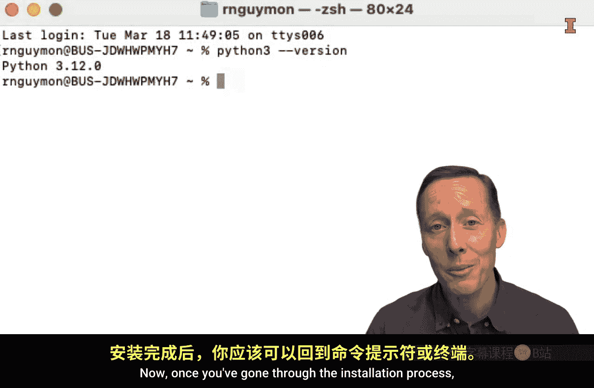
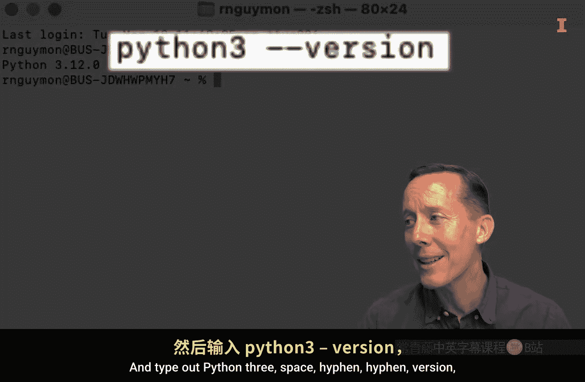
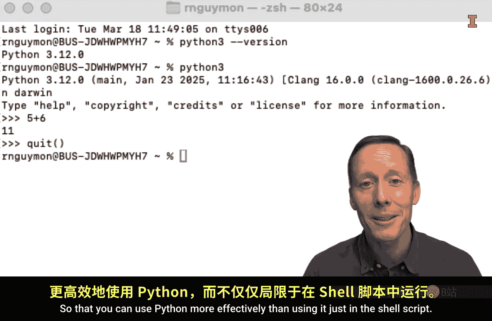

# 伊利诺伊大学【中英⚡商业分析｜Business Analytics Specialization】 p13 P13 10_为高级Windows用户从python -BV1z86nB9EGz_p13-

There are a variety of ways to install Python on your computer。

 The approach that I will demonstrate in this video is to install Python directly from Python。org。

Now， for those of you using a computer with the Mac operating system。

 I encourage you to watch another video in which I talk about how to install Python through Homebrew。

 and I talk about the benefits of that approach and how to do it in that other video That being said。

 you can install Python through Python。org on both Windows and Mac operating systems。

The first thing you should do is make sure you don't already have Python installed on your computer。

 The way you should do that is to open up either the command prompt if you're on a Windows machine or the terminal。

 if you're on a Mac machine， so I'm going to use a spotlight search by pressing command spacebar and then type out terminal and hit enter。

And that'll bring up this basic window here。 And then once I've opened this， I can type out Python。

3 space  to hyphens version。

And if a version of Python 3 is installed， then you'll get a message that tells you Python and the version so you can see the version that I'm using is Python 3。

12。0。

If you don't get anything， then you need to install it。

All right， so to install Python， navigate to Python。org and then go to the download section。

And your browser should detect what type of operating system you are using。

 and you can just click this button here that will encourage you to download the latest version of Python。

So I'll go ahead and click this button here， Python 3。13。2。

 and it's downloading the installer into the downloads folder on my computer。Okay。

 once it has been downloaded， I can go to my file navigator and I can double click on the installer。

 and this will walk me through the steps for installing Python。

So you'll need to go ahead and read through various pieces of information like what's being installed。

 where it's being installed， the license agreement， and so on。

 so I'll let you go ahead and decide how much of that you want to read and for those using a Mac you can go ahead and accept the default settings if you're installing this on a Windows computer。

You'll get to a point where you can either click installs now or a custom installation。

And before you click on customized installation， make sure to click on add Python。X to path。

Because that will allow you to start at Python in an easier way。All right。

 and then you can decide if you want to use admin privileges when installing the executable file and then click on customize installation。

And that should take you to another window in which it tells you all the additional features that you can install along with Python。

And you could go ahead and click all of them， but the key thing here is to make sure that PIip is checked。

 and PIipP is a package manager which is very helpful for installing additional modules that will allow you to extend Python for a lot of different purposes。

Alright， so once you click that， then go ahead and click next and for both Mac and Windows users。

 you can accept the remaining settings and finish installing Python。 Now。

 once you've gone through the installation process。

 you should be able to go back to either the command prompt or the terminal and type out Python 3 space hyphen hyphen version and verified that you have the latest version of Python installed。

 you can even use Python from this shell script right here， either the command promptter terminal。

 So if you just type Python 3 and hit enter， it takes you into what's called the Reple with these three greater than signs and you can do some basic Python calculations in here。

 So 5 plus6 enter is 11 All and then to get out of it。

 you can type quit open close parentheses and then you're out of Python。

You now have Python installed， however， make sure to follow along in other videos where we demonstrate how to install an integrated development environment like Jupiter La or Visual Studio code so that you can use Python more effectively than using it just in the shell script。

