# 伊利诺伊大学【中英⚡商业分析｜Business Analytics Specialization】 p130 P130 01_ChatGPT 接口 -BV1z86nB9EGz_p130-

I'm really excited in this video to show you how you can use APIs， not just for getting data。

 but for using AI in a programmatic way。Specifically。

 I'm going to demonstrate how you can access chat GPT by using the open AI API。

 and that means you can access chat GPT from your Python environment。

 The first thing that you'll want to do is to read the documentation because it's going to be different from every other API。

So I did a search for open AI。 that's the parent company of Cha GBT for their API documentation。

 and it took me to this website。 This was the first link that I found。And in here。

 there's a lot of information。 We're not going to go through all of it。

 but it's really good documentation。 And one of the things that's really important is authentication。

 because you cannot use the API unless you have a paid account。

 So let's click on this organization settings to learn more about authentication。

And this is my personal account。 And here are my API keys。

 and openaiI actually doesn't let you see them again。 So there's no way that I can access this。

 if I want to use it again。 I have to create a new one Okay so I'm not worried about you seeing this here because I can always delete it and you can't see all the middle values in there。

 it's only showing the beginning in the end。 But I've got several different API keys。

 that can be helpful because you can allow different privileges for each API key。

 It's also worth pointing out in here that because this is a paid service。

 you can go into billing and you can kind of see how much you have left in your balance and how much you've used and so on。

 Anyway， the key thing， though， is for you to be able to use the API。

 you're gonna to have to get an API keys。 It's not required that you do this。

 but I hope you get excited about this。 So there's the authentication。

And then we can go down here into debugging request。

 this just tells us that the response header contains information that can help us learn why we're getting what we're getting back。

Backward compatibility indicates that they're committed to making sure that future versions will not invalidate this current version of the API。

And if we scroll down a little further， it tells us about responses。 Now， this is not API responses。

 but it， it's the response that you get from their large language model。

And there's a quick start link， which is helpful。 I'm just going to go down to this part right here。

 so。The first thing here after can a setting up is create a model response。

And this is really awesome because on the right here， it gives us examples for how to use their SD K。

 their software development kit for getting a response from the model programmatically。

 And you can see we've got different applications。😊。

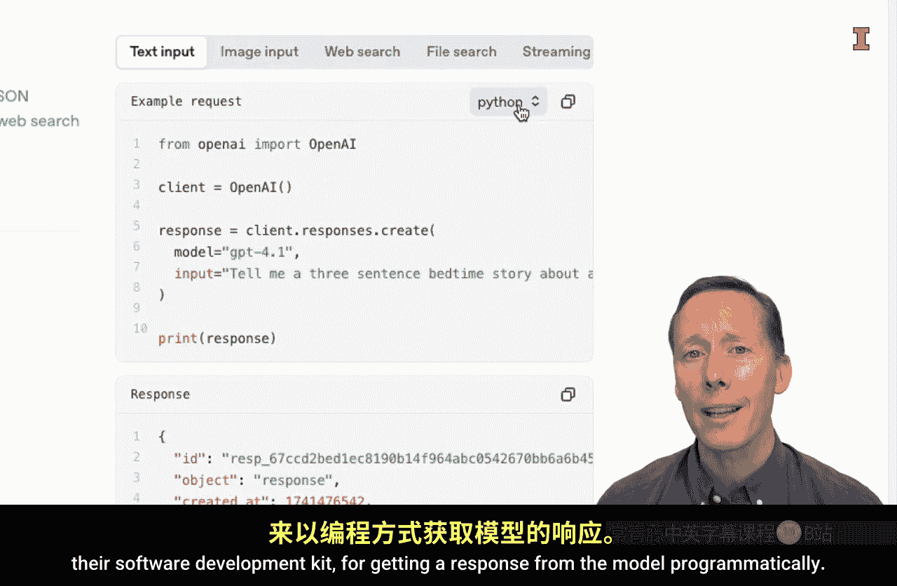

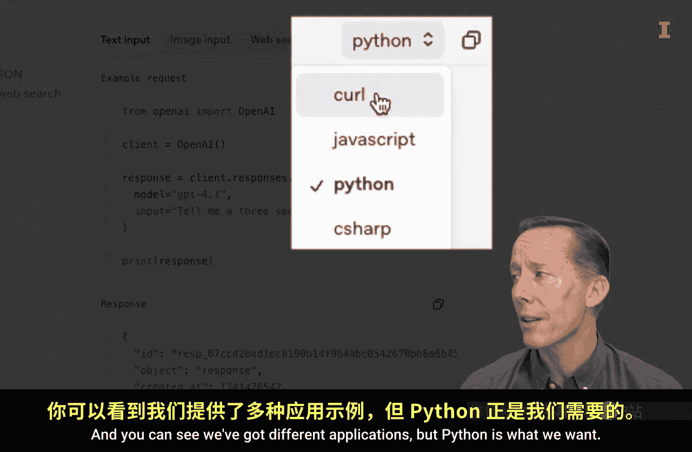

But Python is what we want。 So we can just copy this right here。 And this is。

 if we want to get a response back from just text， Let's go into our Python environment and try it out。

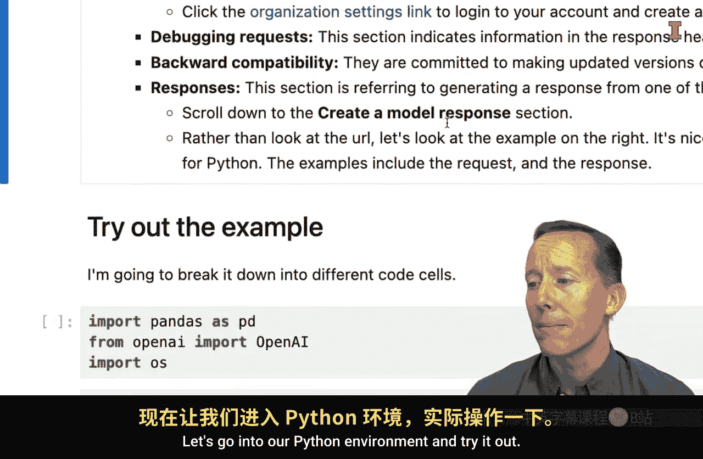

So we need to make sure that we import functions from pandas。Open AI and O， S， as well。Now， open AI。

 you may need to install if you haven't already。 This is the module that they're referring to up here。

 Okay， so you could look that up on P P。 org or just to Pip install Open AI。

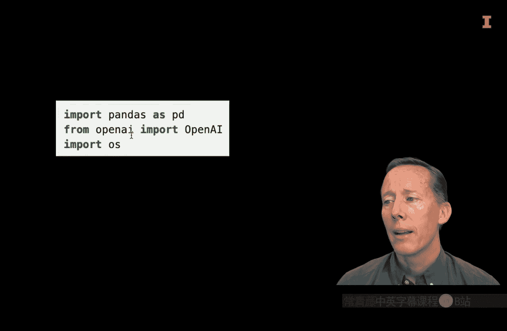

All right。 so I'm breaking up their example in a little bit different way。

 This O module is for interacting with the operating system。

And that's helpful because I don't want to show you my API key in this case here。

 So what I've done is that I have stored it on a different place on my computer as an environmental variable。

 And then I can use the O S do Environ dot get。 and this will basically go to that file and look for the open AI key。

 And this is a much more secure way of using API keys so that when you share code。

 otherss can't use your API key。

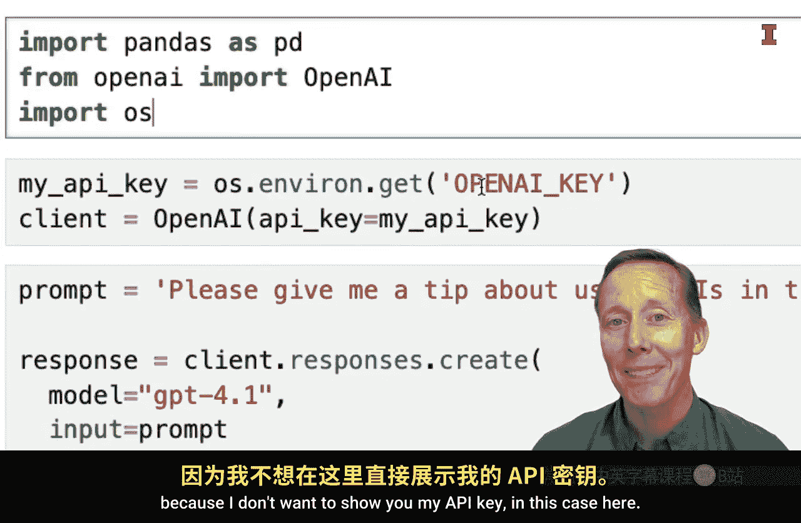

Alright， so I'm going use that function to get my API key and save it as a variable， my API key。

 And then I'm just following the steps that they gave me in the example。

 but I've broken them into different code cells。 So I'm initiating my client here。

 Now this is really simple。 I'm just going to say， I'm going to create a prompt。

 Please give me a tip about using Apis in the form of a limeic。

 All I did was change the question that they had in their example。

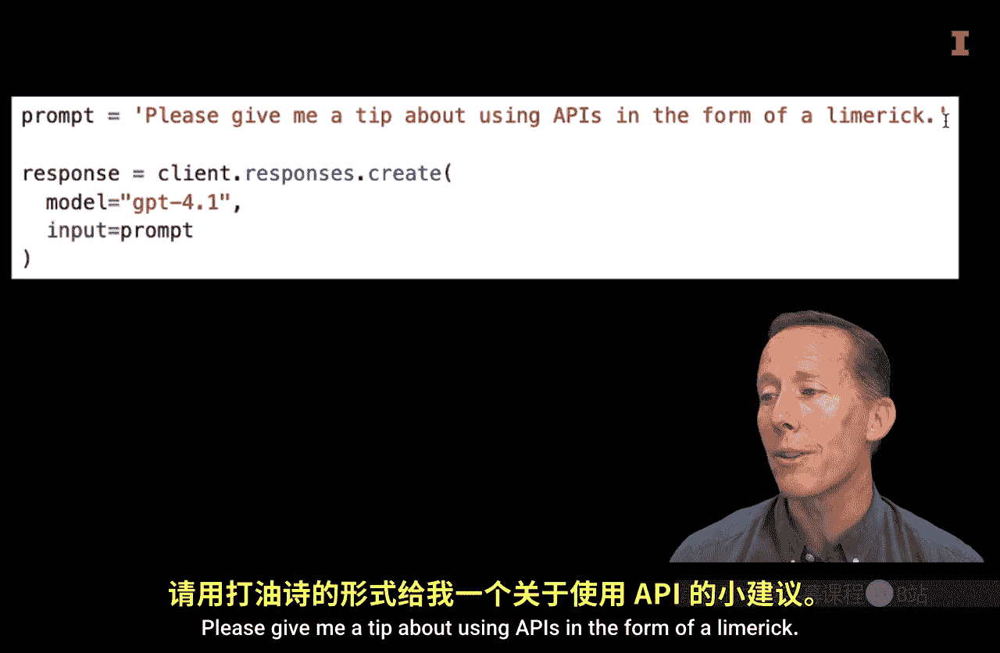

Tell me a three sentence bedtime story about a unicorn。To this prompt right here， Okay。

 so let me run this。And we might have to wait。A little bit。 Okay， it's already done。

 and then I can print out the response。

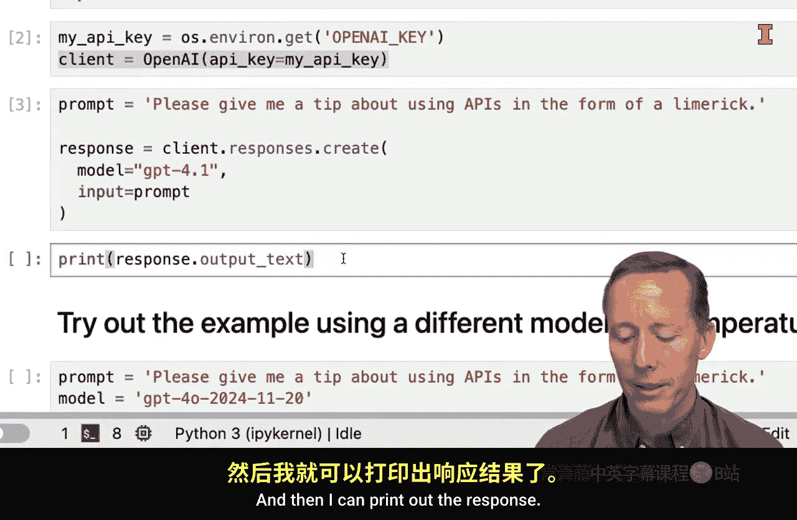

And here it is。 when using an API， don't rush。 read docs。 Give your endpoints a brush。

 Check errors you get and mind your rate set， or you'll find that your calls turn to mush。 I love it。

😊，I love mush as well， especially oatmeal。

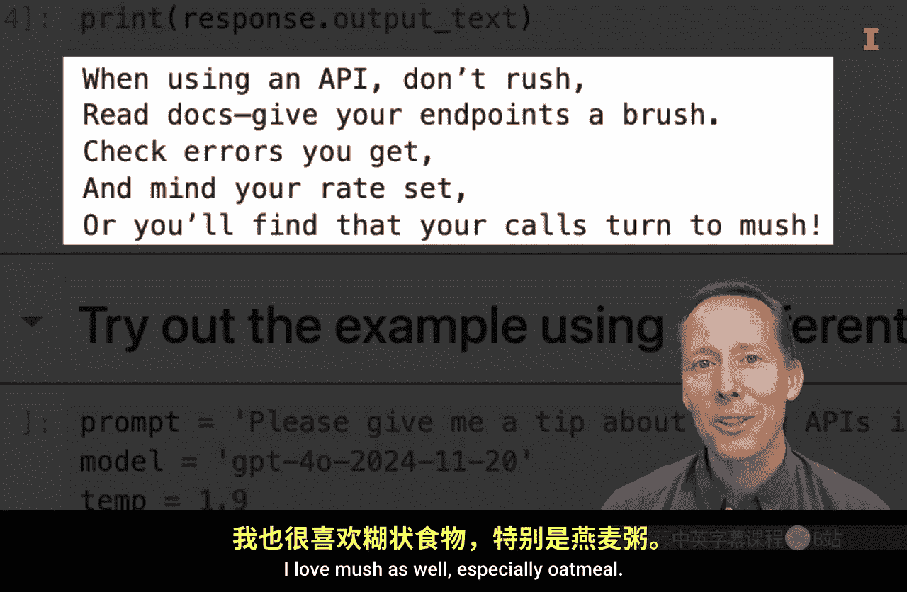

But anyway， that's awesome， it worked pretty cool that it provides a lot of support。

 it's really not that hard to use their API。I want to just demonstrate some other things here。

 So they've also got some other models。 So if we want to evaluate an image。

 then we can click on this image input and get an example here。 And I copied that。And pasted it。

In here。And I modified it a little bit so that I can enter my own image address up here and not have to find where it is in the code。

So what I'm going to do is go to Pixabay， which is a free image sharing website。

 So these are all in the public domain。And so let's look at this picture right here。

 I'm going to right click on it and copy the image address。And go back over here and paste it。

In there。And now I'm asking the question， what is in this picture， Okay。

 this is kind of their baseline example。 But they use the Wikipedia picture。

 So you saw the picture there done running。All right。

 And it says this is a black and white portrait photograph of an elderly man。 He has gray hair。

 a prominent mustusache and a beard。 The man is wearing a traditional garment draped over shoulders。

 The image is highly detailed， showing the texture of his skin and facial features  clearly。

 And the man is looking directly at the camera with a serious expression。

 The background is blurred emphasizing the subject's face。 Okay， All right， so it's it worked。

 That's pretty cool。😊，So we're starting with a simple example。

Let's now think of a business application。 So let's say I've got pictures of inventory。

 Perhaps I want to figure out how much inventory is in there。 I've got a crowd of people。

 I want to know how many people approximately there are or something like that。

 So I went back onto Pixabay and searched for an image of a cornfield。

 And let's take this one right here。I'm going to copy this image address。

I'm going to paste that image address in here and then we'll run another query。But I'm going to ask。

 how much do you think the corn in this picture is worth。All right， so I'll run this。 Okay。

 it is done。 So let's look at the response。And what does it tell us。

 It says it's difficult to estimate the value of the corn in this picture based on the image alone。

 because important variables are missing， such as the size of the field。Okay， so it goes on anyway。

 it's pretty cool， though， It tells us 180 bushels，450 a bushel。 It gives us some。

 some kind of idea in here。 So that could be helpful。 I can imagine， with additional training。

 and you can even try different models so。If we were to try out a different model。

 the quick start tells us about it。So we can look at more expensive models。

 we can look at the pricing。 this tells us the price per1 million tokens。

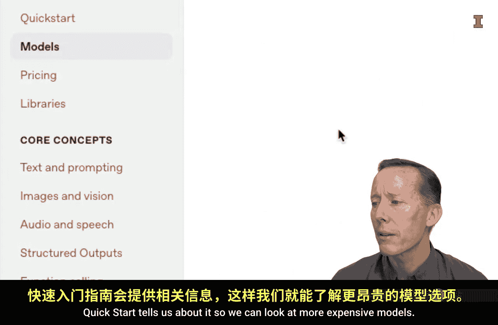

And let's see。 that was 4。1。 Let's go for a more expensive one。 I don't know， about 75。

 I guess we could try that。 Let's try this G 4。5 preview。

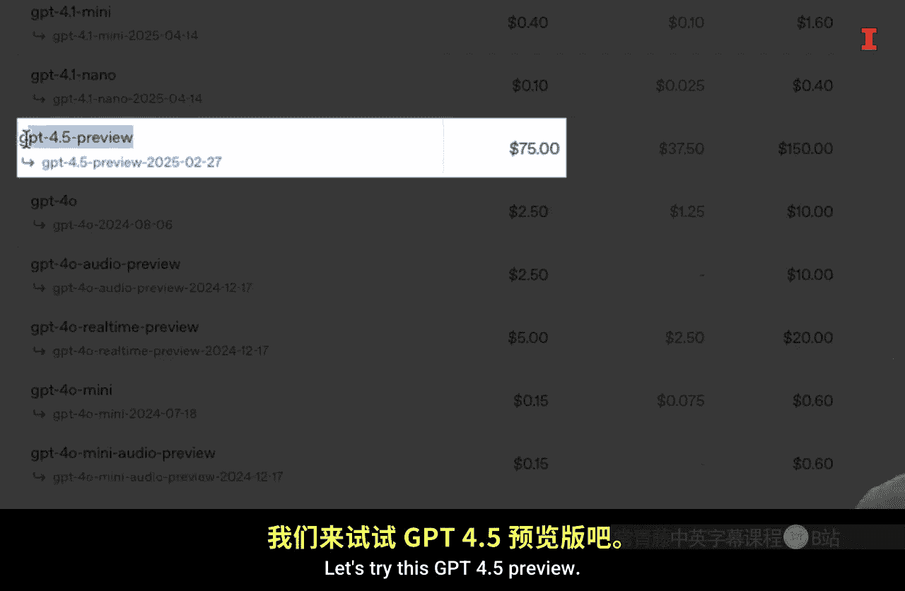

Copy that， I'm not using anywhere near a million tokens。收啊。😔，I'll paste that in here。

And I'm also going to say。给你。Specific dollar value。Based just on the in this。All right。

 let's look at the response。

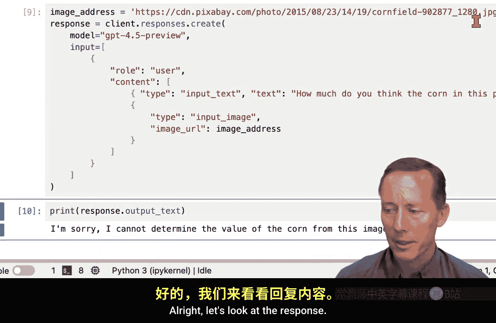

All right。 It paid a lot。 I'm sorry。 I cannot determine the value of the corn from this image。

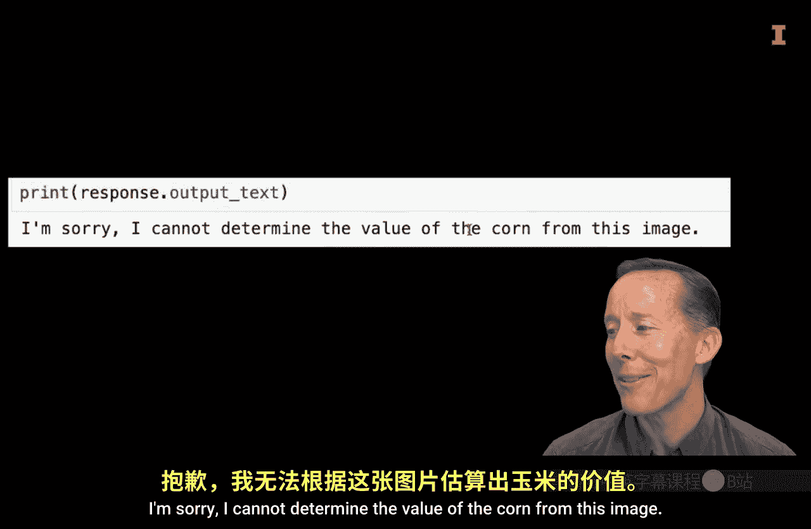

Well， we are not concerned about that as much as just demonstrating how you can combine APIs with AI in a programmatic fashion。

 so I hope you get excited about this， I think it's really awesome to think about what you can create when you combine the power of APIs and AI Now you have the tools to integrate APIs and AI。

 What will you create next。

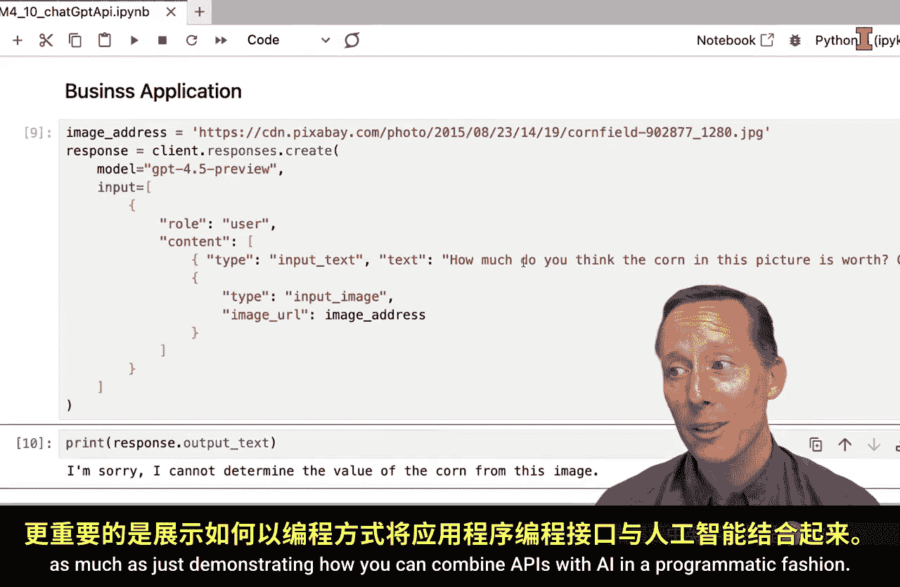

