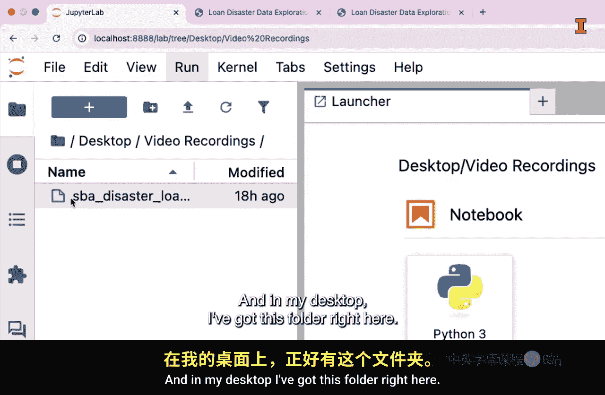
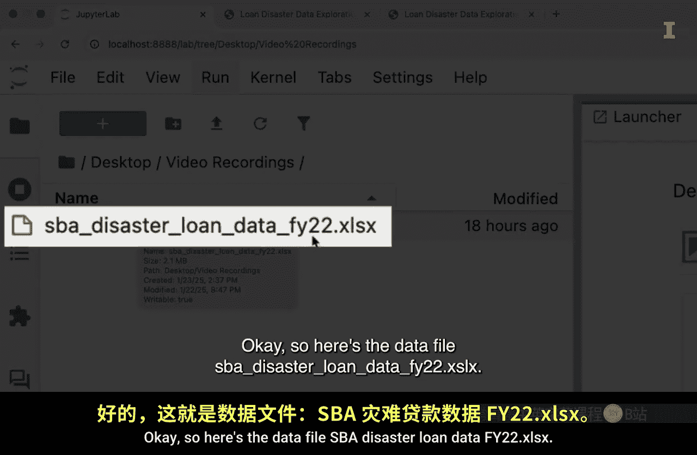
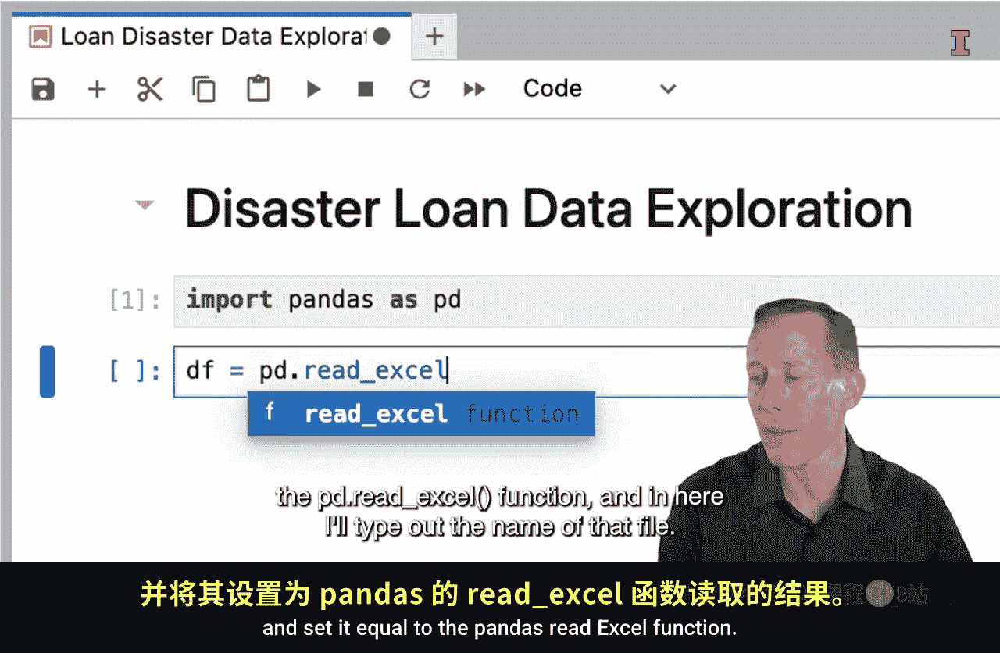
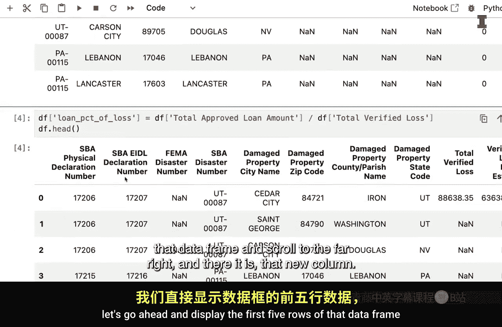
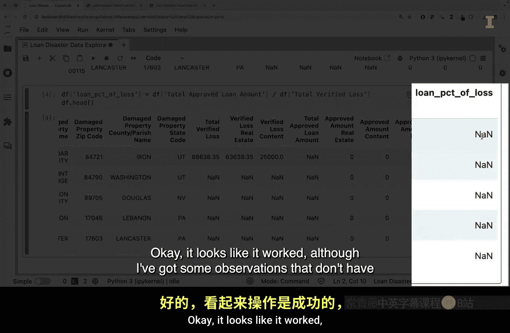
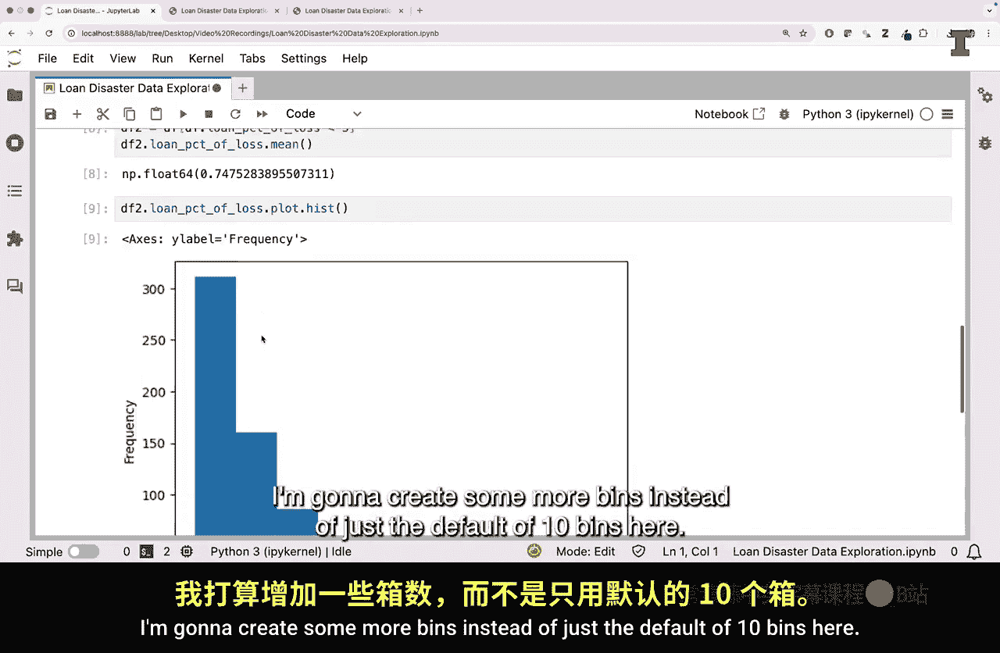
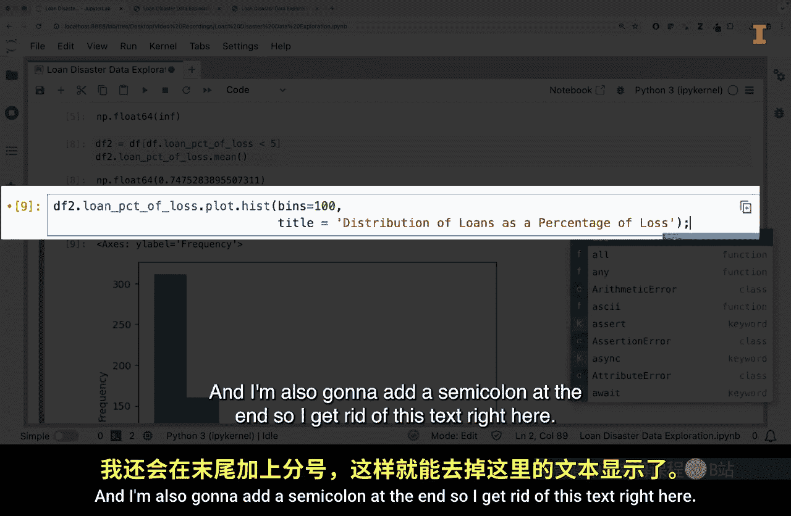
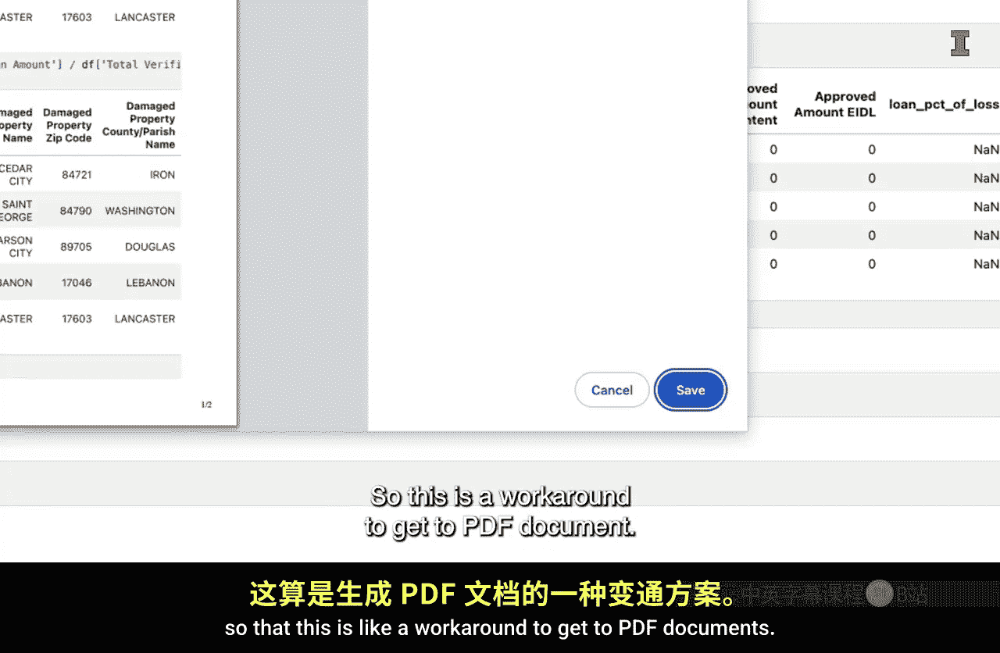

# 伊利诺伊大学【中英⚡商业分析｜Business Analytics Specialization】 p14 P14 11_使用JupyterLab的一个示例工作流程 -BV1z86nB9EGz_p14-

We like to teach by example， so in this video I'm going to show you a workflow for reading data in from an Excel file and we'll read it into a Python environment in Jupyter labb。

 and then I'll explore the data a little bit， manipulate it。

 create a visualization and save it as a comma separated value file on my computer。Now。

 the purpose of this video is not to explain every single detail that I do。

It's just to help you get a feel for how data analytics works within the Jupiter lab environment。

 in later videos we'll go into more detail about how the code works and how to use Jupiter La。

 Once I've started Jupiter labb， I'm going to go to the file browser。

 I'm going to navigate where the data is located on my computer。 And in my desktop。

 I've got this folder right here。 Okay， so here's the data file。

 SPA disaster loan data FY 22 do X L S X。 Since I'm now in the right place。

 I'm going to create a new notebook file。

And I'm going to save this new untitled do IPY B file with a better name。So click saveve notebook。😔。

So L disaster data exploration， Rename， and now I can see that it's been renamed there and I've got this new IPY and B file in that same folder on my computer。

All right， I'm going to close that， let's go ahead and give this a title。

I'm going to change it to a markdown file and then type out a title。And run that。

 And there's my title。 Allright， let's go ahead and start doing the analysis。 First。

 I'm going to import functions from the pandas module。

And now I want to read in the data and save it as a data frame。

 I'm going to create a new data frame object Df instead it equal to the pandas read Excel function。

And in here， I'll type out the name of that file。 So I'm going to go back into here and just right click on it and copy path。

And paste it in there， get rid of the whole path name， I just need the file name。All right。

 now to help you get a feel for what this file looks like， here it is in Excel。

 and you can see I've got multiple worksheets I want to read in data from this FY 22 business worksheet。

So in addition to the file name， I need to indicate the sheet that I want to read in。Alright。

 and then once I read it in， let's make sure it works by displaying the first five rows of the data frame。

Okay， so there it is。 Now I can see right off the bat that I've got some column names that don't make sense。

 the column names that I want are down here。 and so I want to skip rows 1，2，3， and 4。

 So there's another argument in here。Skip rows， so that equal to 4。To make this easier to read。

 I'm going to put these on new rows like that。All right， I'll you run this。Okay。

 now I've got those column names that are much easier to understand now。All right。

 so let's look at this data a little bit just by exploring it visually。

 I can see I've got different observations from losses that have happened as a result of disasters for some small businesses and the location。

All， the key columns are the total verified loss。And then the total approved loan amount。

 Let's say we want to evaluate the total approved loan amount。

As a proportion of the total verified loss。 So we want to create a new column in here。

 that's a percentage。So I'm going to create a new。Code cell。I'm going to create a new column name。

Alright， so the new column will be lone per of loss， and that's going to be equal to。

The total approved loan amount。Divided by the values in。The total verified lost column。

And then to make sure it worked， let's go ahead and display the first five rows of that data frame and scroll to the far right。

 And there it is。 that new column。 Okay， looks like it worked。

 although I've got some observations that don't have a number in it because there's no total approved loan amount。

 Let's， let's just calculate the average value of that column there。

 So I'm going gonna create another code cell。

And let's calculate the average。 And it looks like it's infinity。 Okay， so again。

 I've got some observations that don't have any loan amount there。

 So let's go ahead and filter this so that it's less than infinity。

 So I'm going to create another data set D F 2。And this will be equal to the data in the DF data frame。

 but we're going to reduce the observations only to those for which the lone percent of loss is less than。

 let's say 1000， pretty big。All right， and then Df2 dot。All right。

 so we' calculate the average again。Okay， so we've got an average of 2。3。

 but let's look at how the data is distributed in more detail。

 so another code so let's create code to create a histogram。Okay I'll run that。

 And here's my histogram。 Looks like I've got tons of observations between 0 and about 20。

 but I must have some outliers that are way up here。 that are really big。

 So let's change this so that we're only looking at observations for which the loan as a percentage of the loss is less than5。

 rerun that and create the plot again。 Okay， this is much more informative now。

 but I want to make it even more informative。 I'm going to create some more bins instead of just the default of 10 bins here。

 So let's go to hear。

You say bins is equal to 100。And let's give it a title。And let's put the title on a new row。

 So it's not so wide。 And I'm also going to add a semi colon at the end。

 So I get rid of this text right here。 I'll rerun this。

Okay， this is a much more informative histogram now， I've got a title up here。

And so I can see a bunch of the loans are at this one， which is 100%。

 So the loan amount is the same as the total verified loss。

 And then most of the others fall below that， but we do have some that are above that for some reason that we don't know。

Okay， not perfect。 let's， let's assume we're done here。

 but we want to save the data for future analysis。 So I'm going to take this data in DF2 and I'm going to save it as a CSB file。

I don't give you the name of smaller。long as that CSD。And we want to set the index label equal to。

Then I'll run that and if I go back to my file browser in a few seconds。

 I'll see that file show up here if I ran it correctly。 Okay， there it is smaller loanss。 CSv。

 I can double click on this and explore it much like I would in an Excel file。

 it looks like it worked fine。Let's go ahead and summarize what we see here。

 So I'll create another code cell， change it to mark down。And let's tell others about the takeaways。

 I'm going to go back in here。AndI'll create a bulleted list here of the takeaways。Okay。

 so there are some loans given that are worth more than the loss， maybe I'll add one other takeaway。

Okay， there seems to be a lot of loans given that are worth the same amount as the loss and I'll run that。

Okay， fantastic。 Let's go ahead and save this again and。😊。

Now I want to export this so that it's easier to share with others。

 So I'm going to go to save an export notebook as Hm。And in my downloads folder。

 I now have this HTML file， it's not interactive， but it's HTML so others can open it and view it Okay。

 and you can see I've got this formatted text， my code， the output of the code。

 including the visualization， and the takeaways right here。

 Let's say I want to share with others as a PDF document。It takes some extra work。

 but if you install some additional software， you can save it as PDF like this。

And now it's a nice looking PDF document， although the data is displayed in a way that's less helpful。

But everything else looks really nice。 We've got nice looking fonts here and and everything。

 Another thing I could do is I could。😊，Print this HTML file。As a PDF document。

 and then it'll convert it into PDF。 so that this is like a workaround to get to PDF documents。

Anyway， there's an example workflow， I hope that gives you an idea for how to perform data analytics within Jupiter Lab。

In later videos， we'll go into more details about the code。

 as well as the keystrokes that I use to work with Jupiter Lab。

