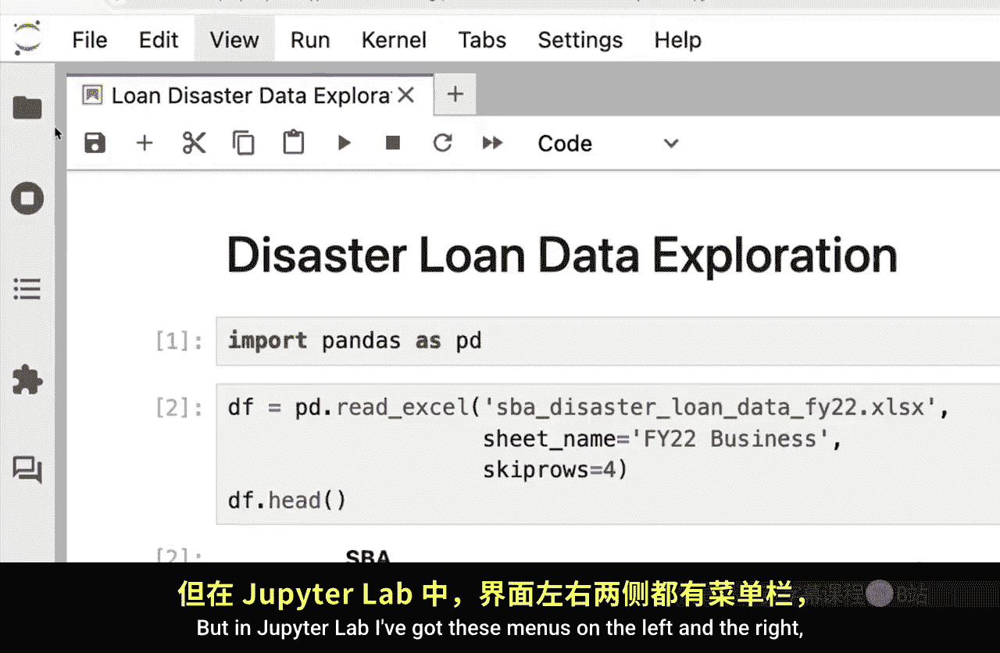
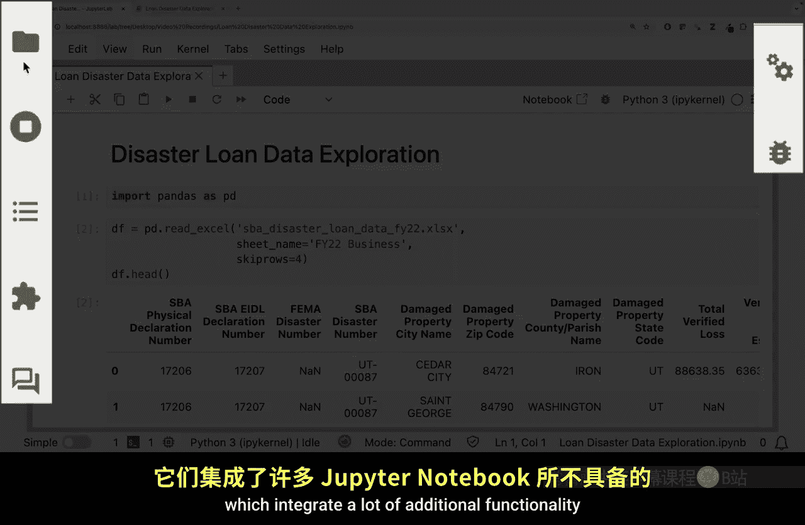
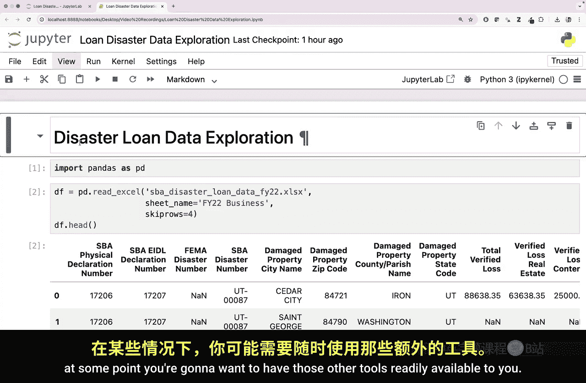
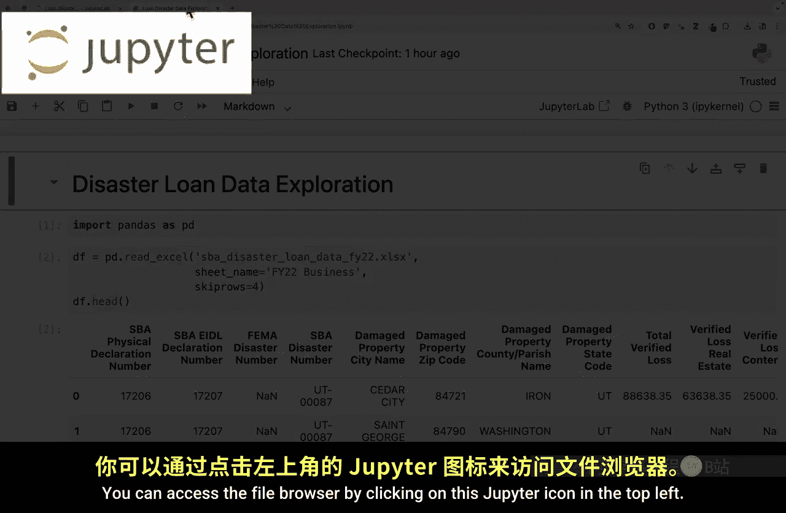
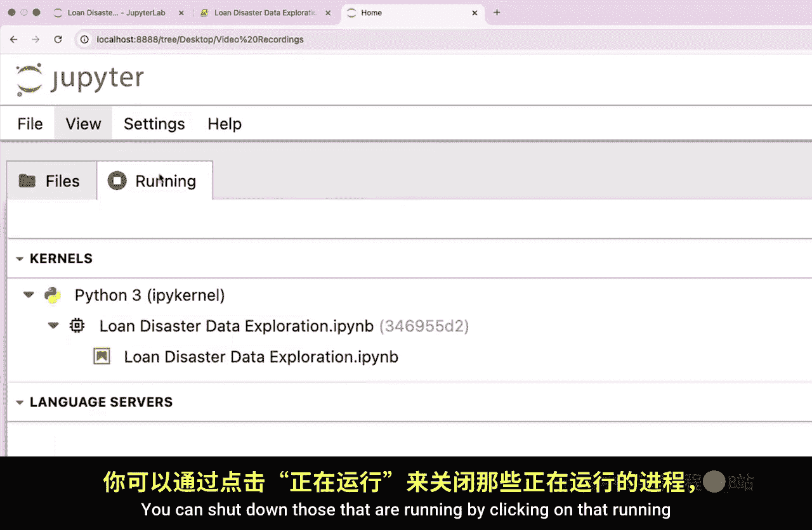

# 伊利诺伊大学【中英⚡商业分析｜Business Analytics Specialization】 p17 P17 14_Jupyter Notebook 之旅 -BV1z86nB9EGz_p17-

In this video， I am going to introduce you to the Jupiter Note Integrated Development Environment。

 which is a simplified version of the Jupiter lab integratedrated development Envi。First of all。

 how do you access Jupiter Note book？ Well， you can access it from the Anaconda Navigator。

Or you can start it up using the command line interface by typing out Jupiter， a space。

 and then notebook， and then hitting enter。You can also access it through Jupiter Lab。

 which is what I'm going to show you right here， so I've got a file open in Jupiter labb called L Disster Data Exploration。

And you can see in Jupiter Lab right here， I've got this notebook icon。 if I click on that。

It takes that I P Y and B file and opens it up within the Jupiter notebook environment。

 And you may not even notice a difference at this point。 but in Jupiter Lab。

 I've got these menus on the left and the right， which integrate a lot of additional functionality that is not included in Jupiter Note。

Okay so like I said， Jupiter notebook is like a simplified version of Jupiter Lab。

And that's both an advantage and a disadvantage。 Initially， when you're first using Python。

 you might like that because Jupiter La might be kind of overwhelming with all these different things that you can access。

 Okay， so Jupiter notebook keeps it nice and simple。

You run cells and create new cells and delete them the same way that you would as in Jupiter lab。

 It's just that you don't have all the other accoutrements that you have with Jupyter La。

 So the disadvantage is that at some point， you're going to want to have those other tools readily available to you。

 You can access the file browser by clicking on this Jupiter icon in the top left and in a separate browser tab。

 you'll see this file browser。 Okay， so you can just click on the different。

Folders that you have and files and open them that way if I want to open up another IPY and B file from this browser window。

 I can do that。Can it opens it up as a separate tab in here。

You can shut down those that are running by clicking on that running and then just exit out of it by closing the tab。

 So that's the brief introduction to Jupiter Note。 You'll use it sometimes。

 but I would say when you have the option between using Jupiter Lab or Jupiter Note。

 Then you should probably go with using Jupiter La。 But at least now。

 you know what it is and you know how to use it。

