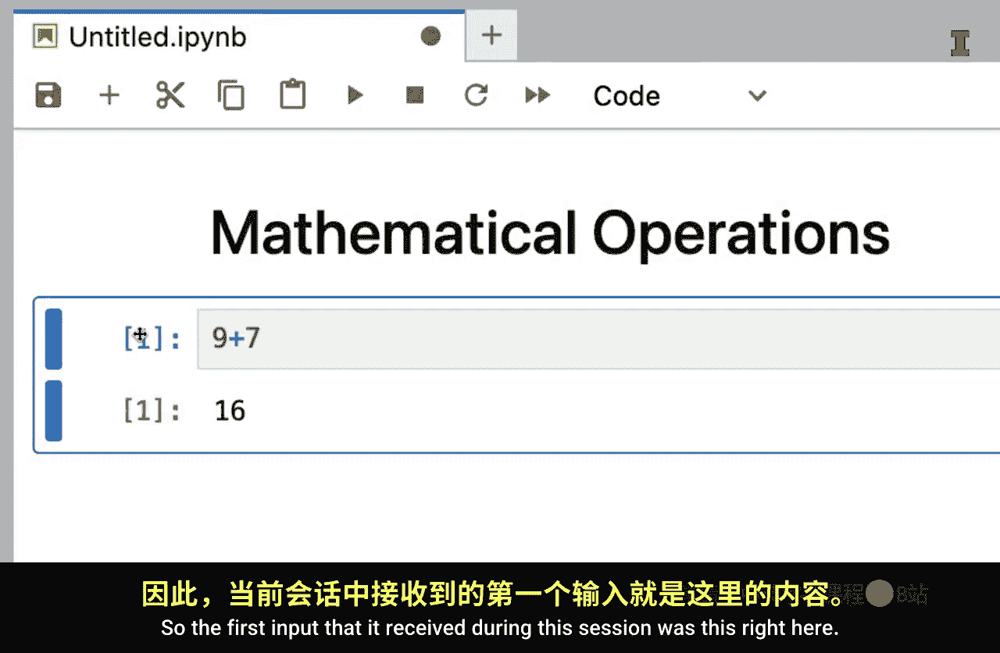
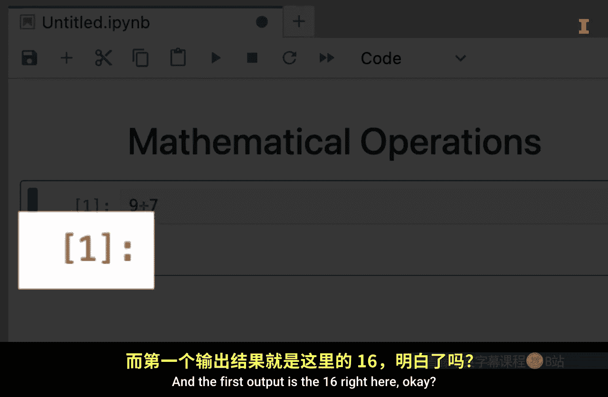
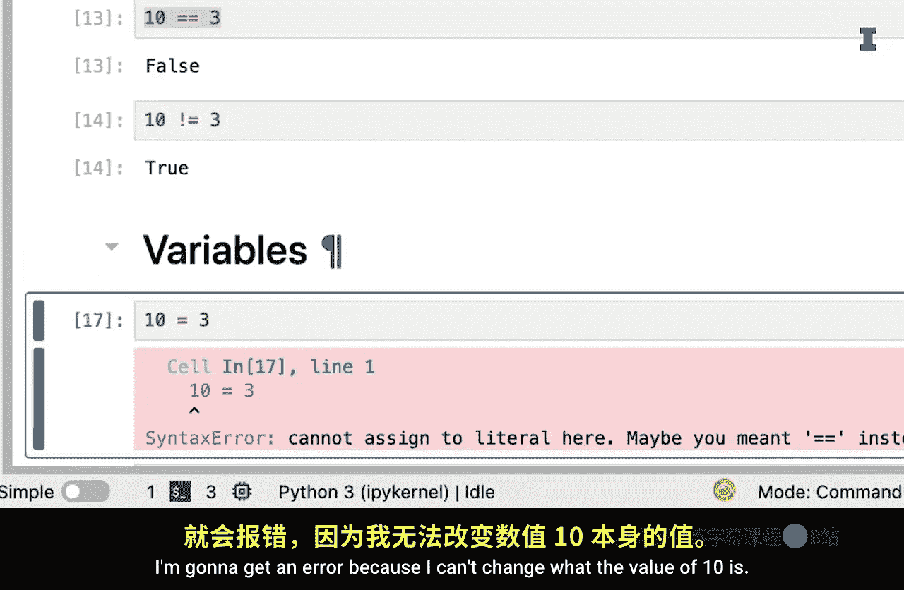
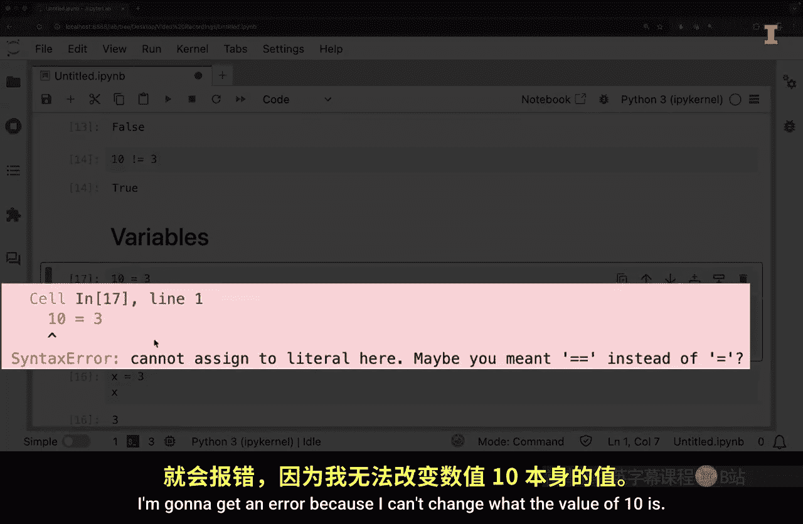
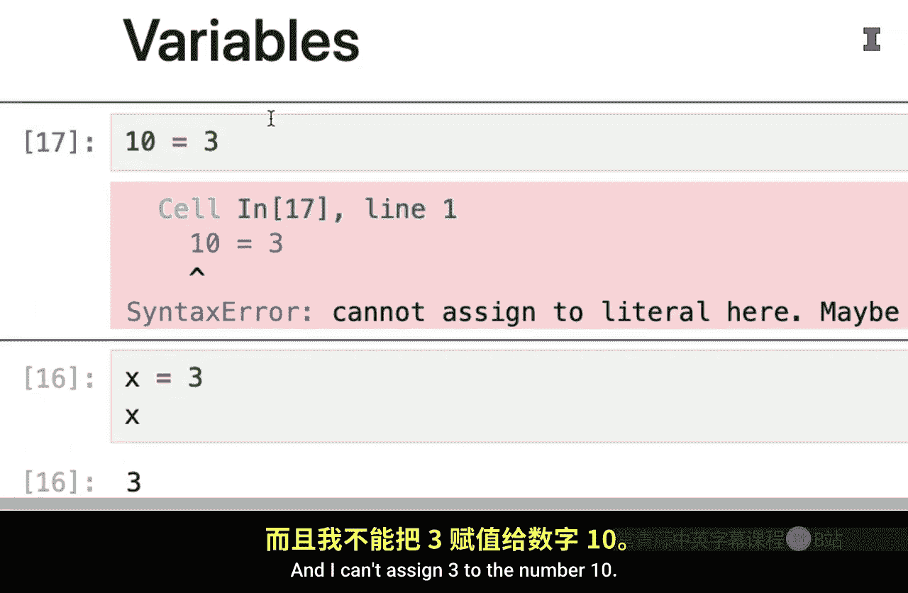
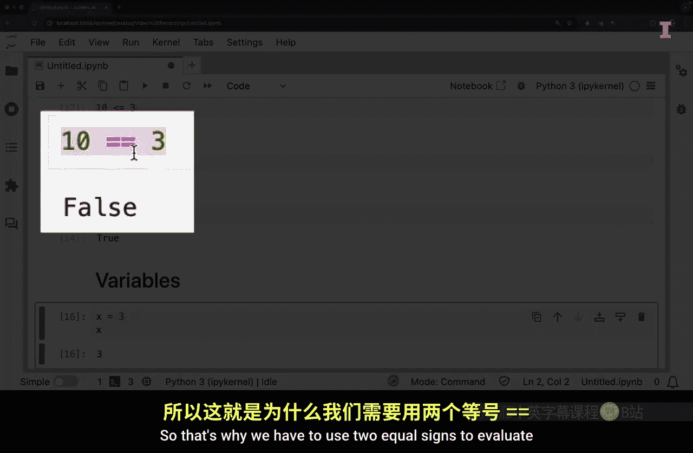
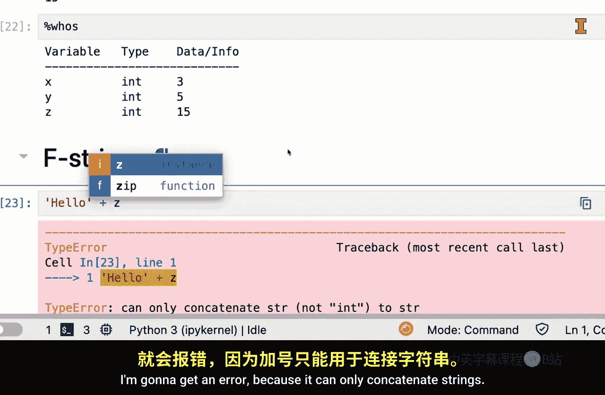
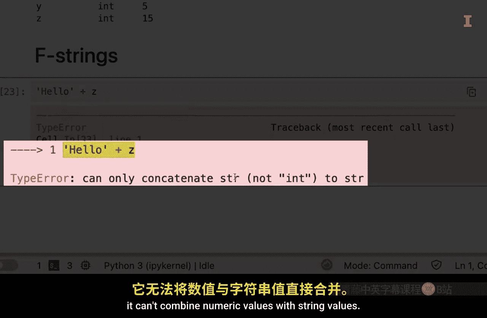

# 伊利诺伊大学【中英⚡商业分析｜Business Analytics Specialization】 p18 P18 15_使用Python进行基础计算 -BV1z86nB9EGz_p18-

We want to help you get started coding with Python as quickly as possible。 So in this video。

 we're going to show you how to perform some basic calculations in Python。

 most of which you may already know how to use with a calculator or with Excel。

So let's go ahead and jump on over to Jupiter Lab， and I'm going to create a markdown cell。

And enter a title。Mathematical operations。 And let's demonstrate some basic math operations。

 So if we enter 9 plus 7 and run that code cell， it returns 16。

 And you can see that next to the cell， we've got this one。

 So the first input that it received during this session was this right here。

 And the first output is the 16 right here。 Okay， so that's what these numbers in brackets mean。

 I'm going to create a new code cell。 And let's try division。 So 9 divided by 4。 run that。 Okay。

 it gives us the answer 2。25。 And we've got the second input and second output。 Okay。

 let's try another calculation 9 times 3 and run that。 We get 27。😊。

Now， what if I want to raise9 to the third power？Then the way we do that is we use two asterisks。

 okay， so nine raised to the third power is 729。And then there's a couple other operators that are not as common。

 but you may see them at some point， so let's take 10 and divide it by3 that gives us three and a third。

But if we use two divisors， so two forward slashes and run that， it gives us just three。All right。

 so this is floor division where it returns only the integer from this division operation right here。

And complementary to that， there is a modullo operator。 So 10 per3。 I run that。 I get one。 Now。

10 divided by 3 is 3。333 or 3 and one third，3 with the remainder of one。 Okay。

 so this one right here is the remainder。 All right。

 So you can kind of break apart that division into the integer component and the decimal component。

 Now， a couple of these mathematical operators also work with text。

 So I'm going to create another code cell。 And I'm going just enter some text。

 And the way we say we're going to create text is we put either single or double quotation marks around it。

😊，So I can just say hello， but then if I take hello and multiply it by2。Then I get hello， hello。

 All right， So if you take text to multiply it by a number。

 it just repeats that associated with the number that you multiply it by。

 Let's take a string of text， Ho。And then we'll add to it another string of text。

 and I'll just say hello space there and run that。You can see that what it does is that it concatenates the two strings together。

 So I've got hello there。 Okay， so the multiplication and addition operators also work with text。

Let's create another cell and let's talk about comparison operators。Al right。

 comparison operators are things like greater than equal to， not equal to and so on。

 So if we take 10 and。Say greater than 3 and run that。

 Then Python will evaluate if 10 is greater than 3 and return a boolean outcome。

 Boolean is just a binary outcome， either true or false。 So this is true。

What if I try 10 is less than， and lets let's change up a little and say less than or equal to3。

 Okay， so the way you do less than or equal to or greater than or equal to is just put the equal after the inequality there。

So I'll run that and this time it's false。All right， what if I want to test if 10 is equal to three？

Then I can say 10， double equal signs and three。And when I run that， it is false。

 and I'll talk about why you have to use double equal signs in just a minute here。All right。

 one other thing is I want to test if 10 is not equal to 3。

 so the way I can do that is use an exclamation point followed by an equal sign。

And that is true because 10 is not equal to three。All right。

 so those are the basic comparison operators that we will use a lot All right let's also talk about variables。

I'm going to say x equal to3。And then below that， I'll just type X。All right。

 you can see the result is just a three right here。So what happened is。

Python first assigned the value of 3 to the variable X， and then it printed X。 Okay。

 so if I were to try doing something like。10 equals 3。

 I'm going to get an error because I can't change what the value of 10 is。 All right。

 so that single equals is used to make assignments， and I can't assign 3 to the number 10。

 So that's why we have to use two equal signs to evaluate if things are equal to each other。

 All right， let's add in another variable。 Let's say y is equal to 5。

And let's say I want to print X and Y。 I run that。 Well， all I get is y。

 So you can see that the only thing that is displayed is the last variable。

 If I want to display both variables， I'll want to add the print in here。

 So I'll surround both of these by print。And then run it。

 And now I can see both X and Y that are displayed。 And， of course。

 I can use variables to create other variables。 so I can say Z is equal to X。😊，Time is why。

And then I'll also include print Z here and run that。And as you would expect， when I print Z。

 we can see that it's equal to 15 because x is 3 y is 5 z' is 15。 Now。

 if you're ever curious about the value stored by a variable。

 you can always just create a code cell and enter the variable and run it and see what it returns。

But you also may wonder， what are the variables I have。 So there is a helpful magic。

 This is not Python code， but a way to explore your variables。

 And so if you type out percentage and then whose run that。

 this will return a list of the variables that you've created during this session。😊。

And tell you some information about those variables。 I've got X， Y， Z。 They're all integers。

 and it tells me the value。 All right， The last concept I want to illustrate is F strings。

F stands for formatted。 So if I were to try and combine something like。Hello。Plus Z， which is 15。

 I'm going to get an error because it can only concatenate strings。

 It can't combine numeric values with string values。

So F strings allow us to do it in a pretty simple way。 So what we would do is we would type F。

And then include whatever my string is within quotation marks。

But if I want to include the value of Z， then within this F string。

 I add open and close curly braces， and within that I can have Z like this。 and now when I run it。

 I get hello， and then the value of Z is included in there。All right。

 So these S strings will come in really handy。 Okay， that's all for this video。

 The calculations we showed are pretty basic， but you have to start somewhere。

 We'll be using these calculations with larger data sets。

 So it's nice to know how they work with small dataset sets。 Every expert was once a beginner。

 So keep practicingrac。 Stay curious， and you'll be amazed at how quickly you progress over the next few weeks。

😊。

