# 伊利诺伊大学【中英⚡商业分析｜Business Analytics Specialization】 p19 P19 16_Google Colab - Jupyter Notebook的在线版本 -BV1z86nB9EGz_p19-

In this video， I'm going to introduce you to Google Collaboratory， which is also just known as Coab。

Collabab is Google's browser based IDE that is similar to Jupiter Lab。

 One of the great things about it is that you don't have to have Python or an IDE installed on your computer。

There are other great things about coabab。 I'll show you more。

 So the first thing that we want to do is make sure that we have a Chrome browser window open。

And what I want to do is run the same IPY and B file where I analyze disaster loan data in Google Coab。

Now I have a personal account and a work account。 I want to switch over to my work account rather than logging out of my personal account。

 What I can do currently is click on these three dots in the top right hand corner and then hover over my profile and a new menu comes up。

 and I'm going to select my other profile Ronald work。

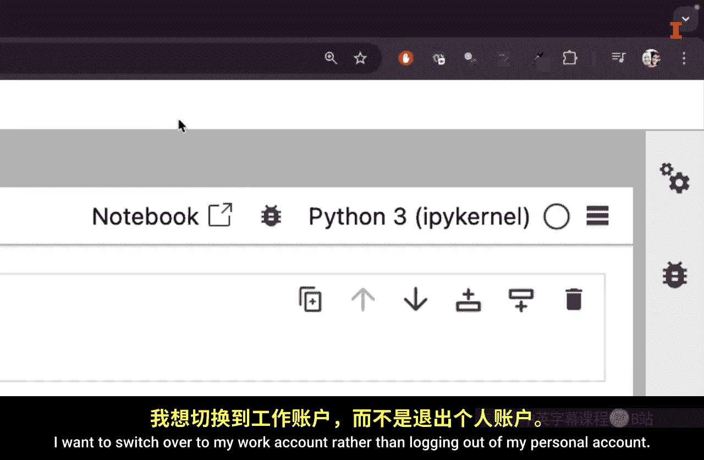

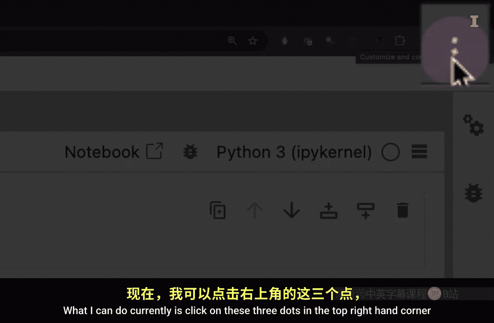

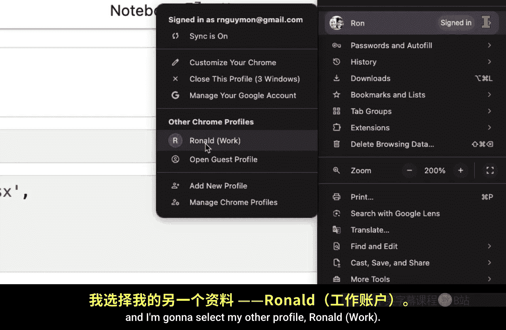

Okay， now I have a new Chrome browser window， and in here I can navigate to Google Drive by clicking that icon or by typing out drive。

google。com。

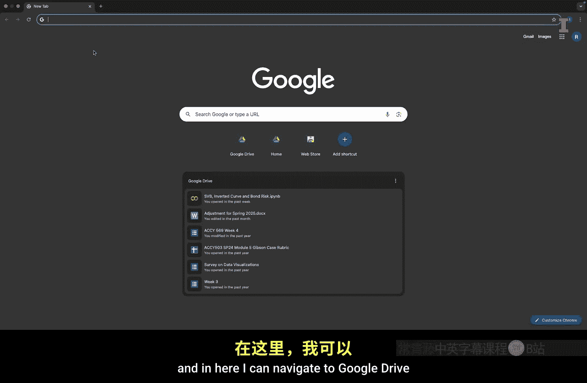

If you're not familiar with Google Drive， it's like Dropbox or box。

 So it's an online file storage and software system。

 And you have access to it if you have a Google account， I want to first go to my drive。

 This is like my home folder。 In here， I can see folders that I've created in other documents。

 What Im going to do is click on this new button， and I'm going to create a new folder。

I will call this video。Recordings without a space， which makes things easier if there's not spaces in the names。

 So I'll click create， and I now have this new folder right here。

 So I'm going to double click on that。So I want to upload data to my Google Drive account so that I can analyze it in Google Coab。

 Now that I have this folder created， I'll click new again。 I'll go to file， upload。

And I'll find where that data is located on my computer。 So here's the Excel file。Now。

 if you want to be able to run an I P Y and B file that has already been created。

 you can do that as well。 And to make things easier。

 I'm going to just hold command down and select both of those and upload them both。

 So I'll click open。Okay， I now have both of these files in this video recordings folder。 Now。

 if I didn't have an I P Y and B file， I could just go to new and go to more and select Google Collaboratory。

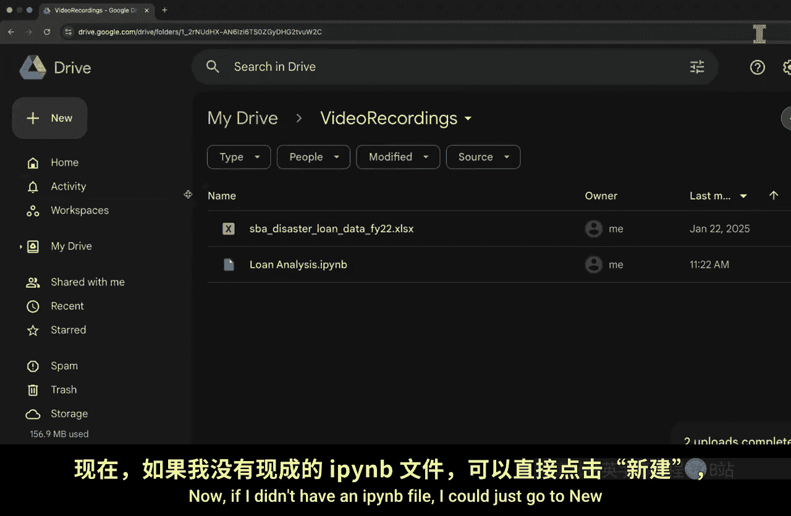

And it would create a blank I P Y and B file， and it just titles it untitled0。 Okay。

 and then you could start creating code just like you would in Jupiter lab。

 you can also create markdown cells。 they call them text cells here。 Okay， so if I just say。

Heading with a hashtag in front of it。 It gives me a preview of what it'll look like。

 Then I can run these cells。 I'll hit shift enter。 I can also hit the play button to run the cells。

 I can delete cells by a pressing delete right here。

 I hope you get the idea that it works very similar to how things work in Jupiter lab。All right， now。

 importantly， I want to use the file that has already been created。

 So rather than copy and paste things in， I can simply double click on this file that I want to use。

 and it will open it up in Google Coab。 All right， so I can see I've got everything that I have in here。

But I'm operating on a cloud version。 Okay， so this is a great advantage of coabab is that you don't have to have Python installed on your computer。

 Moreover， you can get access to some really powerful processors for a fee。

 Let's look at a few other things about Google coabab。 We've got these menus up at the top。

 which are very similar to what we see in Jupiter lab so I can run sell。

 run the selection run all I can get keyboard shortcuts。 so a lot of that's the same。

 A cool feature that isn't included by default in Jupiter lab is Gemini。

 so I can click on that and then get access to Google's AI tool Gemini。 close out of that。

 And then on the left hand side， I've got some additional tools。

 So I've got the table of contents that I can use to navigate my file just like Jupiter Lab。

 I can find text in this file。 I've got a variable Expr， which can be really helpful。

 Let me create a new code cell here。 I'll say X equals3。 Just run that。

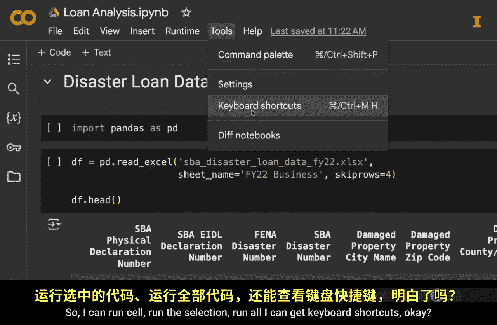

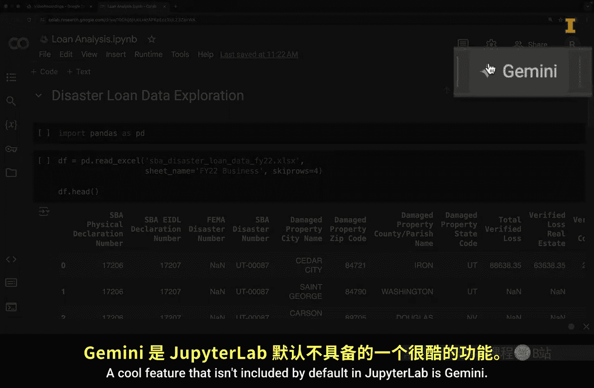

FirstCommand always takes a little bit， but I ran it。

 and now I can see that I've got this variable X。 So this is really nice。

 It'll keep track of all the variables in here。I'm not going to worry about the secrets。

 but I do have this files。 And this is really important。

 So to highlight the importance of files here， let me just try running。Some of this。

These cells in here So I'm going to run the import panda as Pd that worked。

 if I run this next code cell to read in data， it's not working， but I know I have that data in here。

If I go down here and look at the error it says it can't find it。

 you could actually have it explained to you why you can't find it。 And it's really helpful。

 The AI is integrated in here as well。 I'll just show you real quickly what you need to do to read data in。

 you have to mount your drive。 Okay， so I'm going to click on this folder and you can see that I've got sample data。

 but I don't see this SB disaster loan data。 So all you have to do is click on this mount drive icon up here。

 When I click that。

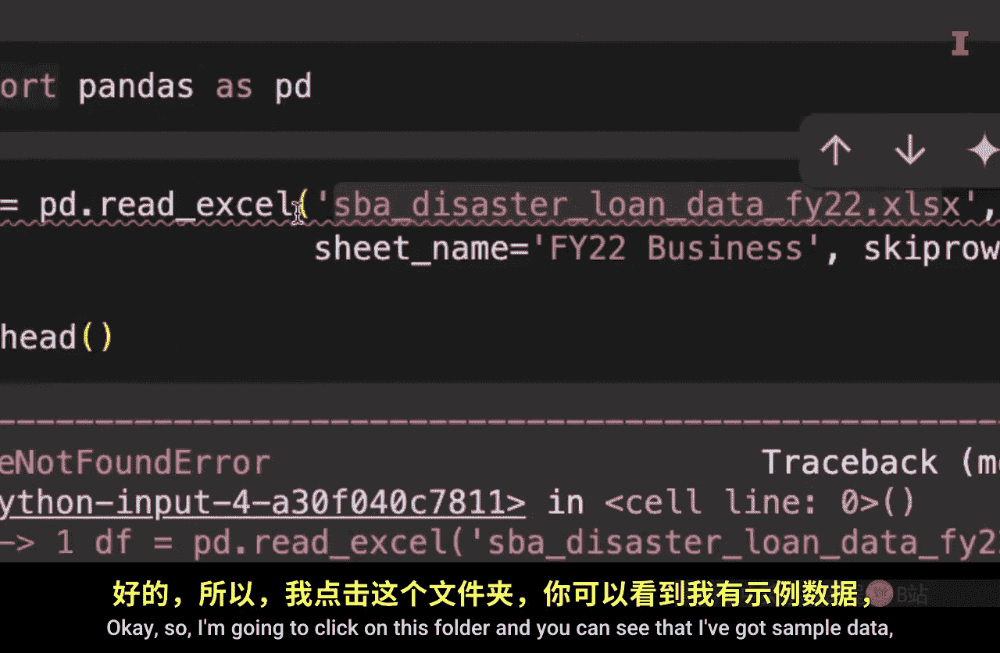

It added this code cell， and it says， run this。 Okay， so I'm going to go ahead and run this。

And it's mounting it。 It says， do you want to grant permission， and I'll have to go in and。

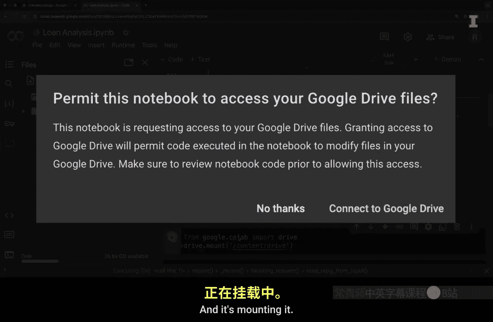

Say yes。Okay， it mounted the drive so I can go ahead and delete this code cell now。

 And I should see another folder。 Okay， there it is。 I've got this drive folder。 And in here。

 I've got my drive。 And here is this video recordings。 So I， you could try running it again。

But it's still not working。 so what you need to do is hover over the data that you want to read in。

 click on the three dots and then select copy path。

And then paste that path in here for the file name。 Now when I paste it， you'll see。

 not only does it have the file name， but the system of folders that you have to go through to find that data。

 And now when I run this， I'll just hit the play button here。ll close that。 Okay， now it worked。

 you can see I've got the first five rows right here。 Okay。

 and I could go ahead and run through the rest of this if I wanted。

 And it's really cool that it works in the cloud like this。 And I could share this with someone else。

 You can find others collab files and run those。 What if you want to export it as an H T M L file。

 So what you would do is you'd create another code cell somewhere。😊。

And I'm going to add an exclamation point。 So this is going to be a terminal command。Okay。

 and I'm going to run Jupiter and be convert。This is really what's happening under the hood when you do this in Jupiter lab。

 It's just that there is a button for it。But I'm going to hit type out Jupiter and B convert and remember the exclamation point and then two hyphens and then two HTML。

 And then what I will do is I will copy the path of the file that I want to convert so I'm going to copy path and since there's a space in it。

 need to use quotation marks and then paste that in there。 Okay。

 so there's the whole path to that loan analysis file。Now， I will run this。

And it's converting it to an H Tm document。 You can see that it's writing it to the same folder。

 So if I go into my folder。

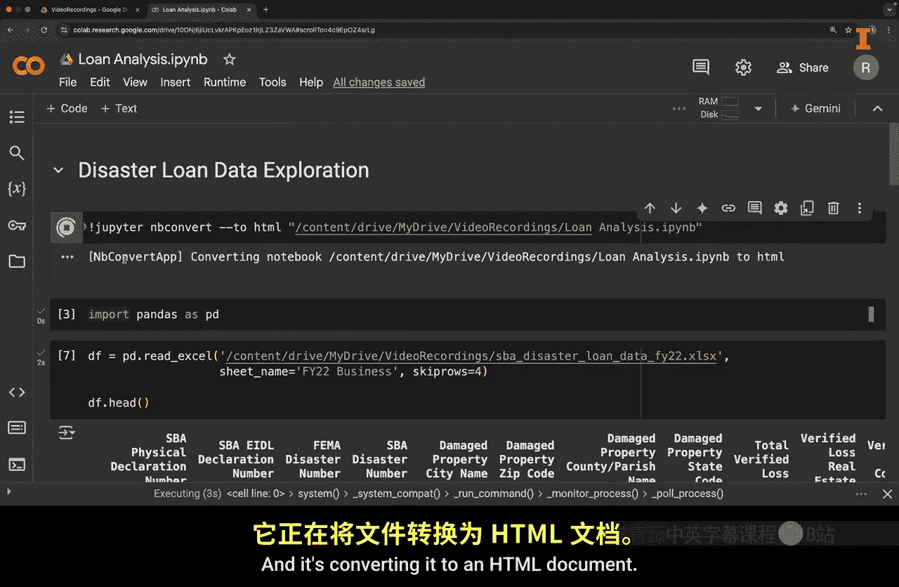

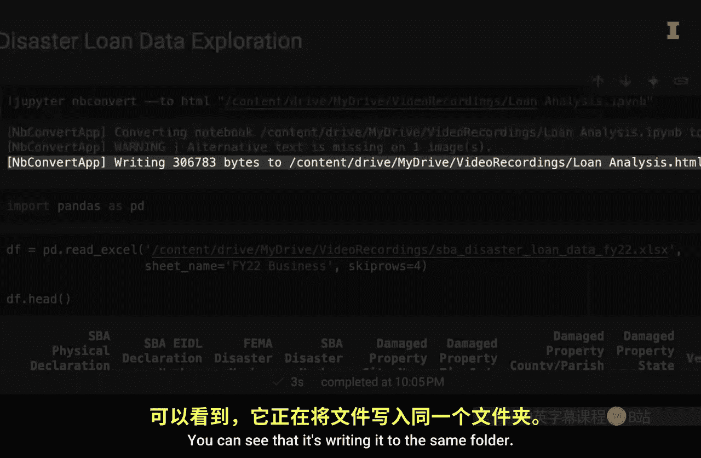

And refresh this。Oh， there it is loan analysis H。 So let's go ahead and download this。

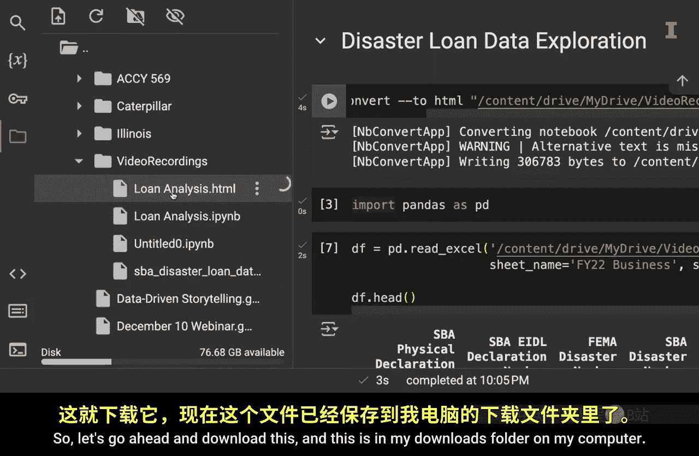

And this is in my downloads folder on my computer。Click on that。

 You can see that it converted it to H T M。 Okay， that's an introduction to Google Collab。

 There are a lot of great things about it。 For instance。

 it's really helpful when you want to collaborate with others on code。

 and it makes it easy to work on the same file together。😊。

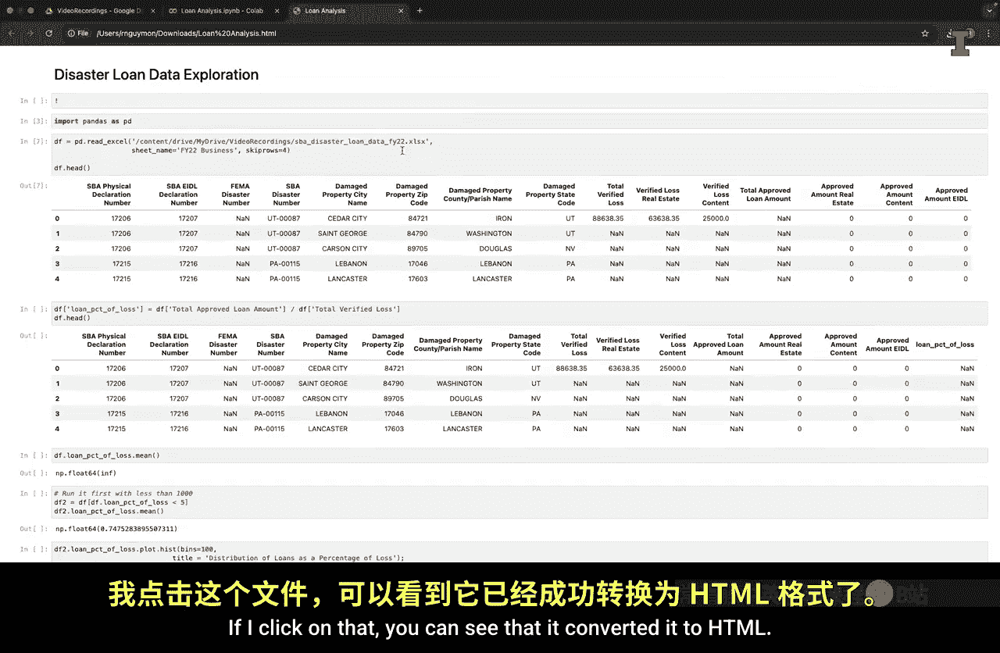

Also， you don't need to have Python or an IDE installed on your computer。

Another great thing about Google Coabab is that once your files are in Google Drive。

 you can access them and work on them from any computer as long as it's connected to the Internet。

 The main disadvantage of Google Coabab is that you have to mount the data to the file that you're working with。

 Also， the default processing power may not be as much as on your personal computer。😊。

By the same token， you can also access more processing power。 If you want to pay。

 you can increase the default processing power， and you can even pay for way more processing power than what you could have on a personal computer。

There's a lot more to learn about Google Collab， but that should be enough to help you get started using it。

